# App shell

> Captured 2026-09-09 · locale EN (switched from Slovak during this pass — see Findings) · account `999gangshit999@gmail.com` · commit `acd7db0d` · viewport 1920×889 (see Responsive section — narrow-viewport capture is blocked)

## What the shell is
The shell is everything `src/App.vue` renders outside `<RouterView>`: the framework's `Navbar` (top bar + collapsible sidebar, with `UserMenu` and `AppBreadcrumbs` inside it), this app's `NotificationBell` dropped into the Navbar's `#actions` slot, and three global overlays — `Snackbar`, `LoadingFullscreen`, `DialogHost`. The nav tree itself is data-only, supplied by `src/app/nav/navItems.ts` to the framework's sidebar at boot via `installFramework`'s `navTrees` option.

## Top bar
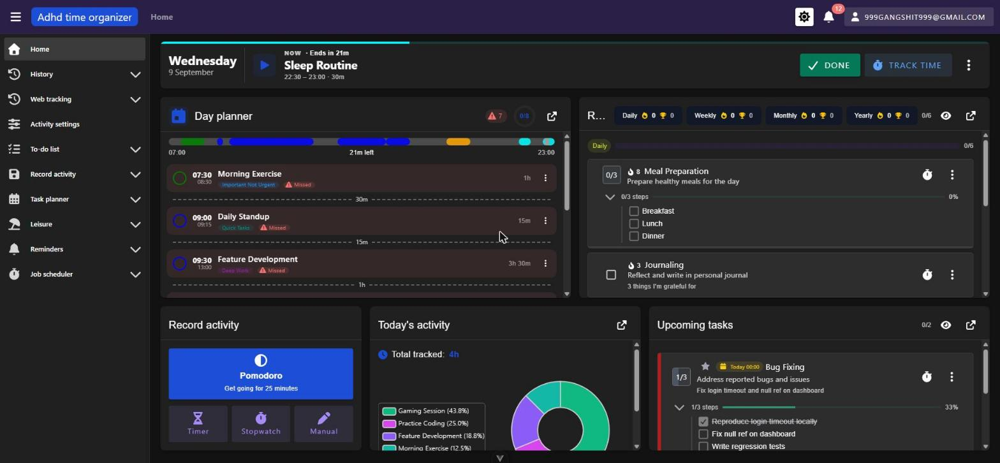
| control | kind | selector | does | destination |
| --- | --- | --- | --- | --- |
| Sidebar toggle (hamburger, icon-only) | button | `read_page` ref (no accessible name — see Findings A1) | Collapses/expands the sidebar between full labels and icon-only rail | in place |
| "Adhd time organizer" logo | link | `a[href="/"]` | Navigates home | `/` |
| Breadcrumbs | text/links | `AppBreadcrumbs` (framework) | Shows route hierarchy; ancestor segments are links, current segment is plain text | varies — see Breadcrumbs section |
| Theme toggle (gear icon) | button | accessible via `title="Switch to light mode"` / `"Switch to dark mode"` | Toggles Vuetify theme light/dark, persists via `userStore.setPreferences({theme})` (see `App.vue:108-117`) | in place |
| Notification bell | button | `aria-label="Notifications, N unread"` | Opens the notification dropdown panel | dropdown, see below |
| User menu (email chip) | button | accessible via visible text (the email) | Opens the user menu | dropdown, see below |

**Narrow viewport (390 × 844)** · checked 2026-10-01 · commit `0e77f904`
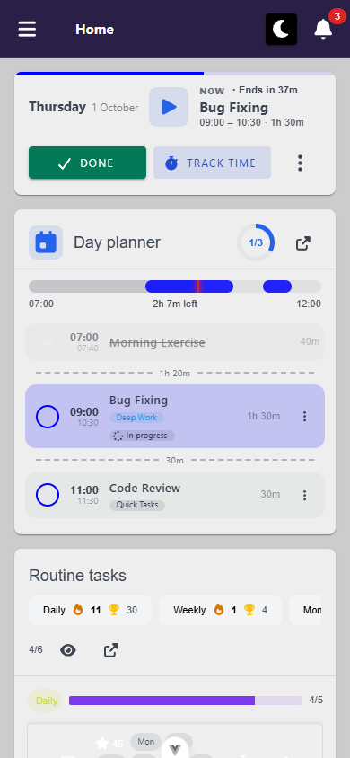
- layout: bar 65 px tall, one row, nothing wraps except the breadcrumb (see Breadcrumbs). Left to right: hamburger 12–48, breadcrumbs 80–284 (`overflow-hidden`, 204 px), theme toggle 296–331, bell 343–378.
- mobile-only controls: none in the bar itself. The round-2 note below about a standalone log-out button in the bar no longer holds: log out moved into the drawer footer (see Sidebar).
- replaced controls: brand chip "Adhd time organizer" → hidden (`d-none d-md-flex`), Home is reached through the drawer. User-menu chip → hidden (`d-none d-md-flex` on its activator), partly replaced by the drawer footer (see User menu, `B3`). The brand's `RouterLink` stays in the DOM as a 0×0 tab stop (`A5`).
- overflow: none from the bar (`docScroll` 390). The two offenders on `/` were the home view's routine chip row, which is out of shell scope.
- visual sweep: nothing wrong with the bar. Hamburger 36×36, theme 35×35 and bell 35×35 all clear the 24 px tap minimum.

## Sidebar
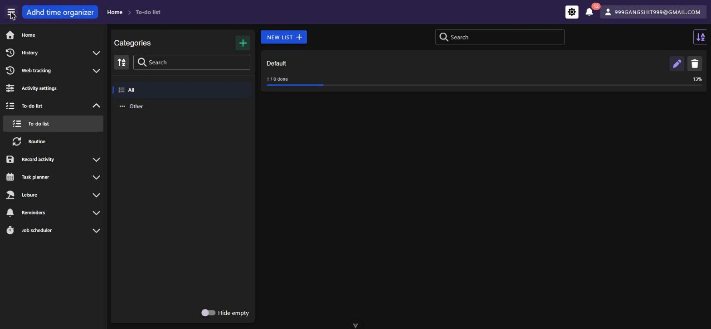
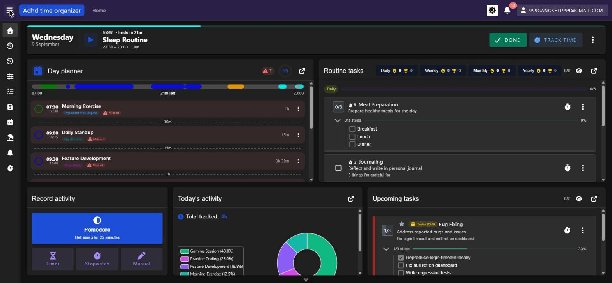
**Rail behaviour:** The hamburger in the top bar toggles between expanded (icon + label) and rail (icon-only) modes. Confirmed the collapsed state survives an in-app navigation (`/` → `/todo-list`) and a full hard reload of `/todo-list` — it is backed by `_common/store/uiStore.ts`, persisted to `sessionStorage` via the app-wide persistence plugin.

**Active highlight:** The current route's leaf item gets a grey background chip and bold white text; its parent group is expanded and its label is also rendered bold white, but without the background chip. Multiple groups can be expanded simultaneously (not an accordion) — expanding History left Web tracking, To-do list etc. all independently open at the same time.

### Nav tree as rendered
Walked every group by expanding it from `src/app/nav/navItems.ts`. All nine groups plus the two standalone items rendered with the same items, order, and targets declared in the source:

- Home → `/`
- History
  - Summary → `/activity-history`
  - Calendar → `/activity-history/calendar`
- Web tracking
  - All sources → `/activity-tracking/unified`
  - Web tracking → `/activity-tracking`
  - Desktop settings → `/activity-tracking/desktop/settings/distinctEntries`
  - Desktop tracking → `/activity-tracking/desktop`
  - Android tracking → `/activity-tracking/android`
  - Android settings → `/activity-tracking/android/settings/distinctEntries`
- Activity settings → `/activity-settings/activities` (standalone link, no children)
- To-do list
  - To-do list → `/todo-list`
  - Routine → `/routine-todo-list`
- Record activity
  - Manually → `/activity-history/manual`
  - Pomodoro timer → `/activity-history/pomodoro`
  - Stopwatch → `/activity-history/stopwatch`
  - Timer → `/activity-history/timer`
- Task planner
  - Day planner → `/day-planner`
  - Day planner - template → `/day-planner/templates`
  - Planner settings → `/day-planner/settings`
- Leisure
  - What should I do? → `/leisure/pick`
  - Backlog → `/leisure/backlog`
  - Projects → `/leisure/projects`
  - Bucket list → `/leisure/bucket-list`
  - Memory anchors → `/leisure/memory-anchors`
- Reminders
  - Reminder register → `/pripomienky/register`
  - Upcoming → `/pripomienky/nadchadzajuce`
  - Overview → `/pripomienky/prehlad`
  - Dispatch history → `/pripomienky/historia`
- Job scheduler
  - Scheduled jobs → `/planovac/ulohy`
  - Needs attention → `/planovac/pozornost`

**Narrow viewport (390 × 844)** · checked 2026-10-01 · commit `0e77f904`
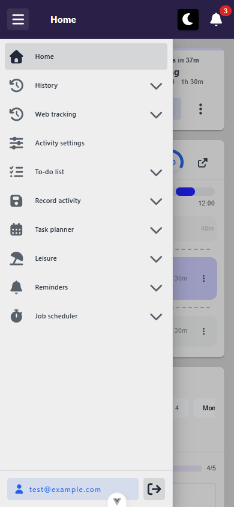
- layout: `Navbar` switches on `mdAndDown` (< 1280 px, not < 960), so the drawer is `--temporary --mobile` with a scrim from 1279 px down. It's closed by default and the hamburger toggles it. Size 288 × 780, from below the bar (top 64) to the bottom of the viewport. `main` stays at left 0, so it overlays the content rather than pushing it. The bar stays clickable above the scrim.
- mobile-only controls: drawer footer (`#append`, `isMobile` only): account button with the e-mail — `.app-sidebar .v-navigation-drawer__append a[href="/user/settings"]` — goes to `/user/settings` (219×36); log out — `getByRole('button', { name: 'Log out' })` inside `.app-sidebar` — logs out (36×36, named by `title`). Not clicked.
- replaced controls: desktop rail/expand toggle → open/close the temporary drawer (the rail is forced off when mobile).
- reach: with all 8 groups expanded the list scrolls inside `.v-navigation-drawer__content` (scrollHeight 1836 / clientHeight 719). The last item, "Needs attention", scrolls fully into view (739–783), directly above the footer ([screenshot](screenshots/drawer-expanded-scrolled--mobile.png)). Choosing a leaf (`/todo-list`) navigates and closes the drawer. A tap on the scrim at (350, 400) closes it.
- keyboard: items use Vuetify's roving tabindex (`tabindex=-2`, arrows move between them; same as desktop). Focus is **not** moved into the drawer on open, **Escape does not close it** whether focus is outside or inside, and every close drops focus to `<body>`. See `A4`. This contradicts round 2's "Escape closes it" below.
- overflow: none (`docScroll` 390).
- visual sweep: nothing wrong. The ▼ disc over the footer in the screenshots is the dev-only Vue devtools anchor, not the app.

### Nav vs routes
`docs/views/_routes.md` does not exist yet (this pass ran before P0.1), so this is a spot check against `navItems.ts` and known route tables, not an exhaustive diff:

- `myReminders` (`/pripomienky/moje`) is **deliberately absent** from the sidebar — reachable only via the user menu's "My reminders" entry (comment in `navItems.ts:74` confirms this is intentional, not an oversight).
- `/user/settings` has no sidebar entry — reached only via the user menu ("User settings"). Expected: it's an account page, not a feature module.
- `/notifikacie` and `/nastavenia/pripomienky` have no sidebar entry either — both reached via the user menu and/or the bell's "See all" link. Consistent with the rest of the account-layer pages.
- The framework's `TermsAndConditionsView.vue` is not routed by this app at all (the app routes its own `TermsView` instead) — a known, documented orphan per the runbook, not rediscovered here as a defect.
- `activity-settings` tabs (`roles`, `categories`) have no separate nav entries — only the `activities` tab is linked from the sidebar; the other two tabs are reachable only via in-page tab controls once on `/activity-settings/activities`. Not verified further (out of shell scope).

## Breadcrumbs
| route tried | breadcrumb shown | segments clickable? |
| --- | --- | --- |
| `/todo-list` | Home › To-do list | "Home" is a link; "To-do list" is plain text (current) |
| `/todo-list/1` (real seeded id) | Home › To-do list | Same as the list route — the breadcrumb does **not** add a third segment for the specific list, so a param route and its parent list route are visually indistinguishable in the breadcrumb (see Findings) |
| `/todo-list/999999` (invalid id) | Home › To-do list | Same breadcrumb; page renders an empty "No tasks" state without visible error, but see Findings for a console-level exception |
| `/day-planner/templates` | Home › Day planner - template | "Home" clickable, current segment plain text |

**Narrow viewport (390 × 844)** · checked 2026-10-01 · commit `0e77f904`
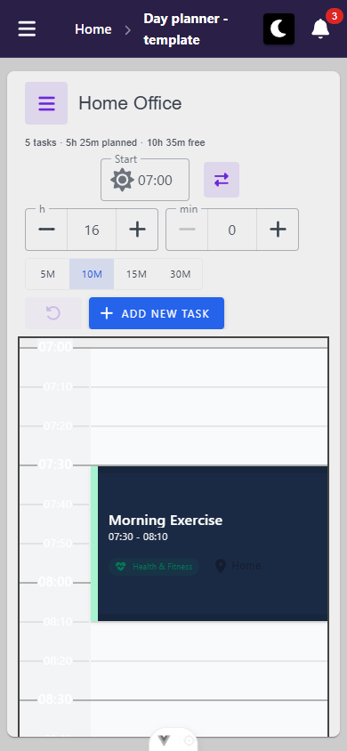
- layout: the trail gets a 204 px slot (80–284) and does not overflow (`scrollWidth` = `clientWidth` = 204). Long segments wrap onto two lines inside the 64 px bar instead of truncating: `/day-planner/templates/20001` → "Day planner - / template", `/todo-list/13001` → "To-do / list" ([screenshot](screenshots/breadcrumbs-3seg--mobile.png)). Each divider takes 28 px of the 204. See `P4`.
- mobile-only controls: none
- replaced controls: none
- overflow: none
- visual sweep: wrapped two-line crumbs, otherwise legible. `/day-planner/templates/20001` shows no segment for the template ("Home Office"). That's a desktop-scope gap like the fixed `P1`, so it isn't filed here.

## Notification bell
Resting state shows a bell icon with a red unread-count badge (started at 12, climbed to 14 over the session as new reminder notifications arrived live). Clicking it opens a dropdown panel ("Notifications" header, "MARK ALL AS READ" action) listing recent items grouped loosely by recency, each with an icon, bold title, one-line body, and relative timestamp. A "SEE ALL →" link at the bottom navigates to `/notifikacie` (the full `NotificationsView`, out of this unit's scope — destination only recorded). Items in the panel did not visibly navigate anywhere when the panel was open (not clicked through, to stay in scope). The panel content itself is entirely in Slovak regardless of the EN locale setting — see Findings F1, tagged **[framework]**.

**Narrow viewport (390 × 844)** · checked 2026-10-01 · commit `0e77f904`
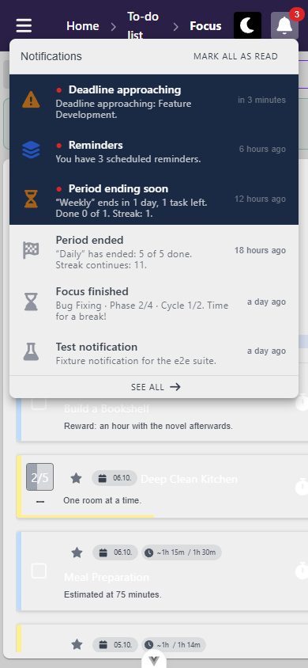
- layout: the menu fits: content box 12–378 × 49–503, so the card's `minWidth="340"` still sits inside 390. The list caps at 60 vh (506 px) and scrolls inside. "Mark all as read" (232–364) and "See all" (full width, 475–503) are both on screen.
- mobile-only controls: none
- replaced controls: none
- overflow: none (`docScroll` 390)
- keyboard: focus moves into the list on open, and Escape closes it and returns focus to the bell.
- visual sweep: nothing wrong.

## User menu
| entry | destination | tested? |
| --- | --- | --- |
| User settings | `/user/settings` | link destination confirmed via `read_page`, not opened in this pass (out of shell scope) |
| My reminders | `/pripomienky/moje` | link destination confirmed, not opened |
| Notifications | `/notifikacie` | link destination confirmed, not opened |
| Notifications & reminders | `/nastavenia/pripomienky` | link destination confirmed, not opened |
| Log out | — | **present, untested** — clicking it would end the session for the rest of this pass |

Escape closes the user-menu dropdown (confirmed).

**Narrow viewport (390 × 844)** · checked 2026-10-01 · commit `0e77f904`
- layout: **the user menu isn't rendered below 960 px.** Its activator is `d-none d-md-flex` (`UserMenu.vue:8`), measured 0×0 with `display: none`. No screenshot: there's nothing to open.
- mobile-only controls: none (the drawer footer replaces it; see below)
- replaced controls: User settings → drawer footer account button. Log out → drawer footer log-out button. Notifications → bell → "See all". Notifications & reminders → `/user/settings` module-settings link (`/nastavenia/pripomienky`, confirmed at 390 px). **My reminders → nothing**: no `a[href*="moje"]` anywhere in the DOM. The only remaining route there is clicking a reminder-type notification in the bell (`B3`).
- overflow: n/a
- visual sweep: n/a

## Global overlays

### Dialogs (DialogHost)
Triggered the to-do list "ADD" dialog (a `MyDialog` instance, "Add to to-do list") from `/todo-list/1` — a route-agnostic global overlay, not documented as to-do-list content. Findings:
- **Escape does not close it.** Confirmed twice (once with focus on the dialog body, once right after opening). Source inspection (`src/_common/component/dialog/MyDialog.vue:86,136-138`) shows this is the *default* behaviour: `persistent` defaults to `true`, and `onEscKey` only calls close when `!persistent`. So most `MyDialog` instances across the app will not close on Escape unless the call site explicitly sets `persistent={false}`. This is a deliberate framework default, not a one-off bug, but it is a real keyboard dead end for any dialog that keeps the default — see Findings F2, tagged **[framework]**.
- The Cancel button closes it normally, restoring focus to the element that opened it (`MyDialog.vue:144-155` re-focuses `openerElement` on close) — this worked as expected.
- Did not observe dialog nesting or a focus trap violation in this single-dialog test.

**Narrow viewport (390 × 844)** · checked 2026-10-01 · commit `0e77f904`
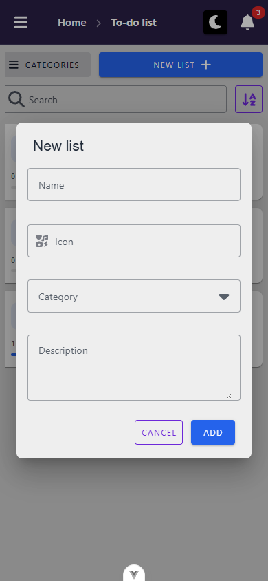
- layout: **`MyDialog` does not go full-screen at any width.** No `v-dialog--fullscreen`: `maxWidth` is `90%` below `sm` (600 px) and `70%` from `sm` to `md` (`MyDialog.vue:161-171`). Later groups should expect a centred card with a 24 px margin each side. "New list" on `/todo-list` measured 24–366 × 178–666. Cancel (196–266) and Add (278–342) are both on screen at y 610–646, and the body is the scrolling part (`VCardText overflow-y-auto`), so a taller dialog keeps its footer.
- mobile-only controls: none
- replaced controls: none
- overflow: none inside the dialog (`docScroll` 390)
- on-screen keyboard: Add sits at y ≈ 646 of 844, so a keyboard would likely cover it while typing in Name (`U3`).
- visual sweep: nothing wrong. Focus went into the dialog on open. After Cancel, focus landed on `<body>` rather than the "New list" opener, at **both** 390 and 1280 px. That contradicts the desktop note above, but it isn't mobile-specific, so it isn't filed here.

### Snackbars
Not independently triggered as a distinct "toast" separate from the notification panel in this pass (the to-do dialog's Cancel/Add path wasn't submitted, to avoid mutating seed data out of scope). A live in-app notification did appear as a blue snackbar-style toast ("Blíži sa termín") near the top of the viewport while on `/todo-list/1`, auto-dismissing within a couple of seconds — consistent with the `Snackbar.vue` component. Did not get to test stacking behavior (only one arrived during the session, transient, not caught in a saved screenshot — see Findings, marked `unverified`).

**Narrow viewport (390 × 844)** · checked 2026-10-01 · commit `0e77f904`
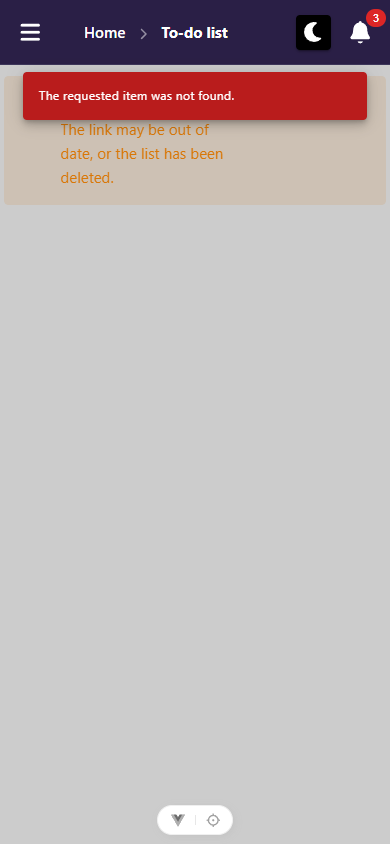
- layout: `VSnackbarQueue location="top"` with `mt-16` puts the toast just under the bar, at 23–367 × 72–120 for the 404 on `/todo-list/999999999` ("The requested item was not found.", z-index 2000, 3 s timeout, no close button). It isn't hidden under anything. It **does** sit directly over the not-found state's only action, "To the lists" (252–370 × 92–128): `elementFromPoint` at the button's centre hits `.v-snackbar__content` until the toast times out (`P3`; [after](screenshots/snackbar-after--mobile.png)).
- mobile-only controls: none
- replaced controls: none
- overflow: none
- visual sweep: the toast also covers the alert's heading "This list doesn't exist" while it's up.

### ActionBar (framework, `src/_common/component/ActionBar.vue`)
Floating `position: fixed` bar at the bottom of the content, centred on the content box since FW17. Its only consumers are the day planner's bars (selection, use-template, calendar bulk/apply-template).

**Narrow viewport (390 × 844)** · checked 2026-10-01 · commit `0e77f904`
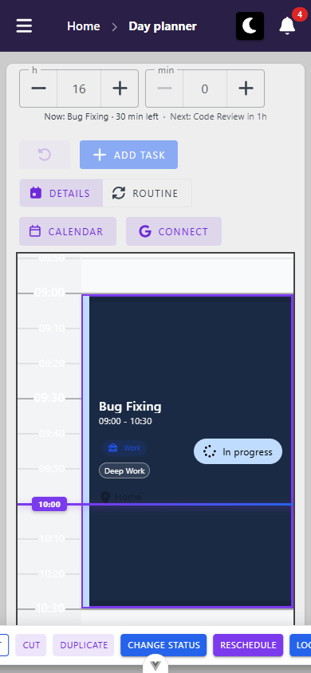
- layout: the FW17 centring holds: it centres on x = 195, and `--v-layout-left` is empty with the temporary drawer. The bar itself is **744 px wide in a 390 px viewport** (−177 → 567) with the day planner's selection on `/day-planner/2026-10-01` ("1 selected", Delete, Edit, Cut, Duplicate, Change Status, Reschedule, Log time, Split, Cancel). The count, Delete and Edit are off the left edge, and Log time, Split and Cancel off the right. Because it's fixed, nothing scrolls them into reach (`B2`). The `@media (max-width: 600px)` compaction shrinks buttons to 28 px tall but doesn't make the row fit. At 768 × 1024 (above that query) the bar is 974 px wide (−103 → 871), still clipped at both ends ([768](screenshots/actionbar--768.png)).
- mobile-only controls: none
- replaced controls: none
- overflow: no document scroll (fixed element), but the bar is clipped at both viewport edges.
- visual sweep: clipped bar as described. Buttons are 28 px tall, which clears the 24 px minimum.

### Fullscreen loading
Not observed stranded during any of the ~15 navigations performed in this pass (home → todo-list → todo-list/1 → todo-list/999999 → day-planner/templates → home, plus dialog opens/closes). Source (`src/router.ts:68-72`) confirms `router.beforeEach` unconditionally calls `hideFullScreenLoading()` on every navigation specifically so an outgoing view's spinner can never strand the overlay — behaviour matches the comment.

## Keyboard & focus
Tabbed from a fresh `/` load, starting with focus on the sidebar-toggle button:
1. Sidebar toggle (hamburger) — **no accessible name** (see Findings A1)
2. Logo link ("Adhd time organizer", `href="/"`)
3. Theme toggle (named via `title` attribute)
4. Notification bell (`aria-label="Notifications, N unread"`)
5. User menu button (named via its visible email text)
6. Sidebar rail items in order (`aria-label="Home"` confirmed for the first), then into main-content controls (task action buttons)

No skip-link was encountered before reaching interactive sidebar/main content — see Findings A2. Order is sensible (top bar left-to-right, then sidebar top-to-bottom, then main content) and matches visual layout. Did not find a focus trap outside the one dialog tested; the user menu and notification panel both closed cleanly on Escape and returned to a sane state.

## Responsive (narrow viewport)
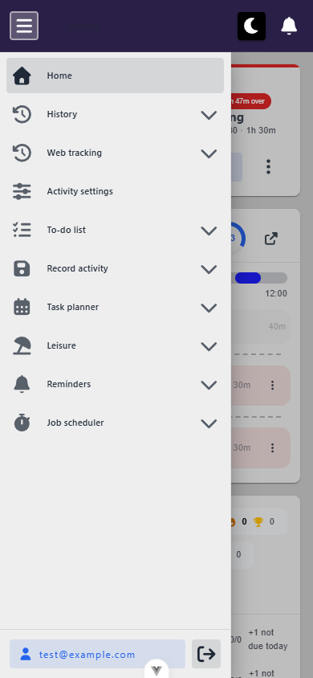
**Unblocked in round 2** — the round-1 block was a tooling limit (the browser MCP's `resize_window` reported success without resizing anything), not an app behaviour. `playwright-cli resize 390 844` actually applies, confirmed by `window.innerWidth`/`innerHeight` reading 390×844.

At 390×844 the sidebar swaps from a persistent drawer to `v-navigation-drawer--temporary v-navigation-drawer--mobile`, closed by default and opened by the same top-bar hamburger; it overlays the content with a scrim (`.v-navigation-drawer__scrim`) rather than pushing it, and Escape closes it. Drawer width stays 288px. No horizontal overflow: `document.documentElement.scrollWidth` is 390, equal to the viewport.

One layout difference worth recording: the top bar renders a **fifth** button at mobile width — a standalone log-out icon button (`title="Log out"`, no `aria-label`) that is not present at desktop width, where log out lives only inside the user menu. The user-menu button still renders the full account e-mail next to it at 390px.

> **Superseded 2026-10-01 (x4, `0e77f904`):** the bar no longer has a log-out button or the e-mail chip at 390 px. Both moved to the drawer footer, and Escape does **not** close the drawer. The per-section **Narrow viewport** blocks above are now the current record.

## Console & network at boot
- **errors/warnings:** none at `/` itself on a clean load (only Vite HMR debug messages). App-code errors *were* seen later in the session, but only after navigating to other routes while testing breadcrumbs, not from the shell/boot path itself:
  - `/day-planner/templates`: five `CanceledError: canceled` console errors plus one "Unhandled error during execution of mounted hook at `<TemplateListView>`", from `TemplateListView.vue:126-128` via `useFetchFiltered` — looks like an aborted-request race on navigating away quickly, not a shell defect, but flagged for the `planner-templates` unit's own pass.
  - `/todo-list/999999` (deliberately invalid id): one `AxiosError: Request failed with status code 404` plus "Unhandled error during execution of mounted hook at `<TodoListView>`", from `TodoListView.vue:126` via `useEntityQuery`. The view itself degrades gracefully in the UI (renders an empty "No tasks" state, no visible crash), but the fetch failure surfaces as an unhandled console exception rather than being caught — flagged for the `todo-lists` unit's own pass.
- **non-2xx:** none observed in the boot network sequence itself (see below). The one 404 above is a view-level fetch on an invalid id, not a boot request.
- **duplicate requests:** none found among the boot-time API calls. `hubs/notifications/negotiate` fires as OPTIONS then POST, which is a CORS preflight + the actual SignalR negotiate call, not a duplicate.
- **boot requests (what fires before any view mounts):** confirmed via `read_network_requests` filtered to the backend origin on a fresh `/` load:
  1. `OPTIONS /hubs/notifications/negotiate` → 204, `POST /hubs/notifications/negotiate` → 200 (SignalR handshake, from `startNotificationSession()`)
  2. `GET /api/user/data` → 200
  3. `GET /api/push-subscription/vapid-public-key` → 200
  4. `GET /api/activity-role/all-options`, `/api/activity-category/all-options`, `/api/activity/all-options` → 200 each (from `useActivityOptionsStore()`'s `ensureLoaded()`)
  5. `GET /api/calendar/day-plan/2026-09-09` → 200
  6. `GET /api/routine-todo-list/grouped-by-time-period`, `/api/routine-time-period` → 200
  7. `OPTIONS`/`POST /api/activity-history/dashboard/detail/pie-chart` → 200 (HomeView widget, out of shell scope but fires at boot)
  8. `GET /api/todo-list-item/dashboard-widget` → 200
  9. `GET /api/notification/mine?limit=20`, `/api/notification/unread-count` → 200
  10. `GET /api/activity-backlog-profile` → 200

  This matches the three boot-time store creations documented in `App.vue`'s comments (`useRunningTimerStore()`, `startNotificationSession()`, `useActivityOptionsStore()`), plus HomeView's own widget fetches riding along on the same initial load.

## Findings

**Tally:** blocker 0 · bug 3 (`B1` closed 2026-09-21) · a11y 5 · polish 4 (`P1`, `P2` fixed) · opportunity 0 · unverified 3 · **15 entries · Framework-tagged: 10**

## Round history
| round | date | commit | what changed |
| --- | --- | --- | --- |
| 1 | 2026-09-09 | `acd7db0d` | initial shell pass |
| 1a | 2026-09-10 | `acd7db0d` | backfilled `Status:` / `Verify:`; renumbered to the severity-prefix rule (`F1`→`B1`, `F2`→`A1`, old `A1`→`A2`, old `A2`→`A3`). Tally corrected: `F2` was severity `a11y` but counted as a bug. |
| 2 | 2026-09-10 | `a87a3502` + working tree | re-verified the whole unit through `playwright-cli` against the **EN default locale** (`src/i18n.ts` `locale: 'EN'`, the signed-out guard in `App.vue`, and the filled-in `_common/_locales/common.en.ts`), signed in through the login form as the seed account `test@example.com`. Responsive section unblocked. A1/A2/A3/P1 re-confirmed open; B1 not re-testable on this account. |
| 3 | 2026-09-21 | working tree | `B1` only — retested after backend `B15` (API `830cad6`) on a fresh `e2e-v3` seed as `primaryUser` (EN): bell rows English, a fresh test notification English, SK/EN switch re-renders existing rows. Closed. Tally: bug 1 → 0. |
| 4 | 2026-10-01 | `0e77f904` | **x4 narrow viewport (390×844)**: all 7 group checks done across 8 surfaces (top bar, drawer, breadcrumbs, bell, user menu, dialog, snackbar, ActionBar); new: B2, B3, A4, A5, P3, P4, U3. Tally recounted over all 15 entries (the old line counted only open polish). |

---

### B1. Notification content ignores the account's English locale preference — renders raw Slovak text
- **Status:** ✅ **fixed and verified 2026-09-21** — backend `B15` (API `830cad6`, `prompts/view-docs/backend/_done/B15-notification-text-ignores-account-locale.md`), no frontend change. The *Verify* block below passed as written on a fresh seed as `primaryUser` (EN): all six fixture rows English in the bell (*Deadline approaching: Feature Development.*, *You have 3 scheduled reminders.*, …), and a fresh `POST /notification/test?type=ScheduledJobFailed` arrived live as *Scheduled job “purge-expired-run-logs” failed and needs attention.* The step-3 caveat about pre-existing rows did not apply: text is composed on every read, so switching the account to SK re-rendered the same rows in Slovak and switching back restored English. Escalation §1 closed; body in `_fix-queue-log.md`. ~~open — **not re-tested in round 2**: the seed account (`test@example.com`) has zero notifications, so the panel only rendered its "No notifications" empty state. Re-testing needs an account with dispatched notifications, or a dispatch triggered on purpose.~~
- **Severity:** bug — **[framework]**
- **Where:** Notification dropdown panel (`NotificationBell` → its panel) and `/notifikacie`, backed by `src/_common/modules/notifications/`
- **Expected:** With the account's language preference set to English (confirmed via `/user/settings` → Appearance → Language = "Angličtina"/English, and every other piece of chrome — nav labels, breadcrumbs, dialog buttons — rendering in English), notification titles and bodies should also be in English.
- **Actual:** Every notification in the panel is in Slovak: "Blíži sa termín", "Obdobie sa skončilo", "Pripomienky", "Naplánovaná úloha sa nespustila", "Naplánovaná úloha zlyhala", "Testovacia notifikácia" — titles, bodies, and relative-time labels are untranslated Slovak strings, while the surrounding UI chrome (bell aria-label, "MARK ALL AS READ", timestamps like "in a few seconds") is in English.
- **Evidence:** `docs/views/_shell/screenshots/notification-panel-sk-leak.png`; requests confirmed served from `/api/notification/mine` and delivered live via the `hubs/notifications` SignalR hub (module `src/_common/modules/notifications/`).
- **Repro:** 1. Set account language to English at `/user/settings`. 2. Open the notification bell. 3. Read any notification title/body.
- **Verify:** 1. With the account locale set to English, open the notification bell. 2. **Pass condition:** notification titles and bodies read as English (e.g. no "Blíži sa termín", "Obdobie sa skončilo", "Naplánovaná úloha zlyhala"). 3. Trigger a fresh notification and confirm the newly-arrived one is English too — pre-existing rows may have been persisted in Slovak at creation time and could need a reseed rather than a code fix.
- **Root cause guess:** Text appears to be localized server-side at dispatch time rather than resolved client-side through vue-i18n. Likely a backend dispatch-template change, not an `src/` fix — do not batch with the client-side raw-key findings.
- **Suggested fix:** Notification title/body text appears to be rendered server-side (or pre-localized at creation time) rather than resolved client-side via vue-i18n against the user's current locale preference — likely a backend template/localization gap, not a frontend rendering bug. Worth an escalation to whoever owns the reminder/notification dispatch templates.

### A1. `MyDialog` does not close on Escape by default (persistent=true default)
- **Status:** open
- **Severity:** a11y — **[framework]**
- **Where:** `src/_common/component/dialog/MyDialog.vue:86,136-138`; observed via the to-do list "Add to to-do list" dialog opened from `/todo-list/1`
- **Expected:** A modal dialog should be dismissable with Escape — this is both a common accessibility expectation (WAI-ARIA dialog pattern) and the PROMPT-TEMPLATE.md checklist explicitly asks "does Escape close the dialog."
- **Actual:** Pressing Escape (tried twice, once with the dialog title clicked into focus first) left the dialog open. Source shows `onEscKey()` only calls `onCloseBtnClick()` when `persistent` is `false`, and `persistent` defaults to `true`. Since call sites must opt out explicitly, most dialogs across the app likely inherit this behaviour unless individually overridden.
- **Evidence:** Manual repro (2 attempts) plus source read of `MyDialog.vue`.
- **Repro:** 1. Go to `/todo-list/1`. 2. Click "ADD". 3. Press Escape. Dialog stays open.
- **Verify:** 1. Go to `/todo-list/1`, click "ADD", press Escape. 2. **Pass condition:** the dialog closes and focus returns to the "ADD" button. 3. Then confirm the guard still holds where it should: open a dialog that is deliberately `persistent` (a destructive confirm, e.g. list delete) and confirm Escape does **not** dismiss that one. Both halves must hold — a fix that makes every dialog escapable is a regression, not a fix.
- **Root cause guess:** Framework-wide default (`persistent = true` in `MyDialog.vue`), so this is one decision affecting every dialog in every app on the framework — not a per-call-site fix. Handle as its own batch.
- **Suggested fix:** Either flip the semantic default so "Escape closes unless the dialog is guarding an in-progress destructive action," or make individual call sites pass `persistent={false}` where there's nothing to lose (e.g. a create form the user hasn't started filling in) — a framework-level decision, not one this app can make unilaterally.

### A2. Sidebar-toggle button has no accessible name
- **Status:** open
- **Severity:** a11y — **[framework]**
- **Where:** Top bar hamburger/sidebar-toggle button, `src/_common/nav/AppTopBar.vue` (rendered inside `Navbar.vue`)
- **Expected:** Every icon-only interactive control needs an accessible name (text content, `aria-label`, or `title`) so it can be addressed by assistive tech and by name-based automation.
- **Actual:** `document.activeElement` inspection after tabbing to it showed empty `textContent`, `aria-label: null`, and `title: ""`. It has no accessible name at all — contrast with the theme toggle right next to it, which does have `title="Switch to light mode"`.
- **Evidence:** JS console query: `{"cls":"v-btn v-btn--icon ...","text":"","title":""}` with `aria-label` returning `null`.
- **Repro:** 1. Load `/`. 2. Tab to the first focusable element (or inspect the hamburger button in devtools). 3. Check for accessible name.
- **Verify:** 1. Load `/`. 2. Inspect the hamburger button in `AppTopBar`. 3. **Pass condition:** it exposes a localized accessible name, and toggling the sidebar still works. 4. Confirm the name changes with the locale rather than being hardcoded English.
- **Root cause guess:** Same class as the unit-level icon-button findings (`todo-lists` A1/A2), but this one is **[framework]** — it lives in the submodule, so it cannot ship in the same commit as the app-side ones. Separate batch.
- **Suggested fix:** Add `aria-label` (localized) to the `VIconBtn` in the framework's `AppTopBar.vue`.

### A3. No skip-to-content link
- **Status:** open
- **Severity:** a11y
- **Where:** App shell overall — first Tab stop from a fresh page load is the sidebar toggle, not a skip link
- **Expected:** A "skip to main content" link (visually hidden until focused) is a standard pattern letting keyboard users bypass the top bar and sidebar to reach the page's primary content directly.
- **Actual:** None found. Tabbing from load goes: sidebar toggle → logo → theme toggle → bell → user menu → sidebar rail items → main content, with no shortcut.
- **Evidence:** Manual Tab-order walk (this pass, Keyboard & focus section) using `document.activeElement` inspection at each step.
- **Repro:** 1. Load `/`. 2. Tab repeatedly from the start and observe the sequence.
- **Verify:** 1. Load `/`. 2. Press Tab once. 3. **Pass condition:** the first focusable element is a visible "skip to main content" link; activating it moves focus into the main content region, past the sidebar. 4. Confirm the link is not visible when unfocused.
- **Suggested fix:** Add a skip link as the first focusable element in `App.vue` or the framework's top-level layout.

### P1. Breadcrumb does not distinguish a list-detail route from its parent list route
- **Status:** fixed and verified (2026-09-13, from the `todo-lists` side — `_fix-queue.md` F11)
- **Fix applied:** `TodoListView.vue` calls the framework's `useSetBreadcrumbExtra()` and pushes the fetched
  list's name once `listEntity` resolves — no route-meta mechanism, no framework change. Before the fetch
  resolves, and for an id that names no list, it pushes nothing.
- **Verified:** `/todo-list/13001` renders `Home › To-do list › Focus` with "To-do list" a working link to
  `/todo-list`; `/todo-list/999999` renders `Home › To-do list` (no raw id, no empty crumb); navigating
  back to `/todo-list` clears the extra segment.
- **Severity:** polish
- **Where:** `AppBreadcrumbs` (framework) rendering `/todo-list` and `/todo-list/1` (and presumably `/todo-list/999999`) identically as "Home › To-do list"
- **Expected:** Plain user sense — a breadcrumb's job is to show where you are; a param route ought to add a segment (even just the record's name) so it's visually distinguishable from its list page.
- **Actual:** Both routes render the exact same two-segment breadcrumb; there is no third segment for the specific to-do list.
- **Evidence:** Screenshots taken at `/todo-list` and `/todo-list/1` (zoomed top-bar crops) are pixel-identical in the breadcrumb region.
- **Repro:** 1. Visit `/todo-list`. 2. Note breadcrumb. 3. Visit `/todo-list/1`. 4. Compare — identical.
- **Verify:** 1. Visit `/todo-list`, note the breadcrumb. 2. Visit `/todo-list/1`. 3. **Pass condition:** the second breadcrumb carries an additional segment identifying the specific list, and the "To-do list" segment is now a working link back to `/todo-list`. 4. Confirm no raw id or i18n key leaks into the new segment.
- **Note:** this is a shell-rendered control but the fix likely belongs to whichever unit owns the route meta. Deferred to `todo-lists` at discovery time.
- **Suggested fix:** Route meta could supply a dynamic breadcrumb label (e.g. the list's name) for `:id` routes; a decision for whichever unit owns `todo-lists`, not this shell pass.

### P2. The current-page breadcrumb is invisible in the light theme — on every route
- **Status:** fixed and verified (2026-09-13, framework — found while verifying P1's fix)
- **Severity:** polish (it is the *current page's* crumb, so in the light theme every page read as one crumb short —
  `/todo-list` showed just `Home ›`)
- **Where:** `src/_common/nav/AppBreadcrumbs.vue` (framework)
- **Actual:** The last segment is `disabled` (meaning "not a link"), and the title slot painted it
  `rgb(var(--v-theme-on-surface))` — dark in the light theme — on an app bar this app colours
  `secondary-container`, which is dark in **both** themes. The `opacity: 1` on the span could not undo Vuetify's
  `0.38` on the disabled `li` either, so even in the dark theme the current crumb was the faintest one.
- **Evidence:** `getComputedStyle` on the disabled crumb's span at `/todo-list`, light theme: `rgb(31, 41, 55)`
  on the dark bar; `li` opacity `0.38`. Clipped screenshot of `.v-breadcrumbs` shows `Home ›` and nothing after.
- **Fix applied:** the title inherits the bar's own text colour (no explicit colour), and a scoped `:deep` rule sets
  the disabled `li` to `opacity: 1` — the current crumb is now the bold one, links medium, both in the bar's colour.
  Generic: no host-specific colour assumption remains. Submodule commit + pointer bump.
- **Verified:** `Home › To-do list › Focus` legible in light and dark, `/todo-list` shows `Home › To-do list`.

### U1. Snackbar stacking behaviour not verified
- **Status:** open
- **Severity:** unverified
- **Where:** `Snackbar.vue` (framework), global overlay
- **What would verify it:** Only one live notification-triggered snackbar appeared during this pass (transient, not caught in a saved screenshot before it auto-dismissed). To confirm whether snackbars stack or replace, a pass would need to trigger two snackbar-worthy actions in quick succession (e.g. two quick toggles that each fire a success toast) and observe whether both are visible at once or the second replaces the first.

### U2. Fullscreen loading strand behaviour only spot-checked
- **Status:** open
- **Severity:** unverified
- **Where:** `LoadingFullscreen.vue` / `router.beforeEach` in `src/router.ts:70-72`
- **What would verify it:** This pass performed ordinary-speed navigations and never saw a stranded overlay, and the source clearly shows `hideFullScreenLoading()` firing unconditionally on every route change. A stronger test — navigating away *during* a slow request that shows the loader, e.g. by throttling the network — was not attempted in this pass and would give firmer confidence.

### B2. ActionBar is wider than the viewport, and its first and last actions (incl. Cancel) are off-screen and unreachable — [framework] (390 px)
- **Status:** fixed 2026-10-07 (`FW28`; one selected task on `/day-planner/2026-10-06` at 390: bar 8–382, Cancel 311–373 always visible, the eight actions scroll inside a 286 px strip and Split ends at 303 when scrolled; at 1440 the bar is unchanged)
- **Severity:** bug — **[framework]**
- **Where:** @390×844 · `src/_common/component/ActionBar.vue:36-51,69-85`. Observed on `/day-planner/2026-10-01` with one task selected (`SelectionActionBar`, `dayPlanner`). Same component, not observed: the use-template bar. Also clipped at 768×1024. **Added by x4 `planner` (2026-10-06):** reconfirmed on `/day-planner/05-10-2026` (same −177…567 geometry). On `/day-planner?mode=bulkSelect` with one day selected, the bulk bar spans −136…526: Select All −25…56 (part cut), **Copy Day** 375…447 and **Cancel** 455…517 off-screen. On `/day-planner?mode=applyTemplate` the bar spans −12…402: "Select template" starts at −3 and Cancel ends at 393, so it's marginal but tappable. **Added by x4 `planner` second half (2026-10-06):** `/day-planner/templates/20001` with one task selected (Delete/Edit/Cut/Duplicate/Split/Cancel) spans −32…422: "1 selected" is cut to "…lected" and **Cancel** sits at 351…413, so 39 px of it shows. The routine "Placing" bar on the same view fits (92…298).
- **Expected:** every action of a bar the user summoned is reachable on a phone, Cancel above all, since a phone has no Escape key (plain sense; WCAG 1.4.10 reflow).
- **Actual:** the bar measures 744 px wide (left −177, right 567). "1 selected", **Delete** (−98…−40) and **Edit** (−32…12) are cut off on the left; **Log time** (363–433), **Split** (441–487) and **Cancel** (495–558) on the right. It's `position: fixed`, so no scrolling brings them into view. FW17's centring works (centre = 195), which is exactly why both ends get cut. At 768 px it's 974 px wide (−103 → 871).
- **Evidence:** `docs/views/_shell/screenshots/actionbar--mobile.png`, `actionbar--768.png`. `getBoundingClientRect` on `.action-bar` and on each button.
- **Repro:** 1. `resize 390 844`, open `/day-planner/<today>` (a day with tasks). 2. Focus a task block (`.base-task-block`) and press Space to select it. 3. Look at the bottom bar.
- **Verify:** 1. `playwright-cli resize 390 844`, then `reload`. 2. Open `/day-planner/<seedDate>`, focus `.base-task-block[data-task-id]`, press Space. 3. **Pass condition:** `.action-bar` satisfies `left >= 0 && right <= innerWidth`, and every button in it, Cancel included, satisfies the same (directly, or by scrolling inside the bar). 4. Press Escape to clear the selection.
- **Root cause guess:** `min-width: min-content` plus `text-wrap: nowrap` override the mobile `max-width: 98%`, so the bar grows to its content and never wraps or scrolls. The mobile media query only shrinks buttons. Nine actions can't fit at 390 px however small they get.
- **Suggested fix:** framework: drop `min-width: min-content` below `md` and give the bar `max-width: calc(100vw - 16px)` with `flex-wrap: wrap` or `overflow-x: auto`, keeping Cancel pinned. App side (`dayPlanner`), consider an overflow menu for the secondary actions.

### B3. "My reminders" has no navigation path below 960 px — the user menu is hidden and its drawer replacement omits it — [framework] (390 px)
- **Status:** open
- **Severity:** bug — **[framework]**
- **Where:** @390×844 · `src/_common/nav/UserMenu.vue:8` (`d-none d-md-flex` on the activator), `src/_common/nav/AppSidebar.vue:85-110` (mobile `#append`). App side: `src/app/nav/navItems.ts:79` keeps `myReminders` out of the sidebar *because* the user menu links to it. Every route.
- **Expected:** a destination that's reachable from the shell at desktop width is also reachable at phone width (plain sense; `navItems.ts:79` assumes the user menu is always there).
- **Actual:** at 390 px the user-menu activator is `display: none` (0×0). The drawer footer replaces only two of its five entries (User settings, Log out). Two more have other routes (Notifications → bell "See all"; Notifications & reminders → `/user/settings` link, confirmed). **My reminders (`/pripomienky/moje`) has none**: no `a[href*="moje"]` exists in the DOM with the drawer open. The only way in is clicking a reminder-type notification in the bell, which depends on having one.
- **Evidence:** `eval` over `document.querySelectorAll('a[href]')` with the drawer open → `moje: []`, `userSettings: ['/user/settings']`, `userMenuDisplay: 'none'`. Drawer footer = account button 219×36 + log-out 36×36.
- **Repro:** 1. `resize 390 844`, open `/`. 2. Open the drawer; expand Reminders. 3. Look for "My reminders" there, in the footer and in the top bar.
- **Verify:** 1. `playwright-cli resize 390 844`, then `reload`. 2. Open the drawer. 3. **Pass condition:** a visible link to `/pripomienky/moje` is reachable from the shell (drawer or top bar) without going through a notification. Check that Notifications (`/notifikacie`) is still reachable too.
- **Root cause guess:** the mobile drawer footer was written as a replacement for the user menu but only copied two entries. The app's `navItems.ts` decision rests on a menu that doesn't exist below `md`.
- **Suggested fix:** framework: render `UserMenu`'s entries (or the menu itself, as an icon-only activator) in the mobile drawer footer, so every app gets the same set. Don't add `myReminders` to `navItems.ts`, which would duplicate it on desktop.

### A4. Mobile nav drawer: focus doesn't move in on open, Escape doesn't close it, and closing drops focus to `<body>` — [framework] (390 px)
- **Status:** open
- **Severity:** a11y — **[framework]**
- **Where:** @390×844 · `src/_common/nav/AppSidebar.vue:2-12` (temporary below 1280 px via `Navbar.vue:11,24`). Every route.
- **Expected:** a modal (temporary + scrim) drawer behaves like a dialog: focus moves into it on open, Escape closes it, and focus returns to the toggle on close (WAI-ARIA dialog pattern; same expectation as `A1`).
- **Actual:** after the hamburger opens it, `document.activeElement` is still the hamburger, and the next three Tabs go to the invisible logo link, the theme toggle and the bell before reaching the drawer. Escape left it open with focus on the hamburger, on "Home" inside it, and on the "History" group header (3 attempts). Closing by scrim tap or by choosing an item leaves focus on `<body>`. Round 2 of this file recorded "Escape closes it". That no longer reproduces.
- **Evidence:** `eval` on `document.activeElement` after each step. Vuetify 3.12.4's `VNavigationDrawer` supports `captureFocus` / `retainFocus` (`useFocusTrap`), which `AppSidebar` doesn't pass. Grep shows no `Escape`/`keydown` handling in `VNavigationDrawer.js`.
- **Repro:** 1. `resize 390 844`, open `/`. 2. Click the hamburger. 3. Check focus; press Escape. 4. Tap the scrim at (350, 400); check focus.
- **Verify:** 1. `playwright-cli resize 390 844`, then `reload`. 2. Click "Toggle navigation". 3. **Pass condition:** `document.activeElement` is inside `.app-sidebar`. 4. Press Escape. **Pass:** `.app-sidebar` loses `v-navigation-drawer--active` and focus is back on "Toggle navigation". 5. Reopen, tap the scrim. **Pass:** same focus return.
- **Suggested fix:** pass `captureFocus` / `retainFocus` when `isMobile`, add `@keydown.esc` on the drawer that closes it, and refocus the toggle on close (the toggle lives in `AppTopBar`, so `Navbar` owns the hand-off).

### A5. The hidden brand link is still a tab stop below 960 px — an invisible 0×0 focus target — [framework] (390 px)
- **Status:** open
- **Severity:** a11y — **[framework]**
- **Where:** @390×844 · `src/_common/nav/AppTopBar.vue:19-31`: the `RouterLink` is always rendered, and only the `VSheet` inside it is `d-none d-md-flex`. Every route.
- **Expected:** a control that's hidden isn't focusable (WCAG 2.4.7 / 2.4.3: a focused element must be visible).
- **Actual:** `a[href="/"]` in the bar measures 0×0 at (60, 32), has `tabIndex 0`, and takes focus. It's the second Tab stop after the hamburger, with nothing visible to show it. Its accessible name "Adhd time organizer" still comes from the hidden text.
- **Evidence:** `eval`: `{ focused: true, tabIndex: 0, rect: {x:60,y:32,width:0,height:0} }`. Tab walk: Toggle navigation → *Adhd time organizer (invisible)* → Switch to dark mode → Notifications.
- **Repro:** 1. `resize 390 844`, open `/`. 2. Focus the hamburger, press Tab once. 3. Nothing visible has focus.
- **Verify:** 1. `playwright-cli resize 390 844`, then `reload`. 2. Focus "Toggle navigation", press Tab. 3. **Pass condition:** `document.activeElement` is a visible element (non-zero bounding box), and no `a[href="/"]` with a 0×0 box is in the tab order. 4. At 1280 px the brand link is still a tab stop and visible.
- **Suggested fix:** move `d-none d-md-flex` from the `VSheet` onto the `RouterLink`.

### P3. The snackbar lands on top of the error state's only action and swallows taps for 3 s — [framework] (390 px)
- **Status:** fixed 2026-10-07 (`FW32`, the close-action option: every error toast now has Close. The toast still lands over "To the lists" for its first moment, so this `Verify:`'s step 3 as written still fails; the pass instead is that Close (57×36) dismisses it and `elementFromPoint` then hits the link. Bottom placement was rejected because it covers `ActionBar`'s Cancel)
- **Severity:** polish — **[framework]** (transient: the action works once the toast times out)
- **Where:** @390×844 · `src/_common/component/feedback/Snackbar.vue:8-14` (`location="top"`, `mt-16`). Observed on `/todo-list/999999999` over `TodoListView`'s not-found alert. Any view that pairs an error toast with a top-of-content action will match.
- **Expected:** a transient toast doesn't cover the one control the user needs next (group-file check 5; plain sense).
- **Actual:** the 404 toast (23–367 × 72–120, no close button, 3000 ms) fully covers "To the lists" (252–370 × 92–128) and the alert's heading. `elementFromPoint(311, 110)` hits `.v-snackbar__content` (`pointer-events: auto`), so a tap on the button is swallowed until the toast goes. Not checked at desktop width, where the toast is narrower and centred, so presumably it misses a right-aligned button.
- **Evidence:** `docs/views/_shell/screenshots/snackbar--mobile.png` (toast up), `snackbar-after--mobile.png` (button revealed).
- **Repro:** 1. `resize 390 844`. 2. Open `/todo-list/999999999`. 3. Within 3 s, tap "To the lists".
- **Verify:** 1. `playwright-cli resize 390 844`, then `reload` on `/todo-list/999999999`. 2. Within 1 s, `eval` `document.elementFromPoint(<"To the lists" centre>)`. 3. **Pass condition:** it resolves to the "To the lists" link or a child of it, not `.v-snackbar__content`.
- **Suggested fix:** below `md`, use `location="bottom"` for the queue (the usual phone placement, away from the bar and page headers), or give error toasts a close action.

### P4. Breadcrumb segments wrap onto two lines inside the top bar instead of truncating — [framework] (390 px)
- **Status:** open
- **Severity:** polish — **[framework]**
- **Where:** @390×844 · `src/_common/nav/AppBreadcrumbs.vue` in `AppTopBar.vue:33-36` (204 px slot). `/day-planner/templates/20001`, `/todo-list/13001`, and any route whose crumb text exceeds the slot. Also `/todo-list/13002` (added by x4 `todo`, 2026-10-06): with the longer current crumb "Errands", the middle crumb wraps onto **three** lines ("To- / do / list"). **Also `/activity-history/detail`** (added by x4 `history`, 2026-10-06), where it's worse than "wraps": with three crumbs (Home › Summary › History Detail) the slot's `scrollWidth` is 238 against a 204 `clientWidth` (`overflow: hidden`). The current crumb (258–318, two lines) is cut at 284, so only "His / Det" shows, right against the theme toggle. `docs/views/history-review/screenshots/activity-history-detail--mobile.png`. Also `/activity-tracking/desktop` ("Desktop / tracking") and `/activity-tracking/android` ("Android / tracking"), added by x4 `tracking` 2026-10-06. Also `/leisure/pick` ("What should I / do?") and `/leisure/memory-anchors` ("Memory / anchors"), added by x4 `leisure` 2026-10-06; both two lines, nothing clipped.
- **Expected:** a breadcrumb in a one-line bar stays one line: ancestors collapse or truncate with an ellipsis, and the current page stays readable (plain sense, consistent with the bar's own single-row layout).
- **Actual:** "Day planner - template" renders as "Day planner - / template", and on `/todo-list/13001` the middle crumb renders as "To-do / list" (li height 48 vs 24 for the others). Nothing overflows (`scrollWidth` = `clientWidth` = 204), but the two 28 px dividers take a quarter of the slot, and a long list name will wrap further. The current crumb "Focus" ends 12 px from the theme toggle.
- **Evidence:** `docs/views/_shell/screenshots/breadcrumbs-deep--mobile.png`, `breadcrumbs-3seg--mobile.png`. Per-`li` boxes from `eval`.
- **Repro:** 1. `resize 390 844`. 2. Open `/todo-list/13001`. 3. Look at the bar.
- **Verify:** 1. `playwright-cli resize 390 844`, then `reload` on `/todo-list/13001` and on `/day-planner/templates/20001`. 2. **Pass condition:** every `.v-app-bar .v-breadcrumbs li` is ≤ 24 px tall (one line), and the current crumb's full text is readable (or `title`-exposed when ellipsised).
- **Suggested fix:** below `md`, show only the parent and current crumbs (or just a back link to the parent), and add `text-truncate` on the title span.

### U3. MyDialog's footer is likely hidden behind the on-screen keyboard on phones — [framework] (390 px)
- **Status:** open
- **Severity:** unverified — **[framework]**
- **Where:** @390×844 · `src/_common/component/dialog/MyDialog.vue:2-10,161-171`: never full-screen, `maxWidth: 90%` below `sm`, vertically centred. Observed geometry on `/todo-list` → "New list". Also `/day-planner/templates` → "Add Template" (added by x4 `planner`, 2026-10-06): the dialog spans 30–814 with Cancel/Create at y 758–794, the worst case so far, since the keyboard would cover everything below "Wake Up".
- **What would verify it:** the dialog spans 178–666 with Cancel/Add at y 610–646. A phone keyboard takes roughly the bottom 40–50 % (≈ y 420+ at 844), so with focus in "Name" the Add button would sit behind it. Confirming that needs a real device or an emulator with a soft keyboard (Chrome DevTools can't show one), and focus in the first field. Check whether the visual viewport pans to the footer or the user has to dismiss the keyboard. Since every app dialog uses this base, the answer applies app-wide.
