# notifications — inventory

> Captured 2026-09-30 · locale EN · account `test@example.com` (seed `primaryUser`, 10001) · commit `4d890646`
> (plus the uncommitted working tree listed in `git status`; nothing under `src/_common/modules/notifications/` is modified)
> · framework unit — every view here lives in `src/_common/modules/notifications/`

Signed in through the login form in a named `playwright-cli` session (`-s=notifications`); a `scheduler` session was
running concurrently on the same account, so no state file was loaded.

## Views

### NotificationsView (`/notifikacie`)
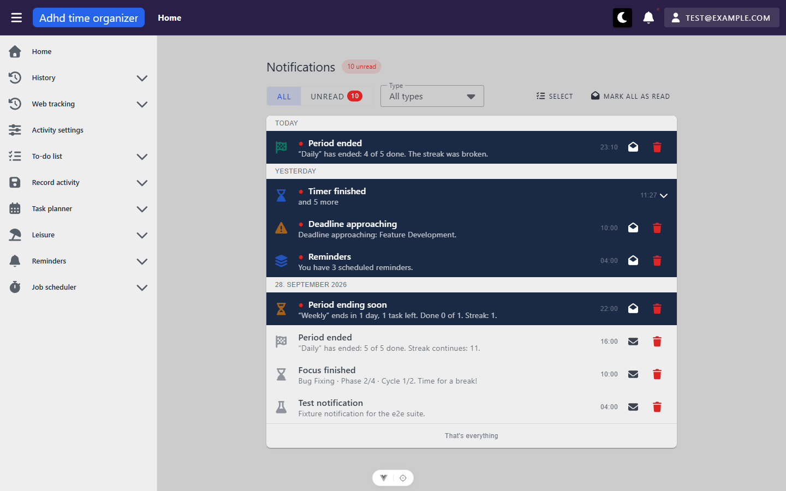

**Route:** `/notifikacie` · params: none · query: `read` (`unread` or absent), `type` (a notification type key or absent) · guard: `auth`
**Reached from:** user menu › *Notifications*; bell panel › *See all*. No sidebar entry (see `_shell/inventory.md`).

**Actions**
| label | kind | selector | does | destination |
| --- | --- | --- | --- | --- |
| All | toggle (in `MyBtnToggle` group "Filter by read status") | `getByRole('button', { name: 'All' })` | clears `read` from the URL, shows every loaded row | in place (`router.replace`) |
| Unread `N` | toggle | `getByRole('button', { name: 'Unread Badge' })` — the badge's `aria-label="Badge"` becomes part of the name (see A1); `name: 'Unread'` is ambiguous with every "Mark as unread" | writes `?read=unread`, hides read rows | in place |
| Type | select | `locator('.notification-type-filter .v-field__input')` to open; `getByRole('option', { name: '…' })` | writes `?type=<Key>`; options: All types, Deadline approaching, Personal reminder, Reminder digest, Routine ending soon, Routine ended, Streak grace expiring, Routine suggested for today, Scheduled job failed, Scheduled job overdue, Timer finished, Test | in place |
| Clear filter | button (only while filtered) | `getByRole('main').getByRole('button', { name: 'Clear filter' })` (appears twice when the filtered-empty state shows) | resets both filters, URL back to bare `/notifikacie` | in place |
| Select | toggle button (`aria-pressed`) | `getByRole('button', { name: 'Select', exact: true })` | enters select mode: a checkbox per row, clusters expand, cluster summaries hide | in place |
| Mark all as read | button (only while unread > 0) | `getByRole('button', { name: 'Mark all as read' })` | `POST /notification/read-all` — **not clicked** (unit prompt forbids mass-mark-as-read) | in place |
| row (whole item) | list item, click / Enter | `getByRole('listitem').filter({ hasText: '…' })` | marks read (no request if already read), then navigates to `notificationRoute(n)` if one resolves | e.g. routine row → `/routine-todo-list?focus=5` (the routine view strips `focus` on arrival, so the URL settles at `/routine-todo-list`) |
| cluster summary "Timer finished · and 5 more" | list item, click | `getByRole('listitem', { name: 'Expand notification group' })` / `'Collapse notification group'` | expands / collapses the same-type run under it | in place |
| Mark as read / Mark as unread | icon button (envelope-open / envelope) | `getByRole('button', { name: 'Mark as read' })` — **not unique**, one per row (A3) | `PATCH /notification/{id}/read` or `/unread` — not clicked (read-only pass) | in place |
| Dismiss notification `<title>` | icon button (trash) | `getByRole('button', { name: 'Dismiss notification Test notification' })` | opens the dismiss confirm dialog | dialog |
| row checkbox (select mode) | checkbox | `getByRole('checkbox', { name: 'Select notification Test notification' })` | adds the row to the selection | in place |
| Select all visible | button (selection bar) | `getByRole('button', { name: 'Select all visible' })` | selects every row matching the current filter (13 with no filter) | in place |
| Mark as read (bar) | button | selection bar › `getByRole('button', { name: 'Mark as read' })` — collides with the row buttons by name | per-id `PATCH …/read` for the unread ones — not clicked | in place |
| Dismiss (bar) | button | `getByRole('main').getByRole('button', { name: 'Dismiss', exact: true })` | opens the bulk dismiss confirm | dialog |
| Cancel selection | button | `getByRole('button', { name: 'Cancel selection' })` | clears the selection, bar disappears (select mode stays on) | in place |
| Load older | button (only while the last page was full, i.e. ≥ 20 rows) | not reachable — 14 rows on this account | `GET /notification/mine?beforeId=…` | in place |

**Readable surfaces**
| surface | kind | contents | raw/derived | populated by |
| --- | --- | --- | --- | --- |
| "N unread" chip beside the heading | chip | `unreadCount` (10, then 11 after a live arrival) | raw | `GET /notification/unread-count` → `{count}`; `+1` on an unread hub push |
| Unread toggle badge | badge | same `unreadCount` | raw | as above |
| "Reconnecting..." | caption, right of heading | shown whenever `isConnected` is false — **including the initial connect**, and permanently if the first handshake fails (B1) | derived | hub state |
| Day group headers | sticky subheader per group (`role=group` named by the label) | "Today", "Yesterday", then `D. MMMM YYYY` — rendered **"28. september 2026" in EN** (B2) | derived from `createdAt`, viewer's local zone | `groupNotificationsByDay` / `notificationDayLabel` |
| Row | list item | icon (type colour, grey when read), `●` + bold title + sr-only "unread" when unread, body, `HH:mm` time; unread rows have a `primary-container` background | title/body **raw** (server-rendered, English on this account); time derived | `GET /notification/mine?limit=20` |
| Held-behind-quiet-hours line | subtitle "Originally due …" | only when `originallyDueAt` is set — **no seeded row has it**, not observed | raw | same |
| Cluster summary | list item | newest member's title + "and N more", newest time; members are a consecutive same-type run (6 × `TimerBoundary` here) | derived | `clusterNotifications` |
| End of list | caption | "That's everything" when `hasMore` is false | derived (`page.length < 20`) | — |

Seed rows observed (primary account): 6 fixture rows (22001–22006) + 6 `TimerBoundary` rows (22103–22108, left by an earlier
unit's timer run) + 1 `RoutinePeriodEnded` (22118) created by the backend at 21:10:03Z during this pass + 1 `Test` (22119, created by
this pass and deleted again — see *Cleanup* in findings). 10 unread at the end.

**States**
- empty (filtered): "None of the loaded notifications match this filter. Try loading older ones or clearing the filter." + *Clear filter* — reached with `?type=ScheduledJobFailed`, and with `?type=Bogus`. 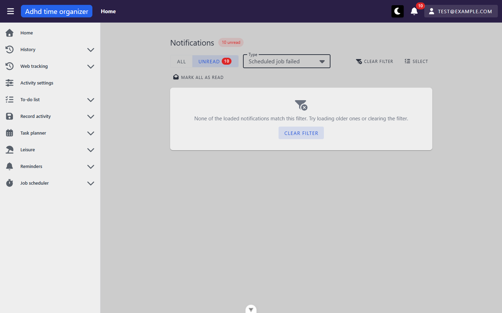
- empty (first run): "No notifications yet. When something happens, you'll find it here." — **not reachable honestly with this seed**; it *is* what renders during the hub handshake and after a failed one (B1). 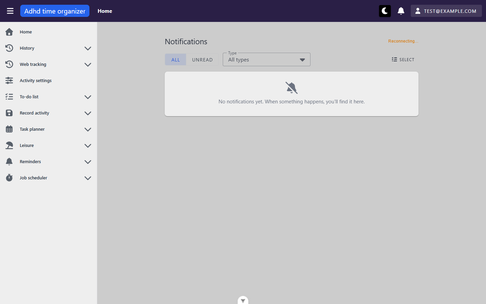
- loading: a `VSkeletonLoader` is coded for `isLoading && list empty`, but `isLoading` is only set once the hub has connected, so the observed first paint is the first-run empty state, not the skeleton. A thin `VProgressLinear` shows on a refresh over an existing list.
- error: "Could not load notifications" + Retry is coded for a failed REST load with an empty list — **not reached**: when the hub fails, the REST load never runs, so `error` stays null (B1).

**URL & persisted state**
- `?read=unread` — written by the toggle via `router.replace`; survives reload (verified). `read=garbage` falls back to *All* and stays in the URL untouched.
- `?type=<Key>` — survives reload; an unknown key (`Bogus`) renders in the select as raw text and matches nothing (deliberate, per the comment in `useNotificationInboxFilters.ts:36-38`).
- `replace`, not `push`, so Back leaves the page rather than walking filter history (deliberate).
- No `localStorage`. Reads the module-level singleton in `useNotifications` — the same state the bell renders; no view-level fetch on mount.

**Dialogs opened from here**
- *Dismiss notification?* (single) — "The notification Test notification will be permanently deleted. This action cannot be undone." · Cancel / Confirm (`errorDark`). Escape closes it. **Focus lands on `<body>` after close**, both via Cancel and via Escape (A2). Not confirmed (read-only pass).
- *Dismiss notification?* (bulk) — "Selected notifications: 13. They will be permanently deleted and this action cannot be undone." · Cancel / Confirm. Title stays singular (P3). 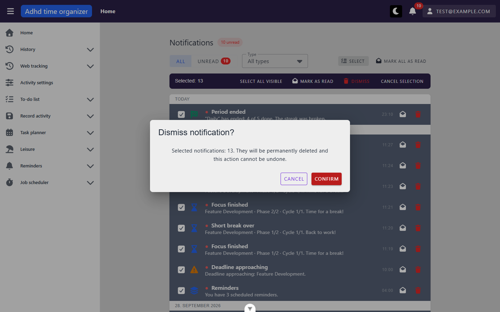

**Keyboard**
- The `VList` is one tab stop (`tabindex=0`); rows are `tabindex=-2` (Vuetify roving focus). **Arrow keys** walk every focusable in order: row → its *Mark as read* → its *Dismiss* → next row / cluster summary. **Tab** enters the first row, then only visits the icon buttons — rows after the first are not Tab stops, so opening one by keyboard needs the arrow keys. Enter on a focused row opens it.
- Dialog: Escape closes; focus not restored (A2).

**Console & network**
- errors/warnings: none on a normal load. With the hub negotiate mocked to 503: four errors (the 503, SignalR's two negotiation errors, `Notification hub connection failed: FailedToNegotiateWithServerError`) and **no further negotiate attempt in ~2 minutes**.
- non-2xx: none (the 503 above was injected with `playwright-cli route`).
- duplicate requests: none — a full load fires `negotiate` once, then `GET /notification/mine?limit=20` and `GET /notification/unread-count` once each. SPA navigation to the page fires nothing (shared state).
- ordering: `mine` and `unread-count` are only requested **after** the hub handshake resolves (`useNotifications.ts:551-559`).
- live arrival: `POST /notification/test` → 204; the row appeared at the top of *Today* and the badge went 10 → 11 with **no** REST refetch (hub push). English: "Test notification / This is a test notification." No snackbar (the inbox registers itself as a notification surface). 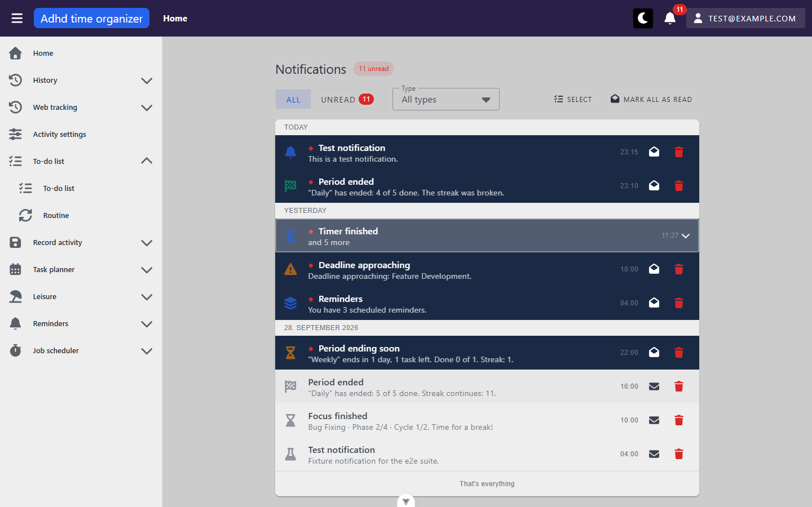

Other screenshots: `notifikacie--unread.png`, `notifikacie--cluster-expanded.png`, `notifikacie--select-mode.png`, `notifikacie--cold-load-false-empty.png` (taken on a warm reload — the list had already loaded; kept for comparison).

Breadcrumb on this route reads **"Home"** only (P1).

### ReminderPreferencesView (`/nastavenia/pripomienky`)
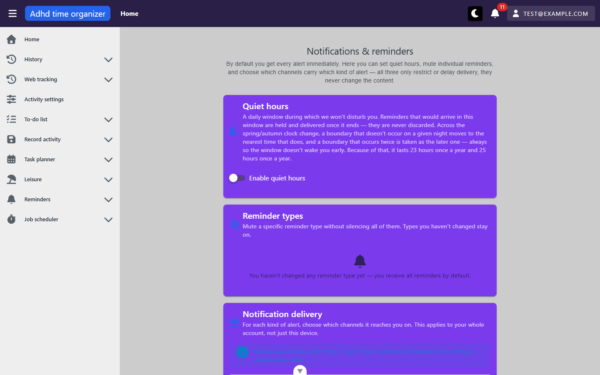
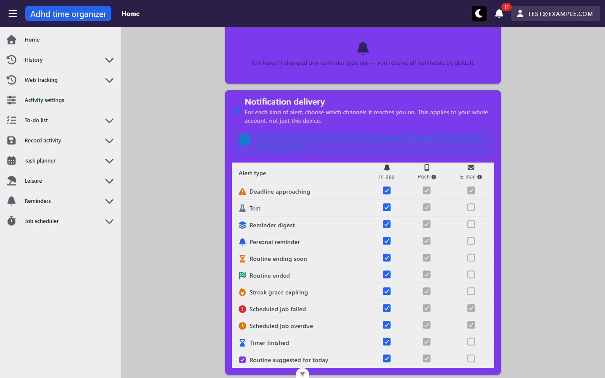

**Route:** `/nastavenia/pripomienky` · params: none · query: none · guard: `auth`
**Reached from:** user menu › *Notifications & reminders*; `/user/settings` › *Notifications & reminders* (per `user-settings/inventory.md`); the day-planner settings *Reminders* tab › *Reminder preferences* link (`PlannerRemindersTab.vue:43`, by route name). No sidebar entry.

Page heading "Notifications & reminders" with an intro paragraph ("By default you get every alert immediately. Here you can set quiet hours, mute individual reminders, and choose which channels carry which kind of alert…"), then three cards, all `VCard color="secondary"` (bright purple in the light theme).

**Actions**
| label | kind | selector | does | destination |
| --- | --- | --- | --- | --- |
| Enable quiet hours | switch | `getByRole('checkbox', { name: 'Enable quiet hours' })` | **auto-saves** (on → `PUT /notification-quiet-hours`, off → `DELETE`, with an undo snackbar per source) — **not toggled** (inventory pass; mutation pass owns preferences). When on, two `TimePicker`s (From / To, 5-minute steps) and a save-status line appear; edits debounce 900 ms and flush on unmount (per source and N10) | in place |
| Reminder types rows | switch per stored `(ownerModule, kind)` row | — | `PUT /reminder-preference/kind` | **no rows on this account** — `GET /reminder-preference` → `{"kindPreferences":[]}`; the card offers **no control to add one** (B3) |
| Delivery matrix cell | checkbox, one per (type, channel) | **no accessible name** — `generate-locator` yields `locator('#input-v-22')`; structural fallback `getByRole('row', { name: /Personal reminder/ }).getByRole('checkbox')` (A5) | `PUT /notification-preference` for that cell, optimistic, no success snackbar — **not toggled** | in place |
| Push / E-mail column header info icon | tooltip on hover | `getByRole('columnheader', { name: 'Push' })` | "This channel is not set up on this server." | tooltip |
| Try again (per card, error state only) | button | `getByRole('alert').filter({ hasText: 'quiet hours' }).getByRole('button', { name: 'Try again' })` | re-fetches that card's resource only; verified recovering the quiet-hours card while the other two stayed errored | in place |

**Readable surfaces**
| surface | kind | contents | raw/derived | populated by |
| --- | --- | --- | --- | --- |
| Quiet hours card | card | title, long subtitle (deferral + DST rule), switch — **off** on this account | raw | `GET /notification-quiet-hours` → `{"quietHours":null}` |
| Reminder types card | card | title, subtitle "Mute a specific reminder type without silencing all of them…", empty copy "You haven't changed any reminder type yet — you receive all reminders by default." | raw | `GET /reminder-preference` → `{"kindPreferences":[]}` |
| "Not set up on this server: Push, E-mail…" | info `VAlert` above the table | lists channels with `configured: false` | derived | `GET /notification-preference/channels` → InApp `true`, WebPush `false`, Email `false` |
| Delivery matrix | table (`Alert type` rowheader + `In-app` / `Push` / `E-mail` column headers with icons) | 11 rows, **server order**: Deadline approaching, Test, Reminder digest, Personal reminder, Routine ending soon, Routine ended, Streak grace expiring, Scheduled job failed, Scheduled job overdue, Timer finished, Routine suggested for today. In-app all checked; Push all checked **and disabled**; E-mail checked + disabled for Deadline approaching, Scheduled job failed, Scheduled job overdue, unchecked + disabled elsewhere | raw values; row icon/colour/label from the app's `notificationTypeMeta` | `GET /notification-preference/mine` (33 cells) |
| "No channel — nothing reaches you" row hint | caption under a row label | only when every deliverable channel is off — not shown (nothing muted) | derived | `notificationPreferenceMatrix` |
| Push device warning | alert linking to account settings | only when Push is configured but this device is not subscribed — not reachable (Push unconfigured on this deployment) | derived | `usePushNotifications` |

**States**
- empty: Reminder types card's empty copy (above) — this is the **only** state that card can show on this deployment (B3).
- loading: an indeterminate `VProgressLinear` under the heading until all three first loads settle; a retry spins on its own button.
- error: each card independently → `VAlert type=error`: "Failed to load quiet hours. This doesn't mean you have none set." / "Failed to load reminder types. This doesn't mean you have none customised." / "Could not load the delivery settings", each with *Try again*. Triggered with `playwright-cli route … --status 500` on the three GETs. **No snackbar** alongside (reads are `_silent`). With the matrix failed, `/channels` is not requested (by design). 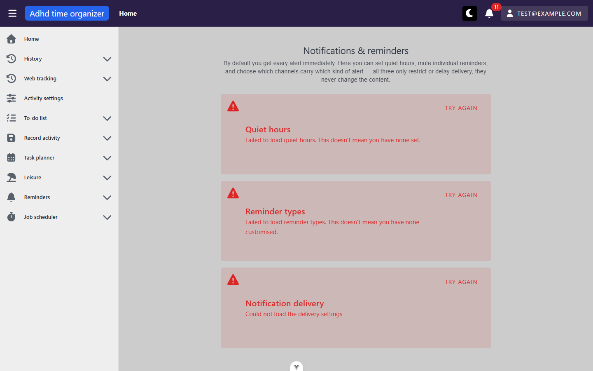

**URL & persisted state**
- none. No query, no `localStorage`. Data is a view-level fetch in `onMounted` (not a store), three reads in parallel, then `/channels` after the matrix.

**Dialogs opened from here**
- none observed (quiet-hours *off* would raise an undo snackbar, not a dialog — not triggered).

**Keyboard**
- Tab order: quiet-hours switch → (when on) the two time pickers → the enabled In-app checkboxes, row by row. Disabled Push/E-mail boxes are skipped. No shortcuts.

**Console & network**
- errors/warnings: none on a normal load (the 6 errors logged later were the injected 500s).
- non-2xx: none unmocked.
- duplicate requests: none — one each of `GET /reminder-preference`, `/notification-quiet-hours`, `/notification-preference/mine`, then `/notification-preference/channels`.

Breadcrumb reads **"Home"** only here too (P1).

**Mutation pass (round 2, 2026-10-01, fixture `e2e-v4` after cleanup)** — every preference write exercised; browser zone `Europe/Bratislava`, local time 00:21–00:29.
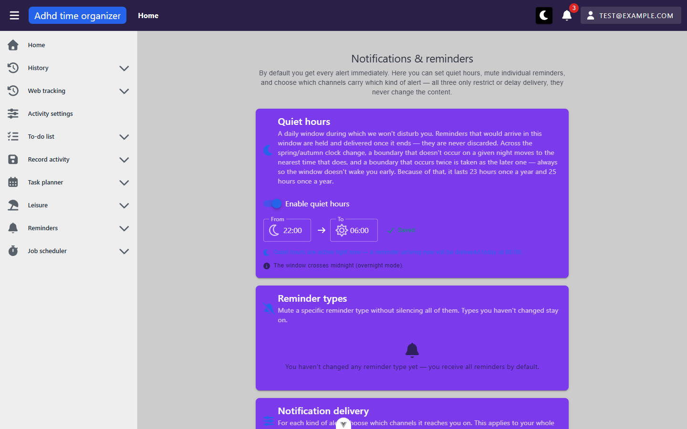
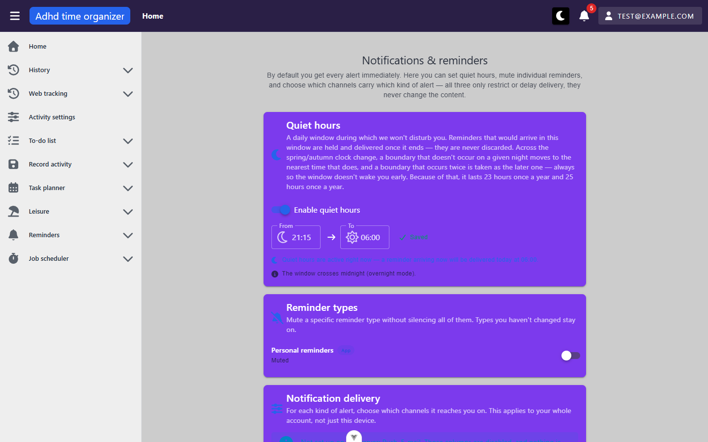

| action | request | observed |
| --- | --- | --- |
| Quiet hours switch **on** | `PUT /notification-quiet-hours` 204 → `GET` read-back `{"startMinute":1320,"endMinute":360,"timeZone":"Europe/Bratislava"}` | default 22:00 → 06:00; snackbar "Quiet hours were saved"; status "✓ Saved"; "Quiet hours are active right now — a reminder arriving now will be delivered today at 06:00."; "The window crosses midnight (overnight mode)." Day word correct past midnight ("today") |
| Edit *From* (`fill "23:30"`) | one `PUT` + `GET` ~900 ms later | read-back 1410; two edits made inside the debounce (From 00:00, To 00:30) were **coalesced into one PUT** |
| *From* = *To* (06:00) | **no request** | inline error "Start and end cannot be the same. To turn quiet hours off, use the switch above."; the "Saved" status goes blank; server keeps the previous window 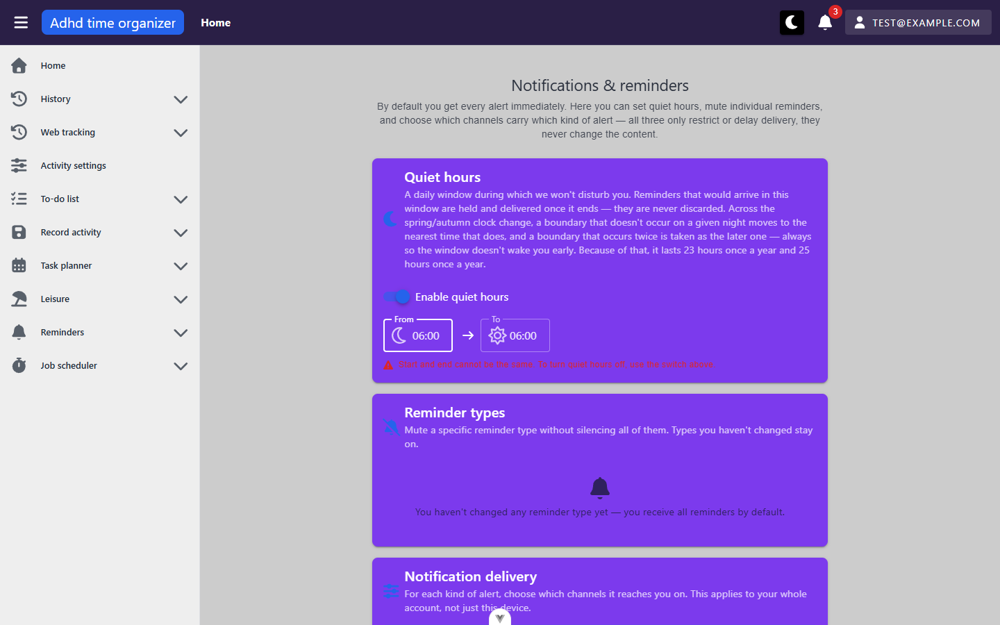 |
| Edit, then leave within 900 ms (`fill "21:15"` + router push) | `PUT` fired on unmount | server read 1275 — the flush-on-unmount works |
| Switch **off** | `DELETE` 204 | snackbar "Quiet hours were cleared" + **Undo** + Close, visible **~3.1 s** (measured: shown at 107 ms, gone at 3252 ms) — A6 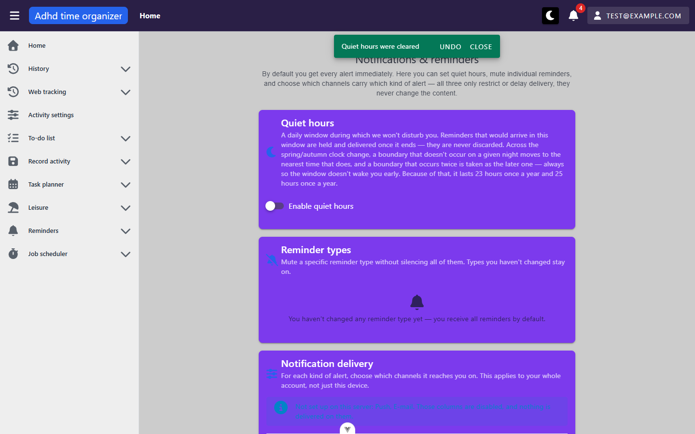 |
| Undo (clicked within 3 s) | `PUT` 204 + `GET` | window restored, snackbar "Quiet hours were restored"; focus lands on `<body>` afterwards |
| Switch on with `PUT` mocked 500 | `PUT` 500 | switch reverts to off; one snackbar "A server error occurred. Please try again later." |
| Matrix *Personal reminder › In-app* off | `PUT /notification-preference` `{"type":"PersonalReminder","channel":"InApp","enabled":false}` 204 | no snackbar (by design); row caption "You will not get it at all — not even in the notification list" (joins the rowheader's name); survives reload  |
| Matrix *Test › In-app* off, then `POST /notification/test` | 204 | same caption on the *Test* row — **but the Test row was written and delivered**: unread 4 → 5, top of `GET /notification/mine` = id 22104 `Test`, shown on `/notifikacie` under *Today* — B4 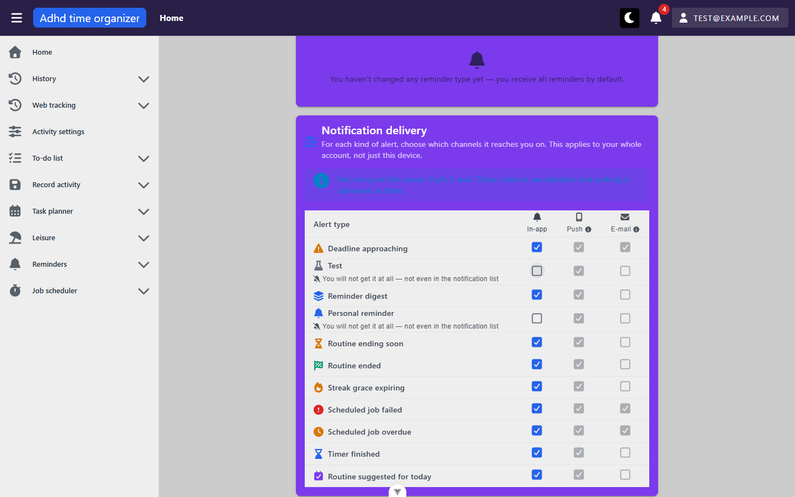 |
| Matrix cell with `PUT` mocked 500 | `PUT` 500 | box springs back to checked; one generic server-error snackbar 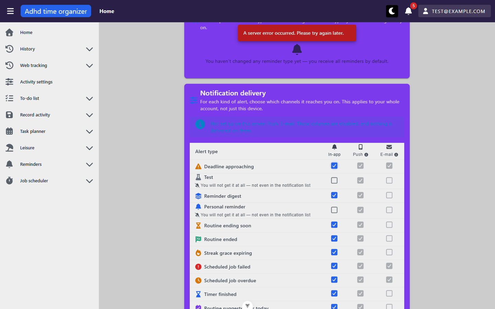 |
| Reminder-kind row (created with `PUT /reminder-preference/kind` `{Portal, PersonalReminder, enabled:true}` via `fetch`, since the card has no add control — B3) | — | row "Personal reminders" + chip "App" + caption "Delivered" + switch; the switch has **no accessible name** (`generate-locator` → `#switch-v-22`) — A7 |
| Kind switch off | `PUT /reminder-preference/kind` 204 | caption → "Muted", snackbar "Preference was saved" |
| `POST /notification/test` inside an active window (00:00–00:30) | 204 | delivered to the inbox **immediately**, `originallyDueAt: null` — by the server's design, in-app is never held (P6) |

Visual sweep (round 2, `…--kind-row-muted.png`): the surfaces that only appear once quiet hours are on — the green "✓ Saved" status, the blue "active right now" line, the switch track — and the kind row's "App" chip are unreadable on the purple card; folded into A4.

## Transitions out of this unit
| from | control | goes to |
| --- | --- | --- |
| `/notifikacie` | row click (routine types) | `/routine-todo-list?focus=<periodId>` (focus param stripped by the destination) |
| `/notifikacie` | row click (planner-task subject) | `/day-planner/task/:id` → redirects to `/day-planner/<date>?focus=<id>` (per source; no such row seeded) |
| `/notifikacie` | row click (`TimerBoundary`, `Test`, `ReminderDigest`, `DeadlineApproaching`) | per the app's `notificationTypeMeta` constant route, or nowhere (`TimerBoundary` is deliberately unrouted) — not clicked, would mark unread rows read |
| top bar bell | *See all* | `/notifikacie` (documented in `_shell`) |
| `/nastavenia/pripomienky` | none | — (the page links nowhere; the push toggle lives in `/user/settings` › Security, linked from the device warning only when that warning shows) |

