# reminders-user — inventory

> Captured 2026-10-01 · locale EN · account `test@example.com` (seed `primaryUser`, id 10001) · commit `4d890646`
> (framework `b1b82a1`, submodule tree clean) · viewport 1440×900 unless noted · signed in through the form in
> session `reminders-user` (unit 17 was running in parallel as `reminders-admin`). Round 2 (mutation) the same day,
> same commit, the only live session; see *Mutation pass* below.

Shell (top bar, sidebar, user menu, bell, dialog host, snackbars) is as documented in `../_shell/inventory.md`;
only differences are noted below.

## Views

### MyRemindersView (`/pripomienky/moje`)
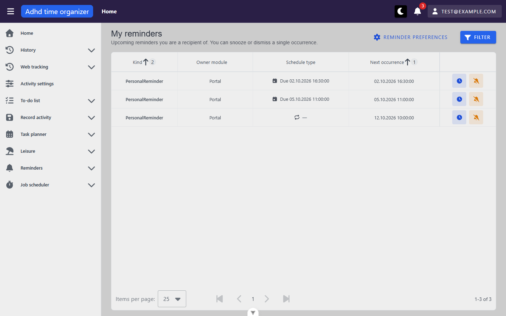

**Route:** `/pripomienky/moje` · params: none · query: see *URL & persisted state* · guard: auth (no role)
**Reached from:** user menu → *My reminders* (`getByRole('link', { name: 'My reminders' })`). Not in the sidebar, by
design (`navItems.ts:74`).

**Actions**
| label | kind | selector | does | destination |
| --- | --- | --- | --- | --- |
| Reminder preferences | link (styled button, gear icon) | `getByRole('link', { name: 'Reminder preferences' })` | navigates | `/nastavenia/pripomienky` (outside unit) |
| Filter | button | `getByRole('button', { name: 'Filter' })` | opens the *Filter* dialog | dialog |
| filter chip remove | button (icon-only) | `getByRole('button', { name: 'Close' })` — the only name it has | removes that one filter, reloads, rewrites URL | in place |
| Kind (header) | sort toggle | `getByRole('columnheader', { name: /^Kind/ })` | sorts by `kind`; shows a priority badge ("2" by default) | in place, URL `sortBy=` |
| Owner module (header) | sort toggle | `getByRole('columnheader', { name: /^Owner module/ })` | click → `sortBy=ownerModule:asc` (replaces the default sort entirely) | in place |
| Schedule type (header) | — | — | not sortable (click does nothing, URL unchanged) | — |
| Next occurrence (header) | sort toggle | `getByRole('columnheader', { name: /^Next occurrence/ })` | default sort, asc, badge "1" | in place |
| Snooze (clock icon, per row) | row action, icon-only | `getByRole('button', { name: 'Snooze reminder PersonalReminder' }).nth(i)` — every row has the **same** name | opens *Snooze reminder* dialog for that row's next occurrence; disabled once the occurrence has passed (reactive clock) | dialog |
| Dismiss (bell-slash icon, per row) | row action, icon-only | `getByRole('button', { name: 'Dismiss delivery of reminder PersonalReminder' }).nth(i)` — same name on every row | opens *Dismiss reminder* confirm | dialog |
| Items per page | select | `combobox` in the table footer (value `25`) | page size, written to `perPage=` | in place |
| First / Previous / Next / Last page | buttons | `getByRole('button', { name: 'Next page' })` etc. | paging; all disabled with 3 rows | in place |

**Readable surfaces**
| surface | kind | contents | raw/derived | populated by |
| --- | --- | --- | --- | --- |
| Heading + subtitle | text | "My reminders" / "Upcoming reminders you are a recipient of. You can snooze or dismiss a single occurrence." | static i18n (`reminderDashboard.my.*`) | — |
| Result count | `role=status`, `d-sr-only` | "3 results found", "0 results found" | derived from `itemsCount` after each load settles | `POST /api/reminder-dashboard/my-upcoming` |
| Table | server-paged, server-sorted | columns **Kind**, **Owner module**, **Schedule type**, **Next occurrence**, **Actions** (header text is `d-sr-only`). Default sort `nextOccurrenceAt asc` + `kind asc` tie-breaker pushed by `BasicTable`. No select column, no inline edit. | — | same request |
| Kind cell | text | `PersonalReminder` on all three rows — the raw `kind` code. The subject caption (`subjectType #subjectId`) never renders: the personal projection does not send it | raw `kind` | same |
| Owner module cell | text | `Portal` on all three rows | raw `ownerModule` | same |
| Schedule cell | icon + text | one-shot: calendar icon + "Due 02.10.2026 16:30:00" (the same instant as the next column); interval (`RecurringInterval`): repeat icon + "—" | derived: `scheduleType` + `nextOccurrenceAt`; interval label from `intervalPreset`, which the response does not carry | same |
| Next occurrence cell | text | "02.10.2026 16:30:00", "05.10.2026 11:00:00", "12.10.2026 10:00:00" (UTC 14:30 / 09:00 / 08:00 rendered in Europe/Bratislava) | derived: `formatToDate` + `formatToTimeWithSec` (SK shape) | same |
| Footer | text | "1-3 of 3" | derived | same |

Response for the seed account (request body `{"itemsPerPage":25,"page":1,"sortBy":[{"key":"nextOccurrenceAt","isDesc":false},{"key":"kind","isDesc":false}],"useFilter":true,"filter":{…all null}}`):
`{"items":[{"ownerModule":"Portal","kind":"PersonalReminder","templateKey":"portal.personal-reminder","scheduleType":"OneShot","nextOccurrenceAt":"2026-10-02T14:30:00+00:00","id":23201}, {… "OneShot","2026-10-05T09:00:00+00:00","id":23202}, {… "RecurringInterval","2026-10-12T08:00:00+00:00","id":23203}],"itemsCount":3,"pageCount":1}`.
Ids are the **register** ids (`seed.reminderDefinitions.callTheDentist / fileTaxReturn / payRentRecurring`). Only
these six keys come back — no title, subject, status, interval preset or cron.

**States**
- empty (filtered): table body "No data available" (Vuetify default), live region "0 results found". Triggered with
  `?kind=Personal` or `?to=2026-10-02`. 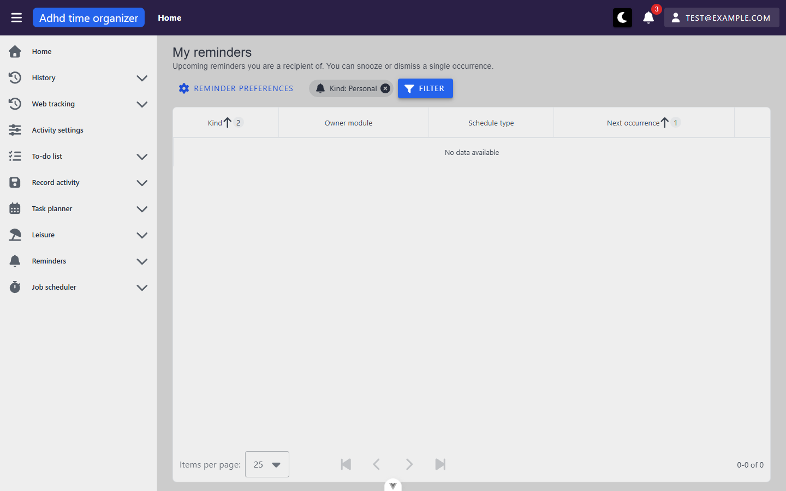 A true empty list
  (no reminders at all) is not reachable read-only with the seed; the copy would be the same.
- loading: `BasicTable` loading bar; not captured separately (load is ~250 ms).
- error: `my-upcoming` routed to 500 → interceptor snackbar "A server error occurred. Please try again later." (3 s),
  then the page shows the same "No data available" row and announces "0 results found". No error state, no retry.
  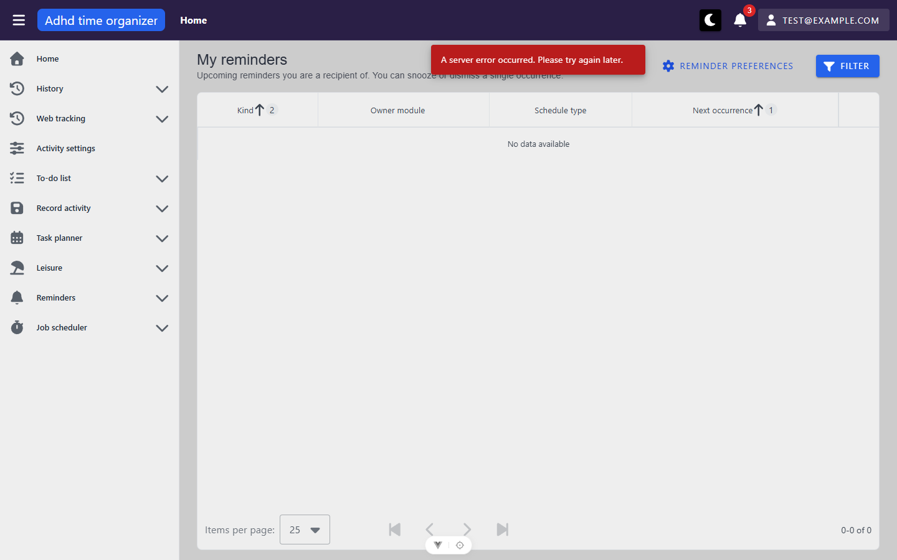
- narrow (375×812): page body does not scroll horizontally (`scrollWidth` 375); the table scrolls inside
  `.v-table__wrapper` (525/325 px). 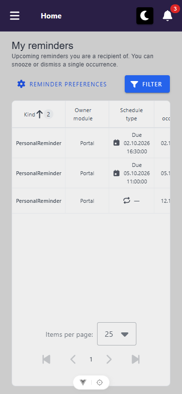

**URL & persisted state**
- `page`, `perPage`, `sortBy` always written; a bare `/pripomienky/moje` is rewritten on mount to
  `?page=1&perPage=25&sortBy=nextOccurrenceAt:asc,kind:asc`.
- filter keys: `ownerModule`, `kind`, `scheduleType`, `from`, `to` (dates as `YYYY-MM-DD`). Survive reload (chip
  and request restored) and Back (`?kind=Personal` restored with its chip after `go-back`).
- Applying a filter appears to `replace` rather than push: after *goto default → filter `to`*, Back skipped the
  default entry and landed on the previous `?kind=Personal` entry.
- No `localStorage` / `sessionStorage` key written by this view (`sessionStorage` empty; `localStorage` holds only
  `theme`, `user` and devtools keys).
- Store: none — `useServerTable` + `useFetchFilteredTable` in the view; no `ensureLoaded()`.

**Dialogs opened from here**
- **Filter** (`dialog "Filter"`, FilterPanel) — *Owner module* (free text), *Kind* (free text), *Schedule type*
  (select: the three schedule types), *Next occurrence from* / *to* (VDateInput, placeholder `mm/dd/yyyy`); buttons
  *Close* (header), *Clear*, *Confirm*. Confirm applies, resets to page 1, writes the URL, adds one chip per value.
  Text filters are **exact match** server-side (`Personal` → 0 rows). *to* is sent as local midnight at the **start**
  of the chosen day (`2026-10-01T22:00:00.000Z` for 10/02/2026) and its chip reads "Next occurrence to: 02.10.2026
  0:00:00". 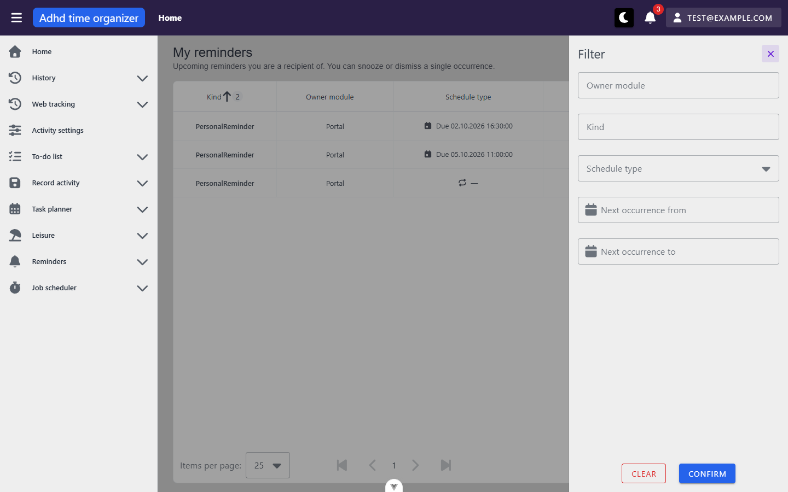 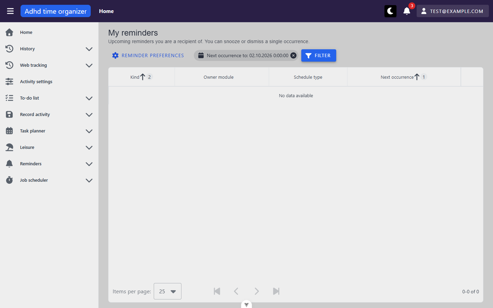
- **Snooze reminder** (`SnoozeDialog`) — intro "Choose when to be reminded about this occurrence. This only affects
  your own reminder and this occurrence."; *Occurrence* row with the instant; radio group: "In 1 hour — 01.10.2026
  1:54:23" (default), "Tomorrow morning (9:00) — 02.10.2026 9:00:00", "In a week — 08.10.2026 9:00:00", "Custom
  time"; info alert "You'll be reminded 01.10.2026 1:54:23."; *Cancel*, *Snooze*. Observed on the row due
  02.10.2026 16:30. *Custom time* reveals a date field "Remind me on" (`mm/dd/yyyy`) and an **unnamed** time textbox
  (`00:00`), a warning "The chosen time must be in the future." and disables *Snooze* until a valid instant is set.
  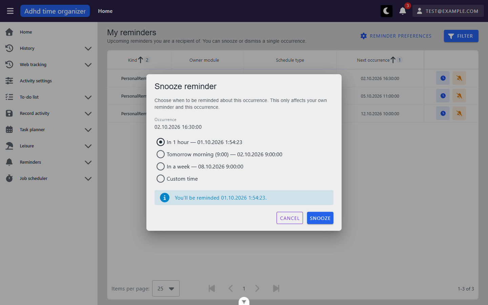 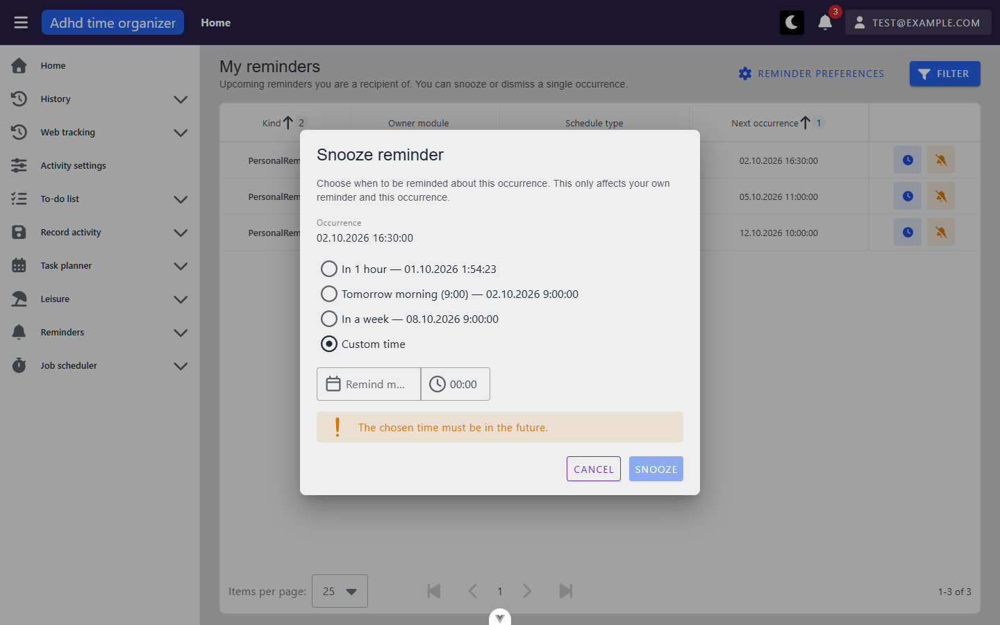
  Confirming → `POST /api/reminder-dashboard/snooze`, which today always 404s (round 2, findings X1).
- **Dismiss reminder** (MyDialog) — "This occurrence will no longer be delivered to you. It only affects you and
  this occurrence — the reminder's schedule and other recipients are unaffected. This cannot be undone from here.";
  *Cancel*, *Dismiss delivery* (warningDark). Does not name the occurrence instant.
  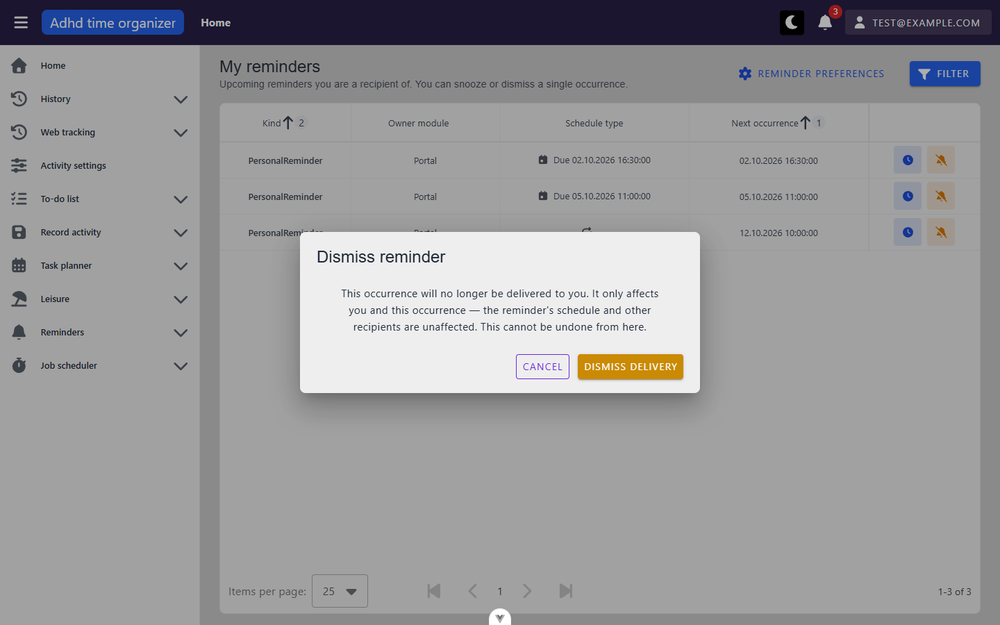 Confirming → `POST /api/reminder-dashboard/dismiss`, which
  today always 404s (round 2, X1).

**Mutation pass (round 2, 2026-10-01; reseeded afterwards, fixture `e2e-v4`, `seedDateUtc` 2026-10-01)**
Session `reminders-user`, signed in through the form, no other `playwright-cli` session live.

| action | how | request → status | what the screen did |
| --- | --- | --- | --- |
| Snooze row 1, default preset | real UI | `POST /reminder-dashboard/snooze` → **404**, body keys `reminderId`/`occurrenceInstant` (findings **X1**) | info snackbar "This reminder is no longer available to you.", row dropped, focus on `h1`, `my-upcoming` reload → row back  |
| Dismiss row 2 | real UI | `POST /reminder-dashboard/dismiss` → **404**, same cause | same snackbar, row back after the reload |
| Snooze 23202 to now+2.5 min | real API, server's keys (`reminderDefinitionId`/`occurrenceAt`/`snoozeUntil`) | → 204 | row unchanged after reload (**B6**). Delivered as notification 22103 "File the tax return" ~40 s after `snoozeUntil`, four days before its 05.10 occurrence (**B2**). Bell → "Notifications, 4 unread" |
| Dismiss 23201, twice | real API | → 204, 204 | row unchanged (**B6**) |
| Snooze with past `snoozeUntil` / dismiss with wrong `occurrenceAt` / dismiss someone else's definition 23001 | real API | → 400 / 400 / 404 | — (400 bodies name the field, see **P7**) |
| Snooze row 3, default | UI, `snooze` routed → 204 | 204 (mocked) | success snackbar "Snoozed — you'll be reminded 01.10.2026 10:25:23.", row dropped, focus `h1`, reload → 3 rows again  |
| Dismiss row 1 | UI, `dismiss` routed → 400 | 400 (mocked) | dialog closes, warning snackbar "This occurrence is no longer in the future.", reload, focus back on the row's *Dismiss* |
| Snooze row 1 | UI, `snooze` routed → 500 | 500 (mocked) | error snackbar "The action could not be performed. Please try again.", no reload, focus → `BODY` (**A1**) 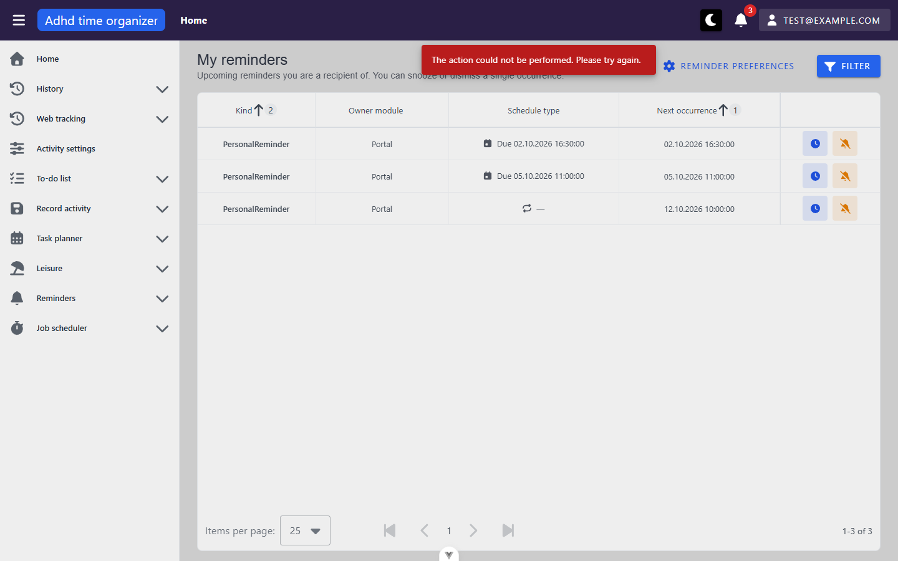 |
| `canAct` | `my-upcoming` routed to one row due in 40 s | — | both row buttons enabled until the instant passed, disabled ≤ 23 s later, without a reload |
| Custom snooze time | UI | — | before a date is entered: warning "The chosen time must be in the future." and *Snooze* disabled; 10/01/2026 + `23:00` → info "You'll be reminded 01.10.2026 23:00:00." and *Snooze* enabled 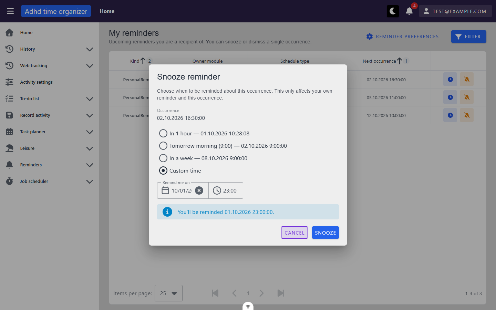 |

Visual sweep (round 2, `…--snooze-success-mocked.png`): nothing new beyond round 1. The page is a grey scrim mid-fade
just after the dialog closes; the table and its row actions are as in the default state.

**Keyboard**
- Tab order in `main`: Reminder preferences → Filter → Kind header → Owner module header → Next occurrence header →
  (Snooze, Dismiss) × 3 rows → items-per-page. Schedule type header is correctly not a stop.
- Enter on a focused row button opens its dialog.
- **Escape does not close** either dialog (MyDialog defaults to `persistent`); only *Cancel* does.
- Focus return: *Dismiss* returns focus to the opening row button. *Snooze* returns it **only from the second open
  on**; the first snooze dialog of a page load drops focus to `<body>` on Cancel (reproduced twice).
- No view-specific shortcuts.

**Console & network**
- errors/warnings: none on a normal load (console info: 0 as well). With the mocked 500: the resource error and
  `AxiosError: Request failed with status code 500` from `axiosConfig.ts:190`, as expected.
- non-2xx: none unmocked on read. Round 2: every UI snooze/dismiss → 404 (X1), each logging `AxiosError: Request
  failed with status code 404` at `axiosConfig.ts:190` despite `_silent`. That flag suppresses only the snackbar.
- duplicate requests: none. There is one `my-upcoming` per load, including the load that rewrites the URL, one per
  filter, sort and chip change, and exactly one follow-up per action (success, 400 and 404 each `reload()` once; 500
  does not).

## Transitions out of this unit
| from | control | goes to |
| --- | --- | --- |
| MyRemindersView | *Reminder preferences* | `/nastavenia/pripomienky` (notifications module, unit 18) |
| any page | user menu → *My reminders* | into this unit |
