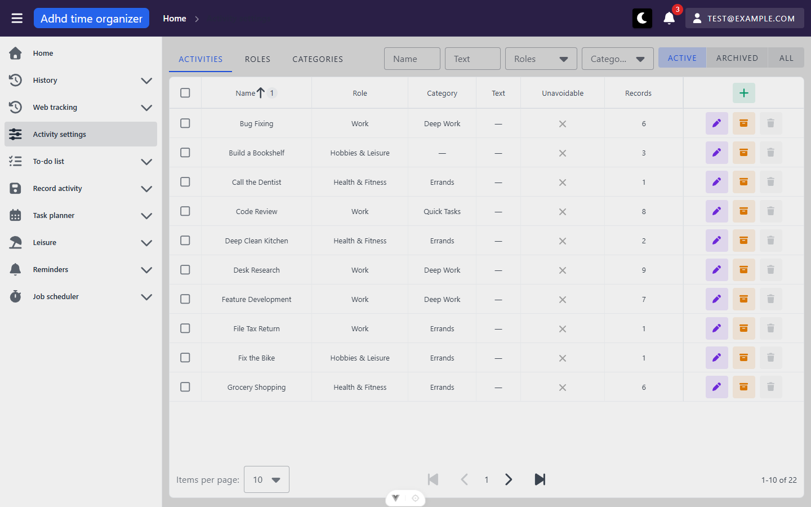
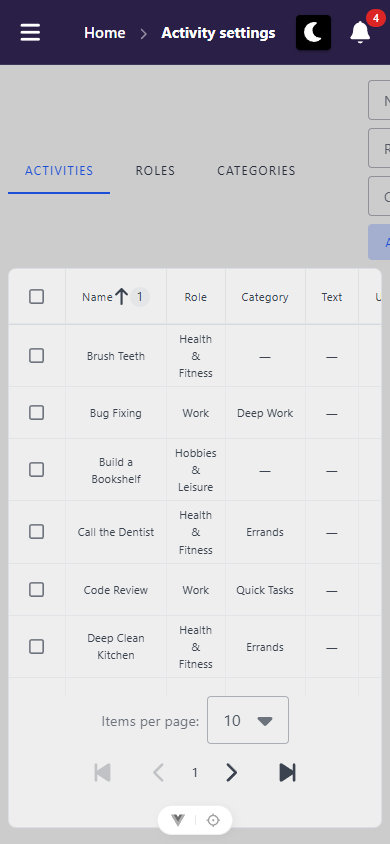
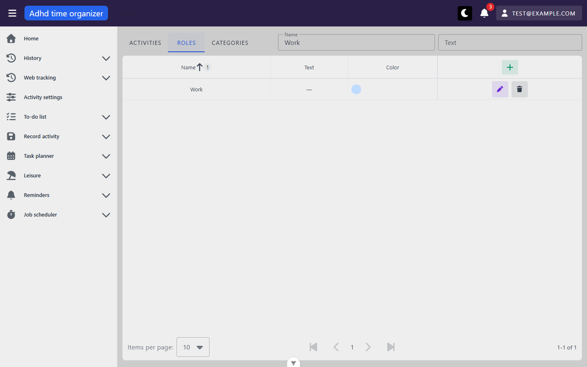
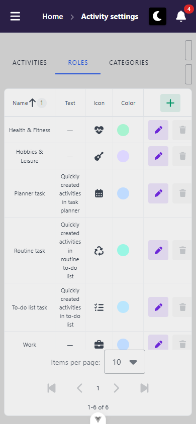
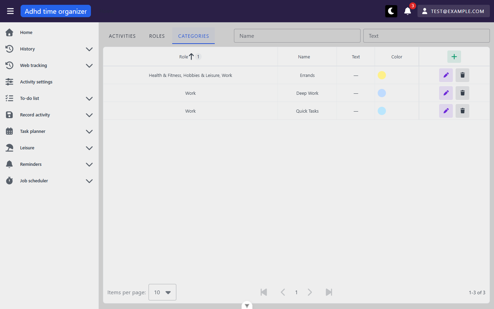
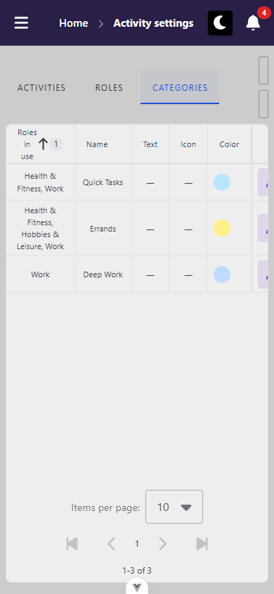

# activity-settings — inventory

> Captured 2026-09-13, mutation pass 2026-09-15 · locale EN · account `test@example.com` · commit `04c405e9`

> **Seed note (round 1):** this unit's draft e2e spec run mid-pass triggered `e2e/global-setup.ts`'s
> `POST /api/test/seed`, resetting the account to fixture `e2e-v3` — done while two other view-docs units
> were running in parallel, which CLAUDE.md warns against (see the operator note in `findings.md`). Once
> those two units finished, this pass re-verified every bug/a11y/polish finding below in a fresh session
> against the reseeded account: **every one reproduced identically**, including the exact seeded ids/names
> quoted (`e2e-v3` reuses the same deterministic ids as the fixture in effect during the first session), so
> nothing below needed correcting. A couple of previously-`unverified` items were also resolved in that
> second session — see `findings.md`'s round `1b`.

> **Mutation pass note (round 2, 2026-09-15):** fixture had moved on again to `e2e-v4` (same id scheme,
> `test@example.com` / id `10001` unchanged). Ran the full Activity lifecycle (create → edit → archive →
> unarchive → merge → delete) and confirmed it end-to-end — all correct, see `findings.md` round 2. The same
> attempt for Role/Category surfaced a new blocker: **create and edit are completely broken for both tabs**
> (`findings.md` X1). The auth state file (`e2e/.state/auth-10001.json`) had a dead refresh token at the start
> of this round and had to be replaced by a fresh login through the form — `.playwright-cli/auth.json` now
> holds a good session for anyone continuing from here. This round deliberately did **not** reseed afterward
> (see the operator note in `findings.md`); the account has one residual change — the seeded activity "Unused
> Idea" (id 12012) was deleted during delete-lifecycle testing and was not restored.

All three views share one component, `ActivitySettingsView.vue`, and one shell (tabs + filter bar). Per
`docs/views/_shell/inventory.md`, the top bar/sidebar/user menu/notification bell/dialog host are not
redescribed here — only the breadcrumb, which behaves differently on this unit's non-default tabs (see
Findings B6), and an invalid `:tab` value, which this unit's route regex makes reachable in a way the shell
pass never exercised (see Findings B5).

## Views

### Activities tab (`/activity-settings/activities`)

**Route:** `/activity-settings/:tab(activities|roles|categories)` · params: `tab: 'activities' | 'roles' |
'categories'`, constrained by a route-path regex and resolved from `route.params.tab` as a prop · guard: auth
(no `public: true` in route meta; redirected to `/login` when signed out, confirmed mid-pass when the access
token expired — see Console & network)
**Reached from:** sidebar "Activity settings" link (only entry point in the nav tree); `/activity-settings`
itself redirects here (confirmed: `path: '/activity-settings', redirect: '/activity-settings/activities'`)
**Invalid param tried:** `/activity-settings/nonsense` — the route regex rejects it (no route matches), so
Vue Router renders nothing for `<RouterView>`: sidebar and top bar render, the main content area is a blank
grey panel, no breadcrumb segment beyond "Home" (plain text, not even a link), and the console logs 24
`[Vue Router warn]: No match found` warnings (1 for the real path, 23 more repeating for an empty-string
path). See Findings B5.

**Actions**
| label | kind | selector | does | destination |
| --- | --- | --- | --- | --- |
| Activities / Roles / Categories | tab | `getByRole('tab', { name: … })` | Switches the active table + filter bar; each tab keeps its own filter state independently (see URL & persisted state) | in place |
| Name | text input | `getByRole('textbox', { name: 'Name' })` | Filters by name, substring, debounced 300ms | in place |
| Text | text input | `getByRole('textbox', { name: 'Text' })` | Filters by description text, debounced 300ms | in place |
| Roles | multi-select combobox | `getByRole('combobox', { name: 'Roles' })` | Picks one or more roles to filter by (chips), or free-typed text as a fallback role-name filter; applies immediately, no debounce | in place |
| Categories | multi-select combobox | `getByRole('combobox', { name: 'Categories' })` | Same as Roles, for categories | in place |
| Active / Archived / All | 3-way toggle | `getByRole('button', { name: 'Active'\|'Archived'\|'All' })` | Switches the lifecycle-state filter; applies immediately | in place |
| Name column header | sortable header | `getByRole('columnheader', { name: 'Name' })` | Sorts by name (ascending by default, the only pre-sorted column) | in place |
| Records column header | sortable header | `getByRole('columnheader', { name: 'Records' })` | Sorts by `usageCount` | in place |
| Role / Category / Text / Unavoidable column headers | header, **not sortable** | n/a | `TableColumn(..., false)` in `ActivityTable.vue:178-181` | — |
| "+" (Add) | icon button, header | `getByRole('button', { name: 'Add' })` | Opens the create-activity dialog (`ActivityForm`) | dialog |
| pen icon | icon button, row | `getByRole('button', { name: 'Edit' })` (title-based) | Opens the edit-activity dialog, prefilled | dialog |
| archive/unarchive icon | icon button, row | `getByRole('button', { name: 'Archive'\|'Unarchive' })` (title-based) | Toggles `isArchived`; no confirmation (reversible); success snackbar; row re-fetches | in place |
| trash icon | icon button, row | **no accessible name — see Findings A1** | Deletes the activity; disabled unless `canDelete`; when enabled, shows a confirm dialog first | in place |
| row checkbox | checkbox | `getByRole('checkbox')` per row | Selects the row for merge; selection is cached across pages (survives paging away and back) | in place |
| header checkbox | checkbox | `getByRole('columnheader').getByRole('checkbox')` | Select/deselect all rows on the current page | in place |
| "Merge" (appears once ≥1 row selected) | button | `getByRole('button', { name: 'Merge' })`, disabled until 2+ selected | Opens `MergeActivitiesDialog` with the selected activities | dialog |
| "Unselect" | button | `getByRole('button', { name: 'Unselect' })` | Clears the selection | in place |
| Items per page | select | `getByRole('combobox')` in table footer | Changes page size (client control, server-paginated request) | in place |
| pagination arrows | buttons | `getByRole('button', { name: 'Next page'\|'Previous page'\|'First page'\|'Last page' })` | Server-side pagination | in place |

**Readable surfaces**
| surface | kind | contents | raw/derived | populated by |
| --- | --- | --- | --- | --- |
| Activities table | server-paged table | Name, Role, Category, Text, Unavoidable, Records (`usageCount`) | raw, except Role/Category which are nested response objects rendered by `.name` | `POST /api/activity/grid` |
| Archived-row indicator | icon + dimming | box-archive icon before the name, row opacity 0.55 | derived (`item.isArchived`) | same response |
| Records count | number | how many rows across the app reference this activity | raw (`usageCount`) | same response |
| Delete-disabled tooltip | tooltip | explains why delete is blocked | derived (`canDelete`) | same response |
| "Selected: N" banner | text | count of currently-selected activities | derived, client-side (selection Map) | n/a |

**States**
- empty (no activities at all): "An activity is the thing you record — one entry for something you do
  repeatedly." + inline "Create new activity" action (confirmed by screenshot)
- empty (filtered, e.g. Archived view with nothing archived): confirmed (mutation pass round 2, by
  temporarily un-archiving the seed's one archived activity) — renders `t('activities.archive.noneArchived')`
  ("Nothing has been archived yet.") with no create button, correctly distinct from the unfiltered empty copy.
  See Findings U1 (resolved).
- loading: not independently captured (requests resolve fast against local seed data)
- error: not triggered (a forced 4xx/5xx on `/api/activity/grid` was not attempted)

**URL & persisted state**
- `name`, `text` — debounced 300ms into the query, `router.replace` (confirmed no history-stack growth from
  repeated edits, by code read of `syncUrl()`); **survive reload** (confirmed)
- `roleIds`, `categoryIds` (comma-joined ids), `roleName`, `categoryName` (free text) — applied immediately;
  **do NOT survive a fresh/direct navigation** — silently dropped on load. See Findings B1 (this is a
  frontend bug, distinct from B2 below).
- `archived` (`archived` | `all`, omitted for the default `active` view) — survives reload (confirmed)
- Switching tabs drops the outgoing tab's query params from the URL, but **each tab's filter state survives
  in memory** for the rest of the session (confirmed: set Roles' Name filter → Categories tab, clean → back
  to Roles, filter restored) — reload loses it, as expected for in-memory state
- Browser back: confirmed collapsing — three sequential `fill()` edits to the Name filter (`r` → `re` →
  `read`) followed by one `go-back` landed on the navigation *before* the filtering started (the previously
  visited Categories tab), not on an intermediate `r`/`re` state, matching `router.replace`'s "one step, not
  three" requirement from `A5-url-state-and-filtering.md`.

**Dialogs opened from here**
- **Create/Edit activity** (`ActivityForm` → reuses `ActivitySelectionForm`'s field set): Role picker (with
  inline "Add new role"), Category picker (with inline "Add new category"), "Activity" name field, "Activity
  description" field, "Is activity unavoidable" checkbox. Cancel/Create buttons. Title reads "Create new
  activity" / editing reads "Edit Activity". **Confirmed end-to-end (mutation pass round 2):** empty-form
  submit shows "This field is required" on Role and Activity; a valid submit creates the row (confirmed via
  filter, since a new row sorts wherever its name lands alphabetically, not necessarily onto page 1); editing
  an existing row prefills every field correctly and the table re-fetches on Save. Archive/Unarchive round-trip
  confirmed (dims the row, moves it between the Active/Archived views, success snackbar fires, no
  confirmation — reversible). Full create→edit→delete cycle produces zero console errors.
- **Merge activities** (`MergeActivitiesDialog`): radio-select the survivor from the selected rows (each
  option shows role · category · records count), a warning banner stating the exact merge consequence ("1
  activity and 3 records will be merged into 'Bug Fixing'. This cannot be undone." — text is dynamic per
  selection) plus a note that overlapping references count once. Cancel/Merge buttons. Matches
  `A9-archive-and-merge.md`'s spec closely, including the "fewer records may move than the total suggests"
  nuance. **Confirmed end-to-end (mutation pass round 2):** merging two test activities opens a **second**,
  separate "Merge confirmation" dialog on top of this one (`useDialog().confirm()`) before the request fires —
  a genuine double-confirmation for an irreversible action, not a duplicate. The request succeeds, the
  selection and merge banner clear, the survivor remains in the table and the merged-away row is gone.
  `screenshots/activities--merge-dialog-mutation.png`.

**Keyboard**
- Not exhaustively walked (tab-order audit is the shell's job per `docs/views/_shell/inventory.md`); the
  dialogs opened normally on click and closed on their Cancel button. Escape-to-close was not retested here —
  `docs/views/_shell/inventory.md` A1 already documents that `MyDialog` defaults to `persistent: true` and
  does not close on Escape app-wide; nothing observed in this unit contradicts that baseline.

**Console & network**
- errors/warnings: a burst of `401`s + `AxiosError` on `/api/activity/grid`, `/api/auth/refresh`,
  `/api/routine/settings` was observed once, mid-pass, when the loaded storage-state's tokens expired —
  matches the documented "first-load 401 burst, clears on refresh" pattern in CLAUDE.md/README, **except**
  that on this occasion the refresh did not recover and the very next `reload` bounced to `/login` instead.
  Re-signed in via the login form (worked cleanly). Not re-investigated further — plausibly just the
  storage-state's tokens being past both the access- and refresh-token TTL by the time this pass reached it,
  rather than a defect (see Findings U4).
- non-2xx: none from in-app interaction other than the above.
- duplicate requests: **`POST /api/activity/grid` fires twice on every mount of this tab** — one
  `net::ERR_ABORTED`, one 200 — reproduced 3 times (initial load, one `goto`, one `reload`). See Findings B3.

**Narrow viewport (390 × 844)** · checked 2026-10-06 · commit `27dd210b`

- layout: the tab bar fits on one row (8–312, no scroll arrows). The filter group can't wrap below the tabs, so it starts at x 368 and runs to 612 (B10). The table takes the card's full width and scrolls sideways in its own `v-table__wrapper` (693/372), as designed. About 6 rows show above the pager.
- mobile-only controls: none (no breakpoint logic anywhere in `src/core/activity`)
- replaced controls: none
- overflow: `docScroll 390`, but `main .v-container` is 612/390 (`div.d-flex.flex-wrap.ga-2 → 612`), so the page content pans 222 px sideways (B10). `table → 702` is inside the table's own scroller (fine).
- visual sweep: Name/Roles/Categories/Active show only as 22 px slivers at the right edge (B10). Add (+) and the row actions are off-screen until the table is swiped (P3). After the swipe, Edit and Archive (40×40) hit-test correctly, and the disabled Delete is greyed as intended (`activities--mobile-actions.png`). Create dialog fits (24–366 × 128–716, Cancel/Create visible, `activities--mobile-create-dialog.png`). Merge dialog not opened (needs ticked row checkboxes, and this pass is read-only). Console clean.

---

### Roles tab (`/activity-settings/roles`)

**Route:** same route, `tab: 'roles'` · guard: auth
**Reached from:** in-page tab control only — no sidebar or breadcrumb entry (confirmed: `navItems.ts` only
registers the `activities` path)

**Actions**
| label | kind | selector | does | destination |
| --- | --- | --- | --- | --- |
| Name / Text | text inputs | `getByRole('textbox', { name: … })` | Filters, debounced 300ms, own state independent of Activities/Categories tabs | in place |
| Name column header | sortable header | — | Sorts by name | in place |
| Text / Color column headers | headers, not sortable | — | — | — |
| "+" (Add) | icon button | `getByRole('button', { name: 'Add' })` | Opens create-role dialog | dialog |
| edit icon | icon button, row | title=`"edit"` (lowercase — see Findings B4) | Opens edit-role dialog | dialog |
| delete icon | icon button, row | title=`"delete"` (lowercase — see Findings B4) | Opens a generic confirm dialog, then deletes — **never disabled**, even for a system role or one with `canDelete: false` (see Findings B7) | in place |

**Readable surfaces**
| surface | kind | contents | raw/derived | populated by |
| --- | --- | --- | --- | --- |
| Roles table | server-paged table | Name, Text, Color (swatch) | raw | `POST /api/activity-role/grid` |
| Color swatch | 24×24 rounded chip | the role's colour, or "—" if none | raw | same response |

**States**
- empty: `TableEmptyState` with `t('activities.noRolesInTable')` + "Add new role" action — not independently
  triggered (seed has roles), confirmed only by code read.
- loading/error: not triggered.

**URL & persisted state**
- `name`, `text` only (`NameTextFilter` — no id-based filters on this tab). Survive reload (confirmed).
  Cleared from the URL on tab-away, restored from memory on tab-back (confirmed).

**Dialogs opened from here**
- **Create/Edit role** (`ActivityRoleForm`): Name (required, with a diacritics/special-chars rule), Text
  (textarea), Color (a swatch `radiogroup`, one option pre-selected by default), Icon (`IconPicker`, renders
  as a labelled textbox with a picker button). Title "Add new role" / "Edit role" — confirmed by opening it
  (`screenshots/roles--create-dialog.png`). The 6 rows visible behind the dialog (3 user roles, 3 system
  roles) render identically — no badge or visual marker distinguishes a system role from a user-created one
  anywhere in this list, including inside this dialog's own Role picker used elsewhere (system roles are
  selectable exactly like user roles when creating an Activity). **Submitting this dialog is completely
  broken (mutation pass round 2) — both Create and Edit 400 on the Color field. See Findings X1.** Deleting a
  role opens a generic confirm dialog that names the row by its **raw numeric id**, not its name — see
  Findings B8. Confirmed (round 2) that attempting to delete a system role ("Planner task") is correctly
  refused server-side with a 409 and a specific message, though the message itself is masked by a separate bug
  (B9) and the row is never actually removed — see Findings U2 (resolved) and B7 (still open: the client never
  disables the button for this case in the first place).

**Keyboard:** not independently walked; no unit-specific deviation observed.

**Console & network**
- errors/warnings: none specific to this tab beyond the shared 401 incident above.
- non-2xx: none.
- duplicate requests: **none** — unlike the Activities tab, this tab's filter object has no comboboxes to
  rebuild on mount, and only one `POST /api/activity-role/grid` fires per load (confirmed by inspecting the
  request log around the tab's first render).

**Narrow viewport (390 × 844)** · checked 2026-10-06 · commit `27dd210b`

- layout: tabs fit. The table fits almost entirely (`v-table__wrapper` 382/372): Add (319–359) and each row's Edit/Delete (295–383) are visible without a swipe. Long "Text" cells wrap to five lines.
- mobile-only controls: none
- replaced controls: none
- overflow: none at page level (`.v-container` 390/390). Name and Text filters are crushed to 14 px (368–382) instead (B10).
- visual sweep: the two filters appear as thin outlined slivers at the top right with no label (B10). Table rows read cleanly. Console clean.

---

### Categories tab (`/activity-settings/categories`)

**Route:** same route, `tab: 'categories'` · guard: auth
**Reached from:** in-page tab control only

**Actions**
| label | kind | selector | does | destination |
| --- | --- | --- | --- | --- |
| Name / Text | text inputs | `getByRole('textbox', { name: … })` | Filters, debounced 300ms, own state | in place |
| Role column header | sortable header | — | Sorts by the (derived — see below) role string | in place |
| Name / Text / Color column headers | mixed | Name is not sortable here (only Role is, per `TableColumn` args in `ActivityCategoryTable.vue:58-62`) | — | — |
| "+" / edit / delete | icon buttons | same pattern as Roles tab | Create/edit/delete a category — delete is likewise **never disabled** regardless of `canDelete` (Findings B7) | dialog / in place |

**Readable surfaces**
| surface | kind | contents | raw/derived | populated by |
| --- | --- | --- | --- | --- |
| Categories table | server-paged table | Role, Name, Text, Color | Role is **derived**: a comma-joined list of every distinct role name among the category's current activities, not a stored foreign key — see Findings P1 | `POST /api/activity-category/grid` |

**States**
- empty: `t('activities.noCategoriesInTable')` + "Add new category" — not independently triggered.

**URL & persisted state:** `name`, `text` only, same behaviour as Roles.

**Dialogs opened from here:** **Create/Edit category** (`ActivityCategoryForm`): Name, Text, Color, Icon —
same field set as the role form minus the diacritics rule, and, confirmed by opening it
(`screenshots/categories--create-dialog.png`), **no Role field of any kind** — reinforcing Findings P1: a
category genuinely cannot be assigned a role anywhere in the UI. **Submitting this dialog is completely
broken (mutation pass round 2), identically to the Roles tab — see Findings X1**
(`screenshots/categories--create-400-bug.png`). Delete confirmation has the same raw-id bug as Roles (Findings
B8).

**Keyboard:** not independently walked.

**Console & network:** same pattern as Roles — one `POST /api/activity-category/grid` per load, no
duplicates observed.

**Narrow viewport (390 × 844)** · checked 2026-10-06 · commit `27dd210b`

- layout: same as Roles. The table scrolls sideways in its wrapper (454/372); "Roles in use" wraps to four lines.
- mobile-only controls: none
- replaced controls: none
- overflow: none at page level. Name and Text filters are 14 px slivers (B10). Add (391–431) and Delete (415–455) are off-screen until the table is swiped, and Edit starts at 367 (P3).
- visual sweep: the three seeded rows read cleanly. Create dialog fits (24–366 × 112–732, colour swatches in a 7-wide grid, Cancel/Create visible, `categories--mobile-create-dialog.png`). Console clean.

## Transitions out of this unit
| from | control | goes to |
| --- | --- | --- |
| Activities tab | "Add new role" (inline, inside the create-activity dialog) | opens `ActivityRoleForm` in a nested dialog — stays on this unit, does not navigate |
| Activities tab | "Add new category" (inline) | same, `ActivityCategoryForm` nested dialog |
| (none) | — | No control in this unit navigates to a route outside `/activity-settings/*`. The only way out is the sidebar/top-nav, which is shell-owned. |
