# auth — inventory

> Captured 2026-09-14 (round 1, inventory) · updated 2026-09-15 (round 2, mutation pass) · updated 2026-09-15
> (round 3, scoped retest of `ForgottenPasswordView` and `RegistrationView` only, after X1/X2 were fixed in
> the `src/_common` submodule working tree) · locale EN · account `test@example.com` (+ `test2@example.com`
> for the logout check; round 2 additionally used two disposable throwaway accounts created via a direct-API
> workaround; round 3 used two further disposable throwaway accounts created through the real UI now that X2
> is fixed — all wiped by end-of-pass reseeds, see findings.md's round 2 and round 3 entries) · commit
> `50bd6b0d` + uncommitted `src/_common` changes (round 3)

Shell baseline: see `docs/views/_shell/inventory.md`. All five views here render the **signed-out** shell —
no sidebar, no notification bell, no user menu — just the logo link and the dark-mode toggle. That is a real
difference from the baseline (documented there for the signed-in case) and is not re-documented per view
below; it is consistent across all five.

## Views

### LoginView (`/login`)
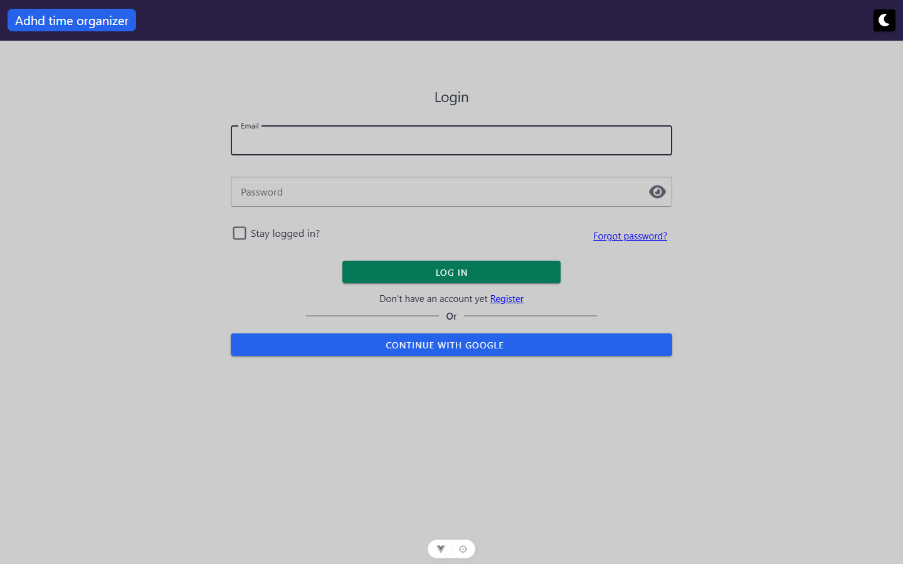

**Route:** `/login` · params: none · guard: `public`, and additionally bounced to `/` if already
authenticated (`SIGNED_OUT_ONLY_ROUTES` in `router.ts:79`)
**Reached from:** the router guard's default-deny (`router.ts:98`, any unauthenticated visit to a
non-public route); "Forgot password?" is not a path back here, "Register" is; the top-level login link is
not in the nav (signed-out shell has no nav)

**Actions**
| label | kind | selector | does | destination |
| --- | --- | --- | --- | --- |
| Email | input | `getByRole('textbox', { name: 'Email' })` | text entry, autofocused unless redirected from registration | in place |
| Password | input | `getByRole('textbox', { name: 'Password' })` | text entry, masked | in place |
| (eye icon) | icon-only button | `getByRole('button', { name: 'Password appended action' })` | toggles password visibility | in place — **a11y**, see A1 |
| Stay logged in? | checkbox | `getByRole('checkbox', { name: 'Stay logged in?' })` | sets `loginRequest.stayLoggedIn` | in place |
| Forgot password? | link | `getByRole('link', { name: 'Forgot password?' })` | navigates | `/forgotten-password` |
| Log in | button | `getByRole('button', { name: 'Log in' })` | validates, executes recaptcha, `POST /auth/login` | `/` on success, or 2FA dialog, or stays with a snackbar. **Round 2:** successful login with the real seeded account lands on `/` even from a deep-link visit (B1, re-confirmed); a genuinely unconfirmed throwaway account gets a generic 401 "Invalid email or password" instead of the dedicated "email not confirmed" UX — see B6 |
| Register | link | `getByRole('link', { name: 'Register' })` | navigates | `/registration` |
| Continue with google | button | `getByRole('button', { name: 'Continue with google' })` | opens Google OAuth (not followed in this pass) | external |
| Enter key (password field focused) | keyboard | — | submits the form, same as Log in | same as Log in — verified |

**Readable surfaces**
| surface | kind | contents | raw/derived | populated by |
| --- | --- | --- | --- | --- |
| Error snackbar | text | one of: raw `generalErrors[0]` from the server, or a localized string for the recognised branches (wrong password, locked-out, unconfirmed e-mail), or the interceptor's generic map | raw (server string) or localized (recognised branches) | `POST /auth/login` response body / status. **Round 2:** the "unconfirmed e-mail" branch (403) was live-tested with a real unconfirmed account and never fired — the server returns 401 "Invalid email or password" instead, so this branch is currently dead code — see B6 |
| "Resend confirmation email" panel | conditional block | shown after an unconfirmed-email 403, or right after registration | derived (a boolean flag) | client-side only |

**States**
- empty: n/a (no list)
- loading: full-screen spinner during the request (`showFullScreenLoading()`/interceptor-hide on success);
  `axiosSuccessLoadingHide` is explicitly disabled here so the view's own `.finally()` hides it — verified,
  no stuck spinner
- error: red snackbar, one of several messages — see Actions/Readable surfaces above; verified live with a
  wrong password ("Wrong email or password") and with an unrecognised-server-string 400 during the
  forgotten-password test (same interceptor path)

**URL & persisted state**
- No query params read on entry in the normal case. On a forced 401 logout the interceptor *sets*
  `?redirect=<path>` (`_common/axiosConfig.ts:175`), but nothing on this view, nor the router guard's own
  redirect, ever reads it back — see Findings B1.
- `userStore.userName` (from the Pinia `user` store, sessionStorage-persisted) prefills the e-mail field when
  set — not independently re-verified beyond the store persisting normally.

**Dialogs opened from here**
- 2FA one-time-code dialog (`LoginVerifyQrCode.vue`) — not reachable, no seeded account has 2FA enabled; see
  Findings U2.

**Keyboard**
- Enter in the password field submits — verified.
- Tab order follows visual order (email → password → eye icon → stay-logged-in → forgot-password →
  log-in → register link → google button) per the accessibility snapshot; not separately timed.

**Console & network**
- errors/warnings: `VITE_RECAPTCHA_SITE_KEY is not set` warning on every submit (expected per CLAUDE.md;
  not filed as a finding)
- non-2xx: `POST /auth/login` → 401 with body `{"errors":{"generalErrors":["Invalid email or password"]}}`
  on a wrong password — handled correctly (see usecase.md)
- duplicate requests: none observed. Exactly one `GET /api/user/data` fires after a successful login — the
  F3 hydrate-on-login fix is confirmed working, no duplicate hydrate call.
- a stray `console.log(valid)` (`LoginView.vue:142`) fires on every submit attempt — harmless but a dev
  leftover; not filed as its own finding, noted here for completeness.

---

### RegistrationView (`/registration`)
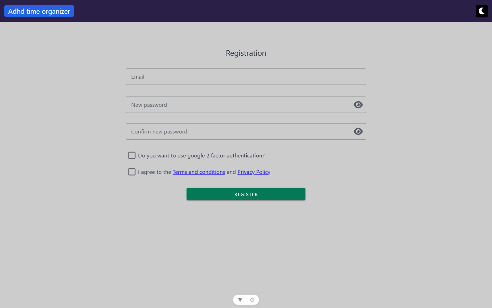

**Route:** `/registration` · params: none · guard: `public`, bounced to `/` if already authenticated

**Reached from:** LoginView's "Register" link

**Actions**
| label | kind | selector | does | destination |
| --- | --- | --- | --- | --- |
| Email | input | `getByRole('textbox', { name: 'Email' })` | text entry, validated | in place |
| New password | input | `getByRole('textbox', { name: 'New password', exact: true })` | masked entry, validated (required, length) | in place |
| Confirm new password | input | `getByRole('textbox', { name: 'Confirm new password' })` | masked entry, validated against New password | in place |
| (eye icons ×2) | icon-only buttons | `getByRole('button', { name: 'New password appended action' })` / `'Confirm new password appended action'` | toggle visibility | in place — same **a11y** defect as Login's, see A1 |
| (clear icons ×3) | icon-only buttons | `getByRole('button', { name: 'Clear Email' })` etc. | clears the field | in place — accessible names here are fine (Vuetify derives them from the label) |
| Do you want to use google 2 factor authentication? | checkbox | `getByRole('checkbox', { name: 'Do you want to use google 2 factor authentication?' })` | sets `twoFactorEnabled` | in place |
| I agree to the… | checkbox | `getByRole('checkbox', { name: 'I agree to the' })` | required-true validation | in place |
| Terms and conditions | link | `getByRole('link', { name: 'Terms and conditions' })` | navigates | `/legal/terms` (outside unit — resolves correctly, F4 confirmed fixed) |
| Privacy Policy | link | `getByRole('link', { name: 'Privacy Policy' })` | navigates | `/legal/privacy` (outside unit — resolves correctly) |
| Register | button | `getByRole('button', { name: 'Register' })` | validates, executes recaptcha, `POST /auth/register` | `/login` (non-2FA) or QR dialog (2FA) — **round 3: X2 fixed, now reachable through the real UI.** Filled a valid form and clicked Register: `POST /auth/register` → **200**, view navigated to `/login` with the prefill/autofocus/resend-panel state (see U5, resolved). A second throwaway with 2FA checked opened the QR dialog in place instead (see below and B8) |

**Readable surfaces**
| surface | kind | contents | raw/derived | populated by |
| --- | --- | --- | --- | --- |
| Inline field errors | text | "Email is required" / "Password is required" / "Must accept before proceeding" / `user.passwordsDontMatch` (raw key — see B2) | derived, client-side rules | `RulesComposition.ts` / `MyNewPasswordInput.vue` |
| Error snackbar | text | "reCAPTCHA verification failed" (client-side guard) or `handleHttpCodes` map (server errors) | derived / mapped | client guard or `POST /auth/register` response |

**States**
- empty: n/a
- loading: full-screen spinner, hidden correctly in both the success and catch branches (`hideFullScreenLoading()` called explicitly in both, `RegistrationView.vue:147,167`) — no stuck-spinner risk here, unlike the two confirm views (see B-series below)
- error: validation errors (screenshot below) and the recaptcha-guard snackbar (screenshot below, **round 3: this snackbar no longer fires on a valid form now that X2 is fixed** — the guard it came from was removed; kept here as historical record of the round-2 state). **Round 3:** the server-side error path is now reachable — registering the same e-mail twice returned **409**, confirmed via the network panel and a logged `AxiosError` console entry (`handleHttpCodes(error.response?.status)` is the code path per source; the resulting snackbar's exact copy was not read back this round, only the network/console evidence)

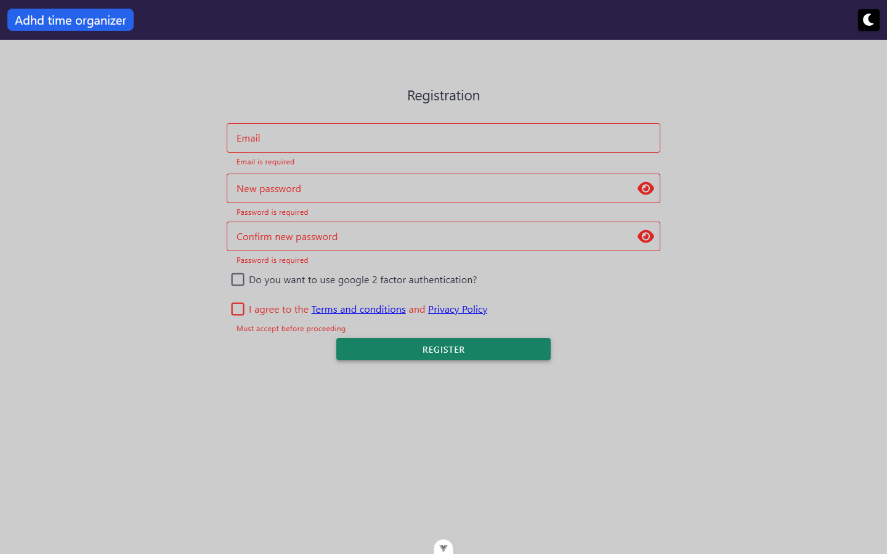
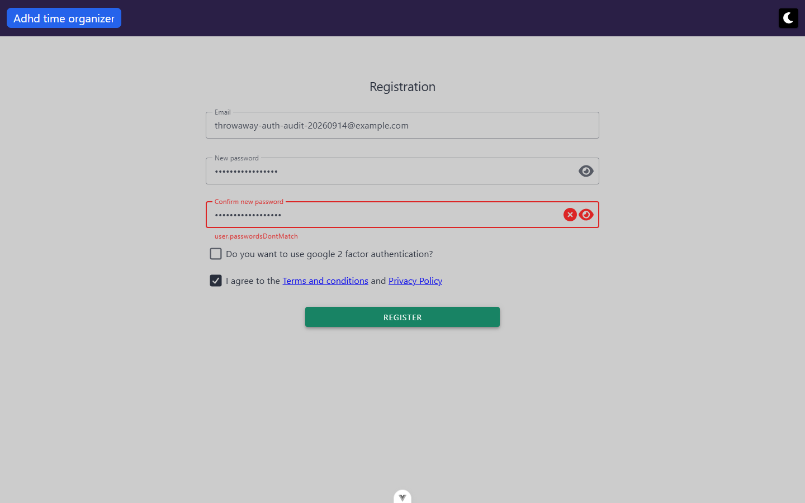
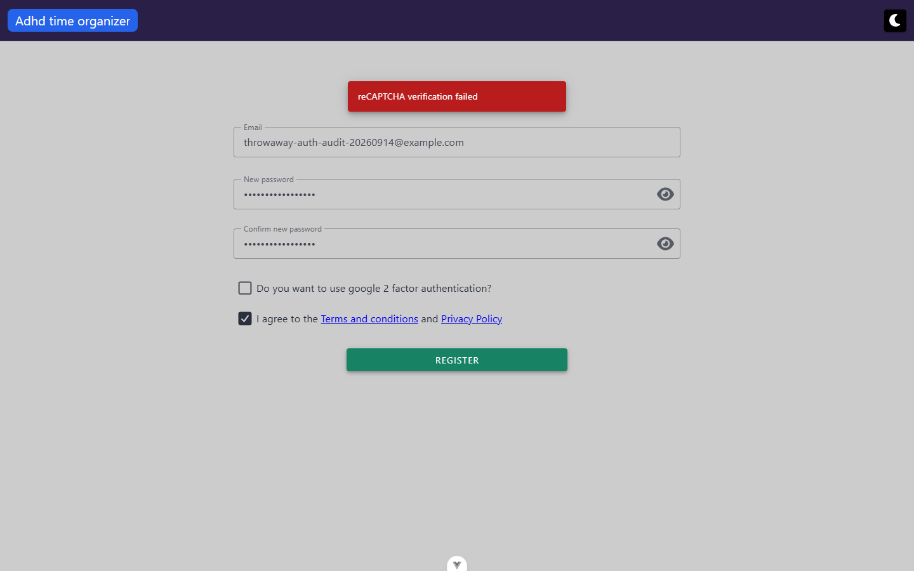
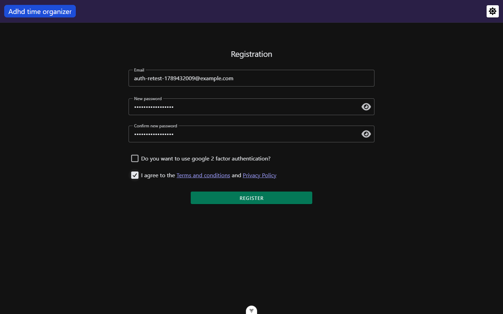
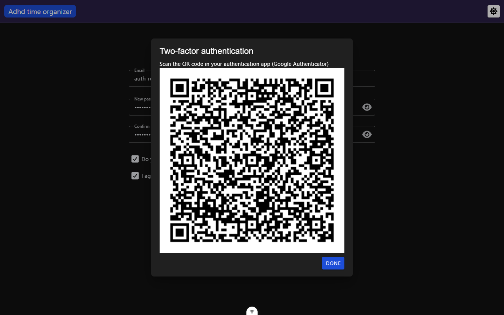

**URL & persisted state**
- None read or written.

**Dialogs opened from here**
- 2FA QR-code dialog (`QrCodeFor2FABody.vue`) — **round 3: now reachable through the real UI**, X2 fixed.
  Registered a throwaway with "use 2FA" checked: `POST /auth/register` returned 200 with a populated
  `recoveryCodes` array alongside the `qrCode`, and the dialog that opened shows only the heading, the
  instruction text and the QR image — no recovery codes anywhere on screen, confirmed live in both the
  accessibility snapshot and a screenshot read back for the visual sweep
  (`docs/views/auth/screenshots/registration--2fa-qr-dialog-no-recovery-codes.png`). Clicking "Done" closes
  the dialog and navigates to `/login` — no follow-up screen shows the codes either. This is now a
  browser-confirmed bug, **B8** (renumbered from round 1/2's `U1`).

**Keyboard**
- Not separately verified beyond Tab order matching visual order in the snapshot.

**Console & network**
- errors/warnings: `[intlify] Not found 'user.passwordsDontMatch' key in 'EN' locale messages` — fires live
  the moment the two password fields disagree; see B2 (re-verified live again in round 3).
- non-2xx: **round 3 update** — `POST /auth/register` now fires through this view (X2 fixed). Two valid
  submits returned 200 each (one plain, one with 2FA checked); a deliberate duplicate-e-mail submit returned
  409, logged as an `AxiosError` in the console. No `/auth/refresh` request followed the 409 (see B7's round 3
  note — the refresh trigger only fires on 401, and this was 409).
- duplicate requests: none observed across the three round-3 submits (one `/auth/register` request per
  click).

---

### ForgottenPasswordView (`/forgotten-password`)
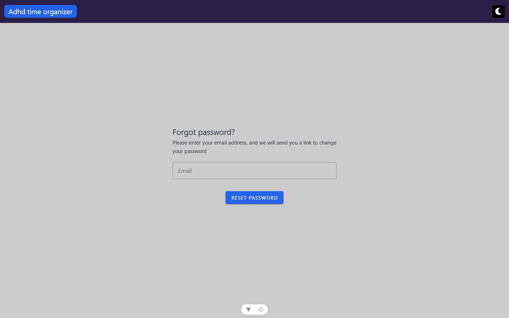

**Route:** `/forgotten-password` · params: none · guard: `public`, bounced to `/` if already authenticated
(`forgottenPassword` is in `SIGNED_OUT_ONLY_ROUTES` — verified live: visiting while signed in redirects to
`/`)

**Reached from:** LoginView's "Forgot password?" link

**Actions**
| label | kind | selector | does | destination |
| --- | --- | --- | --- | --- |
| Email | input | `getByRole('textbox', { name: 'Email' })` | text entry, validated | in place |
| Reset password | button | `getByRole('button', { name: 'Reset password' })` | validates, `POST /auth/forgotten-password` | success dialog — **round 3: X1 fixed, now reached** |

**Readable surfaces**
| surface | kind | contents | raw/derived | populated by |
| --- | --- | --- | --- | --- |
| Error snackbar | text | the server's generic envelope message ("One or more errors occurred!") | raw (interceptor's generic 400 handler, not this view's own catch) | `POST /auth/forgotten-password` response — **round 3: not observed this round**, every attempt returned 204 |
| Success dialog (`MyDialog`, non-closable) | text | "Password reset email has been sent." + instructions | static copy | client-side flag flip on a 2xx — **round 3: confirmed live**, opens on 204 |

**States**
- empty: n/a
- loading: full-screen spinner, hidden correctly in both branches (`.finally()` at `ForgottenPasswordView.vue:76-78`)
- error: **round 3: no longer the only reachable outcome — X1 fixed.** A real seeded e-mail and a nonexistent
  one both returned 204 and opened the success dialog; the error branch (still only handling a 404 per B3,
  unchanged in source) was not exercised live this round since nothing produced a non-2xx response.

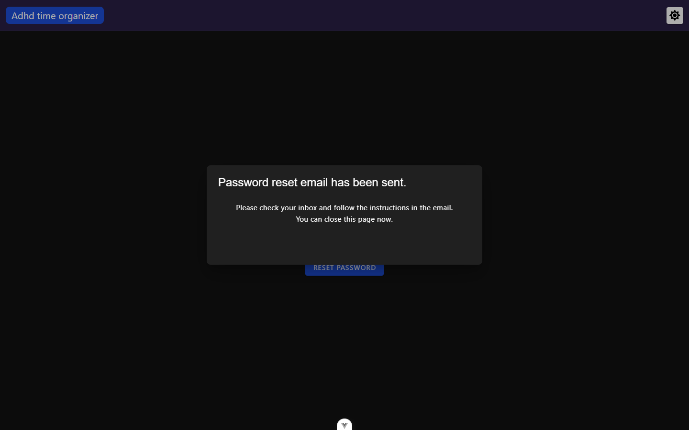

**URL & persisted state**
- None.

**Dialogs opened from here**
- The success `MyDialog` — **round 3: reached live.** Submitted with `test@example.com`:
  `POST /auth/forgotten-password` → 204, dialog opened with the title "Password reset email has been sent."
  and the body "Please check your inbox and follow the instructions in the email. You can close this page
  now." — matches the copy previously read from source. Repeated with a nonexistent e-mail
  (`definitely-not-a-real-user@example.com`): identical 204 and identical dialog — the endpoint does not
  distinguish a real address from a nonexistent one.

**Keyboard**
- Not separately verified.

**Console & network**
- errors/warnings: **round 3:** none — only the expected `VITE_RECAPTCHA_SITE_KEY is not set` warning on
  submit. The round 1/2 `AxiosError`-logged 400 no longer occurs now that `recaptchaToken` is sent.
- non-2xx: **round 3:** none observed — `POST /auth/forgotten-password` → 204 for both a real seeded e-mail
  and a nonexistent one (see X1's round 3 note). No `/auth/refresh` follow-up either (see B7's round 3 note).
- duplicate requests: none observed (one attempt = one request)

---

### ConfirmEmailView (`/confirm-email`)
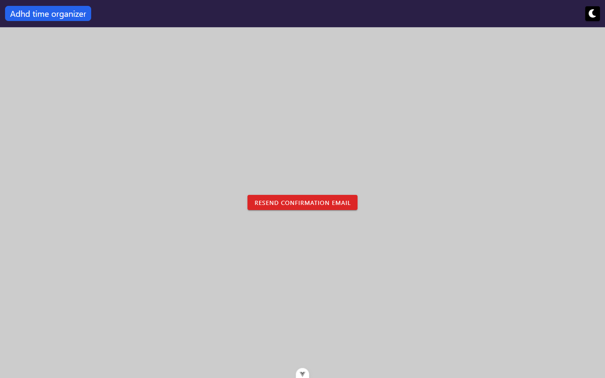

**Route:** `/confirm-email` · params: query, forwarded verbatim as `POST /auth` + the route's `fullPath`
(exact query keys not independently confirmed — no real confirmation e-mail was available this pass) ·
guard: `public` (correctly **not** in `SIGNED_OUT_ONLY_ROUTES`, so a signed-in user confirming a second
device's registration is not bounced away — verified by reading `router.ts:74-77`'s comment, not separately
reproduced signed-in)

**Reached from:** an e-mailed confirmation link only; nothing in the app links here

**Actions**
| label | kind | selector | does | destination |
| --- | --- | --- | --- | --- |
| Go to login | button | `getByRole('button', { name: 'Go to login' })` | navigates | `/login` — **not reached this pass**, success state requires a real token |
| Resend confirmation email | button | `getByRole('button', { name: 'Resend confirmation email' })` | `POST /auth/resend-confirmation-email/:userId` | in place, sets `confirmationEmailResent` |

**Readable surfaces**
| surface | kind | contents | raw/derived | populated by |
| --- | --- | --- | --- | --- |
| Error snackbar (initial confirm) | text | "There was an error confirming your email, please try again" — properly localized | localized | `POST /auth/{fullPath}` catch |
| Error snackbar (resend) | text | literal `Error` — hardcoded, not localized | **raw hardcoded string**, see B5 | `POST /auth/resend-confirmation-email/:userId` catch. **Round 2:** with no `userId` in the URL, this request is sent to the literal path `.../resend-confirmation-email/undefined` and returns 401, which also triggers a spurious `/auth/refresh` attempt — see B5, B7 |
| Error-state body | — | **nothing** — the only content is the Resend button; the explanatory `` is commented out in source (`ConfirmEmailView.vue:19`) | n/a | n/a — see B4 |

**States**
- empty: n/a
- loading: full-screen spinner on mount and on resend; **neither call sets `hideFullScreenLoading` in its
  catch branch** (only the interceptor's success handler hides it). Attempted to reproduce a stuck overlay
  by stalling the request via `playwright-cli route`, but the interception did not actually hold the
  request open (it still resolved), so a genuinely stuck spinner was **not observed live** — recorded as
  unverified rather than a confirmed bug; see the note in findings.md.
- error: reproduced live with no token in the URL — see screenshot above; the request 415s
  (`POST /api/auth/confirm-email` — the server rejects the bodyless/query-only POST). **Round 2:** repeated
  twice more; still no stuck spinner observed after the error state renders (`.v-dialog--fullscreen` absent
  from the DOM both times) — see the updated U6 in findings.md.

**URL & persisted state**
- Query params forwarded to the server; not otherwise read by the component itself. Not tested across a
  reload (there is nothing to reload into — the same 415 recurs, verified).

**Dialogs opened from here:** none.

**Keyboard:** not separately verified (no focus traps possible — no dialog).

**Console & network**
- errors/warnings: one `AxiosError`-logged 415 per load attempt (see above), plus one more per Resend click
- non-2xx: `POST /api/auth/confirm-email` → 415; `POST /api/auth/resend-confirmation-email/:userId` → non-2xx
  (userId is `undefined` with no token in the URL, so this call is malformed by construction — not a
  representative test of the happy path)
- duplicate requests: none observed

---

### ConfirmEmailChangeView (`/confirm-email-change`)
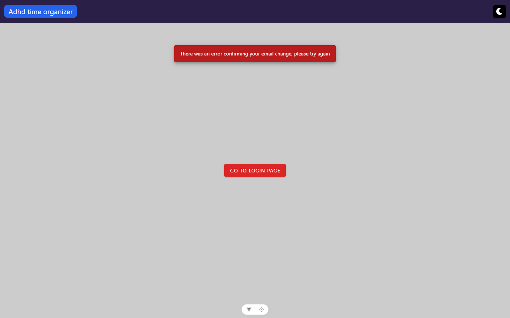

**Route:** `/confirm-email-change` · params: query `userId`, `email`, `token` · guard: `public`, correctly
excluded from `SIGNED_OUT_ONLY_ROUTES` for the same reason as `/confirm-email`

**Reached from:** an e-mailed confirmation link only, sent after requesting an e-mail change in
`/user/settings` (out of this unit)

**Actions**
| label | kind | selector | does | destination |
| --- | --- | --- | --- | --- |
| Go to login (success state) | button | `getByRole('button', { name: 'Go to login' })` | navigates | `/login` — not reached, needs a real token |
| Go to login page (error state) | button | `getByRole('button', { name: 'Go to login page' })` | navigates | `/login` — **verified live** |

**Readable surfaces**
| surface | kind | contents | raw/derived | populated by |
| --- | --- | --- | --- | --- |
| Error snackbar | text | "There was an error confirming your email change, please try again" — properly localized | localized | `POST /user/change-email/confirm` catch |
| Error-state body | — | **nothing persistent** — round 1 recorded static body text here from a screenshot that, on round-2 re-inspection, was the snackbar caught mid-fade; the template has no persistent-text element in this branch at all, same gap as `ConfirmEmailView` | n/a | n/a — corrected in B4 (round 2) |

**States**
- empty: n/a
- loading: same gap as `ConfirmEmailView` — `hideFullScreenLoading` is never called in the catch branch
  (`ConfirmEmailChangeView.vue:55-59`); same inconclusive stall-test result, recorded as unverified rather
  than confirmed.
- error: reproduced live with no query params — request 400s, error state renders only the snackbar
  (transient) and the "Go to login page" button; **round 2 correction:** once the snackbar dismisses, no
  on-page text remains — this view is *not* more complete than `ConfirmEmailView` as round 1 claimed, both
  are equally bare in steady state (see B4)

**URL & persisted state**
- `userId`, `email`, `token` query params read once on mount and posted to the server; not re-read on
  reload beyond the same request repeating (verified: reload reproduces the same 400).

**Dialogs opened from here:** none.

**Keyboard:** not separately verified.

**Console & network**
- errors/warnings: one `AxiosError`-logged 400 per load (`Number(undefined)` for `userId` → `NaN`, sent
  anyway)
- non-2xx: `POST /api/user/change-email/confirm` → 400
- duplicate requests: none observed

## Transitions out of this unit

| from | control | goes to |
| --- | --- | --- |
| LoginView | "Forgot password?" | `/forgotten-password` (in-unit) |
| LoginView | "Register" | `/registration` (in-unit) |
| LoginView | "Continue with google" | Google's OAuth consent screen (external — not followed) |
| LoginView | successful login | `/` (home, outside unit) |
| RegistrationView | "Terms and conditions" | `/legal/terms` (outside unit — visited and returned; renders correctly) |
| RegistrationView | "Privacy Policy" | `/legal/privacy` (outside unit — href confirmed, not clicked separately) |
| RegistrationView | successful registration | `/login` (in-unit) — **round 3: reached live through the real UI**, X2 fixed |
| ConfirmEmailView / ConfirmEmailChangeView | "Go to login" / "Go to login page" | `/login` (in-unit) |
| any guarded route while signed out | router guard default-deny | `/login`, **destination not preserved** — see B1 |
