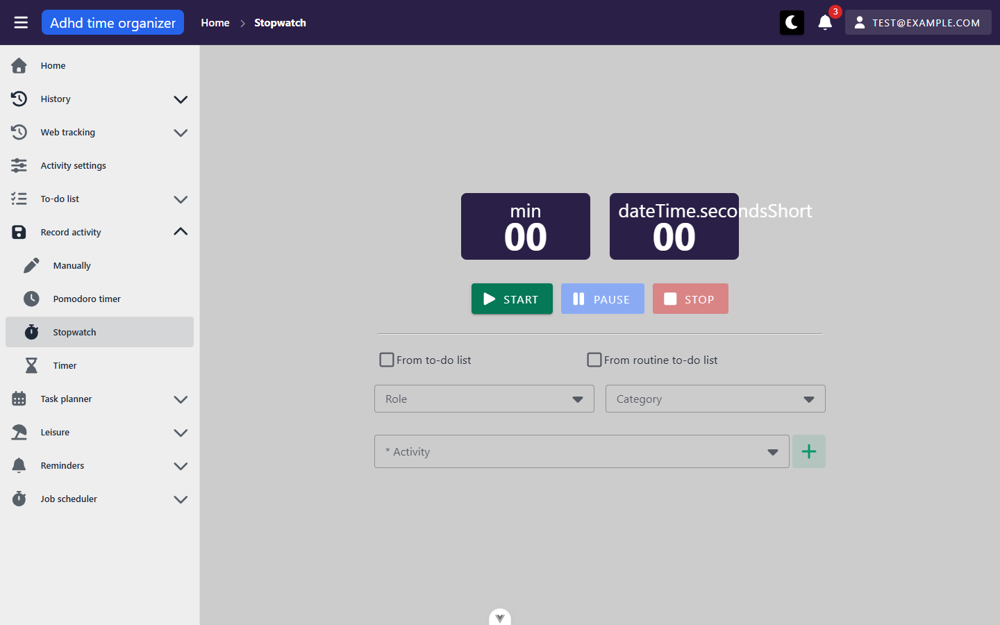
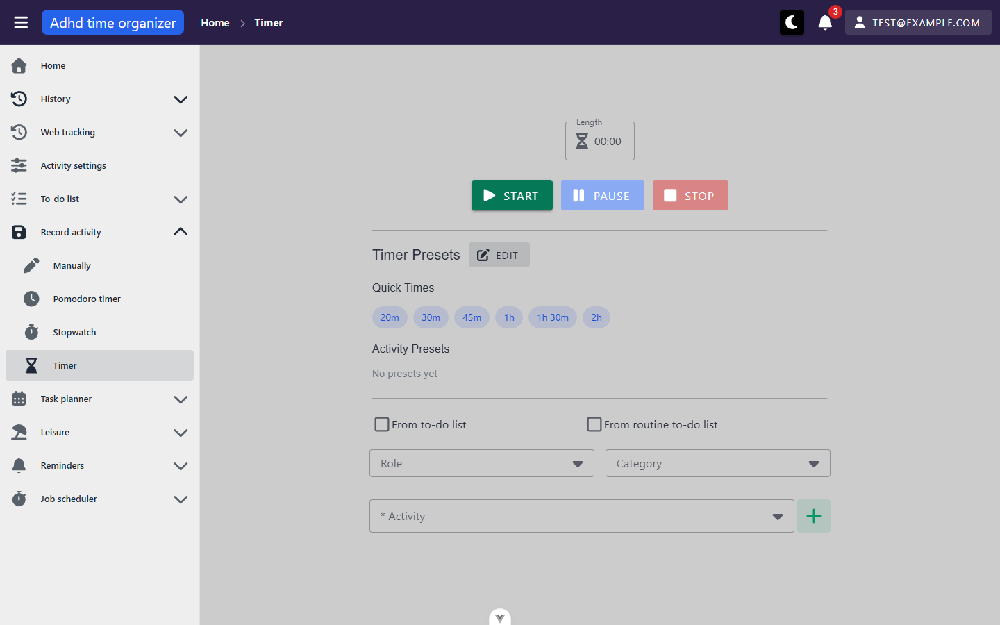
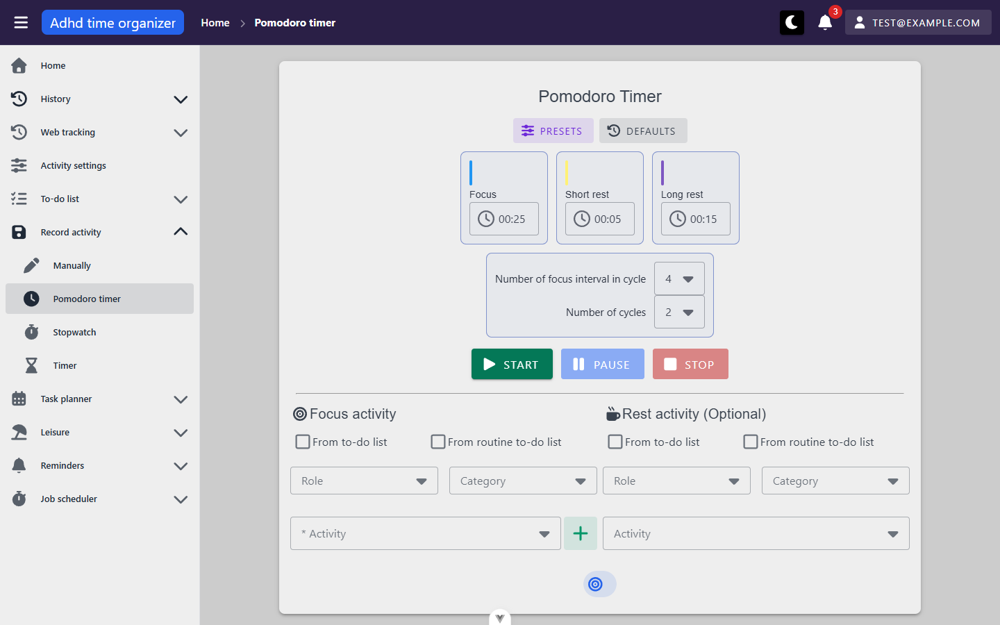
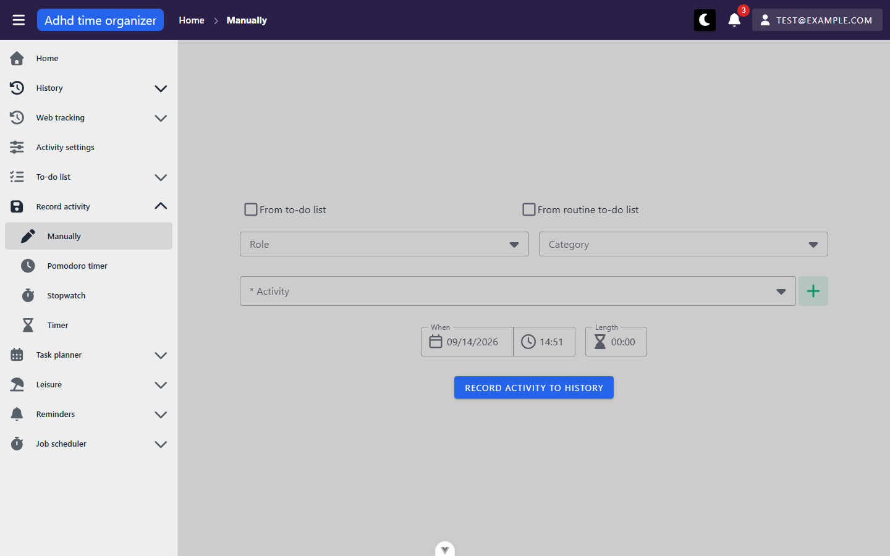

# history-capture — inventory

> Captured 2026-09-14 · locale EN · account `test@example.com` · commit `5e42b813`

## Views

### StopWatchView (`/activity-history/stopwatch`)

**Route:** `/activity-history/stopwatch` · params: none · guard: `auth`
**Reached from:** sidebar "Record activity" › Stopwatch; `NowBar`'s running-session link when the live session is
a stopwatch

**Actions**
| label | kind | selector | does | destination |
| --- | --- | --- | --- | --- |
| Start | button | `getByRole('button', { name: 'Start' })` | validates the activity field, prompts to discard a foreign session if one is running, then starts the stopwatch | in place |
| Pause | button | `getByRole('button', { name: 'Pause' })` | freezes the count, cancels any scheduled alarm (n/a for stopwatch — it has none), unlocks the activity picker | in place |
| Stop | button | `getByRole('button', { name: 'Stop' })` | ends the session and opens the save-to-history confirm dialog | dialog |
| From to-do list | checkbox | `getByRole('checkbox', { name: 'From to-do list' })` | reveals a task-priority select and narrows the activity picker to that list's activities | in place |
| From routine to-do list | checkbox | `getByRole('checkbox', { name: 'From routine to-do list' })` | reveals a routine-time-period select, same narrowing | in place |
| Role | combobox | `getByRole('combobox', { name: 'Role' })` | narrows the activity picker | in place |
| Category | combobox | `getByRole('combobox', { name: 'Category' })` | narrows the activity picker | in place |
| * Activity | combobox | `getByRole('combobox', { name: '* Activity' })` | required; groups options under "Recently used" / "All activities" subheaders once any activity has been picked before | in place |
| Create new activity | button | `getByRole('button', { name: 'Create new activity' })` | opens `ActivityForm` dialog; on success, the new activity is selected | dialog |
| Record new activity → Cancel | button | `getByRole('button', { name: 'Cancel' })` (inside the post-Stop dialog) | discards the elapsed span (no write), clears the session | in place |
| Record new activity → Confirm | button | `getByRole('button', { name: 'Confirm' })` (inside the post-Stop dialog) | writes the `ActivityHistory` row, clears the session | in place |

**Readable surfaces**
| surface | kind | contents | raw/derived | populated by |
| --- | --- | --- | --- | --- |
| Time display | two boxes, `min` / seconds | elapsed time, minute and second digits | derived — `stopwatchElapsedMs` computed from `accumulatedMs` + wall clock against `runningSince` | client tick only, no request |

**States**
- empty: n/a (no list to be empty — idle state is the picker with `00:00`)
- loading: none observed — options load in the background, form usable immediately
- error: activity-required validation shows inline "This field is required" under the Activity field; no
  network error state exercised in this pass (kept read-only)

**URL & persisted state**
- no query params
- `localStorage: runningTimerSession::u<accountId>` — the whole session (kind, timestamps, activity, alarm ids).
  Survives reload and tab close (up to 12h); confirmed by reload mid-run: elapsed at reload matched wall-clock
  time passed since the pre-reload reading (45s → 55s across a ~10s round trip through Home and back)
- `localStorage: activityPickerRecency.v1::u<accountId>` — last-picked activity ids, feeds the "Recently used"
  subheader

**Dialogs opened from here**
- "Record new activity" (`SaveActivityBody` in a `MyDialog`) — text "Confirm saving activity "<name>" - done for
  <length>?", Cancel/Confirm. **Escape does not close it** (confirmed twice) — same framework `persistent=true`
  default as `_shell` finding A1, not re-logged here.
- "Create new activity" (`ActivityForm`) — not exercised beyond opening, to avoid mutating the activity list in
  an inventory pass.

**Keyboard**
- Escape closes the activity-picker dropdown menu (confirmed) but not the save-confirm dialog (confirmed, see
  above)

**Console & network**
- errors/warnings: `[intlify] Not found 'dateTime.secondsShort' key in 'EN' locale messages` — every time this
  view (or Timer/Pomodoro) renders. See finding B1.
- non-2xx: none in this pass, once a stale access token was cleared by one reload at session start (documented
  401 burst per CLAUDE.md, not view-specific)
- duplicate requests: none observed for this view specifically

### TimerView (`/activity-history/timer`)

**Route:** `/activity-history/timer` · params: none · guard: `auth`
**Reached from:** sidebar "Record activity" › Timer; `NowBar`'s running-session link when the live session is a
countdown

**Actions**
| label | kind | selector | does | destination |
| --- | --- | --- | --- | --- |
| Length | masked textbox | `getByRole('textbox', { name: 'Length' })` | sets the countdown duration; **typed values silently round to the nearest 5 minutes with no feedback** — see finding B2 | in place |
| Start | button | `getByRole('button', { name: 'Start' })` | same validate → guard → start flow as the stopwatch, plus: if length is 0, shows an error snackbar and does not start | in place |
| Pause / Stop | button | as stopwatch | pause cancels the server-side alarm for the remaining boundary; stop ends the session | in place |
| Quick Time chips (15m/20m/30m/45m/1h/1h30m/2h) | chip | `.locator('span').filter({ hasText: '<label>' })` (no accessible role/name — see finding A1) | outside edit mode: applies the duration to the Length field | in place |
| Quick Time chip's "Close" sub-button | button, icon-only | `.v-chip__close` inside the chip, `aria-label="Close"` | **present and focusable at all times, including outside edit mode; clicking it outside edit mode hides the chip from the current view with no server call — reappears on reload** — see finding A1/B3 | in place (cosmetic only) |
| Activity Presets chips | chip | same pattern as Quick Time | outside edit mode: applies duration **and** activity; same phantom-Close issue | in place |
| Edit (Timer Presets) | button | `getByRole('button', { name: 'Edit' })` | toggles edit mode: adds a "+" create button per section and turns each chip's close icon into a pencil (edit) icon | in place |
| From to-do list / From routine to-do list / Role / Category / * Activity / Create new activity | — | as stopwatch | — | in place / dialog |

**Readable surfaces**
| surface | kind | contents | raw/derived | populated by |
| --- | --- | --- | --- | --- |
| `TimeDisplayWithProgress` | ring + digits | remaining time, titled with the activity name | derived from `store.remainingMs` against `endsAt` | client tick; `endsAt` set at Start/Resume |
| Quick Times list | chip row | 7 fixed durations | raw | `GET /api/timer-preset`, filtered client-side to `!isActivityPreset` |
| Activity Presets list | chip row / "No presets yet" | duration + activity name pairs | raw | same `/api/timer-preset` response, filtered to `isActivityPreset` |

**States**
- empty: "No presets yet" under Activity Presets on a fresh account (confirmed — seed account has none)
- loading: none observed blocking the form
- error: "Please set a duration first"-class snackbar on Start with a 0 length (source-confirmed via
  `history.timer.setDurationFirst`; not independently screenshotted in this pass)

**URL & persisted state**
- `runningTimerSession::u<id>` as stopwatch, kind `"timer"`, plus `durationMs`, `endsAt`, `scheduledAlarms`
  (array of epoch ms already posted, used to skip a no-op re-post on reload — confirmed via network: reload of a
  running countdown fired **no** `timer-alarm/schedule` call)

**Dialogs opened from here**
- Save-to-history confirm — same as stopwatch.
- "Another timer is running" replace-guard (`useTimerSessionGuard`) — title "Another timer is running", text
  `Stopwatch is running for "Bug Fixing". Starting a new session discards it.`, buttons Cancel / "Discard and
  start". Confirmed: Cancel leaves the other session untouched.

**Keyboard**
- Escape closes an open `TimePicker` overlay (confirmed — clicking the Length field opens a `VTimePicker` menu
  that blocked a subsequent click until dismissed with Escape)
- Escape does not close the save-confirm or replace-guard dialogs (same framework default)

**Console & network**
- errors/warnings: same `dateTime.secondsShort` warning while running; `[LOG] Proxy(Array)` printed to console
  on every mount from a leftover `console.log(allPresets.value)` in `TimerPresetsSection.vue` — see finding B4
- non-2xx: none
- duplicate requests: none — confirmed a running countdown does not re-fetch presets/activity options (the
  idle-only sections are unmounted while a session is active)
- alarm lifecycle, confirmed via `requests`/`request-body`: Start → `POST timer-alarm/schedule` with one
  boundary at the absolute UTC `endsAt`; Pause → `POST timer-alarm/cancel` (204); Resume → `schedule` again with
  the shifted boundary; reload while running → no request (memoized via `scheduledAlarms`)

### PomodoroTimerView (`/activity-history/pomodoro`)

**Route:** `/activity-history/pomodoro` · params: none · guard: `auth`
**Reached from:** sidebar "Record activity" › Pomodoro timer; `NowBar`'s running-session link when the live
session is a pomodoro
**Structural note:** routed from `src/core/activityHistory/component/PomodoroTimerView.vue`, not `view/` like
every sibling in this unit (`docs/views/_routes.md` already flags this) — confirmed by file listing, not a new
finding.

**Actions**
| label | kind | selector | does | destination |
| --- | --- | --- | --- | --- |
| Presets | button | `getByRole('button', { name: 'Presets' })` | opens `PomodoroPresetsDialog` — a card list (Classic Pomodoro, Extended Focus, Short Sprint, Deep Work seeded), each applying all 5 durations + up to 2 activities at once | dialog |
| Defaults | button | `getByRole('button', { name: 'Defaults' })` | resets Focus/Short rest/Long rest to 25/5/15 | in place |
| Focus / Short rest / Long rest | masked textbox × 3 | as Timer's Length field | same silent 5-minute rounding on typed input — see finding B2 | in place |
| Number of focus interval in cycle / Number of cycles | combobox | `getByRole('combobox', { name: '...' })` | integer pickers, default 4 / 2 | in place |
| Start / Pause / Stop | button | as stopwatch | Start schedules **every** boundary of the whole run up front (confirmed: 2 cycles × 4 periods → 15 boundaries posted in one request, phase/cycle-tagged); Pause cancels the whole remaining set; Resume re-posts from the current point | in place |
| Focus activity fields (checkboxes/Role/Category/* Activity/Create new activity) | — | as stopwatch, `mode="required"` | required — Start is blocked without one | in place / dialog |
| Rest activity fields (checkboxes/Role/Category/Activity) | — | as stopwatch but `mode="optional"` — no "* " prefix, no create-new button | optional | in place |

**Readable surfaces**
| surface | kind | contents | raw/derived | populated by |
| --- | --- | --- | --- | --- |
| `TimeDisplayWithProgress` | ring + digits | remaining time in the current phase, titled "Focus"/"Short rest"/"Long rest" and recoloured per phase | derived from `store.remainingMs` | client tick; phase transitions computed in the store, not the view |
| Presets dialog cards | card list | name + 5 numeric fields + up to 2 activity names | raw | `GET /api/pomodoro-timer-preset` |

**States**
- empty: not reached — seed account has 4 pomodoro presets; the dialog's own empty copy
  (`history.noPresetsYet`) was not triggered
- loading: none observed
- error: none exercised (kept read-only — Start with an unselected focus activity was not separately tested,
  behaviour inferred identical to the other views' required-field validation from shared `ActivitySelectionForm`)

**URL & persisted state**
- `runningTimerSession::u<id>`, kind `"pomodoro"`, carrying `focusMs`/`shortRestMs`/`longRestMs`,
  `focusPeriodsPerCycle`, `totalCycles`, `currentCycle`, `currentFocusPeriod`, `isFocus`, `focusElapsedMs`,
  `restElapsedMs`, `scheduledAlarms` (15-entry array for the default 2×4 run)

**Dialogs opened from here**
- `PomodoroPresetsDialog` — Escape does not close it (confirmed, same framework default); its own "Close" button
  does.
- Save-to-history confirm on Stop — same shape as the other two, quoting the **focus** activity's name and
  accumulated focus time only (rest time, if any, is saved silently in the same call without its own dialog).
- "Another timer is running" replace-guard — reached from here too when a stopwatch/timer is already live;
  confirmed identical copy pattern, naming the *other* kind.

**Keyboard**
- Escape closes an open duration-field `TimePicker` overlay, same as Timer.

**Console & network**
- errors/warnings: `dateTime.secondsShort` warning while running (the ring's `TimeDisplayWithProgress` uses the
  same seconds label)
- non-2xx: none
- duplicate requests: none
- alarm payload detail (`POST timer-alarm/schedule` body, default 25/5/15 × 4 periods × 2 cycles): 15 boundaries,
  each tagged `phase` (`Focus`/`ShortBreak`/`LongBreak`), `phaseIndex`/`phaseTotal`, `cycleIndex`/`cycleTotal`.
  **The very last boundary in the set is tagged `phase: "Focus"`** (the last focus period of the last cycle) —
  there is no boundary for the trailing long break, because the client's own `advancePomodoro()` ends the
  session immediately after that focus period rather than starting one more break. This matches an already-open
  item in `H11-timer-end-notifications.md` ("the last pomodoro boundary has nothing marking it as the end of the
  run") — confirmed live here via the actual request payload rather than a source read; not re-logged as a new
  finding, see O1.

### AddActivityManuallyView (`/activity-history/manual`)

**Route:** `/activity-history/manual` · params: none · guard: `auth`
**Reached from:** sidebar "Record activity" › Manually

**Actions**
| label | kind | selector | does | destination |
| --- | --- | --- | --- | --- |
| From to-do list / From routine to-do list / Role / Category / * Activity / Create new activity | — | as stopwatch | — | in place / dialog |
| When | date+time input pair | `getByLabel('When')`-adjacent calendar/clock icons | defaults to "now"; date and time are two separately-clickable segments | in place |
| Length | masked textbox | `getByRole('textbox', { name: 'Length' })` | same 5-minute-rounding behaviour as Timer/Pomodoro — see finding B2 | in place |
| Record activity to history | button | `getByRole('button', { name: 'Record activity to history' })` | validates activity (required) and length (must be non-zero) client-side before any request; **not disabled during the request and the form is not reset/cleared after a successful save** — see finding B5 | in place (no confirm step, unlike the other three) |

**Readable surfaces**
| surface | kind | contents | raw/derived | populated by |
| --- | --- | --- | --- | --- |
| (none beyond the form itself) | — | — | — | — |

**States**
- empty: n/a — this is a create form, not a list
- loading: none observed
- error: **confirmed** — clicking Record with no activity selected shows an inline "This field is required"
  alert under the Activity field and fires no request; clicking Record with an activity but a zero length fires
  no request either (confirmed via network — no POST), matching the source's `lengthNotSet` snackbar guard (the
  snackbar itself was not caught on screen in this pass, likely already auto-dismissed by the time the follow-up
  screenshot was taken — see CLAUDE.md's note that snackbars auto-dismiss within a couple of seconds)

**URL & persisted state**
- none — this view holds no session, reads nothing from `runningTimerStore`

**Dialogs opened from here**
- "Create new activity" only (via the activity field's "+") — not opened in this pass.

**Keyboard**
- not separately walked beyond the validation checks above (shares `ActivitySelectionForm` with the other three,
  already covered there)

**Console & network**
- errors/warnings: none — this is the one view of the four that never renders `TimeDisplay`'s seconds label, so
  the `dateTime.secondsShort` warning does not appear here
- non-2xx: none
- duplicate requests: none observed at mount

## Transitions out of this unit
| from | control | goes to |
| --- | --- | --- |
| any of the four | sidebar "Record activity" group | the other three views in this unit |
| any of the three live views | "Create new activity" (+) | `ActivityForm` dialog (activity module, not routed) |
| StopWatchView/TimerView/PomodoroTimerView | NowBar link ("Timer running for <activity> — open it") on `/` | back to whichever of the three owns the live session |
| any view | sidebar / breadcrumb "Home" | `/` |
