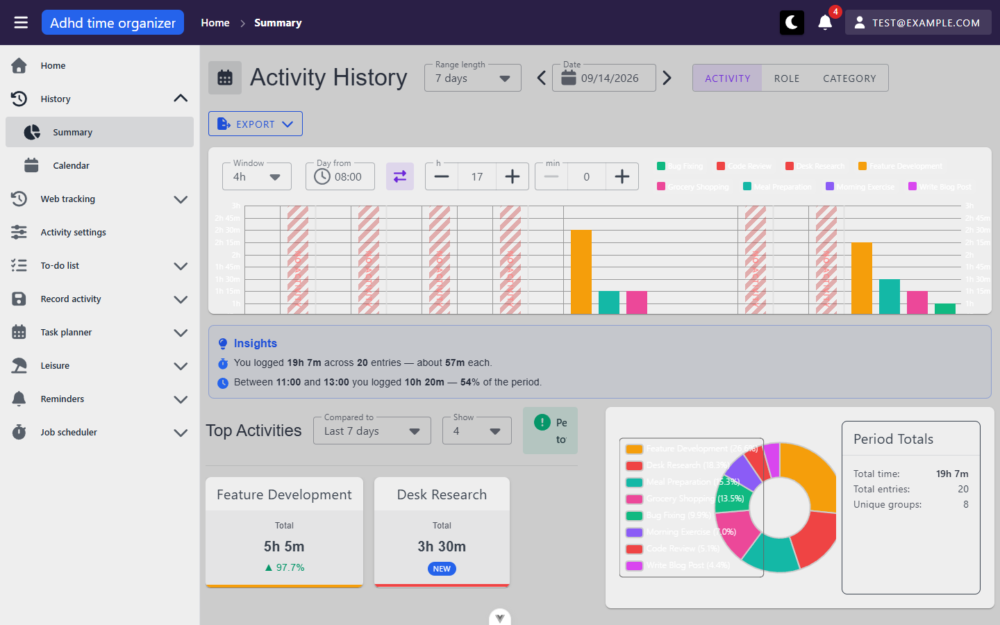
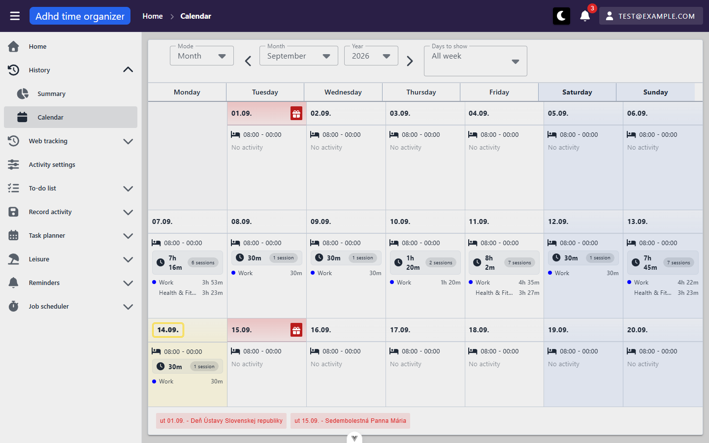
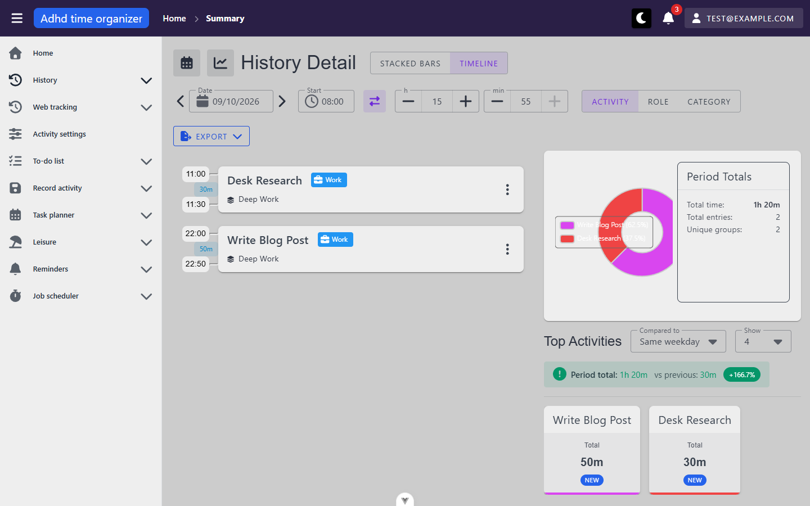

# history-review — inventory

> Captured 2026-09-14 · locale EN · account `test@example.com` (seed `e2e-v4`, `primaryUser`, id 10001) ·
> commit `adc9c67f`

## Views

### HistorySummaryView (`/activity-history`)

**Route:** `/activity-history` (name `activityHistory`) · params: none, all state in query · guard: auth
**Reached from:** sidebar › History › Summary; also the module's default landing route

**Actions**
| label | kind | selector | does | destination |
| --- | --- | --- | --- | --- |
| Calendar icon (top-left) | button | `VIconBtn` icon="calendar-days", tooltip "Open calendar" | navigates | `/activity-history/calendar` |
| Range length | select | `combobox "Range length"` | sets `rangeType` (3 days/week/2 weeks/month/3 months/year/custom) | in place, refetches |
| Date prev/next arrows | button | unnamed icon buttons flanking the date field | steps `date` by one unit of the range | in place, refetches |
| Date field | date input | `textbox "Date"` | sets `date` directly | in place, refetches |
| Activity / Role / Category | button group | `button "Activity"` etc. | sets `groupBy` | in place, refetches |
| Export | button+menu | `button "Export"` → listitems "Excel (.xlsx)" / "CSV (.csv)" | downloads the current period's grouped totals | file download |
| Window | select | `combobox "Window"` | sets stacked-bar window size (options vary by range length) | in place |
| Day from / time-range toggle | time input + button | `textbox "Day from"`, `button "Switch to time range"` | sets the chart's daily clock bounds | in place |
| Stacked-bar columns | **unnamed clickable `div`s** | no accessible name — see **A1** | drills into a day | `/activity-history/detail?date=…&groupBy=…` |
| "Compared to" (Top Activities) | select | `combobox "Compared to"` | sets baseline (last 7 days/30 days/same weekday/all time) | in place, refetches summary-cards |
| "Show" (Top Activities) | select | `combobox "Show"` | sets topN (3/4/5/8/10) | in place, refetches |
| Top-activity cards ("View details for X") | button | `button "View details for <name>"` | toggles a cross-highlight/filter on that group (adds `.summary-card--selected`) — **does not navigate**, despite the accessible name; see **P1** | in place |

**Readable surfaces**
| surface | kind | contents | raw/derived | populated by |
| --- | --- | --- | --- | --- |
| Stacked-bar chart | DOM bars (not canvas) | one column per window, segmented/coloured by group, hatched fill for windows outside the requested clock range | raw per-window group totals | `POST /activity-history/dashboard/summary/stacked-bars` |
| Insights block | text | up to 3 stated sentences (2 observed: total+entries+average, and a time-of-day concentration sentence) | derived client-side from the pie-chart response, plus one dedicated `time-of-day` fetch | `POST .../summary/pie-chart`, `POST .../summary/time-of-day` |
| Top Activities cards | cards | group name, total, %-change chip or "NEW"/"no baseline" | raw + derived (%-change from baseline) | `POST .../summary/summary-cards` |
| Period-total banner | alert | "Period total: X vs previous: Y, +Z%" | derived | same as above — see **B1**, gets clipped unreadably in this panel's width |
| Pie chart | `<canvas>` (echarts) | one slice per group with % label, legend list | raw | `POST .../summary/pie-chart` |
| Period Totals card | text | total time, total entries, unique groups | raw | `POST .../summary/summary-cards` |

**States**
- empty: not reachable on this seed within the default week — a day known to be empty (`date=2026-09-07`)
  showed the module-wide `HistoryFirstRunState`/`HistoryEmptyState` pattern correctly on **Detail**; not
  independently forced on Summary in this pass, but the components are shared (see H7 code read)
- loading: `VSkeletonLoader`/`alert "Loading..."` placeholders per panel, observed on first paint
- error: not forced on this view directly (forced on Detail's pie-chart instead, see below) — same
  `useHistoryDashboard` composable backs both, so the behaviour is shared: the panel renders its normal empty
  state ("No data for this period"), not a distinct error state — see **B2**

**URL & persisted state**
- `range`, `date`, `endDate`, `groupBy`, `windowSize`, `timeFrom`, `timeTo`, `baseline`, `topN` — all
  confirmed present in the query and confirmed to survive a reload and a fresh `goto` of the copied URL in a
  new tab (same requests refire, same values shown). `selectedGroup` (the cross-highlight) is **not** in the
  URL — deliberate, matches H6's own list of what to sync.

**Dialogs opened from here**
- none

**Keyboard**
- Escape closes the Export dropdown menu (confirmed)

**Console & network**
- errors/warnings: none on a clean load
- non-2xx: none on a clean load (one deliberately-mocked 500 tested on Detail's pie-chart, see Findings)
- duplicate requests: none — the four dashboard POSTs (`stacked-bars`, `pie-chart`, `summary-cards`,
  `time-of-day`) each fire exactly once per relevant state change

---

### HistoryCalendarView (`/activity-history/calendar`)

**Route:** `/activity-history/calendar` (name `activityHistoryCalendar`) · params: none · guard: auth
**Reached from:** sidebar › History › Calendar; icon button on Summary and Detail

**Actions**
| label | kind | selector | does | destination |
| --- | --- | --- | --- | --- |
| Mode | select | `combobox` (Month/…) | sets calendar grouping mode | in place |
| Month / Year | select | `combobox "Month"`, `combobox "Year"` | sets the visible month | in place, refetches |
| prev/next month arrows | button | unnamed icon buttons either side of Month/Year | steps a month | in place, refetches |
| Days to show | select | `combobox "Days to show"` | narrows the visible day range (e.g. "All week") | in place |
| Day cell | **unnamed clickable `div`** | no accessible name — see **A2** | drills into that day | `/activity-history/detail?date=…` |

**Readable surfaces**
| surface | kind | contents | raw/derived | populated by |
| --- | --- | --- | --- | --- |
| Day cell | grid cell | wake/bed time row, total duration + session count, up to 2 role/category rows with per-role duration | raw, per-day summary | `POST /activity-history/dashboard/calendar` |
| Holiday strip | text list | `<date> - <holiday name>` per public holiday in the visible range | raw (server-supplied `holidayName`) | same request | 
| Holiday cell highlight | cell styling | red-tinted cell + gift icon on holiday dates | derived from the same `holidayName` field | same |

**States**
- empty: per-day "No activity" text renders for a day with `totalSeconds === 0` but the request still
  succeeded; if **every** visible day is empty, the view shows either `HistoryEmptyState`
  ("No activity in this range") or, when `getHasAnyHistoryEver()` also comes back false, the shared
  `HistoryFirstRunState` onboarding block — not independently forced in this pass (this seed always has
  data in the visible months), confirmed by code read only (H7's stated behaviour) — **unverified**
- loading: `CalendarGrid`'s own loading prop, not independently inspected beyond "no visible glitch"
- error: not forced on this view

**URL & persisted state**
- **None.** Month/year/mode/days-to-show are local `ref`s with no query sync — reloading the page always
  returns to the current month. This is consistent with the view being a landing/browsing surface rather
  than a bookmarkable filtered state, and the intent sources (H6) never asked for it here — not filed as a
  finding, noted for completeness.

**Dialogs opened from here**
- none

**Keyboard**
- not separately probed beyond Tab reaching the day cells (they are focusable per the shell's general Tab
  order)

**Console & network**
- errors/warnings: none
- non-2xx: none
- duplicate requests: none — one `POST /activity-history/dashboard/calendar` per month/range change

---

### HistoryDetailView (`/activity-history/detail`)

**Route:** `/activity-history/detail` (name `activityHistoryDetail`) · params: `date` (query, `dd? — actually
`yyyy-MM-dd` via `formatDateForApi`), `view`, `groupBy`, `windowSize`, `timeFrom`, `timeTo`, `baseline`,
`topN` — all query, no path params · guard: auth
**Reached from:** stacked-bar column click on Summary; day-cell click on Calendar. **Not linked from any
sidebar entry or nav menu** — confirmed intentional drill-down target, not an orphan (see usecase.md,
Entity lifecycle). Tried `/activity-history/detail` with no `date` query at all: it defaults to today's date
and loads normally (no crash, no blank state) — the "invalid input" case for this route is a non-issue since
every param has a safe default.

**Actions**
| label | kind | selector | does | destination |
| --- | --- | --- | --- | --- |
| Calendar icon | button | tooltip "Open calendar" | navigates | `/activity-history/calendar` |
| Chart-line icon | button | tooltip "Open summary" | navigates to Summary for the week containing this day, carrying `groupBy` | `/activity-history?date=<week start>&range=Week&groupBy=…` |
| Stacked bars / Timeline | button toggle | `button "Stacked bars"`, `button "Timeline"` | sets `view` | in place |
| ‹ / › date arrows | button | either side of the Date field | steps the date by one day | in place, refetches |
| Date field | date input | `MyDateInput`, capped at today (`:max="today"`) | sets the date directly | in place, refetches |
| Start time / time-range toggle | time input + button | `TimeRangePicker` | sets the day's clock bounds | in place, refetches |
| Activity / Role / Category | button group | same as Summary | sets `groupBy` | in place, refetches |
| Export | button+menu | same as Summary | downloads the day's raw records | file download |
| "Compared to" / "Show" | select | same as Summary | sets baseline/topN | in place, refetches |

**Readable surfaces**
| surface | kind | contents | raw/derived | populated by |
| --- | --- | --- | --- | --- |
| Timeline | list | per-record start/end time, activity name, role chip, category/note line, overflow menu (`⋮`, not exercised) | raw records | `POST /activity-history/filter` |
| Stacked-bar chart (stackedBars mode) | DOM bars | same component as Summary, single-day scale, clamped to the requested clock range (see code comment on the known `detail/stacked-bars` 24-window backend quirk) | raw | `POST .../dashboard/detail/stacked-bars` |
| Summary cards + pie chart | cards + `<canvas>` | identical shape to Summary's | raw + derived | `POST .../dashboard/detail/{summary-cards,pie-chart}` |

**States**
- empty: verified directly — navigating to a day with zero records (`date=2026-09-07`) renders
  `HistoryEmptyState` independently in **three** places (timeline list, pie chart, summary cards), each with
  its own icon and the shared date label ("No data for this period · 07.09.2026") — H7's stated behaviour
  confirmed working
- loading: not independently captured (transitions were fast against local seed data)
- error: **forced via a mocked 500** on `dashboard/detail/pie-chart` — the panel renders exactly the same
  "No data for this period" empty state as a genuine empty response. The failure does surface elsewhere (an
  `AxiosError` logged through the shared interceptor at `axiosConfig.ts:122`, which per the interceptor's own
  contract also fires an error snackbar), but the pie-chart panel itself gives no visual distinction between
  "nothing happened here" and "the request failed" — see **B2**

**URL & persisted state**
- `date`, `view`, `groupBy`, `windowSize`, `timeFrom`, `timeTo`, `baseline`, `topN` — all present, confirmed
  to survive a reload and a fresh `goto` of the full copied URL in a new tab, firing the identical four
  requests (`stacked-bars`, `pie-chart`, `summary-cards`, `filter`). This is the H6 gap that this pass
  confirms is now closed: HistoryDetailView previously lost everything but `date` on reload; it now behaves
  identically to Summary.

**Dialogs opened from here**
- none opened in this pass (the timeline row's `⋮` overflow menu was not exercised — read-only pass, and it
  likely opens an edit/delete dialog which belongs to unit 4's mutation territory)

**Keyboard**
- Escape closes the Export dropdown (same component as Summary, confirmed once is sufficient — shared code)

**Console & network**
- errors/warnings: none on normal loads; the deliberately-mocked 500 produced exactly the expected
  `AxiosError` console line and no *additional* unhandled errors
- non-2xx: none except the one deliberately-injected 500 (cleaned up via `unroute` + reload before moving on)
- duplicate requests: none

## Transitions out of this unit
| from | control | goes to |
| --- | --- | --- |
| HistorySummaryView | calendar icon | `/activity-history/calendar` |
| HistorySummaryView | stacked-bar column click | `/activity-history/detail?date=…&groupBy=…` |
| HistoryCalendarView | day-cell click | `/activity-history/detail?date=…` |
| HistoryDetailView | calendar icon | `/activity-history/calendar` |
| HistoryDetailView | chart-line icon | `/activity-history?date=<week start>&range=Week&groupBy=…` |
| any view | sidebar › Record activity | `/activity-history/{manual,pomodoro,stopwatch,timer}` (unit 4, not exercised here) |
