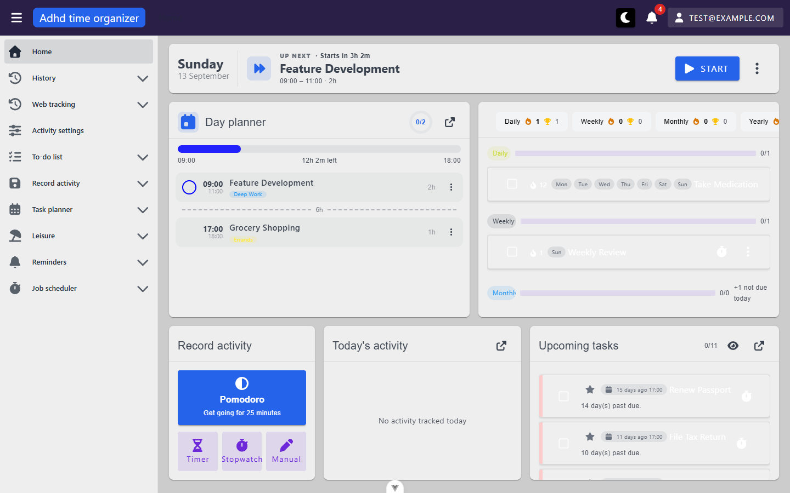
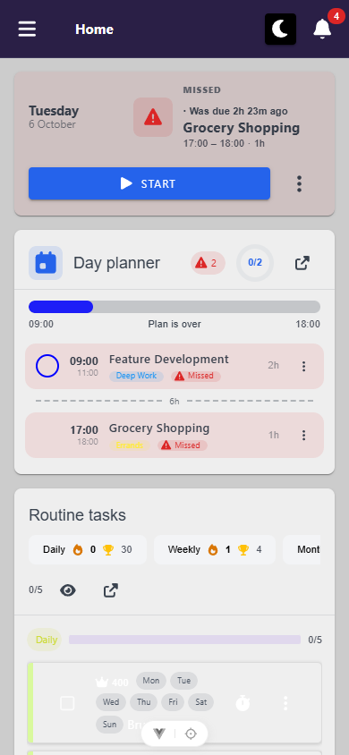

# home — inventory

> Captured 2026-09-13 (round 1, inventory) · updated 2026-09-15 (round 2, mutation — see
> `findings.md`'s round history for what changed) · locale EN · account `test@example.com` · commit
> `430e6f03` (round 1) / `04c405e9` (round 2) · viewport 1440×900

## Views

### HomeView (`/`)

**Route:** `/` · params: none · guard: auth (not `public` in router meta)
**Reached from:** sidebar "Home" entry, the app logo link, and it is the post-login landing route

Composed of one full-width bar (NowBar) plus five widgets in two rows: DayPlannerWidget +
RoutineTodoWidget (main row), QuickRecordWidget + ActivityHistoryWidget + TodoListWidget (bottom
band). Actions and surfaces below are grouped by widget for traceability, but all belong to this one
view/route.

**Actions**
| label | kind | selector | does | destination |
| --- | --- | --- | --- | --- |
| Start / Done (focus task) | button | `getByRole('button', { name: 'Start' })` / `{ name: 'Done' }` | Starts or finishes the focus task in place (optimistic) | in place |
| Track time (focus task) | button | `getByRole('button', { name: 'Track time' })`, shortcut **T** | Opens `TrackTimeDialog` ("Log task: {name}") pre-filled with the remaining slot length | dialog |
| Actions menu (focus task) | button, icon-only | `getByRole('button', { name: 'Actions for "{task}"' })` (`TaskActionMenu`) | Opens start/finish/track + give-longer (if running) + move-later + skip | menu |
| Plan today | button | `getByRole('button', { name: 'Plan today' })` (NowBar and DayPlannerWidget both render one when `!hasPlan`) | Navigates to the day planner for today | `/day-planner/DD-MM-YYYY` |
| Running-timer chip | button (chip) | `title`/`aria-label` = the running/paused/finished label | Jumps to the timer view the session belongs to | timer route |
| Streak chip (now bar) | non-interactive | `title`/`aria-label` = "Streaks: N" | display only | — |
| Day planner: task checkbox | button, icon-only | `getByRole('button', { name: 'Mark "{task}" as done' })` (`aria-pressed`) | Toggles the row's completion in place | in place |
| Day planner: per-row actions | button, icon-only | `TaskActionMenu` (same menu as the now bar) | Same action set as the now bar's menu | menu |
| Day planner: open | button, icon-only | `getByRole('button', { name: 'Open: Day planner' })` | Navigates to the full planner | `/day-planner/DD-MM-YYYY` |
| Routine: hide/show done | button, icon-only, toggle | `getByRole('button', { name: /Show done|Hide done/ })` (`aria-pressed`), **1st** of two identical-labelled buttons on the page | Filters completed routine items in place | in place — **see B1, control itself is unreachable by pointer at common desktop widths; its state does not persist, see B3** |
| Routine: open | button, icon-only | `getByRole('button', { name: 'Open: Routine tasks' })` | Navigates to the full routine list | `/routine-todo-list` — **same clipping as B1** |
| Routine: item checkbox / menu | button | `RoutineTodoListItem` (owned by `todoList`, not re-audited here) | Toggles done / opens item actions | in place / menu |
| To-do: hide/show done | button, icon-only, toggle | `getByRole('button', { name: /Show done|Hide done/ })`, **2nd** instance | Filters completed to-do items in place, count in header updates | in place — reachable (this widget's header does not overflow) |
| To-do: open | button, icon-only | `getByRole('button', { name: 'Open: Upcoming tasks' })` | Navigates to the full to-do list | `/todo-list` |
| To-do: row checkbox / "More actions" / "Add to planner" | button | `NormalTodoListItem` (owned by `todoList`) — `getByRole('button', { name: 'More actions: {item}' })` → `getByRole('button', { name: 'Add to planner' })` | Toggles done / opens item menu / navigates | in place / menu / `/day-planner/DD-MM-YYYY` — **confirmed live, no crash (H1 fix verified); actually clicked through in the mutation pass (round 2), landed on `/day-planner/15-09-2026` with no console errors** |
| Activity history: open | button, icon-only | `getByRole('button', { name: "Open: Today's activity" })` | Navigates to the detail timeline for today | `/activity-history/detail?date=YYYY-MM-DD&…` — **confirmed real current date, not the historic hardcoded one (H1 fix verified)** |
| Quick record: Pomodoro | button | `getByRole('button', { name: /Pomodoro/ })` | Navigates to the pomodoro timer | `/activity-history/pomodoro` |
| Quick record: Timer / Stopwatch / Manual | button | icon + label, named | Navigates to the respective recording view | `/activity-history/timer` \| `/stopwatch` \| `/manual` |
| Keyboard: S / F / T / M / P | shortcut | `useKeyboardShortcuts` | Start / Finish / Track / Snooze(+15m) / Open planner for the focus task | in place / dialog / route |

**Icon-only controls** (WidgetCard's "open" button ×4, both hide/show-done toggles, the day-planner
row checkbox, `TaskActionMenu`'s kebab, the running-timer chip) all resolve an accessible name via
`title` **and** `aria-label` together — confirmed via `find`/accessibility-tree inspection, not a
single one is unnamed. This is a deliberate improvement over the shell's own hamburger (`_shell` A2) —
`WidgetCard.vue`'s header comment states the reasoning explicitly.

**Readable surfaces**
| surface | kind | contents | raw/derived | populated by |
| --- | --- | --- | --- | --- |
| Now bar headline + kicker + countdown | text | task name / "You're done for today!" / "No plan for today"; DONE/NOW/UP NEXT/MISSED; "Ends in Xm" etc. | derived (`focusMode`, `focusCountdown` — pure client computeds over `tasks`/`hasPlan`) | `GET /api/calendar/day-plan/{date}` |
| Now bar progress bar | progress | fill % of the active task's elapsed slot | derived (`activeProgress`) | same |
| Day strip | bar chart (positioned divs, `aria-hidden`) | one segment per non-background task, elapsed fill, now-marker | derived | same |
| Day planner list | list | time range, name, category chip, duration, missed/status chips | raw (times, name, category) + derived (missed/status chip visibility) | same — **a `Cancelled` (skipped) row renders identically to a `Completed` one, no distinct chip or class; see B4** |
| Day planner progress ring | ring | completed/total non-background tasks | derived | same |
| Routine period sheets | chips | per-period streak + best-streak | raw (`currentStreak`/`bestStreak` from the API) | `GET /api/routine-time-period` |
| Routine groups | list + progress bar | per-group done/total (counting multi-count items), "+N not due today" | derived (`isSuggestedForToday`, confirmed correctly reading the discriminated `suggestedDays`/`suggestedDayOfMonth` fields — **H8 item 3's "is this overloaded" question resolved: it is not, see Findings note**) | `GET /api/routine-todo-list/grouped-by-time-period` |
| To-do list | list | due-date chip (colour-coded, "N day(s) past due"/"today"/"tomorrow"/"in N days") per row | raw chip text/colour is computed by `NormalTodoListItem` itself (`todoList` module), not by `home` | `GET /api/todo-list-item/dashboard-widget` |
| To-do done/total counter | counter | "{done}/{total}" in the header | derived | same |
| Activity pie chart | chart (echarts canvas) | one slice per activity, click-to-select | raw, aggregated server-side | `POST /api/activity-history/dashboard/detail/pie-chart` — **read via `response-body`, not the snapshot** (empty on this pass: `{"items":[],"totals":{"totalSeconds":0,...}}` for the seed account's real current date) |
| "Total tracked" line | counter | formatted duration | derived (`fromSeconds`) from the same pie response | same |

**States**
- empty: Day planner → "No plan for today" + Plan-today button (the seeded calendar for today
  genuinely has no plan on some sessions and 2-3 real tasks on others, date-dependent; **see B2** — on
  a day that *does* have a plan, this same pair renders anyway on most fresh sign-ins, not just
  transiently on first render, and needs a manual reload to clear). Routine/To-do → not reachable with
  current seed (both have items). Activity history → "No activity tracked today", confirmed reachable
  (seed has no entries dated today).
- loading: Day planner and each of the four `WidgetCard`-based widgets show a centred
  `VProgressCircular` while `loading` is true. **The now bar does not** — see B2. **Confirmed
  (mutation pass, round 2) that this spinner can also get stuck permanently** if the sign-in race
  described in B2 lands after a failed fetch — forced via `playwright-cli route` returning 500, see B2.
- error: reachable and correct in isolation (mutation pass, round 2) — forcing a 500 on
  `calendar/day-plan` with no sign-in race in flight renders `home.loadFailedPlan`/`home.noCalendar`
  text plus a working Retry button on both the now bar and the day planner widget; Retry re-fires the
  request. Resolves round 1's `U1`. The other four `WidgetCard` widgets' error paths were not
  individually forced this round.

**URL & persisted state**
- No route params or query params on `/` itself.
- `hideDoneTodoList` / `hideDoneRoutine` (Pinia `homeUiStore`, sessionStorage by convention) — **does
  not survive a reload or an in-app navigation-and-back**; confirmed absent from `sessionStorage`
  immediately after toggling. See B3.
- No `localStorage` keys owned by `home` (confirmed via `localstorage-list` — the module's own docs say
  the streak's old localStorage cache was removed in favour of a server-computed `PlannerStreak`, and
  that holds: no residual key was found).

**Dialogs opened from here**
- `TrackTimeDialog` ("Log task: {task name}") — opened by the T shortcut, the now bar's Track button,
  and `TaskActionMenu`'s Track item. Fields: method (defaults to `timer`), pre-filled remaining
  length. **Escape closes it** — confirmed, and unlike the shell's `MyDialog` default (`_shell` A1)
  this one does not block on Escape, so it must set `persistent={false}` explicitly or use a different
  base.

**Keyboard**
- **S** — start the focus task (enabled only when a focus task exists and it is not already `now`)
- **F** — finish the focus task (enabled only in `now` mode)
- **T** — open the tracker for the focus task — confirmed live, opened `TrackTimeDialog`
- **M** — snooze the focus task by the menu's first snooze step (+15m) — confirmed live (mutation
  pass, round 2): task moved 09:00–10:30 → 09:15–10:45, `PUT /api/planner-task/{id}` → 200, both NowBar
  and the day-planner list updated in sync
- **P** — open today's planner — confirmed live, navigated to `/day-planner/13-09-2026`
- All five are bound once from `HomeView` (`useHomeShortcuts`), not per-widget, and are suppressed
  while an `INPUT`/`TEXTAREA`/`SELECT`/`contenteditable` has focus (`isTypingTarget` in the shared
  `useKeyboardShortcuts`) — confirmed by source. **Round 2 (mutation pass):** opened `TrackTimeDialog`
  (which itself has a text input, the "Length" field — the one available on this view), focused it, and
  pressed **F**: no finish request fired (confirmed via `requests`), consistent with suppression. This
  does **not** cleanly isolate `isTypingTarget` from the dialog's own guard, though — the timer dialog
  already disables all five shortcuts while open (see next bullet), so this observation is consistent
  with either mechanism and does not independently confirm typing-target suppression outside a dialog.
  No text input exists on this view **outside** a dialog, so that narrower case remains corroborated by
  source only.
- The timer dialog disables all five while open (`enabled: () => !trackerOpen.value`) — confirmed by
  source, consistent with Track (T) putting up a dialog that would otherwise still respond to S/F/M.

**Console & network**
- errors/warnings: none on a clean boot after the documented stale-token 401 burst clears on reload
  (see CLAUDE.md's own note on this — reproduced exactly: 401s on `user/data`, `push-subscription`,
  `activity-*`, `calendar/day-plan`, `routine-*`, `todo-list-item/dashboard-widget`,
  `activity-history/…/pie-chart`, `auth/refresh`, and the SignalR negotiate call, all against the
  restored `e2e/.state/auth-10001.json`, whose refresh token had actually expired — this account
  needed a fresh sign-in rather than the usual access-token-only staleness).
- non-2xx: none once signed in fresh. No 4xx/5xx observed against any of home's own endpoints in this
  pass.
- duplicate requests: **none** — one round of every boot request per navigation, confirmed by
  `requests` filtered to the backend origin, matching the shell's own boot inventory
  (`docs/views/_shell/inventory.md`).
- requests firing before data is needed: none observed — all ten-odd boot requests are the documented
  set (activity options, day-plan, routine grouped-by-period, routine-time-period, todo dashboard
  widget, pie-chart, notifications, push key, backlog profiles).

**Narrow viewport (390 × 844)** · checked 2026-10-06 · commit `27dd210b`

- layout: **one column** at 390 px. Every `VCol` is `cols="12"` and splits only at `md`. Order: NowBar (y 80–241), Day planner (257–530), Routine tasks (546–1391), Record activity (1407–1648), Today's activity (1664–1827), Upcoming tasks (1843–3503). The focus task (NowBar: "Missed · Grocery Shopping", Start, ⋮) and the top of the day plan are visible without scrolling. The page is ≈ 3,500 px tall, and Upcoming tasks alone is ≈ 1,660 px (11 rows, no cap).
- mobile-only controls: none. NowBar only shrinks its buttons below `md` (`buttonSize`, `NowBar.vue:299`: `large` → `default`).
- replaced controls: none. **Keyboard shortcuts (S/F/T/M/P) all have a tap equivalent at this width:** S → Start (NowBar), F → Done (NowBar while running, also in the ⋮ menu), T → Track time (⋮ `Actions for "<task>"` menu, 216×40, and the NowBar button while running), M → "+15m" (same menu), P → `Open: Day planner` (WidgetCard header). Nothing is shortcut-only ([menu screenshot](screenshots/home-nowbar-menu--mobile.png)).
- overflow: the routine widget's period sheets (Daily/Weekly/Monthly/Yearly, → 595) are inside `.routine-periods` (`overflow-x: auto`, 563 / 326, intentional). The page doesn't scroll sideways.
- tap targets: of 80 visible controls, only the multi-count Decrease (20×20, `NormalTodoListItem` in Upcoming tasks) is under 24 px. It passes through the spacing exception (see `todo-lists` inventory). DayPlannerWidget's `:hover` rules are cosmetic (background, scale), with no hidden actions.
- visual sweep: the routine widget's group chips clip to "Weekl" / "Monthl" (Findings P1, [screenshot](screenshots/home-routine-widget--mobile.png)). Routine and to-do rows (the item components owned by `todoList`) wrap their chips over two to three lines, as on the routine page; item titles are white on the light card at every width. `HistoryPieChart` (Today's activity) showed only its empty state, "No activity tracked today", so it had nothing to judge at this width. It belongs to the history group and isn't filed here ([screenshot](screenshots/home-bottom-widgets--mobile.png)). `TrackTimeDialog` (⋮ → Track time, cancelled) fits at 24–366, and Cancel is visible at y 619. Its Stopwatch / Timer / Pomodoro toggle (400 px in a 310 px `overflow-x: auto` group) shows "POMOD…" until scrolled, and Start/Stop touch the dialog's edges (23 / 367). The dialog is `activityHistory`'s component, so this is left for the history group ([screenshot](screenshots/home-track-dialog--mobile.png)).

## Transitions out of this unit
| from | control | goes to |
| --- | --- | --- |
| Now bar / Day planner | Plan today, per-row menu items, planner open button | `/day-planner/DD-MM-YYYY` |
| Routine widget | open button | `/routine-todo-list` |
| To-do widget | open button, row menu's "Add to planner", row menu's "Edit"/"Delete" | `/todo-list`, `/day-planner/DD-MM-YYYY`, `/todo-list` (both edit and delete push to the plain list route rather than opening in place — observed via source, matches `TodoListWidget.vue:39-40`, not independently clicked to avoid mutating/deleting seed data) |
| Activity history widget | open button | `/activity-history/detail?date=…&view=timeline&…` |
| Quick record widget | Pomodoro / Timer / Stopwatch / Manual | `/activity-history/pomodoro` \| `/timer` \| `/stopwatch` \| `/manual` |
| Now bar | running-timer chip | the active timer's own route (kind-dependent) |
