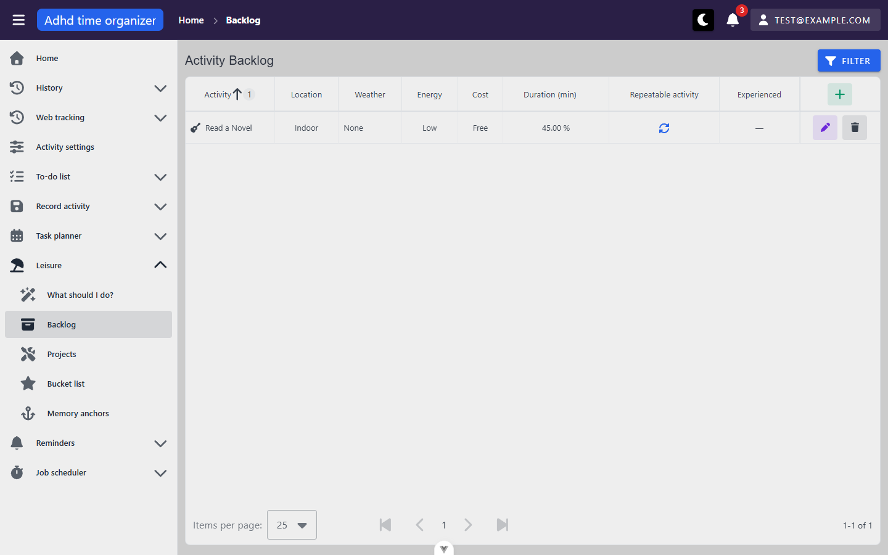
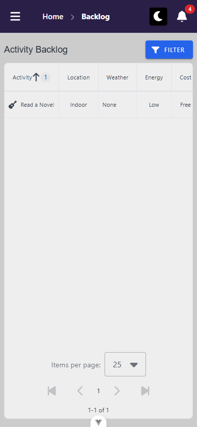
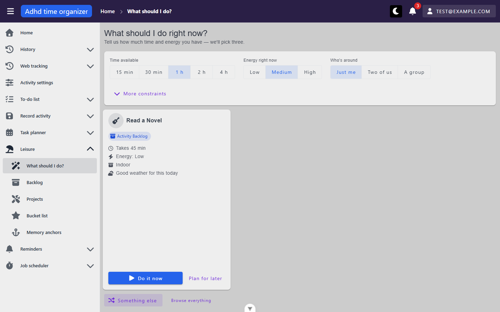
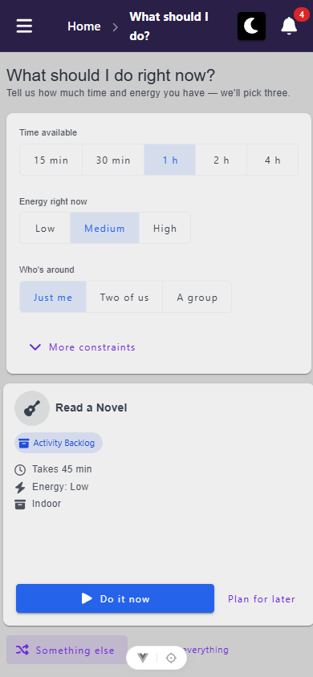

# leisure-backlog-picker — inventory

> Captured 2026-09-15 · locale EN · account `test@example.com` · commit `f457aa0c`

Shell (nav, top bar, dialog Escape-persistence default, breadcrumbs) is documented once in
`docs/views/_shell/inventory.md` — only differences from that baseline are called out below.

## Views

### BacklogView (`/leisure/backlog`)

**Route:** `/leisure/backlog` · params: none · query: `page`, `perPage`, `sortBy`, plus every filter
field (`locationTypeIds`, `weatherDependencyIds`, `energyLevels`, `effortTypes`,
`expectedCostTierIds`, `maxDurationMinutes`, `isRepeatable`, `isAnchored`, `activityName`) when set ·
guard: auth (no `public` meta)
**Reached from:** sidebar "Leisure → Backlog"; `ExperiencedCell`'s "open anchor" link from
`/leisure/memory-anchors` goes the other way

**Actions**
| label | kind | selector | does | destination |
| --- | --- | --- | --- | --- |
| Filter | button | role=button "Filter" | opens the `FilterPanel` drawer | in place (drawer) |
| Add (header, icon `+`) | button | role=button "Add" | opens create dialog (`BacklogProfileForm`) | dialog |
| edit (row) | button | role=button "edit" in row | opens edit dialog, activity locked | dialog |
| delete (row) | button | role=button "delete" in row | opens `BasicTable`'s built-in delete-confirmation dialog, naming the activity | dialog, then **fails silently — see X1** |
| "I did this" (row, `Experienced` col) | button | role=button "I did this", only on non-repeatable rows with `isAnchored !== true` | opens `MemoryAnchorForm` ("Write it down") | dialog |
| "Experienced" chip (row) | chip/link | `.v-chip` inside `tbody` — not addressable by role, only by text (see A1) | navigates to memory anchors, pre-filtered | `/leisure/memory-anchors?activityName=…` |
| column headers (Activity, Duration) | sort toggle | role=columnheader | re-sorts; **clicking a second header adds a secondary sort key rather than replacing the first** (`sortBy` became `activity.name:asc,durationMinutes:asc`) | in place |
| Items-per-page select / pagination | select + buttons | standard `BasicTable` footer | pages the table | in place |

**Create dialog fields** (`BacklogProfileForm` → `NewBacklogProfileForm`): Activity (searchable
autocomplete, required, inline-create-on-no-match), Location (select, required by data but **no
client `required` rule**), Weather (same), Energy (select, defaults "Medium"), Effort (select,
optional), Cost (select, required by data but no client rule), Min/Max people (number inputs), Duration
(number input, defaults 60), Repeatable (checkbox).

**Readable surfaces**
| surface | kind | contents | raw/derived | populated by |
| --- | --- | --- | --- | --- |
| table | server-paged table | Activity, Location, Weather, Energy, Cost, Duration (min), Repeatable activity, Experienced | raw, one derived column (`isGoodToday` chip is client-computed from `weatherFit` + row's `weatherDependency.id`) | `POST /activity-backlog-profile/grid` |
| "N of M one-time things experienced" bar | progress bar + text | count of `isAnchored === true` over count of `isRepeatable === false`, under the current filter | derived client-side from two extra count-only (`itemsPerPage:1`) requests | two extra `POST /activity-backlog-profile/grid` calls, see Console & network |
| "good today" chip | chip | shown when the row's `weatherDependency.id` is in today's `matchingWeatherDependencyIds` | derived | `GET /leisure-weather-fit` |

**States**
- empty: "No entries yet" style copy + an inline Add button in the table's `#noData` slot (per L4) —
  not captured this pass since the seed always carries one row; confirmed present in source
  (`BacklogTable.vue`'s `noData` template) but not screenshotted — **unverified, U1**.
- loading: standard `BasicTable` skeleton/spinner (framework, not re-documented here).
- error: a failed `grid` fetch is not something this pass could trigger without breaking the network
  connection; not exercised — **unverified**.

**URL & persisted state**
- `page`, `perPage`, `sortBy`, and every filter field round-trip through the URL and survive a hard
  reload — confirmed: filtered by Location=Indoor, URL carried `locationTypeIds=4`, reload kept both
  the URL and the filter chip.
- No `localStorage`/`sessionStorage` use observed in this view.

**Dialogs opened from here**
- **Create/Edit "Activity Backlog"** (`BacklogProfileForm`) — see fields above. Cancel/Save. Escape
  does **not** close it — matches shell baseline A1 (`persistent` default), not re-filed here.
- **Delete confirmation** (`BasicTable`'s built-in `MyDialog`) — "Are you sure you want to delete
  {activity name}?", Cancel/Confirm. Confirms unconditionally regardless of `askBeforeDelete` (there
  is no cascade here to warn about — a backlog profile has no children).
- **"Write it down"** (`MemoryAnchorForm`, opened via `ExperiencedCell`) — Activity (disabled,
  prefilled), Month, Year, Highlight (textarea, server-required, **no client `required` rule** — see
  B3), Rating (number, 1–10, default 5). Cancel/"Save the moment".

**Keyboard**
- Tab reaches Filter, Add, then each row's action buttons in order; standard `BasicTable` pattern,
  not re-audited per-control here (see shell).
- The `VIdSelect` fields in both the filter drawer and the create dialog use Vuetify's
  `data-no-activator` wrapper on the input — a **direct** `getByRole('combobox').click()` was
  intercepted by that wrapper in every attempt (5/5) and had to fall back to clicking the outer
  field container. Real pointer clicks anywhere in the visible field still land on the same outer
  container, so this was not confirmed to be user-facing; flagged as a documentation note only, not
  a filed defect.

**Console & network**
- errors/warnings: none on a plain load or on filtering.
- non-2xx: `POST /activity-backlog-profile` → 400 (create with unselected required fields, X2/B1);
  `POST /memory-anchor` → 400 (empty Highlight, B3); `PUT` and `DELETE /activity-backlog-profile/{activityId}`
  → 404 (X1) — all captured below in Findings.
- duplicate requests: a filter change fires **three** `POST /activity-backlog-profile/grid` calls
  (one from the table's own `load()`, two count-only `itemsPerPage:1` calls from
  `useExperiencedProgress`'s filter watch) — this is documented, deliberate design (separate
  composable instances, per the code comments), not a bug. The very first load additionally fires
  two more count-only calls once the main row arrives (the progress bar's `supported` flip). None of
  these share an identical request body, so this is not the "same request fired twice" duplicate
  pattern the audit is looking for.
- requests while signed out / before data needed: none observed.

**Narrow viewport (390 × 844)** · checked 2026-10-06 · commit `8a2d4ffa`

- layout: title and Filter stay on one row. The table keeps every column and scrolls sideways inside its
  wrapper (`overflow-x: auto`, 842 wide in 372): Activity to Cost show on landing, People/Repeatable/
  Experienced/actions are off to the right. The "N of M one-time things experienced" bar doesn't render
  with the seed (its one row is repeatable). Pagination stays centred. The Filter panel is full-width under
  the bar (0–390 × 64–844), its fields scroll inside it (768/628), Clear/Confirm stay pinned at y 792, and
  focus moves to its Close button.
- mobile-only controls: none. `src/core/leisure/` has no `useDisplay`/breakpoint code at all.
- replaced controls: none
- overflow: `docScroll` 390. One offender, the `table` (right 851) inside `.v-table__wrapper`
  (`overflow-x: auto`), which is intentional. **But the actions column doesn't stay pinned**: header Add
  at 779, row Edit/Delete at 755/803. Swiping the table to its end brings them to 309–383
  ([screenshot](screenshots/backlog-scrolled--mobile.png)). See `B6` [framework].
- dialogs: create ([screenshot](screenshots/backlog-create-dialog--mobile.png)) and edit both 24–366 ×
  24–820. The body scrolls inside (720/673, Repeatable is just below the fold), Cancel/Create at y 764.
  "Max people" reads "Max …" while empty (`P2`). Delete confirm 24–366 × 321–524, buttons on screen.
  "Write it down" not reached: the seed has no non-repeatable, un-anchored backlog row. On-screen
  keyboard: Create sits at y 764, so shell `U3` applies.
- visual sweep: nothing wrong beyond the hidden actions column. Number-input spinners are 40×48, row
  icon buttons 40×40, pagination 48×48, so every tap target clears 24 px.

### PickerView (`/leisure/pick`)

**Route:** `/leisure/pick` · params: none · query: `minutes`, `energy`, `people`, `seed`, plus
`maxCostTierId`/`locationTypeId` when set · guard: auth
**Reached from:** sidebar "Leisure → What should I do?"; `BacklogTable`'s empty-state offers no link
here (only the reverse: this view links to `BacklogView`)

**Actions**
| label | kind | selector | does | destination |
| --- | --- | --- | --- | --- |
| Time available (15 min/30 min/1 h/2 h/4 h) | button toggle group | role=button, each duration label | sets `minutes`, re-ranks (re-fetches pool only if the change crosses the project/bucket-list minute thresholds) | in place |
| Energy right now (Low/Medium/High) | button toggle group | role=button | sets `energy`, re-ranks locally (no re-fetch) | in place |
| Who's around (Just me/Two of us/A group) | button toggle group | role=button | sets `people`, re-ranks locally | in place |
| More constraints | disclosure button | role=button "More constraints" | reveals Cost/Location selects (not URL-hidden-state, just a local `ref`) | in place |
| Spend at most / Location (when revealed) | select | `VIdSelect`, same `data-no-activator` pattern as Backlog's filters | sets `maxCostTierId`/`locationTypeId`, re-fetches pool | in place |
| Do it now | button | role=button "Do it now" | books a slot starting now, `InProgress` | `POST /planner-task`, card flips to "planned" state |
| Plan for later | button | role=button "Plan for later" | opens `PlanLaterDialog` (start-time stepper + live "Booking H:MM – H:MM" preview) | dialog → same commit path |
| Something else | button | role=button "Something else" | records current cards as "shown", draws a new `seed`, re-ranks (no re-fetch) | in place |
| Browse everything / Fill the backlog | link | role=link | leaves the unit | `/leisure/backlog` |
| Open planner (after commit) | link | role=link "Open planner" | leaves the unit | `/day-planner/:date` (today) |

**Readable surfaces**
| surface | kind | contents | raw/derived | populated by |
| --- | --- | --- | --- | --- |
| suggestion cards (≤3) | cards | activity name/icon/colour, source chip (Backlog/Bucket list/Project), 2–5 "why" reasons, primary actions | derived — client-side ranking over three raw pools (`leisureScoring.ts`, pure, unit-tested) | `POST activity-backlog-profile/grid`, `POST activity-project-profile/grid` (only when `minutes ≥ 60`), `POST activity-bucket-list-profile/grid` (only when `minutes ≥ 120`), plus `GET /leisure-weather-fit` |
| empty state | card + copy + recovery actions | one of three distinct messages (load failed / nothing filed / nothing fits) | derived from `loadFailed`/`poolCount`/eligible-count | same requests above |

**States**
- **empty — nothing fits** (the state this pass actually landed on with default constraints and the
  seed data, see X3 for why): "Nothing matches those constraints. Try loosening one.", offers "I
  have {next longer duration}" and "Fill the backlog". Screenshot:
  `screenshots/leisure-pick--empty-nothing-fits.png`.
- **empty — nothing filed** (`poolCount === 0`): not reached this pass without deleting the only
  seeded backlog row — **unverified, U2** (message exists in source, `leisure.picker.emptyNothingFiled`).
- **empty — load failed**: not reached (would need a network failure) — **unverified, U3**.
- **populated** (3 cards, or fewer under a thin pool): reached only via a mocked `leisure-weather-fit`
  response — see X3. `screenshots/leisure-pick--suggestions-mocked-weather.png`.
- **committed**: card replaces its action row with "Planned {start}–{end}" + "Open planner"; observed
  for both time-shown cards after a "Do it now" commit —
  `screenshots/leisure-pick--mutation-committed.png`.
- loading: `VSkeletonLoader` cards while `loading && suggestions.length === 0` (source-confirmed, not
  screenshotted mid-flight — **unverified, U4**).

**URL & persisted state**
- `minutes`, `energy`, `people`, `seed` (and `maxCostTierId`/`locationTypeId` when set) all round-trip
  through the URL and survive a reload — confirmed: after "Something else" changed `seed` in the URL,
  a reload reproduced the identical draw (same `seed` → same three-or-fewer cards, per the scoring
  rule's determinism).
- `suggestionHistory` (staleness/last-committed-effort) is written to browser storage on every draw
  and every commit — **not verified against `useUserScopedStorage`** (CLAUDE.md requires per-user
  namespacing for exactly this kind of state); `suggestionHistory.ts` was not read in this pass —
  flagged as unverified rather than asserted, **U5**.
- "More constraints" expanded/collapsed is a local `ref`, correctly NOT persisted (a display toggle,
  not data).

**Dialogs opened from here**
- **Plan for later** (`PlanLaterDialog`) — Start time stepper (‹ / › plus a time field), live
  "Booking H:MM – H:MM" preview computed from the candidate's slot sizing. Cancel/"Add to plan".
  Not `persistent` (`dialogProps.persistent: false` explicitly passed, unlike every other dialog in
  this unit) — **this one does close on Escape**, the one dialog in the unit that differs from the
  shell A1 baseline. Confirmed by source (`SuggestionCard.vue` passes `persistent: false` explicitly)
  though not independently re-tested with Escape in-browser this pass.

**Keyboard**
- Button-toggle groups (`VBtnToggle`) are native `role=button` elements in a row — standard Tab/Enter,
  no custom arrow-key handling observed or claimed by the source.

**Console & network**
- errors/warnings: none across every interaction in this pass (constraint changes, reroll, commit,
  plan-later cancel).
- non-2xx: none — the picker's own requests were all 200/201/204 throughout.
- duplicate requests: none — a constraint change that crosses a source threshold fires exactly one
  `grid` call per newly-eligible source; a constraint change that only affects ranking (energy,
  people, "something else") fires **zero** network requests, confirmed by the request log staying
  flat across several toggles.
- requests while signed out: none observed.

**Narrow viewport (390 × 844)** · checked 2026-10-06 · commit `8a2d4ffa`

- layout: everything stacks in one column. Title, then the constraint card (Time available 5-up row 24–372;
  Energy and Who's around rows; "More constraints"), then the cards one per row (`cols="12"`), then
  "Something else" / "Browse everything". With the seed's single card at 1 h, its "Do it now" (20–267 ×
  728) and "Plan for later" (275–376) are on screen without scrolling, and so is "Something else" (y 792).
  **With two or more cards the constraint card is crushed instead of the page scrolling**: 137 px of 325
  with two ([screenshot](screenshots/pick-4h--mobile.png)), 32 px with three
  ([screenshot](screenshots/pick-3cards--mobile.png), backlog grid mocked), so the time/energy/company
  controls can't be reached. See `X2`. With one card the view fills exactly 780 px, which leaves ~100 px of
  blank space inside the card above its buttons. That's the same stretched flex column.
- mobile-only controls: none
- replaced controls: none
- overflow: `docScroll` 390. One offender, a `v-row` reaching 400, which is Vuetify's −12 px row gutter
  and clipped by its parent. Not a finding.
- dialogs: "Plan for later" 24–366 × 295–549 ([screenshot](screenshots/pick-plan-later--mobile.png)),
  stepper ‹ › 36×36, Cancel/"Add to plan" at y 493. Nothing clipped. The Start field takes typed input; no
  picker popup opened from it. Cancelled, not committed. "More constraints" opens two full-width selects
  (24–372) inside the card, which runs into `X2`
  ([screenshot](screenshots/pick-more-constraints--mobile.png)).
- breadcrumb: "What should I do?" wraps to two lines in the bar. Added to shell `P4`.
- visual sweep: the crushed constraint card (`X2`), otherwise nothing wrong. Toggle buttons are 64–96 × 40.
  "Browse everything" is 126 × 28.

## Transitions out of this unit
| from | control | goes to |
| --- | --- | --- |
| BacklogTable row, "Experienced" chip | click | `/leisure/memory-anchors?activityName=…` |
| PickerView, "Browse everything" / "Fill the backlog" | click | `/leisure/backlog` |
| PickerView, committed card's "Open planner" | click | `/day-planner/:date` (today, `DD-MM-YYYY`) |
| BacklogProfileForm / NewBacklogProfileForm, inline activity create | nested dialog only, no navigation | stays in unit (`QuickCreateActivityDialog`) |
