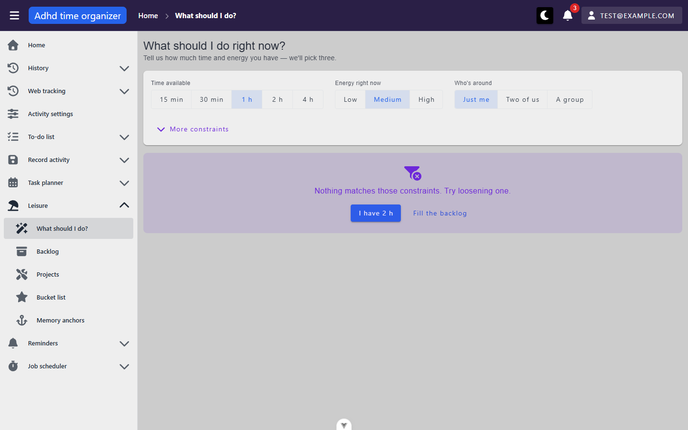

# leisure-backlog-picker — inventory

> Captured 2026-09-14 · locale EN · account `test@example.com` · commit `50bd6b0d`

## Views

### BacklogView (`/leisure/backlog`)

**Route:** `/leisure/backlog` · params: none · query: `page`, `perPage`, `sortBy`, plus every
`ActivityBacklogProfileFilter` field · guard: auth
**Reached from:** sidebar "Leisure → Backlog"; `PickerView`'s "Browse everything" / "Fill the
backlog" links; `SuggestionCard`'s backlog-source chip does **not** link here (chip is not a link,
`sourceMeta.routeName` is unused for navigation — see Findings)

**Actions**
| label | kind | selector | does | destination |
| --- | --- | --- | --- | --- |
| Filter | button | `getByRole('button', {name:'Filter'})` | opens the filter side panel | overlay, see Dialogs |
| Activity / Location / Weather / Energy / Effort / Cost / Duration (min) / Repeatable activity / Experienced | filter inputs | `getByLabel(<field>)` inside the filter panel | edits the draft filter | in place, applied on Confirm |
| Clear | button (in filter panel) | `getByRole('button',{name:'Clear'})` | resets filter to defaults, applies immediately, closes panel | in place |
| Confirm | button (in filter panel) | `getByRole('button',{name:'Confirm'})` | applies the draft filter, writes it to the URL, closes panel | in place |
| filter chip × (e.g. "Repeatable activity: X") | chip, closable | `ChipWithIcon` in the header row | removes just that one filter field | in place |
| Add (+) | icon button | `getByRole('button',{name:'Add'})` (title="Add") | opens the create dialog | dialog, see below |
| Edit (pencil) | icon button | `getByRole('button',{name:'Edit'})` (title="Edit") | opens the edit dialog, prefilled | dialog, see below |
| Delete (trash) | icon button | `getByRole('button',{name:'Delete'})` (title="Delete") | opens a delete-confirmation `MyDialog` | dialog, see below |
| "I did this" | button (per row, one-time entries only) | `getByRole('button',{name:"I did this"})` | opens anchor-capture flow | dialog (not opened in this pass — would create a `MemoryAnchor`, out of scope for an inventory pass) |
| "Done" chip (per row, already-anchored) | chip, link | `title="Open the memory anchor"` | navigates to the matching anchor | `/leisure/memory-anchors?activityName=<name>` |
| Column header (sortable: Activity, Duration (min)) | columnheader | `getByRole('columnheader',{name:...})` | toggles sort asc/desc, writes to URL | in place |
| Column header (non-sortable: Location, Weather, Energy, Cost, Repeatable activity, Experienced) | columnheader | — | no-op on click (confirmed: clicking "Location" left `sortBy` unchanged) | in place |
| Items-per-page select, pager arrows | table footer | `MyTableFooter` | pages the table | in place |

**Readable surfaces**
| surface | kind | contents | raw/derived | populated by |
| --- | --- | --- | --- | --- |
| Backlog table | server-paged table | Activity, Location, Weather, Energy, Cost, Duration (min), Repeatable activity (icon), Experienced | raw (each column is a DTO field) except the weather "good today" chip, which is derived (`fitsToday(item.weatherDependency.id, weatherFit)`) | `POST /activity-backlog-profile/grid` |
| Experienced progress bar | text readout, conditionally rendered | "N of M experienced" | derived — two page-size-1 count requests under the current filter (one unscoped, one `isAnchored:true`) | `POST /activity-backlog-profile/grid` ×2 (see Findings for a `[framework]` chip layout note only; the two-call design itself is intentional, documented in the composable) |
| Filter chips | chips in header | one per active filter field | derived from the applied filter | client-side, from `filter.value` |

**States**
- empty: "These are things you could do. You don't have any here yet[…]" (`leisure.emptyStates.backlog`), with an inline "ADD" button. Reached both when the table is genuinely empty and when a filter matches zero rows (same copy either way — confirmed by filtering `isRepeatable: false` against a seed whose one row is repeatable).
- loading: not captured distinctly (single-row seed loads too fast to catch a loading skeleton in this pass) — `unverified`.
- error: not reachable with the current seed/session (no way to force the grid endpoint to fail from the UI) — `unverified`.

**URL & persisted state**
- `page`, `perPage`, `sortBy` — survive reload (confirmed: toggled sort to `activity.name:desc`, reloaded, sort held).
- Every `ActivityBacklogProfileFilter` field — survives reload (confirmed with `activityName=novel`: filter chip and filtered result both held after reload).
- No `localStorage` use on this view.

**Dialogs opened from here**
- **Create/Edit** (`BacklogProfileForm` → `NewBacklogProfileForm`, title "Activity Backlog") — fields: Activity (autocomplete, locked on edit), Location, Weather, Energy, Effort, Cost, Min/Max people, Duration (min), Repeatable activity (checkbox). Confirm label "Create" or "Save". See Findings X3 for defects found inside this dialog.
- **Delete confirmation** (`MyDialog`, title "Delete confirmation") — "Are you sure you want to delete `<activity name>`?", Cancel / Confirm. No cascade warning (correct — deleting a backlog profile has no children). Escape does **not** close it — same framework default as shell finding A1, not re-filed here.
- **Quick-create activity** (`QuickCreateActivityDialog`, reachable via the Activity field's "create «typed text»" no-results affordance) — not opened in this pass (would create a real `Activity`, a side effect out of scope for read-only inventory); code-reviewed only, see `usecase.md`.

**Keyboard**
- Tab order inside the filter panel moves through fields top-to-bottom then Clear/Confirm; the panel traps focus (`handleKeydown`'s Tab-wrap logic) and returns focus to the "Filter" button on close — not independently re-verified by direct Tab-key testing in this pass, confirmed by source read only.
- Escape closes the **filter panel** (confirmed: panel's own `handleKeydown` sets `open=false`, distinct from `MyDialog`'s persistent-by-default behaviour).
- Escape does **not** close the delete-confirmation dialog (confirmed, see Dialogs above).

**Console & network**
- errors/warnings: one recurring **[framework]** Vue warning — `Extraneous non-props attributes (class) were passed to component… at <FilterPanel>` — fires on every render because `BacklogView.vue` passes `class="flex-1-1"` to `<FilterPanel>`, whose root is a fragment (a `
` plus a `<Teleport>`), so Vue cannot auto-inherit the class. See Findings P1.
- non-2xx: two, both self-inflicted by this pass while probing the create dialog — `POST /activity-backlog-profile` → 400 `{"errors":{"activityId":["Activity not found."]}}`, twice. See Findings X3.
- duplicate requests: none. Three `POST /activity-backlog-profile/grid` calls fire on load, but with three different bodies (main table page, and two page-size-1 "experienced" counts with different `isAnchored` values) — by design, documented in `useExperiencedProgress.ts`. **However**, see Findings X1: the main table's copy of the filter is not applied the same way the two count requests' copies are, so "three requests, three different bodies" is not the same claim as "three requests, all correctly filtered."

## Transitions out of this unit
| from | control | goes to |
| --- | --- | --- |
| BacklogTable "Done"/"I did this" | anchor chip | `/leisure/memory-anchors?activityName=<name>` (out of unit scope) |

---

### PickerView (`/leisure/pick`)

**Route:** `/leisure/pick` · params: none · query: `minutes`, `energy`, `people`, `cost`, `location`,
`seed` (all written on mount even at defaults, except `cost`/`location` which are omitted at `null`)
· guard: auth
**Reached from:** sidebar "Leisure → What should I do?" (listed first in the group); `BacklogView`
does not link here.

**Actions**
| label | kind | selector | does | destination |
| --- | --- | --- | --- | --- |
| Time available chips (15 min/30 min/1 h/2 h/4 h) | `VBtnToggle` | `getByRole('button',{name:...})` | sets `minutes`, triggers a re-draw (and a re-fetch if a source crosses its minute threshold) | in place |
| Energy right now (Low/Medium/High) | `VBtnToggle` | `getByRole('button',{name:...})` | sets `energy`, re-ranks locally (no re-fetch) | in place |
| Who's around (Just me/Two of us/A group) | `VBtnToggle` | `getByRole('button',{name:...})` | sets `people`, re-ranks locally | in place |
| More constraints | disclosure button | `getByRole('button',{name:'More constraints'})` | reveals Spend-at-most / Location selects | in place |
| Spend at most / Location | `VIdSelect`, clearable | `getByLabel(<field>)` | sets secondary constraint, re-fetches (these two are request-affecting) | in place |
| "Do it now" | button, per card | `getByRole('button',{name:'Do it now'})` | **mutation** — creates an `InProgress` `PlannerTask` starting now | in place, card flips to confirmation |
| "Plan for later" | button, per card | `getByRole('button',{name:'Plan for later'})` | opens `PlanLaterDialog` | dialog, see below |
| "Something else" | button | `getByRole('button',{name:'Something else'})` | records the current set as seen (rejected), draws a new `seed` | in place |
| "Browse everything" | link | `getByRole('link',{name:'Browse everything'})` | — | `/leisure/backlog` |
| "Fill the backlog" (empty state) | link | `getByRole('link',{name:'Fill the backlog'})` | — | `/leisure/backlog` |
| "I have `<n>`" (empty state, `nothingFits` only) | button | `getByRole('button',{name:/I have/})` | relaxes `minutes` to the next `TIME_OPTIONS` value | in place |
| "Clear extras" (empty state, `nothingFits` only, shown when a secondary constraint is set) | button | — | resets `maxCostTierId`/`locationTypeId` to null | in place |
| "Open planner" (per committed card) | link | `getByRole('link',{name:'Open planner'})` | — | `/day-planner/<today, DD-MM-YYYY>` |

**Readable surfaces**
| surface | kind | contents | raw/derived | populated by |
| --- | --- | --- | --- | --- |
| Suggestion cards (≤3) | cards | icon/colour, name, category, source chip, "why" reason list, primary actions | derived — client-side ranking (`leisureScoring.ts`) over three raw pools | `POST /activity-backlog-profile/grid`, `/activity-project-profile/grid` (≥60 min), `/activity-bucket-list-profile/grid` (≥120 min) |
| "Fits in `<n>`" / "Takes `<n>`" reason | text | duration fit | derived label over a raw field (`statedDurationMinutes`) or a derived slot size (`slotMinutesFor`) | same as above |
| "Energy: X" / "Energy: ~X (estimated)" reason | text | energy match | raw for backlog (`energyLevel`), derived for project/bucket-list (`difficultyAsEnergy`/`comfortStepAsEnergy`), and the card is honest about which (`energyIsDerived`) | same as above |
| Weather-fit reason ("fits today's weather") | text, conditional | shown only when `fitsToday()` is true | derived, gated on `GET /leisure-weather-fit` | `leisure-weather-fit` |
| Empty-state panel | card | one of three messages + contextual actions | derived from `loadFailed` / `poolCount` / (`poolCount>0 && suggestions.length===0`) | client-side state, see Findings X2 for why `nothingFits` was the only one reachable in this pass |

**States**
- empty (`nothingFiled`, "you have nothing filed yet"): **not reachable with the current seed** — the account's backlog is never empty (one row always present) so `poolCount` never hits 0 — `unverified`.
- empty (`nothingFits`, "nothing matches those constraints"): reached and screenshotted — see `leisure-pick--default.png`. Root cause in this account is **not** narrow constraints, see Findings X2.
- empty (`failed`, load error): not reachable without forcing a network failure — `unverified`.
- loading: `VSkeletonLoader` × `SUGGESTION_COUNT` (3) grid — not independently screenshotted (loads too fast against localhost) — confirmed present in source only.

**URL & persisted state**
- `minutes`, `energy`, `people`, `seed` — always present, confirmed written on bare `/leisure/pick` load (arrived as `?minutes=60&energy=medium&people=1&seed=<random>` with no query at all).
- `cost` (`maxCostTierId`), `location` (`locationTypeId`) — present only when set, confirmed absent by default and confirmed the two secondary selects show "Anything" (a real placeholder, unlike the create-dialog "0" bug — see Findings) rather than a stray value.
- `leisure.picker.history::<userId>` in `localStorage`, via `useUserScopedStorage` — confirmed written on "Something else" (`{"suggestedAt":{"bucketList:12008":"<ISO instant>"},"lastCommittedEffort":null}`).

**Dialogs opened from here**
- **Plan for later** (`PlanLaterDialog`, title "Plan for later", explicitly `persistent: false`) — a `TimePicker` defaulted to the next half hour, a live "Booking `HH:MM`–`HH:MM`" preview, Cancel / "Add to plan". **Escape closes it** (confirmed) — this is the dialog CLAUDE.md's `MyDialog` default would otherwise block, and this call site correctly opts out.

**Keyboard**
- `VBtnToggle` groups (time/energy/people) were not exhaustively arrow-key-tested in this pass beyond confirming click selection — `unverified`.
- Escape on `PlanLaterDialog` confirmed working (see Dialogs).

**Console & network**
- errors/warnings: none specific to this view (the only recurring warning in this unit's console log is `BacklogView`'s FilterPanel one, confirmed not present while on `/leisure/pick`).
- non-2xx: none.
- duplicate requests: none. `GET /leisure-weather-fit` fires once per mount; `POST .../grid` fires once per source per pool-signature change (confirmed: raising `minutes` from 60→120 fired exactly one new `activity-bucket-list-profile/grid` call, and neither backlog nor project re-fetched since their part of the signature hadn't changed); a `seed` change (reroll) fires **zero** new requests (confirmed — ranking is re-run over the cached pool).

## Transitions out of this unit
| from | control | goes to |
| --- | --- | --- |
| "Browse everything" / "Fill the backlog" | link | `/leisure/backlog` (same unit) |
| "Open planner" (committed card) | link | `/day-planner/<today>` (out of scope) |
| "Do it now" / "Plan for later" confirm | mutation | writes into `dayPlanner`, no navigation |
