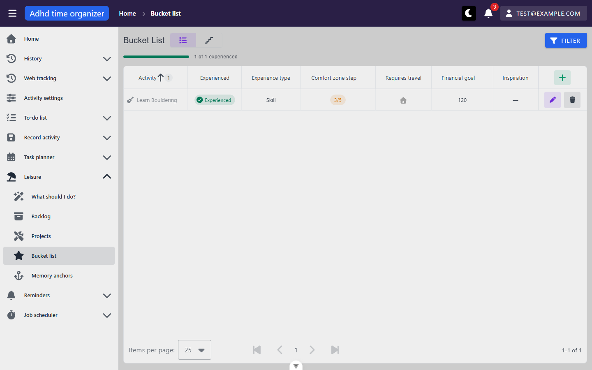
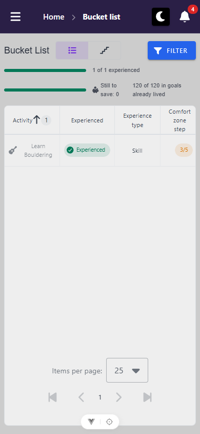
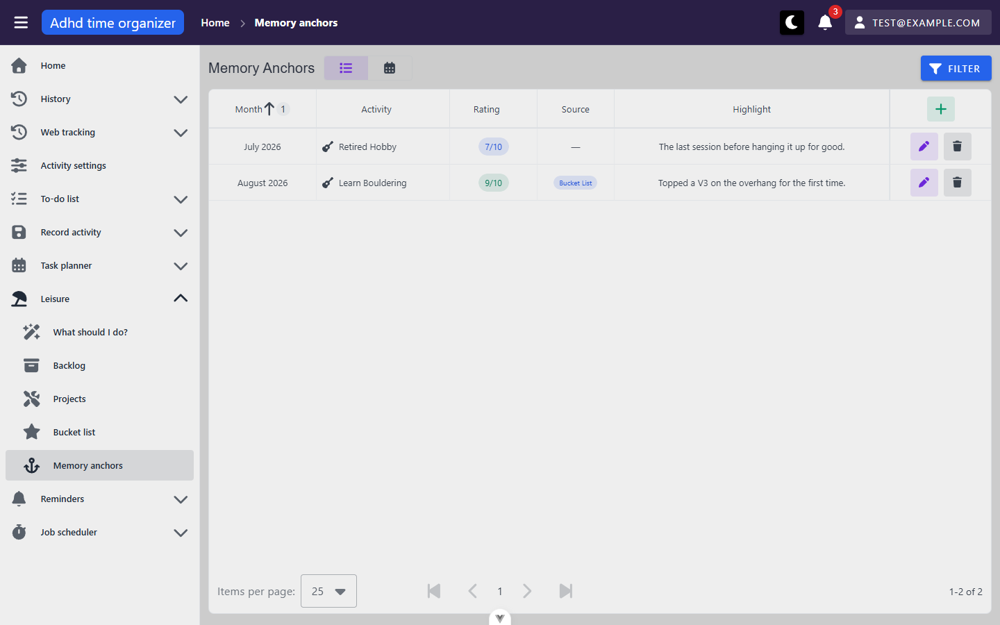
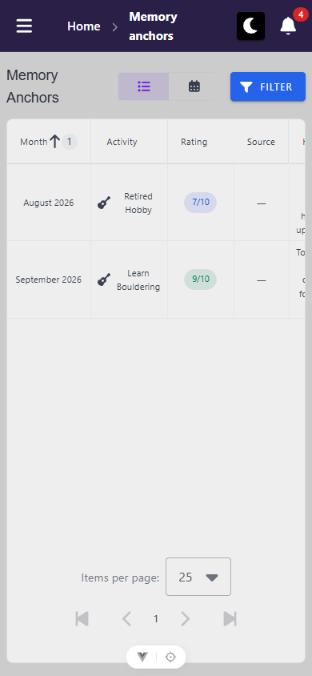

# leisure-bucket-anchors — inventory

> Captured 2026-09-15 (inventory pass, `50bd6b0d`) · updated 2026-09-15 (mutation pass, `f457aa0c`) · locale EN
> · account `test@example.com`

Shell chrome (top bar, sidebar, user menu, notification bell, dialog host, snackbars) is documented once in
`docs/views/_shell/inventory.md` — not repeated here except where this unit's views differ from that
baseline. One difference worth flagging up front: `MyDialog`'s Escape-does-not-close default (shell finding
A1) was re-confirmed on both `BucketListProfileForm`'s and `MemoryAnchorForm`'s create dialogs in this
unit — same framework behaviour, not a new defect.

## Views

### BucketListView (`/leisure/bucket-list`)

**Route:** `/leisure/bucket-list` · params: none · guard: auth
**Reached from:** Sidebar → Leisure → Bucket list. Also reachable with `?activityName=<name>` from a memory
anchor's "Bucket List" source chip (`MemoryAnchorTable.vue` / `MemoryAnchorTimeline.vue`).

**Actions**
| label | kind | selector | does | destination |
| --- | --- | --- | --- | --- |
| Table / Ladder | toggle (icon-only, `title`-named) | `getByTitle('Table')` / `getByTitle('Ladder')` | Switches `viewMode`; writes `view=table\|ladder` to the URL | in place |
| Filter | button (labelled) | `getByRole('button', { name: 'Filter' })` | Opens `FilterPanel` overlay | dialog, see below |
| Add (table header, icon-only, `title="Add"`) | button | `getByRole('button', { name: 'Add', exact: true })` | Opens `BucketListProfileForm` create dialog | dialog, see below |
| Add (ladder, top-right, labelled "Add") | button | `getByRole('button', { name: 'Add' })` (ladder) | Same create dialog | dialog, see below |
| edit (row, icon-only, `title="edit"`) | button | `getByTitle('edit')` | Opens `BucketListProfileForm` pre-filled | dialog, see below |
| delete (row, icon-only, `title="delete"`) | button | `getByTitle('delete')` | Opens a delete-confirmation dialog naming the activity | dialog, see below |
| Experienced chip / "I did this" (table & ladder) | link chip / button | `ExperiencedCell` — `getByText('Experienced')` when done, `getByRole('button', {name:'I did this'})` when not | Done: navigates to the matching memory anchor. Not done: opens the anchor-capture dialog with the activity locked | link → `/leisure/memory-anchors?activityName=…`, or dialog |
| Ladder rung delete (icon-only, `title="general.delete"` i.e. "Delete") | button | `getByTitle('Delete')` inside a rung card | Opens the same delete-confirmation dialog | dialog |
| Pagination (First/Prev/Next/Last, table only) | buttons (all `aria-label`-named) | `getByRole('button', { name: 'Next page' })` etc. | Pages the table | in place |
| Column header sort (Activity — the only sortable column) | button | `getByRole('columnheader', { name: 'Activity' })` | Toggles sort direction; writes `sortBy` to URL | in place |

**Icon-only controls** (a11y — see Findings A1): the table/ladder toggle and the row edit/delete buttons all
carry a `title` attribute (so they do have a computed accessible name) but no visible text and no
`aria-label`. `edit`/`delete` titles are lower-case, inconsistent with the sentence-case "Add"/"Table"/
"Ladder" titles on the same screen — cosmetic, not filed as its own finding (very likely a `BasicTable`
framework default shared by every table in the app, not unit-specific).

**Readable surfaces**
| surface | kind | contents | raw/derived | populated by |
| --- | --- | --- | --- | --- |
| Experienced-progress bar | progress bar + text ("N of M experienced") | `done`/`total` counts | derived — two extra count-only (`itemsPerPage:1`) requests under the current filter, not read off the loaded page | `POST /api/activity-bucket-list-profile/grid` ×2 (isAnchored:null, isAnchored:true), fired alongside the table's own fetch — 3 total requests per load/filter change, by design (see `useExperiencedProgress.ts` comments) |
| Table | table, 7 data columns + actions | Activity, Experienced, Experience type, Comfort zone step (`/5`, coloured), Requires travel (icon), Financial goal, Inspiration | raw, except Experienced (derived display of `isAnchored`); **Inspiration always renders "—" regardless of the underlying value — a table-formatter bug, not missing data, see Findings B3** | `POST /api/activity-bucket-list-profile/grid` |
| Ladder | 5 grouped sections ("rungs") | one per `comfortZoneStep` 1–5, each holding its matching rows; a "next rung" nudge card above the rungs | raw grouping of the same rows the table would show; nudge is derived (lowest rung with an unexperienced item) | intended: `POST /api/activity-bucket-list-profile/grid` at `itemsPerPage:500` — **currently never succeeds, see Findings X1** |
| Activity name cell icon | icon | the activity's `Role` icon/colour | raw (`ActivityInfo.role`) | same table fetch |

**States**
- empty: "These are experiences you want to have once. You don't have any here yet." + Add button — reachable
  by filtering to something with zero matches (confirmed via `isAnchored=false`, since the seed's one row is
  already experienced) — screenshot: `bucket-list--filter-chip-applied.png`. The **ladder always renders this
  same empty state**, even with real data present — see Findings X1, this is the bug, not a real empty state.
- loading: `BasicTable`'s built-in loading state (not separately screenshotted; standard Vuetify row
  skeleton/indeterminate bar, same as every other table in the app).
- error: no distinct visible error state for the table fetch itself in this pass (the one server error
  observed, X1, is swallowed silently rather than rendering an error state — see Findings).

**URL & persisted state**
- `view` (`table`|`ladder`) — survives reload (confirmed: reloaded on `view=ladder`, state and the
  underlying bug both persisted) and is written via `router.replace` on toggle.
- `page`, `perPage`, `sortBy` (table only) and every filter field (`activityName`, `experienceTypeIds`,
  `minComfortZoneStep`, `maxComfortZoneStep`, `requiresTravel`, `isAnchored`) — all live in the URL query
  string (confirmed by navigating directly to `?minComfortZoneStep=5` and `?isAnchored=false` and seeing the
  filter chip and request body reflect them). No `localStorage` use observed for this view.

**Dialogs opened from here**
- **Filter** (`FilterPanel`) — Activity (text), Experience type (multi-select), Comfort zone step min/max
  (number), Requires travel (tri-state checkbox), Experienced (tri-state checkbox). Confirm writes every
  field to the URL and closes; Clear resets. Applied filters render as removable chips above the table
  (`Experienced: ✗` observed rendering as a literal glyph next to a circle-check icon that does not change
  between the true/false state — minor, not filed).
- **BucketListProfileForm** (create/edit) — Activity (autocomplete-with-create, required), Experience type
  (select, required implied by DTO default but not enforced — see Findings B2), Comfort zone step (1–5
  stepper), Requires travel (checkbox), Financial goal (number, nullable), Inspiration (text). Cancel closes
  without saving (confirmed); Escape does not close (shell A1, re-confirmed here). **A fresh create dialog
  shows "0" in the Activity and Experience type fields** — see Findings B2. **Create itself works** (confirmed
  in the mutation pass: `POST /api/activity-bucket-list-profile` → 201, new row appears without a reload) —
  **but Save on an edit always fails silently** (`PUT /api/activity-bucket-list-profile/{activityId}` → 404,
  dialog stays open with no error shown) — see Findings X4.
- **Delete confirmation** — "Are you sure you want to delete {activity name}?" Cancel/Confirm. Cancel
  verified not to delete (row count unchanged after). **Confirm also does not delete** — mutation pass found
  `DELETE /api/activity-bucket-list-profile/{activityId}` 404s for every row, silently (dialog closes, row
  stays, no error shown) — see Findings X4.
- **"I did this" capture dialog** (`MemoryAnchorForm`, locked-activity mode, titled **"Write it down"**) —
  Activity rendered as read-only text (not a picker), Month/Year (number, defaults to the current month/year),
  Highlight (textarea, empty by default), Rating (number, defaults to 5). Confirmed working end-to-end in the
  mutation pass: saving fires `POST /api/memory-anchor` → 201, the source row's Experienced state flips
  immediately, and the new anchor appears in `/leisure/memory-anchors` with a working "Bucket List" source
  chip. This is the one create path in this view that is **not** affected by Findings X4 (it never calls
  `update()`/`deleteEntity()` on the bucket-list profile itself).

**Keyboard**
- Tab order through the header reaches Table/Ladder toggle → Filter → Add, matching visual order.
- Escape does not close the create/edit dialog (see above); the Filter panel and delete-confirmation dialog
  were not separately Escape-tested in this pass (time-boxed — same `MyDialog` base, expected to match).

**Console & network**
- errors/warnings: none on the table view's default load. **On switching to the ladder view: 2 console
  errors** (`AxiosError: Request failed with status code 400` from `loadLadder`, `BucketListView.vue:65`) —
  see Findings X1.
- non-2xx: `POST /api/activity-bucket-list-profile/grid` → **400** whenever the ladder is loaded (`itemsPerPage`
  exceeds the backend's max of 200) — see Findings X1. Also observed: the same endpoint ignores
  `minComfortZoneStep`/`maxComfortZoneStep` server-side (200, but unfiltered) — see Findings B1.
- duplicate requests: the table view fires `POST /api/activity-bucket-list-profile/grid` **3 times** per
  load/filter change (1 table fetch + 2 progress counts) — by design, not a bug (see `useExperiencedProgress.ts`
  comments; each uses its own `useFetchFilteredTable` instance specifically so they don't cancel each other).
- Also observed (not app-code, timing artefact): a burst of `401`s on the first request after the tab sat
  idle past the access-token lifetime, self-healed by `POST /api/auth/refresh` — matches CLAUDE.md's
  documented behaviour exactly, not a defect.

**Narrow viewport (390 × 844)** · checked 2026-10-06 · commit `8a2d4ffa`

- layout: title, Table/Ladder toggle (108–236) and Filter (288–382) fit on one row. The progress bars sit
  under it at 160 px wide, with their text in narrow columns beside them ("Still to / save: 0", "120 of 120
  in goals / already lived"), wrapped but readable. **Table mode:** every column kept, scrolling sideways
  inside the wrapper (table right 772). **Ladder mode**
  ([screenshot](screenshots/bucket-list-ladder--mobile.png)) reflows cleanly. The five rungs stack
  vertically, the rung card fills the width (activity, inspiration, type, Experienced chip and trash on one
  row), and its labelled "Add" (316–382 × 205) is on screen.
- mobile-only controls: none
- replaced controls: none
- overflow: `docScroll` 390 in both modes. Table mode: the `table` inside `.v-table__wrapper`
  (`overflow-x: auto`), intentional, but the header Add (700) and row Edit/Delete (676–764) start off-screen,
  so in table mode no Add is visible on landing. See `leisure-backlog-picker` B6 [framework]. Ladder: no
  offenders.
- dialogs: create ([screenshot](screenshots/bucket-list-create-dialog--mobile.png)) 24–366 × 139–706, no
  inner scroll, Cancel/Create at y 649, comfort-zone stepper 5 × 40 px. Filter panel full-width under the
  bar, Clear/Confirm at y 792. Delete confirm: **the ladder's trash button has none and deleted the row on
  the first tap.** See `B4` (not width-specific). "I did this" not reached: the only row was already
  anchored.
- visual sweep: nothing wrong at this width. Ladder trash 32×32, toggle buttons 64×36.

### MemoryAnchorsView (`/leisure/memory-anchors`)

**Route:** `/leisure/memory-anchors` · params: none · guard: auth
**Reached from:** Sidebar → Leisure → Memory anchors. Also reachable with `?activityName=<name>` from a
bucket-list row's Experienced chip, and opened directly (activity locked) from the bucket-list/backlog "I
did this" action anywhere in the app.

**Actions**
| label | kind | selector | does | destination |
| --- | --- | --- | --- | --- |
| Table / Timeline | toggle (icon-only, `title`-named) | `getByTitle('Table')` / `getByTitle('Timeline')` | Switches `viewMode`; writes `view=table\|timeline` to the URL | in place |
| Filter | button (labelled) | `getByRole('button', { name: 'Filter' })` | Opens `FilterPanel` overlay | dialog, see below |
| Add (table & timeline, labelled/icon-`title`) | button | `getByRole('button', { name: 'Add', exact: true })` | Opens `MemoryAnchorForm` create dialog, activity unlocked | dialog, see below |
| edit (row, icon-only, `title="edit"`) | button | `getByTitle('edit')` | Opens `MemoryAnchorForm` pre-filled, activity locked | dialog, see below |
| delete (row, icon-only, `title="delete"`) | button | `getByTitle('delete')` | Opens delete-confirmation naming the activity | dialog, see below |
| Source chip ("Bucket List" / "Backlog (one-time)") | link chip | `getByText('Bucket List', { exact: true })` | Navigates to the source profile, filtered by activity name | `/leisure/bucket-list?activityName=…` or `/leisure/backlog?activityName=…` |
| Timeline: prev/next year (icon-only, `title`-named) | button | `getByTitle('Previous year')` / `getByTitle('Next year')` | Steps `year` | in place, writes `year` |
| Timeline: year picker | menu button | `getByTitle('Pick a year')` | Opens a year list with a per-year anchor count | in place |
| Pagination (table only) | buttons (`aria-label`-named) | as shell baseline | Pages the table | in place |
| Column header sort (Month — the only sortable column) | button | `getByRole('columnheader', { name: 'Month' })` | Toggles sort by `periodKey` | in place |

**Readable surfaces**
| surface | kind | contents | raw/derived | populated by |
| --- | --- | --- | --- | --- |
| Table | table, 4 data columns + actions | Month (`periodKey`, formatted via `Intl.DateTimeFormat`), Activity, Rating (`/10`, coloured — thresholds ≥8 green, ≥5 blue, else amber), Source (chip or "—"), Highlight | raw, except Month/Rating colour (derived formatting) | `POST /api/memory-anchor/grid` |
| Timeline — year strip | 12-cell horizontal strip, one per month | each cell shaded by that month's **best** rating; empty months rendered as a distinct outlined "is-empty" cell | derived (client-side grouping + colour-intensity formula) | intended: `POST /api/memory-anchor/grid` at `itemsPerPage:500` — **currently never succeeds, see Findings X2** |
| Timeline — month rows | 12 rows, one per month, each listing that month's anchors in full (activity, source chip, rating swatch, and the **full highlight note text**, not truncated) | same | same (blocked by X2) | same |
| Timeline — year picker | menu | every year with ≥1 anchor, plus the current year, each showing a count | derived from the full (currently unfetchable) anchor set | same (blocked by X2) |

**States**
- empty: "These are experiences you've had and want to remember. You don't have any memory anchors here
  yet." + Add button. **The timeline shows this every time**, regardless of real data — see Findings X2 (same
  bug class as the bucket-list ladder, X1).
- loading: standard `BasicTable` loading state on the table; a `VProgressLinear` at the top of the timeline
  (confirmed present, but never resolves to real content — see X2).
- error: none rendered distinctly; server/network failures are swallowed (see Findings).

**URL & persisted state**
- `view` (`table`|`timeline`) — same pattern as bucket list, confirmed surviving reload.
- `page`, `perPage`, `sortBy` (table) and filter fields `activityName`, `year`, `month`, `minRating` — all in
  the URL (confirmed via direct navigation to `?year=2025`, `?month=1`, `?minRating=9`, each correctly
  appearing in the outgoing request body — see Findings B1 for what the backend then does with them).
- Timeline's `year` is the same URL param as the filter's `year` field, by design (comment in
  `MemoryAnchorsView.vue`) — confirmed switching timeline → table keeps the chosen year as the table's Year
  filter.

**Dialogs opened from here**
- **Filter** (`FilterPanel`) — Activity (text), Year (number, 2000–2200), Month (number, 1–12), Rating
  (number, **1–10** — confirmed live: setting `9` and confirming produces `minRating=9` in the URL, i.e. the
  L2 fix for the old 1–5 filter cap is present and working on the frontend side; see Findings B1 for the
  backend half).
- **MemoryAnchorForm** (create, unlocked) — Activity (autocomplete, required; sourced from
  `fetchAnchorEligibleActivities()`), Month/Year (number), Highlight (textarea), Rating (number, 1–10).
  **This dialog is non-functional against the running backend** — see Findings X3. Shows "0" in the Activity
  field exactly like the bucket-list form — same root cause, Findings B2.
- **MemoryAnchorForm** (edit / "I did this", locked) — same fields, Activity replaced by a read-only text
  field showing the locked activity name; dialog is titled **"Write it down"** in locked/create-from-capture
  mode. **Confirmed working end-to-end in the mutation pass**: created a fresh not-yet-anchored bucket-list
  row specifically to exercise this path — the dialog opened pre-filled with the activity locked, Month/Year
  defaulted to the current month/year, Rating defaulted to 5; saving fired `POST /api/memory-anchor` → 201 and
  the new anchor appeared immediately in the table with a working source chip. **Editing an existing anchor
  also works** — a no-op edit (open, change nothing, Save) on the seeded `Retired Hobby` row fired `PUT
  /api/memory-anchor/18002` → 200. Unlike the bucket-list profile forms (Findings X4), `MemoryAnchor` carries
  its own real `id` rather than an activity-derived one, so this entity's edit/delete are not affected by that
  bug.
- **Delete confirmation** — "Are you sure you want to delete {activity name}?" — confirmed via screenshot
  `memory-anchors--delete-confirm.png`; Cancel verified not to delete. **Confirm does delete** (mutation pass:
  `DELETE /api/memory-anchor/{id}` → 204, row disappears without a reload) — and deleting an anchor that came
  from a bucket-list "I did this" correctly reverts the source row's `isAnchored` back to false (was Findings
  U2, now resolved/confirmed working — see findings.md's Resolved section).

**Keyboard**
- Not separately walked beyond the Escape check (shared `MyDialog` base, same as bucket list).

**Console & network**
- errors/warnings: none on the table view's default load.
- non-2xx: `POST /api/memory-anchor/grid` → **400** on switching to the timeline (Findings X2, same
  `itemsPerPage:500 > 200` shape as X1). `GET /api/memory-anchor/anchor-eligible-activities` → **400** every
  time the unlocked create dialog opens (Findings X3). `POST /api/memory-anchor` → **400** when the create
  dialog is submitted with the un-fixed default `activityId:0` (Findings B2, backend correctly rejects it —
  no anchor was created; confirmed row count unchanged afterwards).
- duplicate requests: none beyond the by-design table+timeline pattern already noted for bucket list (this
  view's timeline uses its own `useMemoryAnchorCrud()` instance for the same cancellation-avoidance reason).
- Also observed the same self-healing `401` burst / `auth/refresh` pattern as bucket list, at a different
  point in the session — not a defect.

**Narrow viewport (390 × 844)** · checked 2026-10-06 · commit `8a2d4ffa`

- layout: the title wraps to two lines ("Memory / Anchors") beside the Table/Timeline toggle and Filter.
  **Table mode:** columns kept, scrolling sideways (table right 548). Highlight gets 81 px and wraps to 4–5
  lines per row (rows 96 px tall), cramped but readable
  ([scrolled](screenshots/memory-anchors-scrolled--mobile.png)). **Timeline mode**
  ([screenshot](screenshots/memory-anchors-timeline--mobile.png)) fits. The year bar is prev/year/next
  (8–168), then "Memories: 2", then a labelled Add (316–382). The 12-cell strip spans 8–382, and the month
  rows stack with their anchor cards at full width.
- mobile-only controls: none
- replaced controls: none
- overflow: `docScroll` 390 in both modes. Table: the `table` inside `.v-table__wrapper` (intentional). Header
  Add (476) and row Edit/Delete (452–540) start off-screen, see `leisure-backlog-picker` B6 [framework].
  Timeline: no offenders.
- dialogs: unlocked create ([screenshot](screenshots/memory-anchors-create-dialog--mobile.png)) 24–366 ×
  171–674. Month/Year side by side (149 px each, 69 px inputs, values readable), Cancel/Create at y 617.
  Year menu 56–170 × 186–242. Filter panel full-width as on the other views.
- breadcrumb: "Memory anchors" wraps to two lines in the bar. Added to shell `P4`.
- visual sweep: nothing wrong beyond the cramped Highlight column. Learn Bouldering's Source reads "—"
  because this pass deleted its bucket-list row (`B4`). That's fixture damage, not a view defect.

## Transitions out of this unit
| from | control | goes to |
| --- | --- | --- |
| BucketListView | Experienced chip (done row) | `/leisure/memory-anchors?activityName=…` (this unit) |
| BucketListView | "I did this" (not-done row) | opens `MemoryAnchorForm` dialog, in place — no navigation |
| BucketListView | `NewBucketListProfileForm`'s "no eligible activities"-style create-activity flow is not present here (that alert only exists on `MemoryAnchorForm`) | n/a |
| MemoryAnchorsView | Source chip → "Bucket List" | `/leisure/bucket-list?activityName=…` (this unit) |
| MemoryAnchorsView | Source chip → "Backlog (one-time)" | `/leisure/backlog?activityName=…` (out of unit — `leisure-backlog-picker`) |
| MemoryAnchorForm (unlocked, no eligible activities) | "Backlog" / "Bucket List" buttons in the info alert | `/leisure/backlog` / `/leisure/bucket-list` (not exercised — the alert never rendered in this pass because the fetch that would populate it failed outright rather than returning an empty list; see Findings X3) |
