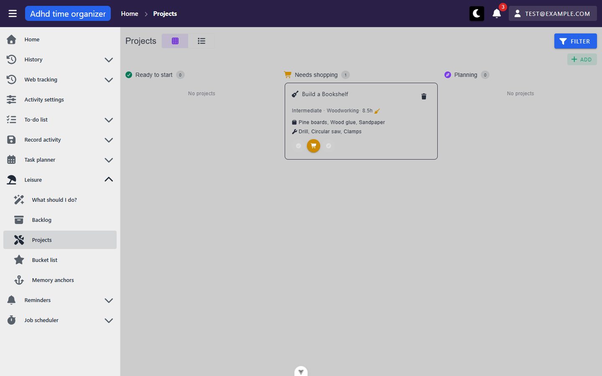

# leisure-projects — inventory

> Captured 2026-09-15 (mutation pass; supersedes the 2026-09-13 inventory-pass snapshot below it in
> `git log` for this file) · locale EN · account `test@example.com` · commit `f457aa0c`

## Views

### ProjectsView (`/leisure/projects`)

**Route:** `/leisure/projects` · params: none · query: `page`, `perPage`, `sortBy` (table mode only),
`view` (`board`|`table`), plus one query key per filter field · guard: auth
**Reached from:** sidebar Leisure group → "Projects". Not linked from any other view.

**Actions**
| label | kind | selector | does | destination |
| --- | --- | --- | --- | --- |
| Board / Table toggle | button group (`VBtnToggle`) | `getByRole('button', { name: 'Board' \| 'Table' })` | Switches view mode; writes `view` query param **unreliably on the first switch after a fresh load, see Findings B1** | in place |
| Filter | button | `getByRole('button', { name: 'Filter' })` | Opens the `FilterPanel` overlay (`role=dialog`) | overlay |
| Filter panel close (×) | button, **icon-only, no accessible name** | fallback: CSS `.v-btn--icon.text-secondaryOutline` inside the panel header | Closes the filter overlay | in place — see Findings A1 |
| Filter chip, e.g. "Readiness (1)" | chip | `getByText('Readiness (1)')` | Shows active filter value | n/a |
| Filter chip's "Close" | button | `getByRole('button', { name: 'Close' })` (scoped to the chip) | Clears that one filter field | in place |
| Filter panel fields: Activity (text), Difficulty (multi-select), Readiness (multi-select), Area (text), Messy (tri-state checkbox) | input / select / checkbox | role+name, e.g. `getByRole('textbox', { name: 'Activity' })` | Edit the draft filter | n/a until Confirm |
| Filter panel Clear | button | `getByRole('button', { name: 'Clear' })` | Resets the draft filter to default | n/a |
| Filter panel Confirm | button | `getByRole('button', { name: 'Confirm' })` | Applies the draft filter, closes the panel, resets to page 1 | in place, triggers reload |
| Add (toolbar) | button | `getByRole('button', { name: 'Add' })` | Opens the create dialog (`ProjectProfileForm`) | dialog |
| Add (table header "+") | button | `getByRole('columnheader').getByRole('button', { name: 'Add' })` | Same create dialog — a second, framework-provided entry point | dialog |
| Add (board empty-state) | button | `getByRole('button', { name: 'Add' })`, scoped to the empty-state block | Same create dialog | dialog |
| **Board** — card body (click anywhere on it) | `
` with `@click`, **no role/tabindex** | text locator only, e.g. `getByText('Build a Bookshelf')` | Opens the edit dialog, pre-filled, activity field locked | dialog — **not reachable by keyboard, see Findings A4** |
| **Board** — card Delete (trash, icon-only but named) | button | `getByRole('button', { name: 'Delete' })` (title-based) | Opens a delete-confirmation dialog | confirm dialog, then **delete always fails, see Findings X1** |
| **Board** — status buttons ×3 per card (icon-only but named) | button row | `getByRole('button', { name: 'Ready to start' \| 'Needs shopping' \| 'Planning' })`, scoped to the card | Sets `readinessStatus` to that column via a full-profile PUT | in place — **currently always fails, see Findings X1** |
| **Table** — column headers: Activity (sortable, default asc), Est. hours (sortable); Difficulty/Readiness/Area/Messy (not sortable) | header | `getByRole('columnheader', { name: '<label>' })` | Toggles sort, writes `sortBy` to the URL | in place |
| **Table** — row "edit" (icon-only, named) | button | `getByRole('button', { name: 'edit' })` scoped to row | Opens the edit dialog | dialog |
| **Table** — row "delete" (icon-only, named) | button | `getByRole('button', { name: 'delete' })` scoped to row | Opens `BasicTable`'s own delete confirm (`deleteConfirmationColumn="activity.name"`) | confirm dialog, then **delete always fails, see Findings X1** |
| **Create/Edit dialog** fields: Activity (autocomplete, locked on edit, **shows literal "0" on create, see Findings B5**), Difficulty (select), Readiness (select), Area (text), Est. hours (`VNumberInput`, **rounds fractional values, see Findings B4**), Messy (checkbox), Materials needed / Required tools (`VCombobox`, free-entry chips) | various | role+name | Edit the draft request | n/a until Create/Save |
| **Create/Edit dialog** Cancel | button | `getByRole('button', { name: 'Cancel' })` | Closes without saving | in place |
| **Create/Edit dialog** Create / Save | button | `getByRole('button', { name: 'Create' \| 'Save' })` | Validates, then creates/updates — **create succeeds (201); update always 404s, see Findings X1** | in place, triggers reload |
| **Create dialog** activity autocomplete "no data" → create option | list item | `getByText(/Create ".*"\|Create a new activity/)` | Opens `QuickCreateActivityDialog` | dialog |
| **Delete confirmation** Cancel / Confirm | button | `getByRole('button', { name: 'Cancel' \| 'Confirm' })` | Closes / attempts delete | in place / **always fails, Findings X1** |

**Readable surfaces**
| surface | kind | contents | raw/derived | populated by |
| --- | --- | --- | --- | --- |
| Readiness board | 3-column card board | One card per project, grouped by `readinessStatus` | Grouping is **derived** client-side (`computed` `Map` keyed by `COLUMN_ORDER`); card fields are raw | `POST /api/activity-project-profile/grid` (via `loadBoard()`, fixed `itemsPerPage: 200` — a server-side cap, not a preference) |
| Board column count chip | badge | Count of cards in that column | derived (`.length` of the grouped array) | same request |
| Board card body | text | Activity icon+name, difficulty, area, est. hours, messy icon, metadata line | raw, except a formatting bug — **missing space before the second "·" separator, Findings P2** | same request |
| Board card blockers (NeedsShopping only) | text list | First 3 of `materialsNeeded` / `requiredTools`, "+N more" if longer | raw values, truncation derived (`blockerLine()`, max=3) | same request |
| Board/table card activity icon | icon | Activity's role icon, tinted its role colour | raw, via a fallback chain (`icon ?? category?.icon ?? role?.icon`) | same request — **now renders correctly; this was broken in the 2026-09-13 pass (Findings B3, now fixed)** |
| Table | server-paginated grid (`BasicTable`) | Activity, Difficulty, Readiness, Area, Est. hours, Messy (icon only, no accessible text — Findings A2), row actions | raw | `POST /api/activity-project-profile/grid` (`itemsPerPage: 25` default, via `useServerTable`) |
| Filter chips | chip row | One per active filter field, formatted via `textChip`/`countChip`/`boolChip` | derived (formatted from filter state) | n/a, client-only |

**States**
- empty (filtered to zero): reached by filtering `Messy: false` against the one seeded (messy) project.
  Both board and table render the identical "These are things you're building or making. You don't have any
  projects here yet." copy + Add button that a genuinely-empty account would see — no distinction between
  the two cases. See Findings P3.
- empty (genuinely no projects): **not reachable with current seed** — the seed always carries at least one
  project (`profiles.project: 17201`), and deleting it through the UI is impossible (Findings X1). See U1.
- loading: board shows a top `VProgressLinear` (indeterminate) while `boardLoading`; not reliably
  screenshotted (too fast on this seed's single row) — see U2.
- error: not reachable with current tooling — no way to force a 4xx/5xx from the UI without network
  interception, which this pass did not attempt.

**URL & persisted state**
- `page`, `perPage`, `sortBy` — table pagination/sort; round-trip through reload correctly.
- `activityName`, `difficultyLevels`, `readinessStatuses`, `projectArea`, `isMessy` — filter fields; all
  five round-trip correctly through a reload, including the tri-state `isMessy` (confirmed absent from the
  query string when cleared, not present as an empty/false value).
- `view` (`board`|`table`) — **intended** to round-trip so the chosen view mode survives a reload
  (explicitly required by the P1 prompt that built this toggle). **Does not reliably survive** — reproduced
  twice in a row that the very first switch away from board after a fresh page load fails to write `view`
  to the URL; once the table has been mounted once, every subsequent toggle round-trips correctly. See
  Findings B1.
- Nothing in this view touches `localStorage`.

**Dialogs opened from here**
- **Filter** (`FilterPanel`, a `Teleport`-to-body overlay, not a `MyDialog`) — fields listed above; closes
  on **Escape** (confirmed) and on its own × button and on Confirm/click-outside.
- **Add / Edit** (`ProjectProfileForm` in a `MyDialog` via `useDialog().openDialog`) — persistent by default
  (the framework's documented default, `docs/views/_shell/inventory.md` A1); Escape does **not** close it.
  Same title ("Projects") for both create and edit — only the confirm button label changes ("Create" vs
  "Save").
- **Delete confirmation** — board uses `useDialog().confirm()` directly from `ProjectReadinessBoard.vue`;
  table's delete goes through `BasicTable`'s own built-in `MyDialog` confirm. Both read "Are you sure you
  want to delete `<activity name>`?" with no cascade information — correct here, since a project profile
  delete has nothing to cascade to.

**Keyboard**
- Escape closes the Filter overlay but not the Add/Edit `MyDialog` (framework default, not unit-specific).
- Status buttons and the board card's Delete button are real, named `<button>`s — keyboard-reachable.
- The board card body itself (the primary "open this project" gesture) has no `role`/`tabindex` — confirmed
  via `getAttribute`, not reachable by Tab. See Findings A4.
- No drag-and-drop is implemented for moving cards between columns (no `draggable` attribute) — matches
  P1's explicit fallback allowance for a button-based status control instead.
- Table column-header sort is reachable by keyboard via Vuetify's native header semantics.

**Console & network**
- errors/warnings: one recurring **info-level** Vue warning naming app code — "Extraneous non-props
  attributes (class) were passed to component... at `<FilterPanel>` at `<ProjectsView>`" — fires on every
  render/re-render of this view. See Findings P1. Every write attempt (status change / edit save / delete)
  additionally produces a 404 `AxiosError` and an "Unhandled error during execution of..." console entry —
  see Findings X1.
- non-2xx: `PUT /api/activity-project-profile/{activityId}` → 404 (every time), `DELETE
  /api/activity-project-profile/{activityId}` → 404 (every time). `POST /api/activity-project-profile`
  (create) → 201, works correctly.
- duplicate requests: **yes, confirmed reproducing again in this pass** — every filter change made while
  the board is the active view mode fires **two** `POST /api/activity-project-profile/grid` calls in the
  same tick, one with `itemsPerPage:200` (the board's own, real request) and one with `itemsPerPage:25`
  (the table's `useServerTable` filter-watcher, which keeps running even though the table isn't mounted);
  the 200-item call is the one that gets aborted (`net::ERR_ABORTED`). See Findings B2.

## Transitions out of this unit
| from | control | goes to |
| --- | --- | --- |
| Sidebar | "Backlog" / "Bucket list" / "Memory anchors" / "What should I do?" | other `leisure` views — not followed, out of unit scope |
| Create/Edit dialog | activity autocomplete "create new" option | `QuickCreateActivityDialog` — opened and exercised in this pass (create flow) |
