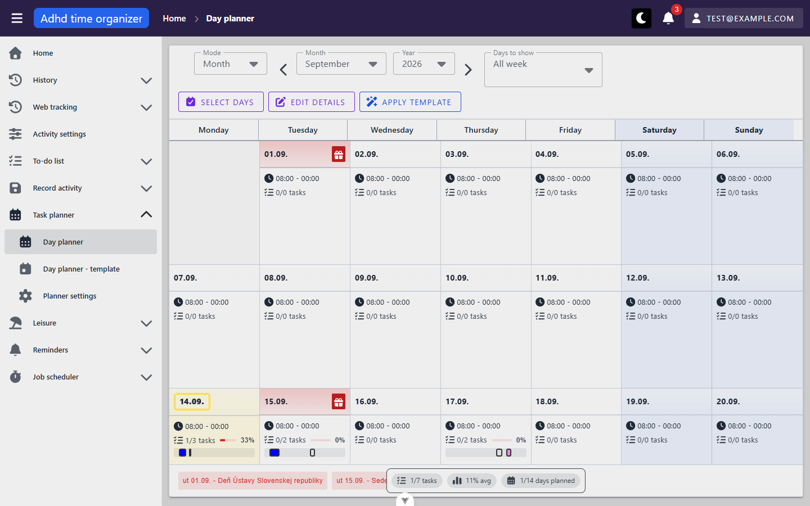
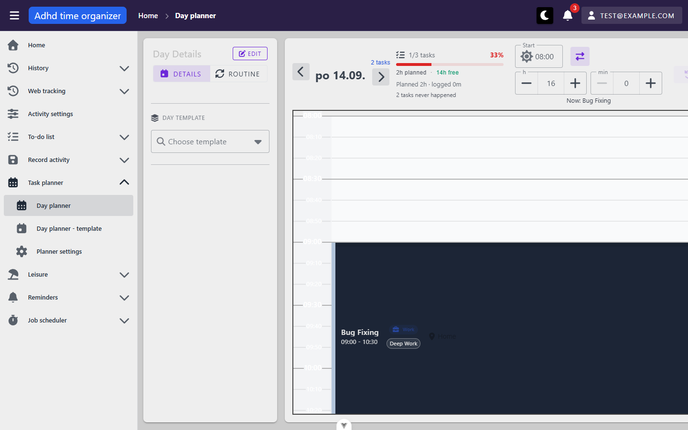
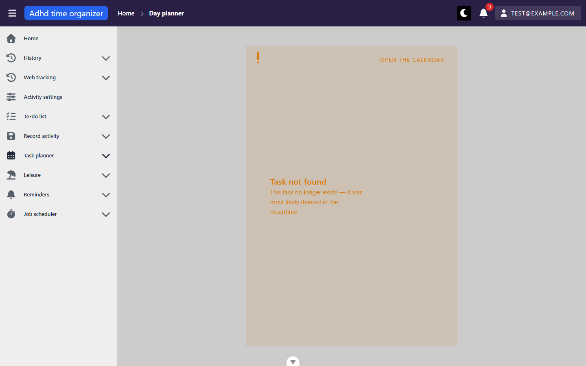
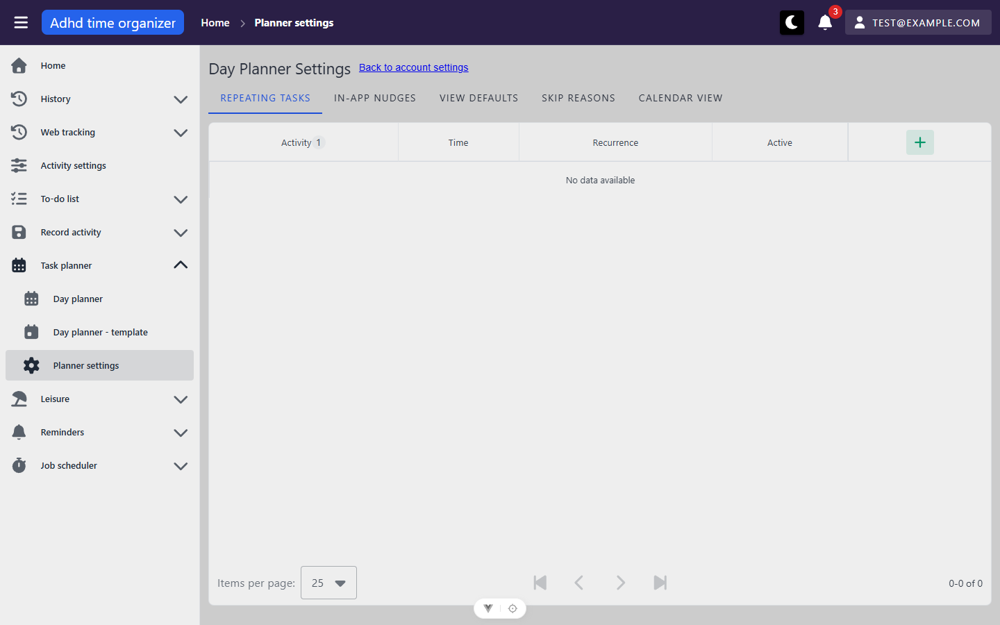

# planner-day — inventory

> Captured 2026-09-14 · locale EN · account `test@example.com` · commit `6aac48bb`

## Views

### PlannerCalendarView (`/day-planner`)

**Route:** `/day-planner` · params: none · query: `month` (`YYYY-MM`, omitted for the current month),
`mode` (`bulkSelect | editDetails | applyTemplate`, omitted for none), `templateId` (only while
`mode=applyTemplate` and a template is chosen) · guard: auth
**Reached from:** sidebar "Task planner → Day planner"; every day cell links back here from
`/day-planner/:date` via the breadcrumb/back nav

**Actions**
| label | kind | selector | does | destination |
| --- | --- | --- | --- | --- |
| Mode (Range / Month / Duration) | select | `getByRole('combobox', {name:'Mode'})` | switches the calendar range strategy | in place |
| Month / Year selects, prev/next arrows | select + icon buttons | prev/next have **no accessible name** (see A1) | moves the visible month; arrows write `?month=` | in place |
| Anchor / Date from / Unit / Quantity (Duration mode only) | selects + date input | visible only when Mode=Duration | defines a rolling N-day/week/month range from a date | in place |
| Days to show (All week / Workdays / Weekend) | select | `getByRole('combobox', {name:'Days to show'})` | filters which weekdays render as columns | in place |
| Select Days | toggle button | `getByRole('button', {name:'Select Days'})` | enters bulk day-selection mode; writes `?mode=bulkSelect` | in place |
| Edit Details | toggle button | `getByRole('button', {name:'Edit Details'})` | enters click-a-day-to-edit-its-details mode; writes `?mode=editDetails` | opens Day Details dialog on day click |
| Apply Template | toggle button | `getByRole('button', {name:'Apply Template'})` | enters click-a-day-to-apply-a-template mode; writes `?mode=applyTemplate` | opens the template picker bar |
| Day cell (default mode) | row action | e.g. `getByText('14.09....')` | navigates to that day | `/day-planner/:date` |
| Day cell (bulk-select mode) | row action | same | toggles the day into the selection | in place |
| Day cell (edit-details mode) | row action | same | opens "Day Details" dialog for that day | dialog |
| Day cell (apply-template mode, no template chosen) | row action | same | navigates to that day, carrying `applyTemplateId` as a query param the day view consumes once then clears | `/day-planner/:date` |
| Select All (bulk bar) | button | `getByRole('button', {name:'Select All'})` | selects every visible day | in place |
| Change day type (bulk bar) | select | `getByRole('combobox', {name:'Change day type'})` | Workday / Weekend / Holiday / Vacation / Sick day / Special | in place |
| Apply Template (bulk bar) | button | `getByRole('button', {name:'Apply Template'}).nth(1)` | opens "Apply Template to N day(s)" dialog | dialog |
| Copy Day (bulk bar) | button | `getByRole('button', {name:'Copy Day'})` | opens "Copy tasks to N day(s)" dialog | dialog |
| Cancel (bulk bar) | button | `getByRole('button', {name:'Cancel'})` | clears selection and exits bulk mode | in place |
| Select template (apply-template bar) | select | `getByRole('combobox', {name:'Select template'})` | Relaxed Weekend / Home Office / Office Day (seed data) | in place |
| Preview / Apply / Cancel (apply-template bar) | buttons | role+name | preview shows the template overlaid before committing | in place |

**Readable surfaces**
| surface | kind | contents | raw/derived | populated by |
| --- | --- | --- | --- | --- |
| Month grid | calendar | one cell per day: date, wake–bed time, `N/M tasks`, a completion %, up to a few colour task chips | raw day fields + `totalTasks`/`completedTasks`; chips are per-task colour from `calendar/task-summaries` | `POST /api/calendar/filter` (day list) + `POST /api/calendar/task-summaries` (chip contents, only for days with tasks) |
| Holiday strip | list | `<weekday> <date> - <holiday name>` for each holiday in view | `holidayKey` resolved through `calendar.holidays.*` (`useHolidayLabel()`), `holidayName` as fallback — B4, fixed 2026-09-21 | `calendar/filter` (`holidayKey` + `holidayName` fields) |
| Footer stats bar | counters | `N/M tasks`, `X% avg`, `N/M days planned` | derived client-side from the loaded `calendar/filter` rows | `CalendarStatsBar.vue` |
| Plan-vs-actual trend line | chart-like | one point per day in view with a planned/actual comparison | raw aggregate per day | `POST /api/planner-task/plan-vs-actual-trend` |

**States**
- empty: a day with `0/0 tasks` renders no progress bar, just the time range — reachable on almost every date in the seed
- loading: not captured distinctly (requests resolve fast in this environment)
- error: not triggered in this pass — `calendar/filter` and `task-summaries` both returned 200 throughout

**URL & persisted state**
- `month` — round-trips on reload and back/forward (confirmed: navigated Sep→Oct→Nov→Dec→Jan 2027 via the
  next-month arrow, URL updated each time, final state survived a screenshot check with correct data)
- `mode` and `templateId` — round-trip on reload (confirmed for `bulkSelect` and `applyTemplate`)
- **Does NOT round-trip: the "Days to show" filter, and the entire Duration/Range mode configuration**
  (Mode itself, Anchor, Date from, Unit, Quantity) — see B2
- `selectedDayIds` — deliberately excluded from the URL (matches P7's explicit decision)

**Dialogs opened from here**
- **Day Details** (edit-details mode, click a day) — Start/duration (hour+min steppers, with a
  time-range/duration toggle), Day Label, Day Type, Location, Weather, Notes; Cancel / Confirm. Escape does
  not close it (see shell A1 — same `persistent` default, not re-filed here).
- **Apply Template to N day(s)** (bulk bar) — Choose template, Conflict resolution (default "Ignore"); Apply
  is disabled until a template is chosen; Cancel / Apply.
- **Copy tasks to N day(s)** (bulk bar) — a single date field labelled **"Date"** instead of "Source date"
  (see B1), defaulting to today; Cancel / Copy.

**Keyboard**
- Escape does not close any dialog opened from this view (persistent-by-default framework dialog, see shell A1)
- No arrow-key navigation was found on the month grid itself (P8's keyboard work targeted the day grid's task
  blocks, not this calendar); tabbing was not exhaustively walked for this view — see shell doc for the global
  tab order baseline

**Console & network**
- errors/warnings: none, once past the known stale-token 401 burst on a fresh sign-in (see CLAUDE.md)
- non-2xx: none observed
- duplicate requests: **none** — one `calendar/filter` + one `calendar/task-summaries` + one
  `plan-vs-actual-trend` POST per navigation, confirmed across five rapid month changes (Sep→Jan 2027). This
  is the P5 fix landed and holding: no per-day fan-out, no request-count growth with a populated month.

### DayPlannerView (`/day-planner/:date`)

**Route:** `/day-planner/:date` (`date` = `dd-mm-yyyy`, resolved from a day-cell click, or defaulted to the
user's today via a `router.replace` when `/day-planner` itself is hit without a date) · params: `date` ·
query: `focus` (a task id to scroll to and highlight, consumed once), `applyTemplateId` (auto-triggers a
template preview, consumed once and cleared via `router.replace({query:{}})`) · guard: auth
**Reached from:** any day cell on `PlannerCalendarView`; `PlannerTaskLinkView`'s redirect; the previous/next
day arrows within this same view

**Actions**
| label | kind | selector | does | destination |
| --- | --- | --- | --- | --- |
| prev/next day arrows | icon buttons | flanking the date heading | moves one day; the view prefetches the adjacent day's calendar | in place |
| Details / Routine tabs | tabs | `getByRole('button', {name:'Details'\|'Routine'})` | switches the left side panel between day-details editing and this day's routine to-do items | in place |
| EDIT (Day Details) | button | `getByRole('button', {name:'Edit'})` | opens the same "Day Details" dialog documented under the calendar view | dialog |
| Choose template | select | `getByRole('combobox', {name:'Choose template'})` | picks a `TaskPlannerDayTemplate` to preview/apply to this day | in place, opens an apply bar |
| Start / duration steppers | inputs + toggle | hour/min number inputs, "Switch to time range" | edits this day's wake time / length | in place |
| Add Task | button | `getByRole('button', {name:'Add Task'})` | opens the create-task dialog | dialog |
| Task block (click) | button | accessible name is "`<activity>`, `<start>` to `<end>`, status: `<status>`, role: `<role>`, category: `<category>`, location: `<location>`" | selects it; a screen-reader-only paragraph documents the full keyboard set (Tab/Space/Enter/E/Delete/Ctrl+D/Arrow Up-Down/Escape/D) | in place, selection action bar appears |
| Selection action bar | buttons | varies by selected task's status — observed: Delete/Edit/Cut (NotStarted), and Reschedule/Log time/Split/Cancel plus Delete/Edit/Cut/Duplicate/Change status (In progress) | bulk or single-task actions | dialogs or in place |
| CALENDAR | button (header) | `getByRole('button', {name:'Calendar'})` | back to the month view | `/day-planner` |
| Connect Google Calendar | button (header, partially off-screen at 1440px — see `GoogleCalendarSyncBtn.vue`) | not fully exercised in this pass | out of scope (`googleCalendar` module) | — |

**Readable surfaces**
| surface | kind | contents | raw/derived | populated by |
| --- | --- | --- | --- | --- |
| Now/next indicator | text | e.g. "Now: Bug Fixing" | derived from `store.tasks` + live clock, per F1 | client-side (`usePlannerNowNext`), no request |
| Progress block | counters + bar | `N/M tasks`, `%`, planned/free minutes | derived from `store.tasks` | client-side |
| Plan-vs-actual block | text | "Planned Xh · logged Ym", "N tasks never happened" | derived from `store.tasks`' `actualStartTime`/`actualEndTime`, excluding background/cancelled tasks per F2 | client-side, no dedicated endpoint for the single-day view |
| Time grid | custom grid | one block per task, colour-coded, `past-task` class on window-passed tasks | raw task fields | `POST /api/planner-task/filter` |
| Routine panel | list | period selector (Daily/…), `N/M tasks`, `N/M fully planned`, each routine item's per-day count and streak (flame icon) | raw `RoutineTodoListItemEntity` rows | `GET /api/repeating-planner-task/suggestions/{calendarId}` and the routine-todo-list endpoints (cross-module, `todoList`) |

**States**
- empty: not reached with an all-zero day in this pass (every date checked had at least the routine items)
- loading: not distinctly captured
- error (invalid `:date`, e.g. `/day-planner/not-a-date`): the entire header/progress/now-next/add-task row
  disappears (renders nothing), the grid and side panel still render with empty/default values, and an
  uncaught `AxiosError` (400) is logged to console — see B4
- error (task not found via `PlannerTaskLinkView`, see below): handled gracefully with a dedicated message

**URL & persisted state**
- `date` (path param) — round-trips naturally (it's a normal route segment)
- `focus` — consumed once (scrolls to and highlights the task), not left in the URL after
- `applyTemplateId` — consumed once (triggers a preview), cleared via `router.replace({query:{}})`
- Selection state (which tasks are selected) is **not** in the URL — reasonable, matches `selectedDayIds`'
  exclusion on the calendar view

**Dialogs opened from here**
- **Day Details** — same dialog documented under `PlannerCalendarView`
- **Edit Task** — Start/duration, quick duration chips (10m…3h), "Quick edit activity" toggle with a "Quick
  edit mode" (Overwrite/…) selector, Name (required), Text, Category, Importance, "Is background" toggle,
  Location, Status, Notes; Cancel/Confirm
- **Apply template bar** (inline, not a modal) — template name, offset (hours), conflict resolution, Apply/Cancel

**Keyboard**
- Confirmed live via a screen-reader-only instructions paragraph rendered next to the grid: Tab between
  tasks, Space/Enter select, E edit, Delete removes, Ctrl+D duplicates, Arrow Up/Down move by one slot (10
  min), Escape clears selection, D toggles completed/not-started — this is the P8 keyboard work landed.
- Escape correctly clears the selection **only when focus is inside the grid/task-block scope** — pressing it
  after focus has moved elsewhere (e.g. the Routine tab button) does nothing, which is correct scoped-listener
  behaviour (P1), not a bug.
- The known, already-documented `SelectionActionBar` "Delete unreachable behind the sidebar" defect (see this
  unit's brief) was re-confirmed visually at this viewport width — not re-filed as a new finding.

**Console & network**
- errors/warnings: none during normal task editing; a natural mid-session token expiry (~18 min in) produced
  two 401s (`activity/form-select-options`, `activity/12001`) that the axios interceptor silently refreshed
  (`POST /api/auth/refresh` → 204) and retried successfully — expected token-lifecycle behaviour, not a defect
- non-2xx: the invalid-date 400 above; the invalid-task-id 404 on `PlannerTaskLinkView` (both logged as
  uncaught `AxiosError`s despite the UI degrading acceptably — see B4)
- duplicate requests: none found; adjacent-day prefetch requests that get superseded by fast navigation show
  up as `net::ERR_ABORTED`, which is proper cancellation, not a duplicate

### PlannerTaskLinkView (`/day-planner/task/:id`)

**Route:** `/day-planner/task/:id(\d+)` · params: `id` · guard: auth
**Reached from:** nothing inside this unit links here directly in normal use — it exists for external callers
(reminders/notifications) that know a task id but not its date

**Actions**
| label | kind | selector | does | destination |
| --- | --- | --- | --- | --- |
| "Open the calendar" (error state only) | link | `getByRole('link', {name:'Open the calendar'})` | escape hatch when the id doesn't resolve | `/day-planner` |

**Readable surfaces**
| surface | kind | contents | raw/derived | populated by |
| --- | --- | --- | --- | --- |
| Error card | text | "Task not found — This task no longer exists — it was most likely deleted in the meantime." | static copy, shown on any lookup failure | `GET /api/planner-task/{id}` (404 case) |

**States**
- success: id `16002` (a real seeded task) redirected to `/day-planner/14-09-2026` with the task
  auto-scrolled-to and highlighted (a visible border), no console errors
- error: id `999999` stayed on `/day-planner/task/999999`, rendered the "Task not found" card with a working
  "Open the calendar" link — good UX, but the 404 is still logged as an uncaught `AxiosError` to console (same
  class as B4)

**URL & persisted state:** none — pure lookup-and-redirect

**Console & network**
- valid id: no errors, one `GET /api/planner-task/16002` (implied by the successful redirect)
- invalid id: one `GET /api/planner-task/999999` → 404, one uncaught `AxiosError` logged despite the graceful
  UI — see B4

### DayPlannerSettingsView (`/day-planner/settings`)

**Route:** `/day-planner/settings` · params: none · query: none (tab state is not encoded — see B5) · guard: auth
**Reached from:** sidebar "Task planner → Planner settings"; `/user/settings` (linked back via "Back to
account settings")

**Actions**
| label | kind | selector | does | destination |
| --- | --- | --- | --- | --- |
| Repeating Tasks / In-App Nudges / View Defaults / Skip Reasons / Calendar View | tabs | `getByRole('tab', {name:...})` | switches settings section | in place — see X1, the switch is badly broken |
| + (Repeating Tasks tab) | icon button | `getByRole('button', {name:'Add'})` in the table header | opens a create-repeating-task dialog (not opened in this pass) | dialog |
| Nudge me before a task starts | toggle | role+name | enables/disables the in-app pre-task nudge | in place |
| Lead time | number stepper | role+name | minutes before a task the nudge fires; doubles as the default reminder lead time | in place |
| "Reminder preferences" | link | `getByRole('link', {name:'Reminder preferences'})` | the nudges tab explicitly hands off always-delivered/quiet-hours config to the separate reminder-preference system — a clean example of the three-preference-systems boundary in `glossary.md` | out of unit |
| Show details panel by default / Arrow key date navigation | toggles | role+name | View Defaults tab | in place |
| Time slot size (5/10/15/30 MIN) | button group | role+name | View Defaults tab | in place |
| New reason + ADD | input + button | role+name | Skip Reasons tab | in place |
| Default template / Default conflict resolution / Default to preview mode | select/select/toggle | role+name | Calendar View tab — these are exactly the defaults `PlannerCalendarView`'s apply-template bar seeds on mount | in place |

**Readable surfaces:** each tab's own saved values (see Actions — this settings view has no separate "display
only" surfaces beyond the controls themselves)

**States**
- empty: "No data available" (Repeating Tasks table), "No predefined reasons yet. Add one below." (Skip
  Reasons) — both are real empty states for this seed account, not errors
- loading / error: not triggered

**URL & persisted state**
- **The active tab is not reflected in the URL and does not survive a reload** — every reload returns to
  "Repeating Tasks" regardless of which tab was open. Not filed as a separate finding; it's the same class of
  gap as B2 and B5 groups it together.

**Console & network:** no errors on any tab visited

**Dialogs opened from here:** not opened in this pass (Add-repeating-task dialog) — noted for a future pass

## Transitions out of this unit
| from | control | goes to |
| --- | --- | --- |
| any day cell (default mode) | click | `/day-planner/:date` (same unit) |
| sidebar | "Day planner - template" | `/day-planner/templates` (`planner-templates` unit, out of scope) |
| sidebar | "Planner settings" | `/day-planner/settings` (same unit) |
| `DayPlannerSettingsView` | "Back to account settings" | `/user/settings` (`user` framework module, out of scope) |
| `DayPlannerSettingsView` (nudges tab) | "Reminder preferences" | reminder-preference settings (`notifications`/`reminders` framework module, out of scope) |
