# planner-templates — inventory

> Captured 2026-09-14 (inventory), retested 2026-09-15 (mutation pass) · locale EN · account
> `test@example.com` · commit `041d9b2d`

Fixture: `homeOffice` (id `20001`, 5 tasks), `officeDay` (id `20002`, 4 tasks), `pinned` a.k.a. "Relaxed
Weekend" (id `20003`, 3 tasks, the only `isPinned` one). All seeded template tasks are foreground; the
2026-09-15 mutation pass added a real `isBackground` task to a throwaway template to exercise the header
stat line's background exclusion (see `findings.md` `P3`), then deleted it — the fixture's own tasks are
still all foreground.

## Views

### TemplateListView (`/day-planner/templates`)
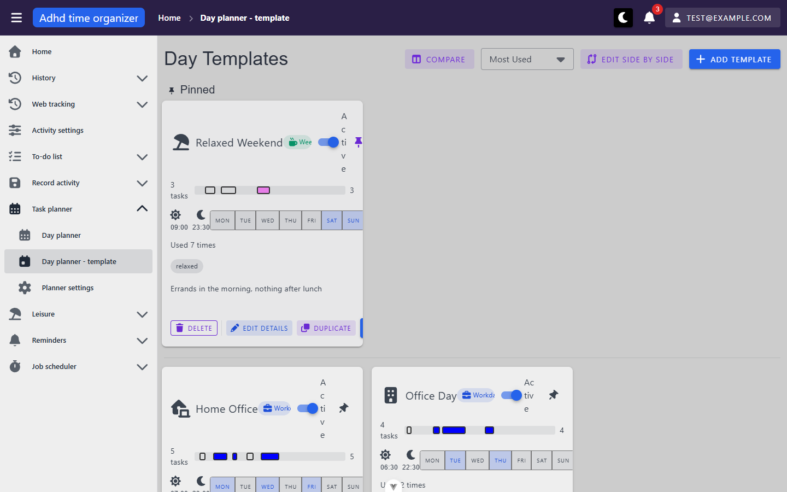

**Route:** `/day-planner/templates` · params: none · guard: auth
**Reached from:** sidebar "Task planner → Day planner - template"; "Cancel"/back-arrow from the split view

**Actions**
| label | kind | selector | does | destination |
| --- | --- | --- | --- | --- |
| Compare | button | `getByRole('button', {name:'Compare'})` | enters compare mode, button becomes disabled "Compare (0/2)" + a "Cancel" button appears | in place |
| (compare-mode) card selection checkbox | checkbox, **unnamed** | no accessible name; also pointer-blocked by the template's own `VIcon` sitting on top of it (see Findings A2) | intended to toggle a template into the 2-slot comparison selection | in place — use the card body click instead, which works |
| Card body (compare mode) | row-ish click target | `getByText(<card text>)` (no dedicated role) | toggles that template into/out of the 2-slot selection, updates "Compare (n/2)" | in place |
| Compare (n/2) | button | `getByRole('button', {name:/Compare \(/})` | enabled at 2/2; opens the `TemplateComparisonDialog` | dialog — **renders completely empty, see Findings X1** |
| Cancel (list toolbar) | button | `getByRole('button', {name:'Cancel'})` | exits compare mode, clears selection | in place |
| Sort dropdown | select | `getByRole('combobox')` | Most Used / Recently Used / Alphabetical; re-sorts within each section (pinned/active/inactive) | in place — **not reflected in the URL, see Findings B4** |
| Edit Side by Side | button | `getByRole('button', {name:'Edit Side by Side'})` | navigates to the split view; renders only at `mdAndUp` (no mobile equivalent) | `/day-planner/templates/split` |
| Add Template | button | `getByRole('button', {name:'Add Template'})` | opens the create dialog (`TemplateDetailsForm`); on a successful create, **navigates straight to the new template's `/day-planner/templates/:id`** (confirmed live, mutation pass 2026-09-15) rather than staying on the list | `/day-planner/templates/:id` |
| Template card (click) | row | `getByText(<card text>)` | navigates to the template's detail view | `/day-planner/templates/:id` |
| Active/Inactive switch | switch | `getByRole('switch', {name:'Active'})`/`'Inactive'` | toggles `isActive`, reloads the list (moves the card between sections) | in place — **label text wraps vertically, see Findings B1** |
| Pin toggle | icon button, **unnamed** | no accessible name/title (see Findings A1); only reachable via a positional locator | `PATCH .../pinned`, optimistic; **confirmed live (mutation pass) to move the card between the Pinned and Active/Inactive sections in both directions** | in place |
| Delete | button | `getByRole('button', {name:'Delete'}).first()` etc. | opens a confirm dialog naming the template and, if it has tasks, the cascade count. **Confirmed live (mutation pass):** with "Ask before deleting single items" off, a 0-task template deletes with *no* confirmation at all, but a template with ≥1 task always shows the cascade count prompt regardless of the preference | dialog, or immediate delete if the template has 0 tasks and the preference is off |
| Edit Details | button | `getByRole('button', {name:'Edit Details'})` | opens the edit dialog, pre-filled including `suggestedForDayType` | dialog |
| Duplicate | button | `getByRole('button', {name:'Duplicate'})` | opens the create dialog pre-filled with `"<name> (copy)"` and every field, including `suggestedForDayType` | dialog |
| Use Today | button | `getByRole('button', {name:'Use Today'})` | navigates to today's day planner with `?applyTemplateId=<id>` | `/day-planner/:todayDate?applyTemplateId=<id>` (out of unit) |

**Readable surfaces**
| surface | kind | contents | raw/derived | populated by |
| --- | --- | --- | --- | --- |
| Template card grid, 3 sections | cards, `VCol lg=4` | pinned / active / inactive, each independently drag-reorderable (`useTemplateCardDragAndDrop`) | raw (order is client-side drag state, not persisted server-side beyond `isPinned`) | `GET /api/task-planner-day-template` |
| Mini-timeline bar | bar chart, one `
` segment per task | task time-of-day proportion within wake–bed window | derived (`getPosition` in `MiniTimeline.vue`) | `POST /api/template-planner-task/filter`, one call per template, keyed by `requestKey: t.id` |
| "Used N times" / "Last used" | text | `usageCount` / `lastUsedAt` | raw | same `GET` as the card list |
| Scheduled-days strip | read-only `VBtnToggle` | `scheduledDays` | raw | same |
| DayTypeChip | chip | `suggestedForDayType` | raw | same — **text hard-clipped with no ellipsis when the row is crowded, see Findings B1** |

**States**
- empty: not reachable with current seed (3 templates always present)
- loading: `LoadingFullscreen` overlay (framework, documented in `_shell/inventory.md`) while `loadTemplates()` runs
- error: not reachable — `fetchAll()` had no way to be made to fail from the UI in this pass

**URL & persisted state**
- No query params used at all. Sort choice, compare-mode and pin drag-order are pure component state and
  do not survive a reload (drag-order is intentionally ephemeral per source comments; sort is not).

**Dialogs opened from here**
- **Add/Edit/Duplicate template** (`TemplateDetailsForm` inside `MyDialog`) — Template Name, Wake Up, Bed
  Time, Description, Suggested for Day Type, Suggested Location, Tags, Icon, Scheduled Days. Confirm label
  is "Create" or "Update". **"Suggested for Day Type" carries no required-rule and no asterisk — see
  Findings B2.**
- **Delete confirm** (`useDialog().confirm`) — "Delete template? '<name>' cannot be restored." plus, when
  the template has tasks, "Tasks in this template: N. They will be deleted with it." Matches CLAUDE.md's
  cascade-confirmation rule.
- **Compare Templates** (`TemplateComparisonDialog`) — **renders two empty panels every time it is opened,
  see Findings X1.** Has a "Confirm" button with no handler — see Findings B3.

**Keyboard**
- Standard Vuetify `VSelect`/`VDialog` keyboard handling observed (arrow keys inside the sort dropdown,
  Enter to submit forms per `MyDialog`'s `onEnterKey`). No custom shortcuts on this view.

**Console & network**
- errors/warnings: none on initial load or on ordinary navigation (three `POST .../filter` calls, one per
  template, all `[200]` — the `requestKey` fix from the intent sources holds)
- non-2xx: none, **except** the reproducible failures under Findings X1/B2 (both are user-triggered, not
  load-time)
- duplicate requests: none on load. One always-firing minor issue: `MiniTimeline.vue:50` calls
  `console.log(tasks)` on every render of every card's timeline — three log lines on every load, see
  Findings P3.

**Narrow viewport (390 × 844)** · checked 2026-10-06 · commit `27dd210b`
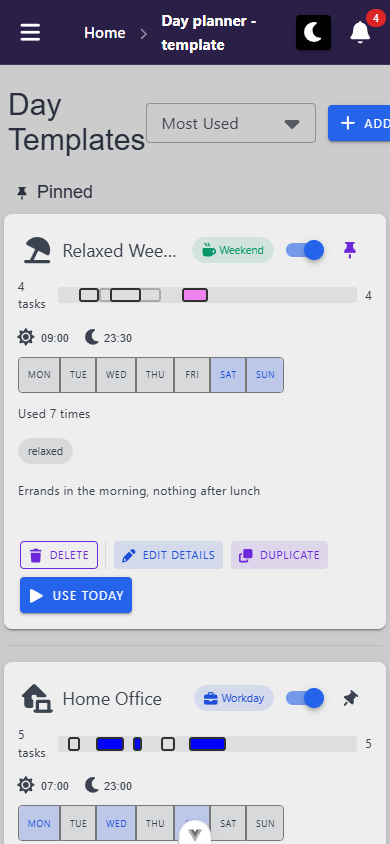
- layout: cards go single-column, full width (4–386). Title wraps to "Day / Templates". The toolbar row doesn't wrap, so "Add Template" spills to 478 and the content scroller pans 88 px sideways (P4). Card rows hold: name, day-type chip, Active switch and pin fit on one line; the action row wraps Use Today onto its own line.
- mobile-only controls: none
- replaced controls: **Compare** and **Edit Side by Side** → nothing. Both are `v-if="mdAndUp"` by design, so compare mode and the split view have no entry point below 960 px.
- overflow: `docScroll 390`, but `main .v-container` is 478/390 (`div.d-flex.align-center.ga-3 → 478`, P4). The cards' `v-row` ends at 394 (Vuetify's −4 px gutter, not visible).
- visual sweep: "Add Template" cut to "+ ADD". Everything else reads cleanly. Tap targets: pin 40×40, Active switch 28×28, card buttons ≥ 78×28, day chips 36×36. The card's `:hover` lift is decorative only. Add Template dialog fits (24–366 × 30–814, Cancel/Create visible, `day-planner-templates-create-dialog--mobile.png`). The delete confirm fits (24–366 × 305–539). Console clean.

### TemplateSplitView (`/day-planner/templates/split`)
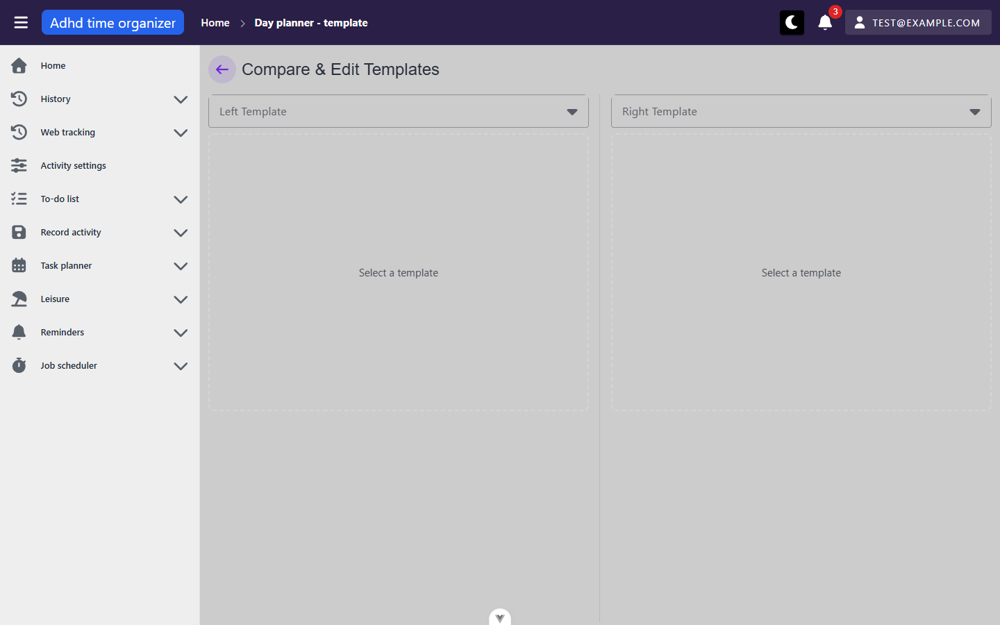
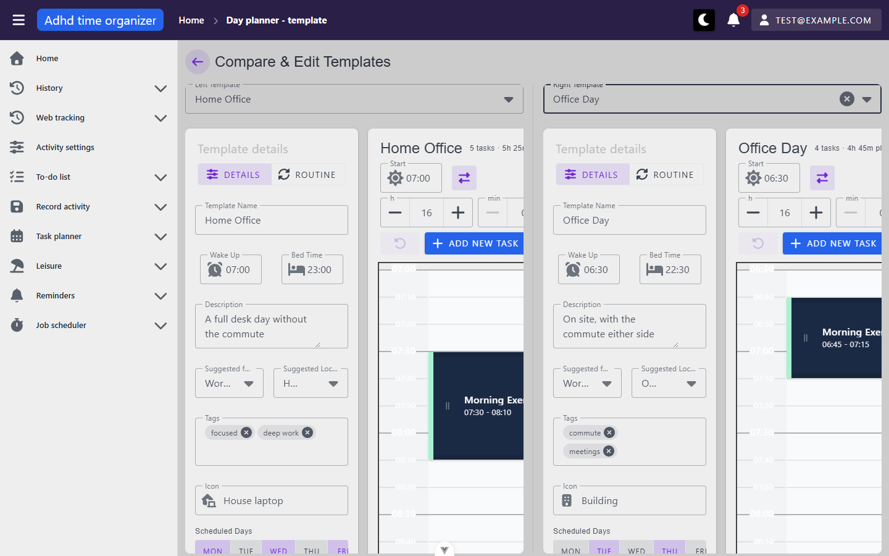

**Route:** `/day-planner/templates/split` · params: none · guard: auth
**Reached from:** "Edit Side by Side" on the list (desktop only, no nav entry — the only way in)

**Actions**
| label | kind | selector | does | destination |
| --- | --- | --- | --- | --- |
| back arrow | icon button | `getByRole('button')` near the title (has an icon but check accessible name — not separately verified this pass) | returns to the list | `/day-planner/templates` |
| Left Template / Right Template | select | `getByRole('combobox', {name:'Left Template'/'Right Template'})` | loads that `TemplateDayPlannerView` into the panel, independently of the other side | in place |
| everything `TemplateDayPlannerView` exposes | — | — | identical to the standalone view, once per panel, against independent `main`/`secondary` stores | in place |
| drag a task across panels | drag-and-drop (`@atlaskit/pragmatic-drag-and-drop`) | a drag handle (`.split-drag-handle`, `title="Drag to other template"`) is visible on each task block | intended to move the task to the other template via `PATCH` + local store splice. **Mutation pass (2026-09-15) made three scripted attempts (`dragTo`, a manual multi-step pointer drag, a handle-targeted drag) and none crossed panels — every attempt was captured by the source panel's own same-grid drag-to-reschedule instead** (confirmed via the resulting `PATCH` body only ever containing `startTime`/`endTime`, never `templateId`); see Findings U2. Same-panel drag-to-reschedule itself works correctly. | in place, or a same-panel time change if the cross-panel drop isn't recognized |

**Readable surfaces**
| surface | kind | contents | raw/derived | populated by |
| --- | --- | --- | --- | --- |
| "Select a template" placeholder | empty-panel text | shown per side until a template is picked | — | — |
| Two independent template detail panels + grids | see `TemplateDayPlannerView` below | — | — | — |

**States**
- empty: both panels show "Select a template" until picked (this is the view's default landing state, not
  a degraded one)
- loading: template-options dropdowns show `:loading` while `fetchAll()` resolves
- error: not reached in this pass

**URL & persisted state**
- Left/right template selection is **not** in the URL. Confirmed: select both sides, reload — both panels
  reset to "Select a template", selections are lost. See Findings B4 (same root issue as the list's sort
  dropdown — this view is a second instance of it).

**Dialogs opened from here**
- Every dialog `TemplateDayPlannerView` opens (task create/edit), scoped correctly per panel — confirmed
  by selecting a task in the left panel and pressing `e`: exactly one dialog opened, for the left panel's
  task. This is the P1-defect-3 fix holding under direct test.

**Keyboard**
- Confirmed scoped correctly: selecting a task in one panel and pressing a shortcut (`e`) affects only
  that panel, not both — the split view's core known risk (duplicated global key handling) did not
  reproduce.

**Console & network**
- errors/warnings: none. Two-or-more `POST .../filter` calls abort as templates load (expected, per the
  `latestLoadToken` handling in `TemplateDayPlannerView.vue`) and are silently swallowed — no console noise.
- non-2xx: none
- duplicate requests: the expected/handled aborts above; nothing unhandled

**Narrow viewport (390 × 844)** · checked 2026-10-06 · commit `27dd210b`
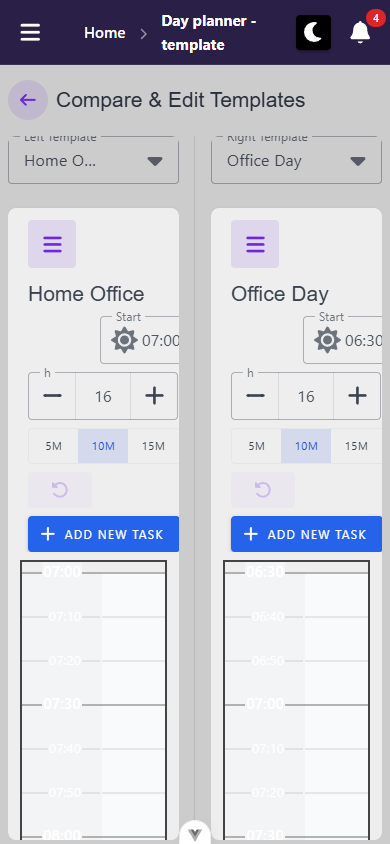
- layout: **doesn't stack, and doesn't scroll sideways either.** The two panes stay side by side at 171 px each (8–179, 211–382), and each planner is compact (< 900 px, `usePlannerLayout.ts`). It's not usable as a comparison: task titles show ~5 characters, the 30M slot button is clipped away, and the side panel is squeezed into the pane (B6). The view is reachable only by URL below `md`, because its entry button is desktop-only.
- mobile-only controls: none beyond the compact planner's (see TemplateDayPlannerView below). Each pane's "Open panel" toggle exists at every width.
- replaced controls: none
- overflow: `docScroll 390`, `.v-container` 390/390. The script's offenders (`div.d-flex.align-center.flex-wrap → 539`, `div.d-flex.ga-4.align-center → 485`) are inside each pane's `overflow: hidden` card, so they're clipped, not scrollable (B6).
- visual sweep: "Left Template" label is cut at its top edge, and the left select reads "Home O…". Focusing a task scrolled the left pane's clipped card by 182 px, hiding its header (planner-day B9, `day-planner-templates-split--mobile-tasks.png`). Panel open: `day-planner-templates-split--mobile-panel.png` (planner-day A2 reproduces here). Console clean.

## Transitions out of this unit
| from | control | goes to |
| --- | --- | --- |
| TemplateListView | "Use Today" | `/day-planner/:date?applyTemplateId=<id>` (dayPlanner unit) |
| TemplateListView | template card click | `/day-planner/templates/:id` (in-unit) |
| TemplateListView | "Edit Side by Side" | `/day-planner/templates/split` (in-unit) |
| TemplateSplitView | back arrow | `/day-planner/templates` (in-unit) |
| TemplateDayPlannerView (Routine tab) | placing a routine item | reads `RoutineTodoListItemEntity` data from `todoList`, via the sanctioned `historyDashboard`-style cross-module read — no navigation |

---

### TemplateDayPlannerView (`/day-planner/templates/:templateId`)
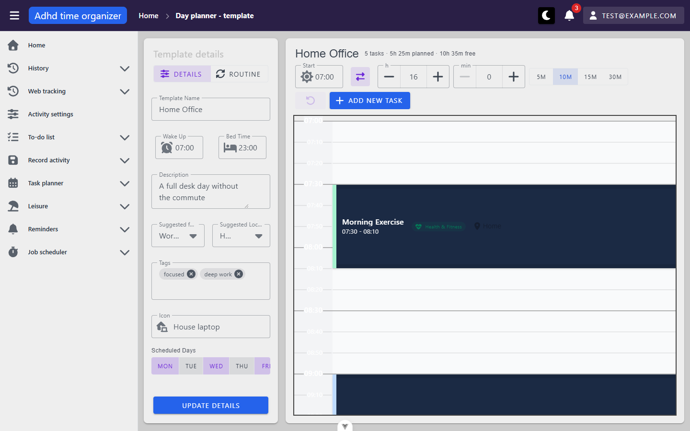
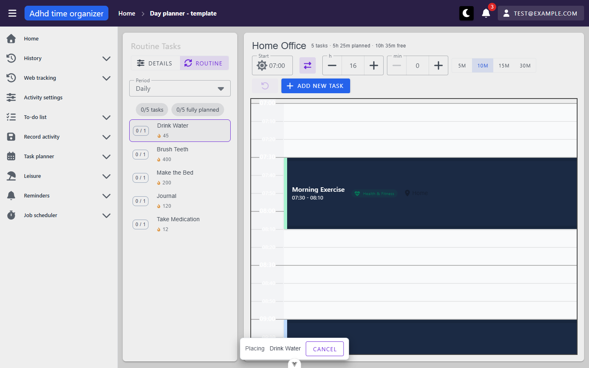
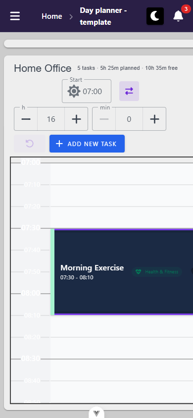
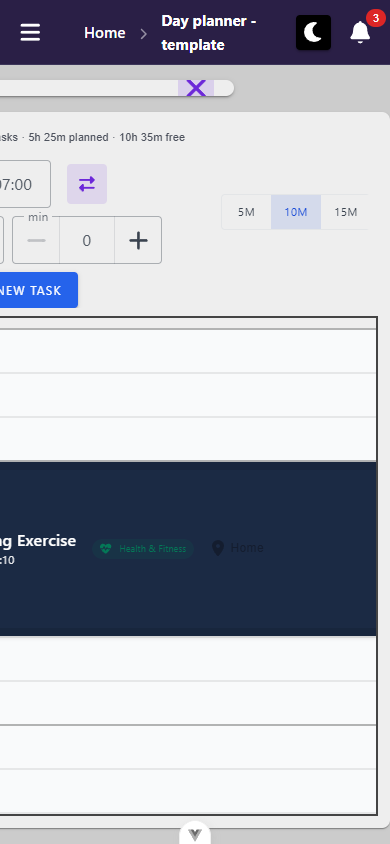
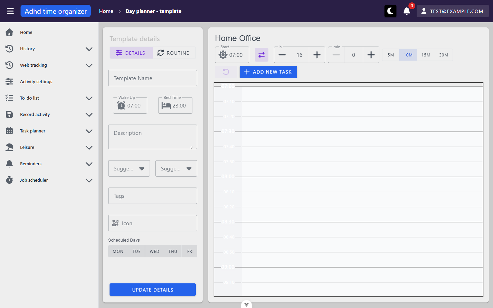

**Route:** `/day-planner/templates/:templateId` · params: `templateId: number, read from route.params`
(deliberately no `props: true` — see the comment in the component; the split view instead passes it as a
prop) · guard: auth
**Reached from:** list card click, "Edit Details" (opens the details dialog, not this route), split view
(as a prop, not this route)

**Actions**
| label | kind | selector | does | destination |
| --- | --- | --- | --- | --- |
| DETAILS / ROUTINE toggle | `VBtnToggle` | `getByRole('button', {name:'Details'/'Routine'})` | switches the side-panel tab; bodies mount/unmount (Routine reloads its list each time) | in place |
| Template Name / Wake Up / Bed Time / Description / Suggested for Day Type / Suggested Location / Tags / Icon / Scheduled Days | form fields | — | edits local form state | — |
| Update details | button | `getByRole('button', {name:'Update details'})` | `PATCH` the template, reloads details | in place |
| Routine item row | list item | `getByRole('listitem')` inside the Routine panel | selects it as the "placing" item, shows a "Placing / <name> / Cancel" banner over the grid | in place |
| Cancel (placing banner) | button | `getByRole('button', {name:'Cancel'})` | clears the placement, banner disappears | in place |
| Start / duration steppers, 5M/10M/15M/30M | inputs + buttons | — | changes the grid's time-slot granularity | in place |
| Add New Task | button | `getByRole('button', {name:'Add New Task'})` | opens the create-task dialog | dialog |
| Task block (grid) | button, accessible name includes time/role/category/importance/location | `getByRole('button', {name:/<task name>/})` | selects it (click adds to selection rather than replacing it — confirmed multi-select via click alone, no Ctrl needed); selection-actions bar appears (Edit/Cut/Duplicate/Split/Cancel for 1 selected, Delete/Cut/Duplicate/Split for 2+). Deleting 2+ selected confirms with "delete N selected tasks?" (`docs/views/planner-templates/screenshots/day-planner-templates-id--mutation-multiselect-delete-confirm.png`) | in place |
| Background task block (grid, `isBackground: true`) | plain `
`, **no role, no accessible name, no tabindex** | `.background-task-block`; only reachable by mouse click — see Findings A4 | click selects it (mouse-only); **not reachable via Tab, and Escape does not clear its selection** (both confirmed live, mutation pass 2026-09-15) | in place |
| Delete (selection-actions bar) | button | `getByRole('button', {name:'Delete'})` | opens a confirm dialog naming the task (or "delete N selected tasks?" for multi-select) — **confirmed live: with "Ask before deleting single items" off, a single task deletes immediately with no dialog; the dialog always appears when the preference is on** | dialog, or immediate delete if the preference is off |
| mobile panel-close "X" | icon button | `d-md-none`, no separate accessible-name check done | closes the panel at `<md` widths | in place |
| mobile panel-open toggle (the collapsed pill) | icon button, **unnamed** | no accessible name (see Findings A3) | opens the panel at `<md` widths — **but see Findings X2, the opened panel is unusable** | in place |

**Readable surfaces**
| surface | kind | contents | raw/derived | populated by |
| --- | --- | --- | --- | --- |
| Header stat line | text | "N tasks · Xh Ym planned · Zh Wm free" | derived, **excludes background tasks by design** (`taskStats` filters `nonBgTasks`) — **confirmed live (mutation pass 2026-09-15): a template with 1 foreground + 1 background task still reads "1 task · 1h planned"**, unchanged from before the background task was added; see Findings P3 for the labelling suggestion this prompted | client-side, from `store.tasks` |
| Time grid | custom grid, one row per slot | task blocks positioned by time | raw times, derived pixel/row position | `POST /api/template-planner-task/filter` |
| Task block accessible name | text | "`<name>, <start> to <end>, role: <role>[, category: <category>][, importance: <level>][, location: <loc>]`" | raw, composed | same |
| Keyboard help paragraph | text (visually hidden, in the a11y tree) | "Tab moves between tasks. Space or Enter selects... Arrow Up/Down move... Escape clears." | static | — |
| Routine panel: period selector + "M/N tasks" + "M/N fully planned" + item list with streak numbers | text/list | routine items from `todoList`, cross-module read | raw | `GET /api/routine-todo-list/grouped-by-time-period` (boot-time, per shell inventory) filtered by period |

**States**
- empty: no-tasks-for-this-template state not exercised (every seeded template has tasks); the grid would
  presumably render with no blocks — not distinguished from "still loading" in this pass
- loading: `LoadingFullscreen` overlay, suppressed for split-view panels (`if (!isSplitView) showFullScreenLoading()`)
- error (invalid id `/day-planner/templates/999999`): grid renders empty (real — no tasks for that id) and
  a **404 fires from `TemplatePlannerPanel.vue`'s `loadTemplateDetails`, but the header keeps showing the
  previously-viewed template's name ("Home Office") instead of any not-found indication — see Findings X2.**

**URL & persisted state**
- `templateId` round-trips correctly through a reload and back-navigation once a *valid* id is in the URL.
- The `templateDayPlannerStore` **persists to `sessionStorage`** (Pinia default persistence, no
  `persist: false` override) including `currentTemplateId` and `templateName` — this is the mechanism
  behind Findings X2: a stale, previously-loaded template's name survives a failed reload of a bad id.

**Dialogs opened from here**
- **Add/Edit template task** (`TemplatePlannerTaskDialog`) — not exhaustively inventoried field-by-field in
  this pass (out of the time budget); confirmed it opens, confirmed exactly one instance opens under `e`
  in the split view.

**Keyboard**
- Fully documented by the view's own on-grid help paragraph (see Readable surfaces above): Tab between
  tasks, Space/Enter select, `E` edit, Delete removes, Ctrl+D duplicates, Arrow Up/Down move by one slot,
  Escape clears selection. Confirmed scoped per-instance in the split view (see TemplateSplitView above).
  **Confirmed live (mutation pass 2026-09-15) that this help text is inaccurate for a background task:**
  selecting a foreground task and pressing Tab jumps to the toolbar's "Delete" button, skipping any
  background task on the grid entirely (it is never in the Tab sequence); selecting only a background
  task and pressing Escape does not clear the selection. See Findings A4.

**Console & network**
- errors/warnings: none on a valid id. **On an invalid id, an uncaught 404 (`AxiosError`) from
  `TemplatePlannerPanel.vue:49`** — same class as the shell inventory's documented `/todo-list/999999`
  finding (unhandled console exception, graceful-looking UI) but here the UI is actively misleading rather
  than merely empty — see Findings X2.
- non-2xx: the 404 above, on invalid id only
- duplicate requests: two `POST .../filter` calls legitimately abort during a template switch (the
  `latestLoadToken` + view-window-watcher interaction described in the component's own comments) and are
  silently handled — not a defect

**Mobile (390×844), out of the shell's own scope:**
- Panel-closed state renders correctly, full-width grid, no horizontal overflow.
- Opening the panel produces a **400×16px, horizontally-offscreen sliver** instead of a usable panel — see
  Findings X2 (the blocker, not the a11y-only finding above). The close "X" is still clickable and does
  close it back to the collapsed state.

**Narrow viewport (390 × 844)** · checked 2026-10-06 · commit `27dd210b`
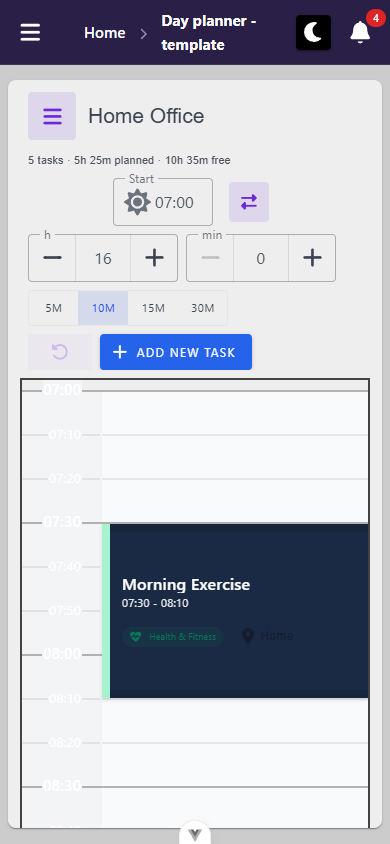
- layout: compact planner (root < 900 px). The side panel starts closed and floats over the grid when opened (8–382 × 64–844, X2's fix holds, `day-planner-templates-id--mobile-x4-panel.png`). The header wraps to four rows (title + stats, Start + swap, h/min steppers, slot toggle, undo + Add New Task), and the grid fills the rest of the card. Task blocks are 266 px wide with a readable title, time, role and location. A tap on a block selected it (no drag started).
- mobile-only controls: compact behaviour of the header toggle — `getByRole('button', { name: 'Open panel' })` / `'Close panel'` (shown at every width, but only overlays below 900 px). Panel X — `getByRole('button', { name: 'Close panel' }).first()` (DOM order puts it before the covered header toggle). Picking a routine item in the panel's Routine tab closes the panel by itself and shows the "Placing / <name> / Cancel" bar (92–298, fits, `day-planner-templates-id--mobile-x4-placing.png`).
- replaced controls: none
- overflow: none (`docScroll 390`, no offenders).
- visual sweep: the breadcrumb wraps ("Day planner - / template", `_shell` P4 already names this route). With a task selected, the ActionBar runs −32…422 and cuts "1 selected" and Cancel (`_shell` B2, `day-planner-templates-id--mobile-x4-selected.png`). The grid's last 50 px are clipped by the card (planner-day B9, last label 22:40). Panel focus doesn't move, Escape doesn't close it, and closing drops focus to `<body>` (planner-day A2). `.tasks-column` is `touch-action: none` (planner-day U1). The Add New Template Task dialog fits (no element past 390, body scrolls inside, Cancel/Confirm visible, `day-planner-templates-id--mobile-x4-task-dialog.png`). Console clean.
