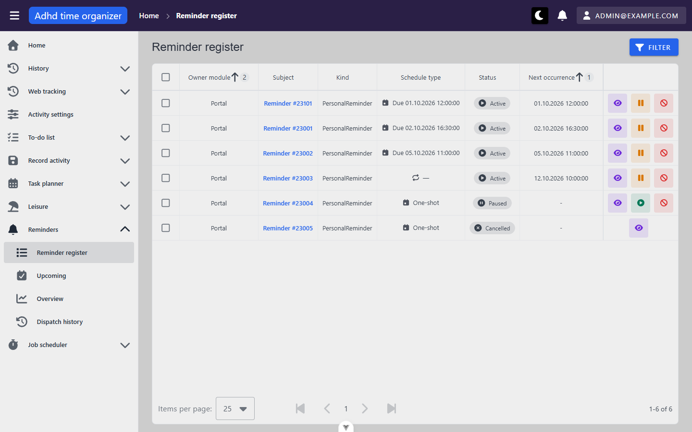
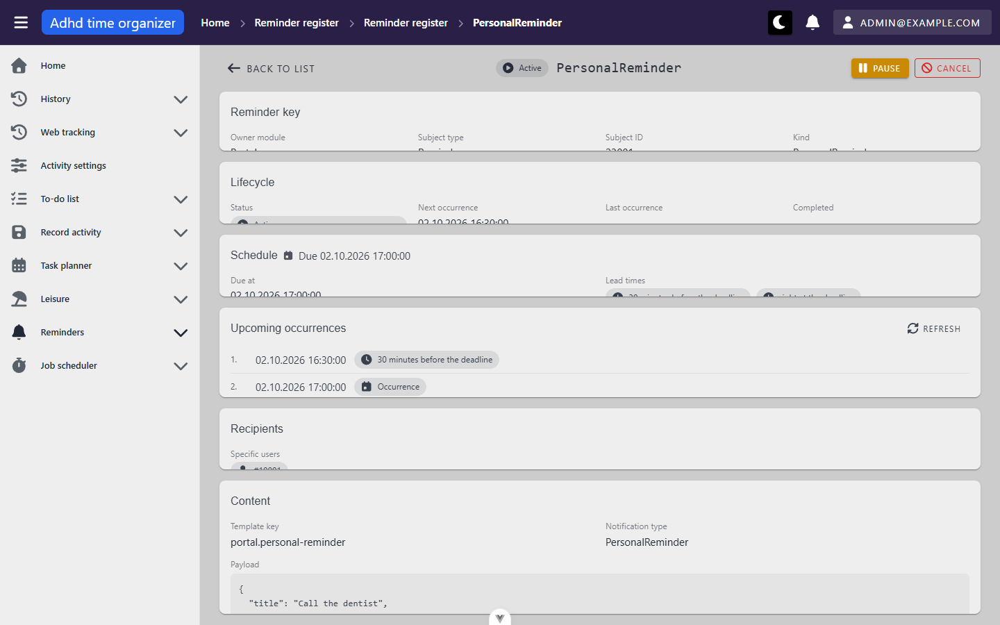
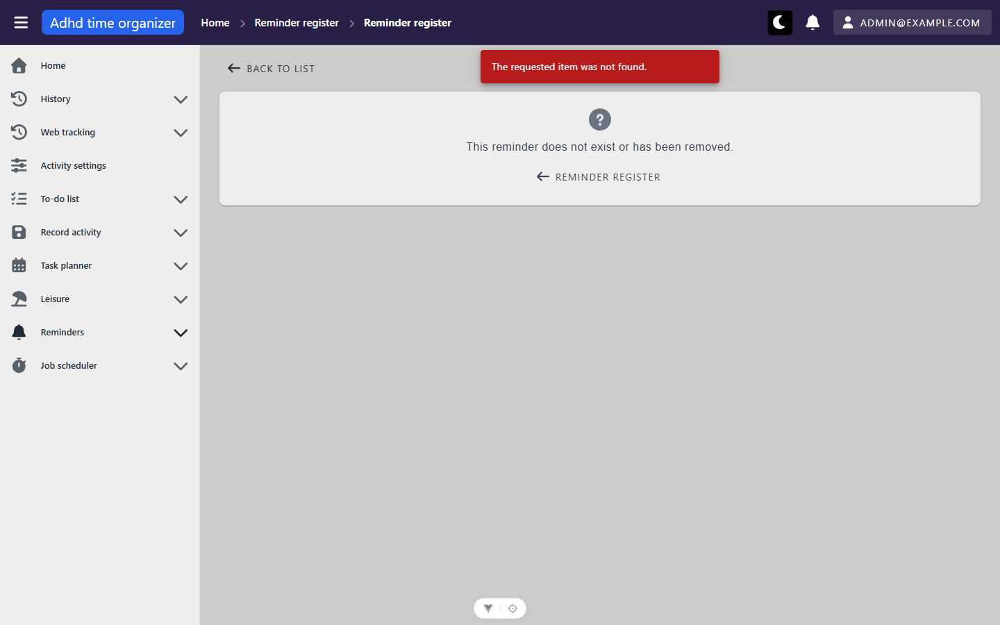
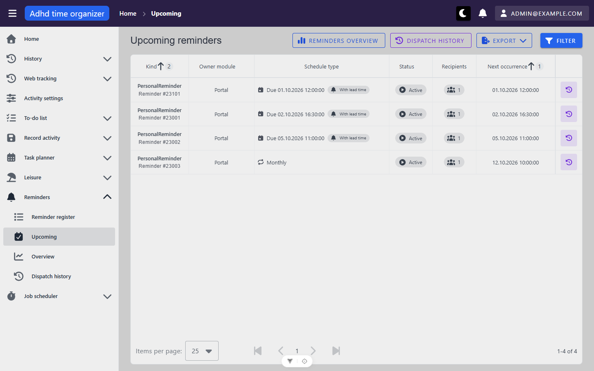
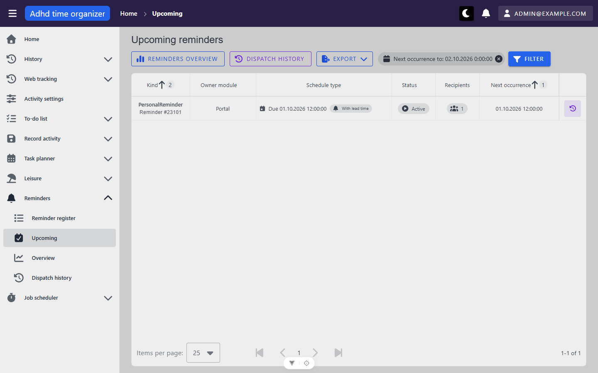
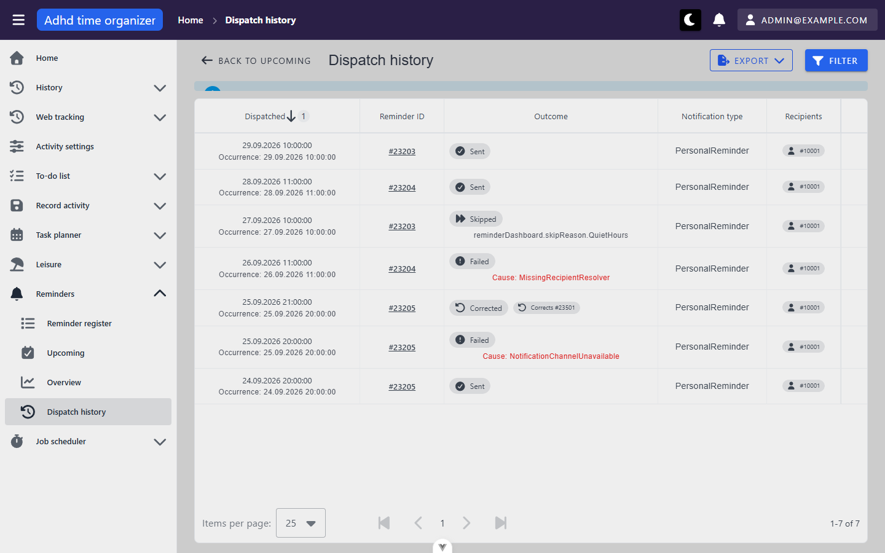
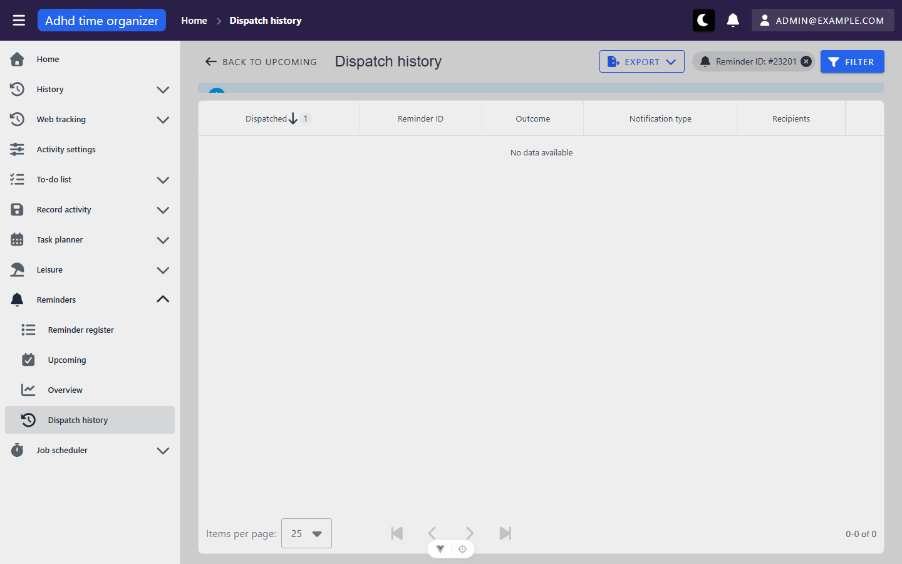
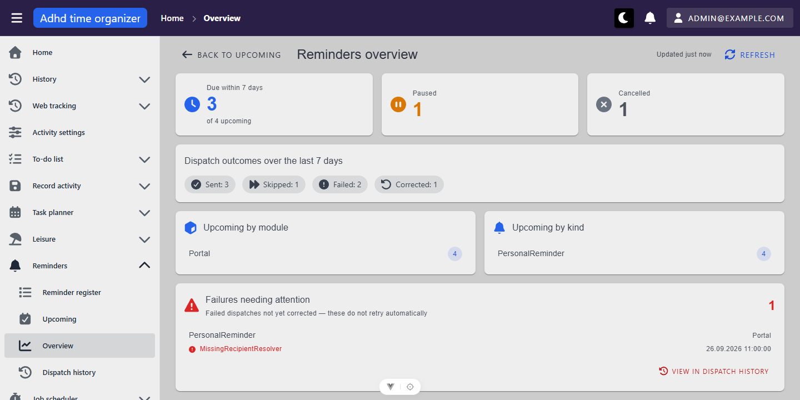
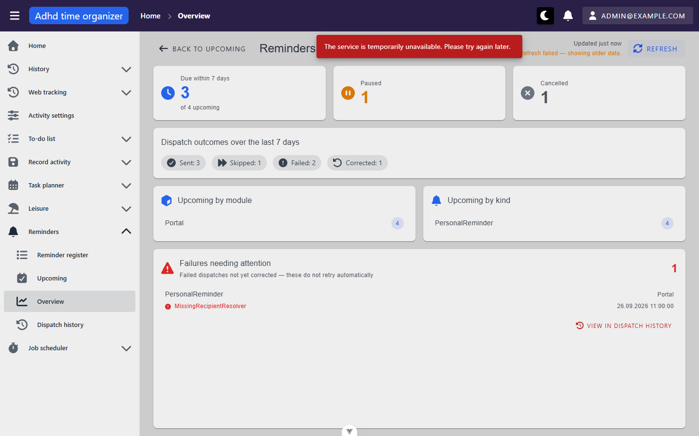
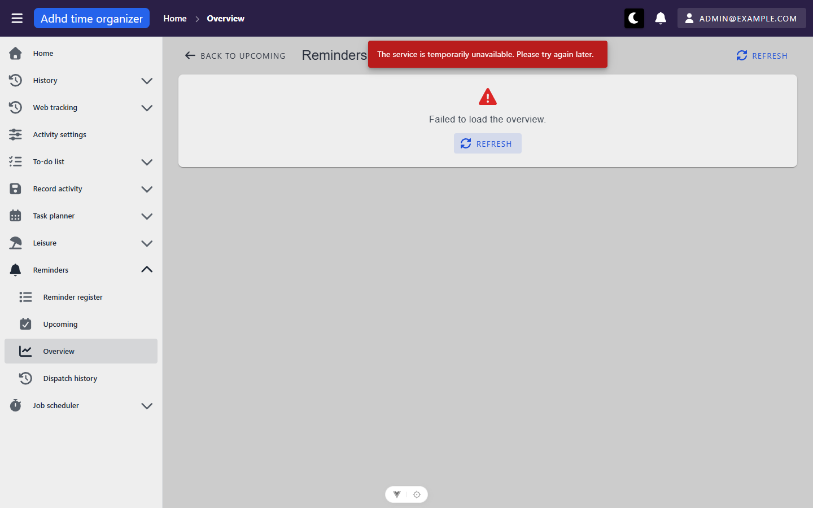

# reminders-admin — inventory

> Captured 2026-10-01 · locale EN · account `admin@example.com` (seed `adminUser`, id 10003, fixture `e2e-v4`) ·
> commit `4d890646` (framework `b1b82a1`) · viewport 1440×900 · browser TZ UTC+2 (CEST), so `10:00Z` renders `12:00`

Framework module `src/_common/modules/reminders/`. Shell (top bar, sidebar, breadcrumbs, bell, dialog host, snackbars)
is as documented in [`_shell/inventory.md`](../_shell/inventory.md); only differences are noted here. Every view in
this unit carries `meta: { requiredRole: 'admin' }`, a client-side no-op in this app (`_routes.md`), and the server
answers 403 to a non-admin. That is correct behaviour and is not re-examined here.

## Views

### ReminderDefinitionsView (`/pripomienky/register`)

**Route:** `/pripomienky/register` · params: none · guard: admin (route meta; server-enforced)
**Reached from:** sidebar › Reminders › Reminder register; the overview's *Paused* / *Cancelled* cards (with
`?status=`); the detail view's *Back to list*.

**Actions**
| label | kind | selector | does | destination |
| --- | --- | --- | --- | --- |
| Filter | button | `getByRole('button', { name: 'Filter' })` | opens the `FilterPanel` dialog | dialog "Filter" |
| Filter › Owner module / Subject type / Kind | text inputs | `getByRole('textbox', { name: 'Owner module' })` … | draft only until Confirm | in place |
| Filter › Status | select (Active, Paused, Cancelled, Completed) | click the field wrapper (`ref` of `combobox` holding "Status"); options by `getByRole('option', { name: 'Paused' })` | draft | in place |
| Filter › Schedule type | select | same pattern | draft | in place |
| Filter › Next occurrence from / to | date inputs (`VDateInput`, placeholder `mm/dd/yyyy`) | `getByRole('textbox', { name: 'Next occurrence from' })` | draft | in place |
| Filter › Clear / Confirm / Close | buttons | `getByRole('button', { name: 'Confirm' })` | Confirm applies the draft, writes the URL, resets to page 1, one grid request | in place |
| filter chip (e.g. "Paused") remove | button, icon-only | `getByRole('button', { name: 'Close' })` — **every chip's remove button is named just "Close"** | removes that filter | in place |
| column headers Owner module, Subject, Kind, Status, Next occurrence | sort toggles | `getByRole('columnheader', { name: 'Status' })` | server sort, URL `sortBy=` rewritten (`status:asc`) | in place |
| Schedule type header | not sortable | — | — | — |
| select-all / row checkbox | checkbox, **no accessible name** | `getByRole('row', { name: /Reminder #23001/ }).getByRole('checkbox')` | selects rows for the bulk bar | in place |
| Subject link "Reminder #23001" | link | `getByRole('link', { name: 'Reminder #23001' })` | shows the *portal* id (`subjectId`), targets the *definition* id — intended (unit prompt) | `/pripomienky/register/23201` |
| Show detail (eye) | icon button | `getByRole('button', { name: 'Show detail of reminder PersonalReminder' })` — **same name on all six rows** | `router.push` to detail | `/pripomienky/register/:id` |
| Pause / Resume (per row) | icon button | `Pause reminder PersonalReminder` / `Resume reminder PersonalReminder` — same name on every row | lifecycle transition (**not exercised — read-only unit**) | in place |
| Cancel (per row) | icon button | `Cancel reminder PersonalReminder` | lifecycle transition, opens `CancelReminderDialog` per source (**not exercised**) | dialog |
| Bulk bar › Pause (n) / Cancel (n) | buttons | `getByRole('button', { name: 'Pause 1 reminder' })` in `group "Actions for the selected reminders"` | bulk lifecycle (**not exercised**) | dialog / result dialog per source |
| Bulk bar › Unselect | button | `getByRole('button', { name: 'Unselect' })` | clears the selection | in place |
| Items per page | select | footer combobox | page size, URL `perPage=` | in place |
| First / Previous / Next / Last page | buttons | `getByRole('button', { name: 'Next page' })` | server paging, URL `page=` | in place |

Row actions by status (observed): Active → eye, Pause, Cancel · Paused → eye, Resume, Cancel · Cancelled → eye only.

**Readable surfaces**
| surface | kind | contents | raw/derived | populated by |
| --- | --- | --- | --- | --- |
| result announcer | `status` live region | "6 results found" / "1 result found" | derived (`itemsCount`) | `POST /reminder-definition/grid` |
| selection announcer | `status` live region | "1 reminder selected" | derived | local selection |
| grid | server table, 25/page, default sort `nextOccurrenceAt asc` (+ `ownerModule asc` tie-breaker pushed by `BasicTable`) | Owner module · Subject (`subjectType #subjectId`) · Kind · Schedule type · Status chip · Next occurrence · Actions | raw, except Schedule type | same |
| Schedule type cell | `ReminderScheduleDisplay` | one-shot: "Due {nextOccurrenceAt}" — **not `dueAt`**; recurring interval: "⟳ —"; paused/cancelled one-shots: "One-shot" | derived from `scheduleType` + `nextOccurrenceAt` only | same — the response also carries `dueAt`, `intervalPreset`, `cron`, `anchorDate`, `endsAt`, `payloadJson`, `recipients`, `leadOffsets`, which `ReminderDefinitionGridResponse.fromJson` drops |
| Next occurrence | text | `DD.MM.YYYY HH:mm:ss` (e.g. `01.10.2026 12:00:00`), "-" when null | raw, formatted by `useReminderFormat.formatInstant` | same |
| footer | text | "1-6 of 6"; current page label rendered as an `<h3>` (`MyTableFooter.vue:22`) | derived | same |

Seed rows seen (all `Portal` / `PersonalReminder`): 23301 (subject 23101, recipient 10002), 23201, 23202, 23203
(RecurringInterval Monthly), 23204 (Paused), 23205 (Cancelled). Matches `seed.counts.reminderDefinitions` = 6.

**States**
- empty: not reached with the unfiltered seed; a no-match filter was not needed — every filter tried matched ≥ 1.
- loading: header row progress bar + body cell "Loading items..." (seen in the first snapshot after `goto`).
- error: not triggered. `onError: reportTableLoadError` per source.

**URL & persisted state**
- `page`, `perPage`, `sortBy` (`key:dir,…`), and each filter field (`status=Paused`, …) via `useServerTable` +
  `useTableUrlState`. A bare `/pripomienky/register` is rewritten on mount to
  `?page=1&perPage=25&sortBy=nextOccurrenceAt:asc,ownerModule:asc`.
- reload with `status=Paused` → still filtered (1 result). `?page=2&perPage=5` deep link → page 2, 1 row, "6 results found".
- URL updates use `replace`: after applying a filter, **Back leaves the register** (went to `/`) rather than
  stepping back through filter states. Consistent, not a defect.
- no `localStorage`.

**Dialogs opened from here**
- Filter (`FilterPanel`) — fields above; Close / Clear / Confirm. Opened and applied; closed by Confirm.
- Cancel reminder / bulk Pause / bulk Cancel / bulk result — present per source, **not opened** (would send lifecycle
  transitions; read-only unit).

**Keyboard**
- nothing view-specific beyond the table's native tab order. Focus-return logic after the bulk bar unmounts
  exists in source (`ReminderDefinitionsView.vue:236-245`); not exercised because the only ways to empty the
  selection besides *Unselect* are the bulk actions.

**Console & network**
- errors/warnings: none on this route (the three boot errors are `GET /api/routine-time-period` 500 from Home's
  `RoutineTodoWidget`, outside this unit). `console info`: none.
- non-2xx: none.
- duplicate requests: none — exactly one `POST /reminder-definition/grid` on mount, one per filter apply, one per sort.

### ReminderDefinitionDetailView (`/pripomienky/register/:id`)

**Route:** `/pripomienky/register/:id(\d+)` · params: `id: number` — the **reminder-definition** id (23201–23205,
23301), not the portal id; resolved by `GET /reminder-definition/{id}` · guard: admin
**Reached from:** the register's Subject link and eye button; the dispatch history's `#id` link. A non-numeric id
(`/abc`) does not match the route and falls through to the app's *Page not found* view.

**Actions**
| label | kind | selector | does | destination |
| --- | --- | --- | --- | --- |
| Back to list | link | `getByRole('link', { name: 'Back to list' })` | — | `/pripomienky/register` (no query — the register's filter/page is not restored) |
| Pause / Resume | button | `getByRole('button', { name: 'Pause' })` | lifecycle transition (**not exercised**) | in place |
| Cancel | button | `getByRole('button', { name: 'Cancel' })` | opens `CancelReminderDialog` per source (**not exercised**) | dialog |
| Upcoming occurrences › Refresh | button | `getByRole('button', { name: 'Refresh' })` | re-fetches `GET …/occurrences?count=8` (one request per click, observed) | in place |
| not-found › Reminder register | link-button | `getByRole('link', { name: 'Reminder register' })` in main | — | `/pripomienky/register` |
| breadcrumb "Reminder register" (×2) | links | `.v-breadcrumbs-item` | both → `/pripomienky/register` | — |

Header buttons by status: Active → Pause, Cancel · Paused → Resume, Cancel · Cancelled → none.

**Readable surfaces** (all `GET /reminder-definition/{id}` unless stated)
| surface | kind | contents | raw/derived | populated by |
| --- | --- | --- | --- | --- |
| header | status chip + `h1` | status; `h1` = `kind` ("PersonalReminder" on every seeded reminder) | raw | detail |
| Reminder key | card, `InfoRow` grid | Owner module, Subject type, Subject ID (the portal id, e.g. 23001), Kind | raw | detail |
| Lifecycle | card | Status chip, Next occurrence, Last occurrence, Completed ("—" when null) | raw | detail |
| Schedule | card, varies by type | one-shot: "Due {dueAt}", *Due at*, *Lead times* chips ("30 minutes before the deadline", "right at the deadline"); interval: "Monthly", *Anchor date*, *End*; cron: raw expression + a plain-English line when translatable (no cron row in the seed) | raw + `formatLeadOffset` / `useCronDescription` | detail |
| Upcoming occurrences | card, ordered list | numbered instants, each labelled "Occurrence" or its lead offset; footer "These are all the remaining occurrences." / "Showing the next 8 occurrences, the series continues beyond them."; paused → "This reminder is paused, so it will not fire for now. Below is what would apply once resumed." + the list; cancelled → "This reminder is cancelled and will never fire again." and no request | raw | `GET /reminder-definition/{id}/occurrences?count=8` |
| Recipients | card | "Specific users" + `#userId` chips (no names, by design — README), or resolver key, or "none" | raw | detail |
| Content | card | Template key, Notification type, optional digest key / preferred channel, Payload as pretty JSON (`"title": "Call the dentist"`, …) | raw | detail |

Observed per seed row: 23201 one-shot, offsets −30/0 → preview 16:30 (nudge) and 17:00 (occurrence). 23203 monthly,
anchor `08:00Z` → preview 12.10 10:00, then 9:00 Nov–Mar, 10:00 from April (the series is a UTC instant, so its
local wall-clock time moves with DST). 23204 paused → "would apply once resumed" + 10:45. 23205 cancelled → terminal
line only. 23301 (recipient #10002, another account) → one nudge at 12:00, due 13:00.

**States**
- loading: centred `VProgressCircular` before the first response (source; too fast to snapshot).
- not found (`/999999`, and the portal id `/23001`): card "This reminder does not exist or has been removed." +
  a *Reminder register* button; **plus** the interceptor snackbar "The requested item was not found." `GET` → 404.
- failed (non-404): card with "Retry" per source; not triggered.
- **layout at 1440×900:** every card is clipped — see findings X1. The values in Reminder key and Lifecycle show only
  their top few pixels.

**URL & persisted state**
- `:id` only. No query. Breadcrumb extra set by the view: `[Reminder register, {kind}]`, or `[Reminder register]`
  on a failed first load.

**Dialogs opened from here**
- Cancel reminder (`CancelReminderDialog`) — per source; **not opened** (read-only unit).

**Keyboard**
- nothing view-specific.

**Console & network**
- errors/warnings: none (`/999999` logs no console error; the 404 is reported by snackbar only).
- non-2xx: `GET /reminder-definition/999999` → 404, `GET /reminder-definition/23001` → 404 (deliberate probes).
- duplicate requests: none — one detail `GET` + one `occurrences?count=8` per load; a 404 fires no occurrences call.

### ReminderUpcomingView (`/pripomienky/nadchadzajuce`)

**Route:** `/pripomienky/nadchadzajuce` · params: none · guard: admin
**Reached from:** sidebar › Reminders › Upcoming; *Back to upcoming* on the dispatch history and the overview; the
overview's due-soon card and rollup rows (with `?to=` / `?ownerModule=` / `?kind=`).

**Actions**
| label | kind | selector | does | destination |
| --- | --- | --- | --- | --- |
| Reminders overview | link-button | `getByRole('link', { name: 'Reminders overview' })` | — | `/pripomienky/prehlad` |
| Dispatch history | link-button | `getByRole('link', { name: 'Dispatch history' })` | — | `/pripomienky/historia` (unfiltered) |
| Export | menu button | `getByRole('button', { name: 'Export' })` — **while open its name becomes "Export Excel (.xlsx) CSV (.csv)"** | opens a list of two formats | menu |
| Export › Excel (.xlsx) / CSV (.csv) | list items, **no button/menuitem role** | `getByText('CSV (.csv)')` (fallback) | `POST /reminder-dashboard/upcoming/export?format=csv` → 200, `text/csv`, file `reminders-upcoming-<yyyyMMdd-HHmmss>.csv`; body = the table's current request | download |
| Filter | button | `getByRole('button', { name: 'Filter' })` | `FilterPanel`: Owner module, Subject type, Kind (text), Recipient (number), Status, Schedule type (select), Next occurrence from / to (date) | dialog |
| column headers Kind, Owner module, Status, Next occurrence | sort toggles | `getByRole('columnheader', …)` | server sort; Schedule type and Recipients not sortable | in place |
| Show dispatch history (per row) | icon button | `getByRole('row', { name: /Reminder #23001/ }).getByRole('button')` — name "Show dispatch history of reminder PersonalReminder", **identical on all 4 rows** | `router.push` | `/pripomienky/historia?reminderId=<definition id>` |
| paging / items per page | footer | as the register | URL `page=` / `perPage=` | in place |

There is **no link from a row to the reminder's detail**: the kind/subject cell is plain text.

**Readable surfaces**
| surface | kind | contents | raw/derived | populated by |
| --- | --- | --- | --- | --- |
| result announcer | `status` | "4 results found" | derived | `POST /reminder-dashboard/upcoming` |
| grid | server table, default sort `nextOccurrenceAt asc` (+ `kind asc` pushed → "Kind 2" badge, URL `sortBy=nextOccurrenceAt:asc,kind:asc`) | Kind (+ caption `Reminder #subjectId`) · Owner module · Schedule type · Status · Recipients · Next occurrence · Actions | mostly raw | same |
| Schedule type cell | `ReminderScheduleDisplay` + chip | one-shot: "Due {nextOccurrenceAt}" (same stand-in as the register — the response carries `dueAt`, unmapped) + "With lead time" chip (`title`: "This one-shot reminder also alerts at the given lead time before the deadline.") when `leadOffsets.length > 0`; interval: "Monthly" | derived | same |
| Recipients | chip | count of `recipients[]` ("1") | derived | same |
| Next occurrence | text | `DD.MM.YYYY HH:mm:ss` | raw | same |

Rows: 23301, 23201, 23202, 23203 — Active only (paused/cancelled excluded server-side). Matches
`seed.counts.upcomingReminders` = 4.

**States**
- empty: not reached here (a no-match filter was not tried on this view; the history view's empty state is below).
- loading / error: as the register (`reportTableLoadError`).

**URL & persisted state**
- `page`, `perPage`, `sortBy`, and filter params `ownerModule`, `subjectType`, `kind`, `recipient…`, `status`,
  `scheduleType`, `from`, `to` (dates as `YYYY-MM-DD`). `to=2026-10-03` survives reload (2 results). A deep link
  `?to=2026-10-02` loads directly, filtered.
- the `to` date is sent as **local midnight at the start of that day** (`nextOccurrenceTo: "2026-10-02T22:00:00.000Z"`
  for 3 Oct), so the chosen day itself is excluded — see findings.
- filter chip for a date reads "Next occurrence to: 03.10.2026 0:00:00" (a date-only filter rendered with a time).

**Dialogs opened from here**
- Filter — as above; applied via Confirm.

**Keyboard**
- nothing view-specific. The Export list items are not buttons, so reaching a format by keyboard was not established.

**Console & network**
- errors/warnings: none.
- non-2xx: none.
- duplicate requests: none — one `upcoming` on mount, one per filter, one per export click.

### ReminderDispatchHistoryView (`/pripomienky/historia`)

**Route:** `/pripomienky/historia` · params: none · guard: admin
**Reached from:** sidebar › Reminders › Dispatch history; Upcoming's *Dispatch history* button and per-row history
button (`?reminderId=`); the overview's outcome chips (`?outcome=&from=`), failure card (`?effectiveFailuresOnly=`)
and failure rows (`?reminderId=`).

**Actions**
| label | kind | selector | does | destination |
| --- | --- | --- | --- | --- |
| Back to upcoming | link | `getByRole('link', { name: 'Back to upcoming' })` | — | `/pripomienky/nadchadzajuce` |
| Export | menu button | as Upcoming (same `ExportMenu`) | `POST /reminder-dashboard/dispatch-history/export?format=…` per source | download |
| Filter | button | `getByRole('button', { name: 'Filter' })` | Reminder ID, Recipient (number), Owner module (text), Outcome (select), *Effective failures only* (checkbox, hint in `title`), Dispatched from / to (dates) | dialog |
| Dispatched header | sort toggle | `getByRole('columnheader', { name: /Dispatched/ })` | the only sortable column | in place |
| `#23205` (Reminder ID) | link | `getByRole('link', { name: '#23205' }).first()` | — | `/pripomienky/register/23205` (definition id) |
| paging / items per page | footer | as the register | | in place |

**Readable surfaces**
| surface | kind | contents | raw/derived | populated by |
| --- | --- | --- | --- | --- |
| append-only hint | `VAlert` info | "This history is read-only and serves as the source of truth — corrections are new records, not edits to the original." — **rendered 16 px tall of 44, text not visible** | static | locale |
| result announcer | `status` | "7 results found" | derived | `POST /reminder-dashboard/dispatch-history` |
| grid | server table, default `dispatchedAt desc` (first column, so no tie-breaker push; URL stays bare) | Dispatched (+ caption "Occurrence: …") · Reminder ID (link) · Outcome (chip + skip reason / failure cause / "Corrects #n" chip) · Notification type · Recipients (`#userId` chips) · **an unnamed, empty 42 px last column** | raw | same |
| Outcome cell | chips + captions | Sent / Skipped / Failed / Corrected (= `Reversed`); Skipped caption from `reminderDashboard.skipReason.*` — **raw key `reminderDashboard.skipReason.QuietHours` on the 27.09 row**; Failed caption "Cause: MissingRecipientResolver" with `title` = correlation id; Corrected chip "Corrects #23501" (a dispatch id; no column shows dispatch ids) | raw | same |

Rows (7, matches `seed.counts.reminderDispatches`): 29.09 Sent #23203 · 28.09 Sent #23204 · 27.09 Skipped #23203
(QuietHours) · 26.09 Failed #23204 (MissingRecipientResolver) · 25.09 21:00 Corrected #23205 (corrects #23501) · 25.09
20:00 Failed #23205 (NotificationChannelUnavailable) · 24.09 Sent #23205.

Identity note: the same reminder is "#23205" here (definition id) and "Reminder #23005" on the register (subject id).
The unit prompt calls the register's split intended; it is recorded, not filed.

**States**
- empty (`?reminderId=23201`, a reminder with no dispatches): Vuetify's default "No data available"; the filter chip
  "Reminder ID: #23201" stays visible above it.
- loading / error: as the register.

**URL & persisted state**
- filter params `reminderId`, `ownerModule`, `recipient…`, `outcome`, `effectiveFailuresOnly`, `from`, `to`; plus
  `page` / `perPage` / `sortBy` once changed.
- `?reminderId=23205` → 3 results + chip "Reminder ID: #23205" on the **first** request (R1 bug 2 is fixed: one
  request on mount). `?outcome=Failed` → 2. `?outcome=Bogus` → ignored, 7 results, no chip (the junk stays in the URL).
  `?to=2026-09-25` → 1 result (the two 25.09 rows excluded — findings B4).

**Dialogs opened from here**
- Filter — as above.

**Keyboard**
- nothing view-specific.

**Console & network**
- errors/warnings: none (the raw key logs no i18n warning at `error`/`warning` level).
- non-2xx: none.
- duplicate requests: none — one `dispatch-history` per navigation, including deep links.

### ReminderOverviewView (`/pripomienky/prehlad`)

(`screenshots/pripomienky-prehlad.png` is the same state at 1440×900.)

**Route:** `/pripomienky/prehlad` · params: none · guard: admin
**Reached from:** sidebar › Reminders › Overview; Upcoming's *Reminders overview* button.

**Actions** — every number is a real `<a>` (middle-click / new tab work), each with an sr-only purpose line
| label | kind | selector | does | destination (observed count there) |
| --- | --- | --- | --- | --- |
| Back to upcoming | link | `getByRole('link', { name: 'Back to upcoming' })` | — | `/pripomienky/nadchadzajuce` |
| Refresh | button | `getByRole('button', { name: 'Refresh' })` | one `GET /reminder-dashboard/overview`; spinner on the button, content stays | in place |
| Due within 7 days · 3 | card link | `getByRole('link', { name: /Due within 7 days/ })` | — | `/pripomienky/nadchadzajuce?to=2026-10-08` → 3 results |
| Paused · 1 | card link | `getByRole('link', { name: /^Paused 1/ })` | — | `/pripomienky/register?status=Paused` → 1 |
| Cancelled · 1 | card link | `getByRole('link', { name: /^Cancelled 1/ })` | — | `/pripomienky/register?status=Cancelled` → 1 |
| Sent: 3 / Skipped: 1 / Failed: 2 / Corrected: 1 | chip links | `getByRole('link', { name: /Sent: 3/ })` | — | `/pripomienky/historia?outcome=<X>&from=2026-09-24` → 3 / 1 / 2 / 1 |
| Upcoming by module › Portal 4 | row link | `getByRole('link', { name: /Portal 4/ })` | — | `/pripomienky/nadchadzajuce?module=Portal` → 4 |
| Upcoming by kind › PersonalReminder 4 | row link | `getByRole('link', { name: /PersonalReminder 4/ })` | — | `/pripomienky/nadchadzajuce?kind=PersonalReminder` → 4 |
| failure row (PersonalReminder · Portal · MissingRecipientResolver · 26.09.2026 11:00:00) | row link | `getByRole('link', { name: /MissingRecipientResolver/ })` | — | `/pripomienky/historia?reminderId=23204` → 2 |
| View in dispatch history | link | `getByRole('link', { name: 'Show all uncorrected failures in the dispatch history' })` | — | `/pripomienky/historia?needsAttention=true` → 1, chip "Uncorrected failures only" |

Every drill-down landed on the same number that was clicked, with its filter visible as a chip.

**Readable surfaces** (all from one `GET /reminder-dashboard/overview`)
| surface | kind | contents | raw/derived | populated by |
| --- | --- | --- | --- | --- |
| freshness | caption | "Updated just now" (`title`: "Loaded 01.10.2026 1:03:04"); ticks per minute per source; "Refresh failed — showing older data." (`role=status`) after a failed refresh | derived (client clock since last success) | client |
| Due within {n} days | card | 3, "of 4 upcoming" | raw (`upcomingNext7Days`, `upcomingTotal`, window `upcomingWindowDays`) | overview |
| Paused / Cancelled | cards | 1 / 1 | raw | overview |
| Dispatch outcomes over the last 7 days | chip row | Sent 3 · Skipped 1 · Failed 2 · Corrected 1; window from `recentWindowDays` | raw | overview |
| Upcoming by module / by kind | two list cards | Portal 4 / PersonalReminder 4 | raw | overview |
| Failures needing attention | card | count 1 (red), subtitle "Failed dispatches not yet corrected — these do not retry automatically", one row per uncorrected failure | raw (`failedNeedingAttention`, `failures[]`) | overview |

Matches the fixture: 3 of 4 due in 7 days, 1 paused, 1 cancelled, 1 failure needing attention (two failed rows,
one reversed).

**States**
- loading (first): centred 48 px spinner (source; not caught).
- refresh failed (overview routed to 503, then *Refresh*): content kept, header adds "Refresh failed — showing older
  data."; the interceptor also shows "The service is temporarily unavailable. Please try again later."
- first load failed (503 before mount): card "Failed to load the overview." + a second *Refresh* button; plus the same
  snackbar.
- empty: not reachable with the seed (every section has data).

**URL & persisted state**
- none. Drill-down URLs are built from the target views' own codecs (param names `to`, `status`, `outcome`, `from`,
  `module`, `kind`, `reminderId`, `needsAttention`).

**Auto-refresh (R9)**
- mount → 1 request; *Refresh* → +1; a `focus` event within 30 s of the last load → no request (throttled); a
  `focus` event 32 s later → +1. The 5-minute poll and its pause while the tab is hidden were **not** observed
  (headless, single tab) — see U1.

**Dialogs opened from here**
- none.

**Keyboard**
- all drill-downs are links in tab order; nothing view-specific.

**Console & network**
- errors/warnings: none (outside the deliberate 503 probe).
- non-2xx: only the routed 503s.
- duplicate requests: none.

## Transitions out of this unit
| from | control | goes to |
| --- | --- | --- |
| any view | sidebar / breadcrumb *Home* | `/` |
| detail not-found | — | (stays in unit) |
| `/pripomienky/register/abc` | — | the app's catch-all *Page not found* (not this unit) |

Every other control in the unit navigates within the unit's five routes. No transition leaves for another module.

