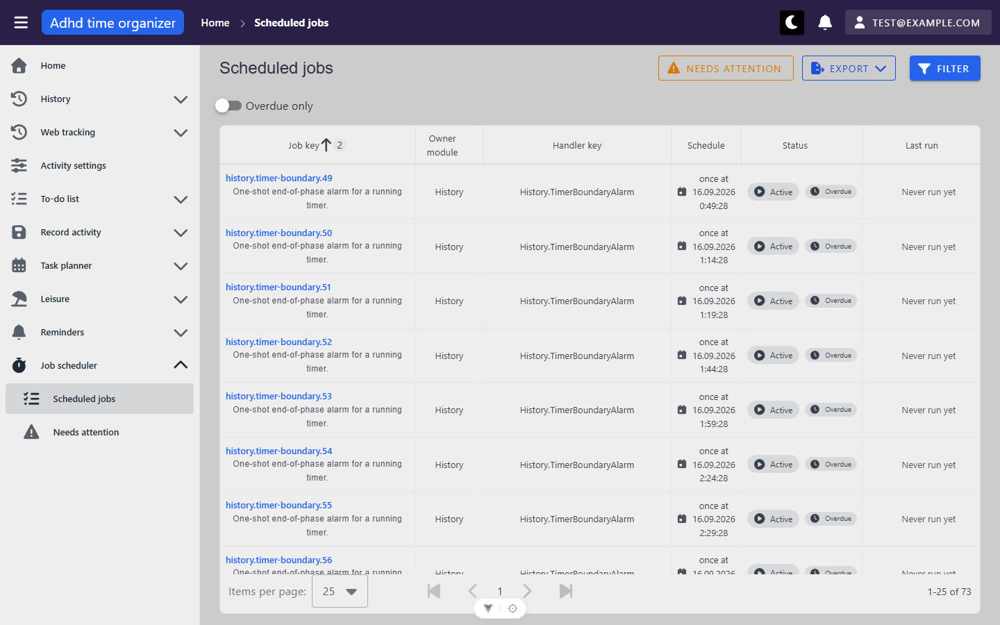
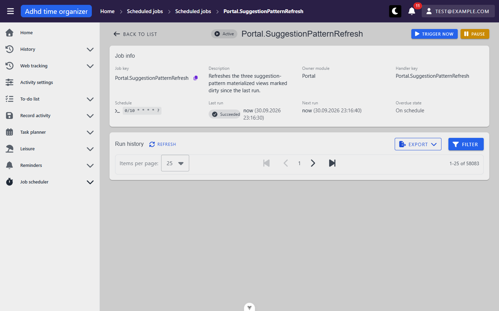
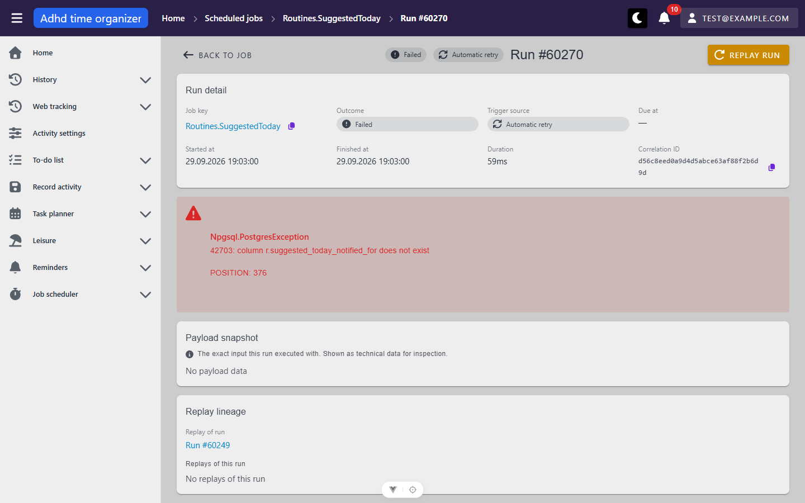
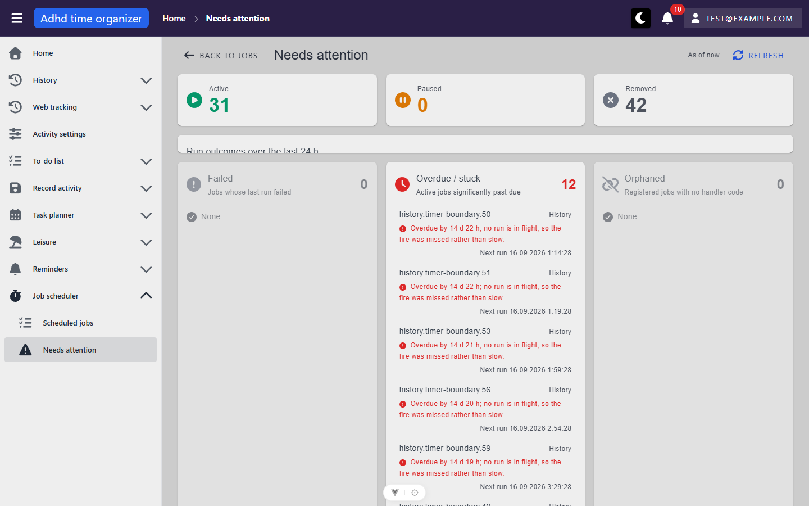

# scheduler — inventory

> Captured 2026-09-30 · locale EN · account `test@example.com` · commit `4d890646` (framework `b1b82a1`)

Framework module (`src/_common/modules/scheduler/`). Paths are this app's Slovak overrides from
`src/router.ts` (`APP_SCHEDULER_PATHS`); every in-module link resolves by route **name**. The shell (top bar,
sidebar, breadcrumbs, bell, snackbars, dialog host) is as described in [`_shell/inventory.md`](../_shell/inventory.md)
and is not repeated here.

**Data on the day.** The jobs are real registered jobs, not seed rows: 73 in total — 11 recurring (10 Cron, 2
Interval — `reminders.scan`, `Scheduler.OverdueJobSweep`) and 62 one-shot `History.TimerBoundaryAlarm` rows
(`Once`), of which 42 are `Removed`, 8 are spent (`Active`, `lastOutcome: Succeeded`, `nextRunAt: null`) and
**12 are `Active` + overdue since 15–16 Sep, never run** (ids 59–70). No job was orphaned, so the orphan badge,
the orphan alert and the orphan attention list could not be seen populated.

## Views

### SchedulerJobsView (`/planovac/ulohy`)

Other states: [filter dialog](screenshots/planovac-ulohy--filter.png) ·
[filtered, chip shown](screenshots/planovac-ulohy--filtered.png) · [390 px](screenshots/planovac-ulohy--390.png)

**Route:** `/planovac/ulohy` · params: none · guard: auth + `requiredRole: 'admin'` (a no-op in this app)
**Reached from:** sidebar › *Job scheduler* › *Scheduled jobs*; *Back to jobs* on needs-attention; *Back to list*
on job detail; breadcrumb crumb on both detail pages; each attention card's *View all* / count card (with a query)

**Actions**
| label | kind | selector | does | destination |
| --- | --- | --- | --- | --- |
| Needs attention | link (outlined warning button) | `getByRole('link', { name: 'Needs attention' })` | navigates | `/planovac/pozornost` |
| Export → Excel (.xlsx) / CSV (.csv) | menu button + two list items | `getByRole('button', { name: 'Export' })`, then `getByText('CSV (.csv)')` | `POST /scheduler-dashboard/jobs-overview/export?format=csv` with the **bare filter**; downloads `scheduler-jobs.csv` — 73 data rows, i.e. unpaged, 20 columns (`JobKey;HandlerKey;…;IsOrphaned;IsOverdue`, `;`-separated, dates `dd.MM.yyyy HH:mm:ss`) | download |
| Filter | button → dialog | `getByRole('button', { name: 'Filter' })` | opens the *Filter* dialog (below) | dialog |
| filter chip ✕ | chip close button | `getByRole('button', { name: 'Close' })` (every chip's ✕ is named just "Close") | removes that filter; refetches | in place |
| Overdue only | switch (checkbox) | `getByRole('checkbox', { name: 'Overdue only' })` | writes `onlyOverdue: true` into the filter; adds `?overdue=true`, an *Overdue only* chip, 73 → 12 rows | in place |
| column headers Job key, Owner module, Status, Last run, Next run | sortable header (`tabindex=0`) | `getByRole('columnheader', { name: 'Status' })` | server sort; writes `?sortBy=status:asc`; one request | in place |
| Handler key, Schedule, Actions | header | — | not sortable | — |
| job key link | link | `getByRole('link', { name: 'history.timer-boundary.49' })` | opens job detail | `/planovac/ulohy/:id` |
| Show detail of job {key} | row icon button (eye) | `getByRole('button', { name: 'Show detail of job history.timer-boundary.49' })` | same as the key link | `/planovac/ulohy/:id` |
| Trigger job {key} now | row icon button (play) | `getByRole('button', { name: 'Trigger job … now' })` | **not clicked** (read-only unit). Source: `POST /scheduled-job/trigger-now {jobKey}`, snackbar, then an immediate grid reload | in place |
| Pause job {key} / Resume job {key} | row icon button | `getByRole('button', { name: 'Pause job …' })` | **not clicked**. Source: `POST /scheduled-job/pause|resume {jobKey}`, snackbar, reload. Only the one matching the status renders; a `Removed` row has neither | in place |
| Items per page | select | combobox in footer (no accessible name — framework `BasicTable` footer) | `?perPage=` | in place |
| First / Previous / Next / Last page | buttons | `getByRole('button', { name: 'Last page' })` | `?page=` | in place |

No action on this page asks for confirmation: *Trigger now* runs a real job's side effects on one click (source;
not exercised). Compare *Replay*, which is behind a two-step acknowledgement dialog.

**Readable surfaces**
| surface | kind | contents | raw/derived | populated by |
| --- | --- | --- | --- | --- |
| jobs grid | server-paged table, 25/page, default sort `nextRunAt asc` + `jobKey asc` | 8 columns: Job key (+ description caption, + *Orphaned* chip), Owner module, Handler key, Schedule, Status (+ *Overdue* chip), Last run (outcome chip + relative time, or *Never run yet*), Next run (relative time; absolute past ~a day; `—` when null), Actions | raw, except relative times (client clock) | `POST /api/scheduler-dashboard/jobs-overview` → `items`, `itemsCount` (73), `pageCount` |
| Schedule cell | text | Cron: the Quartz expression in `<code>` (`0/10 * * * * ?`); Interval: "every 5 minutes"-style label; Once: `once at 16.09.2026 0:49:28` | derived from `scheduleType`, `cron`, `intervalPreset`/`intervalCount`, `runAtUtc` | same |
| Overdue chip | chip | shown on 12 rows | raw `isOverdue` (server grace margin) | same |
| Orphaned chip | chip | none seen (no orphaned job) | raw `isOrphaned` | same |
| footer total | text | `1-25 of 73` | raw `itemsCount` | same |

**States**
- empty: not reached with the real job set (every filter tried returned rows). Source: BasicTable's default empty row.
- loading: the table's linear progress bar; rows stay up.
- error: source only — a non-cancel foreground failure empties the grid and snackbars `scheduler.jobs.loadError`; a
  failed *background* refresh keeps the rows silently. Not triggered.

**URL & persisted state**
- `page`, `perPage`, `sortBy` (`key:dir` list), and the filter: `ownerModule`, `handlerKey`, `status`,
  `scheduleType`, `lastOutcome`, `nextRunFrom`, `nextRunTo`, `overdue`. Written with `router.replace` (no extra
  history entry — Back from the list returned to `/`).
- A **bare** `/planovac/ulohy` is always rewritten to `?page=1&perPage=25&sortBy=nextRunAt:asc,jobKey:asc` — see P1.
- `?overdue=true` survives a reload (switch on, 12 rows); the filter dialog's *Clear* turns the switch off and
  drops the param.
- No `localStorage` / store. Background refresh every 120 s (`usePolling`, suspended while hidden, skipped while
  the filter panel is open, an export runs, or a row action is in flight) — source; not timed in this pass.

**Dialogs opened from here**
- *Filter* (`FilterPanel`, `role="dialog"`, name "Filter") — Owner module (text), Handler key (text), Status,
  Schedule type, Last outcome (selects), Next run from / to (`VDateInput`, placeholder `mm/dd/yyyy`); buttons
  *Close*, *Clear*, *Confirm*. *Confirm* applies and closes (one request), *Clear* resets everything including
  *Overdue only*. Escape closes it.

**Keyboard**
- Sortable headers are tab stops (`tabindex=0`). Escape closes the filter dialog. No page shortcuts.

**Console & network**
- errors/warnings/info: none.
- non-2xx: none once signed in.
- duplicate requests: none — one `jobs-overview` per load, per filter apply, per sort, per page change.

### SchedulerJobDetailView (`/planovac/ulohy/:id`)

Other states: [one-shot, overdue, no runs](screenshots/planovac-ulohy-id--once-overdue.png) ·
[unknown id → not found](screenshots/planovac-ulohy-id--not-found.png) ·
[500 → load failed + Try again](screenshots/planovac-ulohy-id--load-failed.png) ·
[replay dialog](screenshots/planovac-ulohy-id--replay-dialog.png) · [run filter](screenshots/planovac-ulohy-id--run-filter.png)

**Route:** `/planovac/ulohy/:id(\d+)` · params: `id: number` (router regex; `abc` → the app's *Page not found*) ·
guard: auth + admin (no-op)
**Reached from:** job key link / eye button on the jobs list; each row of the needs-attention lists; *Back to job*
and the job-key link on run detail; breadcrumb on run detail

Seeded ids used: **10** (`Portal.SuggestionPatternRefresh`, Cron `0/10 * * * * ?`, 58 075 runs),
**59** (`history.timer-boundary.49`, Once, overdue, no runs); invalid **999999**, malformed **abc**.

**Actions**
| label | kind | selector | does | destination |
| --- | --- | --- | --- | --- |
| Back to list | link | `getByRole('link', { name: 'Back to list' })` | navigates (no query carried) | `/planovac/ulohy` |
| Trigger now | button | `getByRole('button', { name: 'Trigger now' })` | **not clicked**. Source: `POST /scheduled-job/trigger-now`, success snackbar, then polls the run log by correlation id (10 × 3 s) and reloads the history when the row lands. No confirmation | in place |
| Pause / Resume | button (one of) | `getByRole('button', { name: 'Pause' })` | **not clicked**. Source: `POST /scheduled-job/pause|resume`, snackbar, reloads the job | in place |
| Copy to clipboard (job key) | icon button | `getByRole('button', { name: 'Copy to clipboard' })` | source: copies the raw key, snackbar. Not clicked (clipboard) | in place |
| Run history › Refresh | button | `getByRole('button', { name: 'Refresh' })` | reloads the run grid | in place |
| Run history › Export (.xlsx / .csv) | menu | `getByRole('button', { name: 'Export' })` | source: `POST /scheduler-dashboard/run-history/export` with the job-pinned filter. Not clicked — 58 075 rows | download |
| Run history › Filter | button → dialog | `getByRole('button', { name: 'Filter' })` | *Filter* dialog: Outcome, Trigger source (selects), Started from / to (date inputs); *Close*, *Clear*, *Confirm* | dialog |
| run start time (e.g. "now", "2 minutes ago") | link per row | `getByRole('link', { name: 'now' })` — the name is the relative time | run detail | `/planovac/behy/:id` |
| Show detail of the run started at {abs time} | row icon button | `getByRole('button', { name: 'Show detail of the run started at 30.09.2026 23:16:30' })` | run detail | `/planovac/behy/:id` |
| Replay the run started at {abs time} | row icon button | `getByRole('button', { name: 'Replay the run started at …' })` | opens the *Replay run* dialog. **Mouse click times out** — see X1; reached by `focus()` + Enter | dialog |

**Readable surfaces**
| surface | kind | contents | raw/derived | populated by |
| --- | --- | --- | --- | --- |
| header | status chip, *Orphaned* chip (none seen), `<h1>` job key | `Active` · `Portal.SuggestionPatternRefresh` | raw | `GET /api/scheduled-job/{id}` |
| orphan alert | `VAlert` | not seen (no orphaned job) | raw `isOrphaned` | same |
| Job info | info grid, 8 rows | Job key (+copy), Description, Owner module, Handler key, Schedule (`<code>` cron / interval label / `once at …`), Last run (outcome chip + "now (30.09.2026 23:16:30)"), Next run (relative + absolute; absolute only when >~a day away), Overdue state (*Overdue* chip or *On schedule*) | raw + relative time | same |
| Run history grid | server-paged table, 25/page, default `startedAt desc` | Started at (relative, link), Duration (`16ms`), Outcome chip, Trigger source chip, Error (`—`), Actions. Footer `1-25 of 58083`. **Renders no header and no rows on screen** — X1 | raw | `POST /api/scheduler-dashboard/run-history` (`items[]`: `scheduledJobId`, `jobKeySnapshot`, `handlerKeySnapshot`, `scheduledFireTime`, `startedAt`, `finishedAt`, `durationMs`, `outcome`, `errorMessage`, `errorType`, `triggerSource`, `correlationId`, `replaysRunId`, `id`) |

**States**
- empty (run history): `No data available` + `0-0 of 0` — job 59.
- loading: centred spinner for the job; `Loading items...` row in the grid.
- not found (404, id 999999): alert **"Job not found — This job could not be loaded. It may have been removed, or the
  link is no longer valid."** *plus* the interceptor's snackbar **"The requested item was not found."** (P3). Breadcrumb
  `Home › Scheduled jobs`.
- load failed (500, routed with `playwright-cli route`): alert **"Load failed — This job could not be loaded. Please try
  again."** with **Try again**, plus the snackbar "A server error occurred. Please try again later." *Try again* after
  un-routing loaded the job.
- malformed id `abc`: the app's *Page not found* view (router regex), no request.

**URL & persisted state**
- Run-history grid state through `useServerTable` (`page`, `perPage`, `sortBy`, `outcome`, `triggerSource`,
  `startedFrom`, `startedTo`); `jobId` is never in the query. At defaults the URL stays bare (`startedAt desc` is
  also BasicTable's first column, so no tie-breaker is pushed — contrast the jobs list, P2).
- No `localStorage`.

**Dialogs opened from here**
- *Replay run* (`ReplayConfirmDialog` on `MyDialog`, `persistent: false`) — warning alert "Replaying repeats real side
  effects", Job key, Replaying run `#61991`, checkbox *I understand this will repeat real side effects.*, sr-only gate
  hint; buttons *Cancel*, *Replay run* (disabled until ticked). Focus lands on the checkbox on open; Space ticks it and
  enables *Replay run*; Escape closes; reopening on another run shows it **unticked** and the button disabled again
  (S6 #4 holds). *Replay run* was never pressed.
- run-history *Filter* — as above.

**Keyboard**
- Escape closes both dialogs. The replay row buttons are reachable by Tab/`focus()` + Enter even though the rows are
  not visible (X1).

**Console & network**
- errors: only on the 404 — `Failed to load resource … 404` and the interceptor's `ERROR: AxiosError … 404`
  (`axiosConfig.ts:190`), both expected.
- non-2xx: `GET /scheduled-job/999999` → 404 (deliberate), routed 500 (deliberate).
- duplicate requests: none — one `GET /scheduled-job/{id}` and one `POST run-history` per load.
- breadcrumb: `Home › Scheduled jobs › Scheduled jobs › Portal.SuggestionPatternRefresh` — see B3.

### SchedulerRunDetailView (`/planovac/behy/:id`)

Other states: [succeeded, no payload](screenshots/planovac-behy-id.png) ·
[payload, job removed → Replay disabled](screenshots/planovac-behy-id--payload-removed-job.png) ·
[unknown id](screenshots/planovac-behy-id--not-found.png)

**Route:** `/planovac/behy/:id(\d+)` · params: `id: number` · guard: auth + admin (no-op)
**Reached from:** only the run-history grid on job detail (start-time link, eye button) and this view's own lineage
links. With the grid invisible (X1) there is **no mouse path here** from the UI.

Ids used: **61991** (job 10, Succeeded, Scheduled, no payload), **60270** (job 73, Failed, *Automatic retry* of
60249, `Npgsql.PostgresException`), **60249** (Scheduled, retried by 60257 and 60270), **57272** (job 12, payload
`{"alarmId":2}`), **52704** (job 11 — `Removed` — payload), invalid **999999**.

**Actions**
| label | kind | selector | does | destination |
| --- | --- | --- | --- | --- |
| Back to job (Back to list when not loaded) | link | `getByRole('link', { name: 'Back to job' })` | navigates | `/planovac/ulohy/:jobId` (`/planovac/ulohy`) |
| Replay run | button | `getByRole('button', { name: 'Replay run' })` | opens the *Replay run* dialog (same component as on job detail). Disabled when the job is `Removed` or orphaned — 52704: `disabled`, `title="This run cannot be replayed — its job has been removed."`, `pointer-events: none` (B2). Never confirmed | dialog |
| job key | link | `getByRole('link', { name: 'history.timer-boundary.2' })` | navigates | `/planovac/ulohy/:jobId` |
| Copy to clipboard ×3 | icon buttons | `getByRole('button', { name: 'Copy to clipboard' })` — **three identical names** (job key, correlation id, payload) (A2) | source: copies the raw value (payload: raw, not pretty-printed), snackbar. Not clicked | in place |
| Show all / Show less | toggle button | `getByRole('button', { name: 'Show all' })` | lifts the 320 px cap on the payload `<pre>`; `aria-expanded` + `aria-controls`. Rendered even when nothing is capped (3-line payload, `pre` 86/86 px) (P5) | in place |
| payload region | focusable region | `getByRole('region', { name: 'Payload snapshot' })` | `tabindex=0` scroll region, described by the hint line | — |
| Run #{id} (replay of / replays of this run) | links | `getByRole('link', { name: 'Run #60249' })` | navigates run → run; **the body refetches** (61991 → 60249 changed h1, fields and lineage) | `/planovac/behy/:id` |

**Readable surfaces**
| surface | kind | contents | raw/derived | populated by |
| --- | --- | --- | --- | --- |
| header | outcome chip, trigger-source chip, `<h1>` `Run #id` | `Failed` · `Automatic retry` · `Run #60270` | raw | `GET /api/scheduler-dashboard/run/{id}` |
| Run detail | info grid, 8 rows | Job key (+copy), Outcome, Trigger source, Due at (`—` for an off-schedule fire), Started at (relative + absolute), Finished at, Duration (`59ms`), Correlation ID (monospace, breaks mid-string, +copy) | raw + relative | same |
| error alert | `VAlert` (only for `Failed` with a type or message) | `Npgsql.PostgresException` / `42703: column r.suggested_today_notified_for does not exist` / `POSITION: 376`, `white-space: pre-wrap` — the server's CRLFs render as blank lines (P6) | raw | same |
| Payload snapshot | `<pre>` capped at 320 px, line count caption | `3 lines` · pretty-printed JSON; *No payload data* otherwise | derived (pretty-print, line count) | same (`payloadSnapshot`) |
| Replay lineage | "Replay of run" link or *This run is not a replay*; "Replays of this run" link list or *No replays of this run* | 60249 lists `Run #60257`, `Run #60270` — both **automatic retries**, not replays (P4) | raw `replayedFromRunId`, `replayedByRunIds` | same |

**States**
- loading: spinner.
- not found (404): **"Run not found — This run could not be loaded. It may have been removed, or the link is no longer
  valid."**, *Back to list*, plus the snackbar "The requested item was not found." Breadcrumb after a fresh load:
  `Home`; after in-app navigation from run 60249: **`Home › Scheduled jobs › Routines.SuggestedToday › Run #60249`**
  (B4).
- load failed: source only (same `SchedulerDetailPage` frame as job detail, verified there).

**URL & persisted state**
- `:id` only. No query, no storage.

**Dialogs opened from here**
- *Replay run* — as on job detail. Not opened again here.

**Keyboard**
- Payload region is a tab stop. Nothing else beyond Tab order.

**Console & network**
- errors: only for the deliberate 404 (resource + interceptor `AxiosError` lines).
- non-2xx: `GET /scheduler-dashboard/run/999999` → 404.
- duplicate requests: none — one `GET …/run/{id}` per load and per lineage hop.

### SchedulerNeedsAttentionView (`/planovac/pozornost`)

Other states: [full page](screenshots/planovac-pozornost--full.png) ·
[poll failed, stale data kept](screenshots/planovac-pozornost--refresh-failed.png) · [390 px](screenshots/planovac-pozornost--390.png)

**Route:** `/planovac/pozornost` · params: none · guard: auth + admin (no-op)
**Reached from:** sidebar › *Job scheduler* › *Needs attention*; *Needs attention* button on the jobs list

**Actions**
| label | kind | selector | does | destination |
| --- | --- | --- | --- | --- |
| Back to jobs | link | `getByRole('link', { name: 'Back to jobs' })` | navigates | `/planovac/ulohy` |
| Refresh | button | `getByRole('button', { name: 'Refresh' })` | foreground `GET /health` (not silent); recovered the page after a failed poll | in place |
| Active 31 / Paused 0 / Removed 42 | link cards | `getByRole('link', { name: 'Removed 42' })` | jobs list filtered by status — *Removed 42* landed on `?status=Removed…`, `1-25 of 42`, chip shown. The `href` carries every empty key (`ownerModule=&handlerKey=&…`); the jobs list drops them on arrival | `/planovac/ulohy?status=…` |
| attention row (job key, module, reason, time) | link per row | `getByRole('link', { name: /^history\.timer-boundary\.50 / })` — name is the whole row text plus sr-only "Open job detail" | job detail | `/planovac/ulohy/:id` |
| View all in jobs list | link (failed, overdue cards only; hidden when the list is empty) | `getByRole('link', { name: 'View all in jobs list' })` | overdue → `?overdue=true`, switch on, `1-12 of 12` | `/planovac/ulohy?overdue=true` |

**Readable surfaces**
| surface | kind | contents | raw/derived | populated by |
| --- | --- | --- | --- | --- |
| freshness | caption | `As of now` (relative, client receive time); `Refresh failed — showing older data` warning chip after a failed poll | derived | receive time of `GET /api/scheduler-dashboard/health` |
| status counts | 3 cards | Active 31 · Paused 0 · Removed 42 | raw `activeCount`, `pausedCount`, `removedCount` | same |
| run-outcome rollup | card with chips | heading `Run outcomes over the last 24 h`; chips Succeeded 85 · Failed 0 · Skipped 0 · Vetoed 0 (Misfired/Reversed only when > 0). **Crushed to 32 px at 1440×900 — chips invisible** (B5) | raw `recentRunOutcomes[] {outcome, count}` → rollup, `recentWindowHours` 24 | same |
| Failed / Overdue·stuck / Orphaned | 3 cards with count + row list | 0 · **12** · 0. Overdue rows: key, module, reason (`Overdue by 14 d 22 h; no run is in flight, so the fire was missed rather than slow.`, clamped to 3 lines, sr-only "Error:" prefix), `Next run 16.09.2026 1:14:28`. Row order is the server's (50, 51, 53, 56, 59, 49, …) — not by key or by due time (P7) | raw (`failedJobs`, `overdueJobs`, `orphanedJobs`, each item's `detail`) | same |
| all-clear card | card | not reachable (12 overdue) | derived | same |
| live region | `role=status` sr-only | announces count changes after the first load | derived | same |

**States**
- loading: centred spinner (first load only).
- error, nothing loaded yet: `scheduler.needsAttention.loadError` alert — source only.
- error on a background poll (routed 500 for 65 s): data kept, `Refresh failed — showing older data` chip, **no snackbar**;
  *Refresh* after un-routing cleared the chip.
- empty per list: *None* with a check icon, card dimmed.

**URL & persisted state**
- none. Auto-refresh every 60 s (`usePolling`, immediate): observed exactly one extra `GET /health` in 70 s, no
  flicker; **zero** scheduler requests in the 65 s after navigating to `/`. The hidden-tab pause was not tested
  (headless tab visibility).

**Dialogs opened from here**
- none.

**Keyboard**
- Rows are links with a `:focus-visible` outline (source). No shortcuts.

**Console & network**
- errors/warnings: none.
- non-2xx: only the deliberate routed 500.
- duplicate requests: none.
- 390 px: no horizontal page overflow (`scrollWidth` 390).

## Transitions out of this unit
| from | control | goes to |
| --- | --- | --- |
| every view | sidebar / top bar / breadcrumb *Home* | shell — `/` and other modules |
| jobs list (malformed child URL) | `/planovac/ulohy/abc` | the app's *Page not found* view (`NotFoundView`) |

Every other control in the unit stays inside the four scheduler routes.
