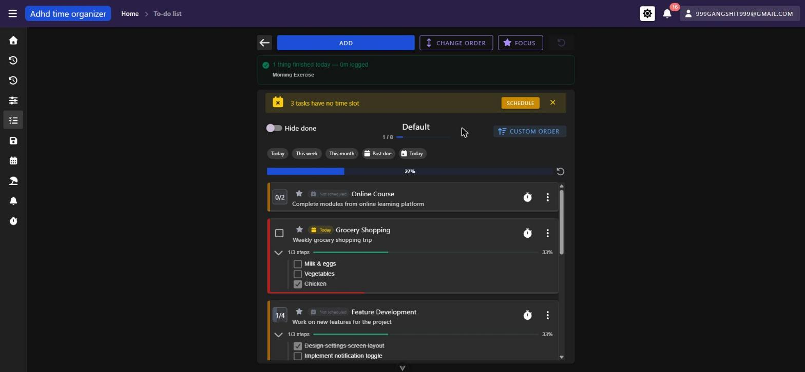
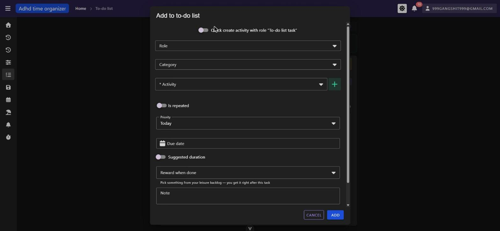
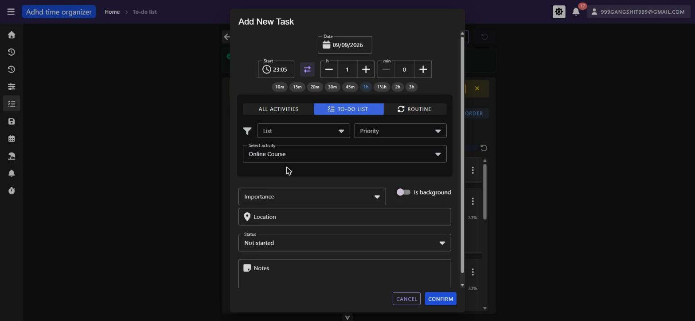
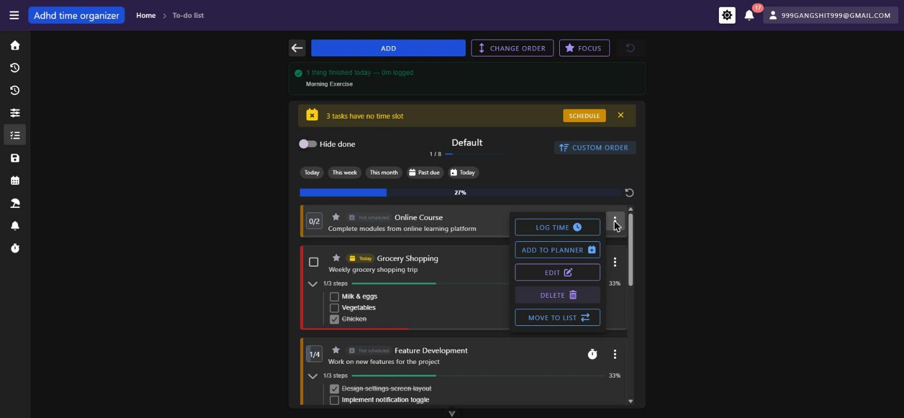
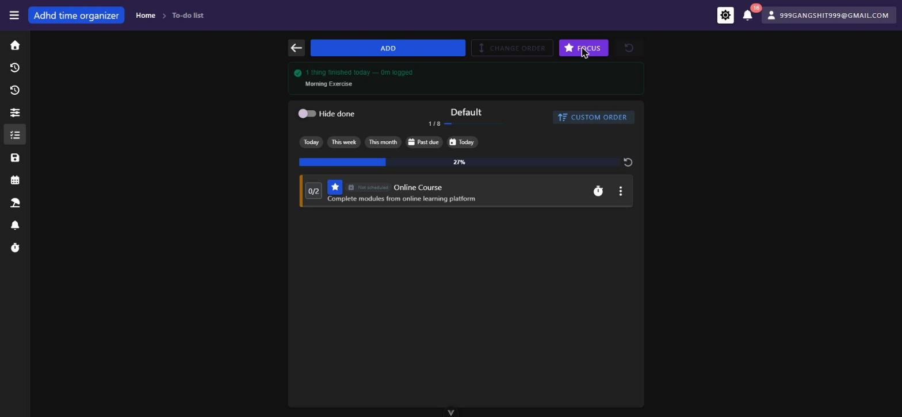
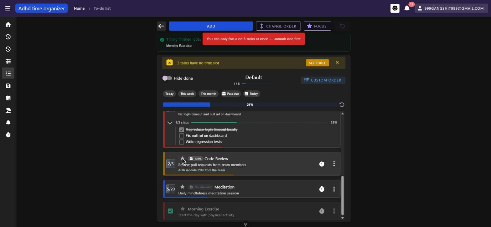
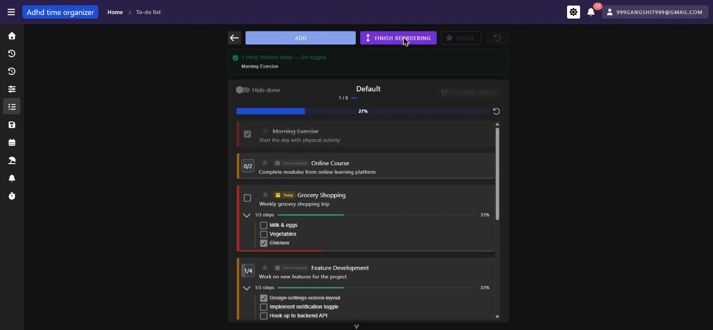
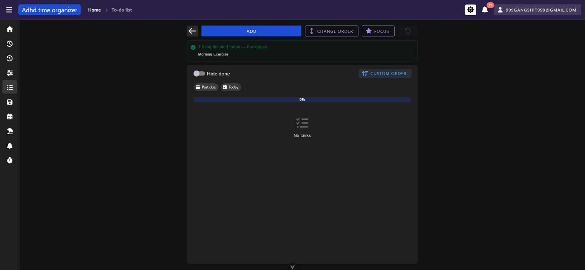

# todo-lists — inventory

> Captured 2026-09-09 · locale EN · account `999gangshit999@gmail.com` · commit `acd7db0d`

## Views

### TodoListsView (`/todo-list`)

**Route:** `/todo-list` · params: none · guard: `auth`
**Reached from:** sidebar › To-do list › To-do list

**Actions**
| label | kind | selector | does | destination |
| --- | --- | --- | --- | --- |
| Add category (icon-only "+") | button | no accessible name — icon only, `main button` #1 in DOM order | opens "New category" dialog | dialog |
| Category sort toggle (icon-only) | button | no accessible name — icon-only, next to category search | reverses category list order | in place |
| Category search | input | `textbox "Search"` (Categories panel) | filters category list by name | in place |
| "All" / per-category rows | link-like list items | `generic "All"` / category name | selects a category, filters the list panel | in place |
| Hide empty | checkbox | `checkbox "Hide empty"` | hides categories with 0 lists | in place |
| Categories (mobile, "d-md-none") | button | text "Categories" (has visible label) | opens full-screen category drawer | dialog (fullscreen) |
| NEW LIST | button | text "New list" | opens `TodoListForm` create dialog | dialog |
| List search | input | `textbox "Search"` (right panel) | debounced (300ms) filter of lists by name | in place |
| List sort toggle (icon-only) | button | no accessible name — icon-only, top-right of list panel | reverses list sort direction | in place |
| List card body (click) | click target | `TodoListCard` | navigates into the list | `/todo-list/:id` |
| Edit list (pencil, icon-only) | button | no accessible name — icon-only, per list card | opens `TodoListForm` edit dialog, prefilled | dialog |
| Delete list (trash, icon-only) | button | no accessible name — icon-only, per list card | opens delete confirmation (cascade-aware) | dialog |
| Edit category (via category row overflow) | — | not separately tested this pass (out of budget) | opens `TodoListCategoryForm` edit dialog | dialog |

**Readable surfaces**
| surface | kind | contents | raw/derived | populated by |
| --- | --- | --- | --- | --- |
| List card progress bar + "`x / y` done" + "`n%`" | progress bar + text | done/total items, percentage | raw count from API, percentage derived client-side | `POST /api/todo-list/filter-sort` |
| Category tree | list | "All" + per-category names, counts implied by filtering | raw | `GET /api/todo-list-category/all-options`, `POST /api/todo-list-category/filter-sort` |
| Empty states | text | "no lists" / "no lists match filter" / "no lists in this category" (three distinct copies, keyed to which filter is active) | n/a | client-side conditional |

**States**
- empty: reachable by filtering to a nonexistent name (`toDoList.namedList.emptyFilter`) or an empty category (`toDoList.namedList.emptyCategory`); the base empty-list-of-lists copy (`toDoList.namedList.empty`) was not independently reached with this seed (there is always ≥1 list, "Default").
- loading: three skeleton `VCard`/`VSkeletonLoader` placeholders while `loadLists()` is in flight.
- error: not observed — no non-2xx response was produced against this view.

**URL & persisted state**
- None of this view's filters (category selection, name search, sort direction) are reflected in the URL or
  query params — a reload or back-navigation resets them to defaults (category = All, no name filter, sort
  ascending). Contrast with `TodoListView`, whose filters are all URL-backed. See Findings.

**Dialogs opened from here**
- **"New category" / category edit** (`TodoListCategoryForm`) — Name, an icon picker whose label renders as the
  raw i18n key `iconPicker.icon` (see Findings), a colour swatch grid (~20 unlabelled colour buttons), Cancel/Add
  (or Edit).
- **"Add to to-do list" / list edit** (`TodoListForm`) — Name, the same `iconPicker.icon`-labelled icon picker,
  Category select, Description textarea, Cancel/Add (or Edit).
- **Delete list?** (confirm dialog via `useDialog().confirm`) — names the list, and when it has items states
  "Items in this list: N. They will be deleted with it." before offering Cancel/Delete.

**Keyboard**
- Not separately walked beyond the shell's Tab-order baseline (see `_shell.md`); the five icon-only buttons in
  this view are unreachable by name for a screen-reader user even though they are in the Tab order (see
  Findings A1–A2 below, this unit's own instances distinct from the shell's sidebar-toggle finding).

**Console & network**
- errors/warnings: none on the base view itself. Opening the category/list dialogs produces
  `[intlify] Not found 'iconPicker.icon' key in 'EN' locale messages.` and
  `[intlify] Not found 'iconPicker.selectIconPlaceholder' key in 'EN' locale messages.` (repeats per dialog open).
- non-2xx: none.
- duplicate requests: none — `todo-list-category/filter-sort` and `todo-list/filter-sort` each fire once per
  load/filter change.

### TodoListView (`/todo-list/:id`)

**Route:** `/todo-list/:id` · params: `id: string` (coerced with `Number(props.id)`), resolved from the route via
`props: true` · guard: `auth`
**Reached from:** `TodoListsView` list card click (link, no dedicated nav entry — matches `_routes.md`)

**Actions**
| label | kind | selector | does | destination |
| --- | --- | --- | --- | --- |
| Back arrow (icon-only) | button (`VIconBtn`) | no visible text, but has a `:to` target — not checked for `aria-label` this pass | navigates to the list list | `/todo-list` |
| ADD | button | text "ADD" | opens `ToDoListItemDialog` create form | dialog |
| CHANGE ORDER / FINISH REORDERING | toggle button | text, changes label by state | enters/exits drag-reorder mode; disabled while `sortMode !== 'custom'` or focus mode is on | in place |
| FOCUS | toggle button | text "FOCUS" | toggles focus mode (hides everything but starred items); disabled while reordering | in place (URL: `?focusMode=true`) |
| Undo | button (icon + count) | `TodoListUndoBtn` | reverts the last queued action, shows a description of what it would undo | in place |
| Star (per item) | icon button | `title`/`aria-label` = "Mark as today's focus" / "Unmark…" (has an accessible name) | toggles that item into/out of the ≤3-item focus set; the 4th attempt shows an error snackbar instead of silently failing | in place (URL: `?focus=<id>,...`) |
| "Not scheduled" chip (per item) | chip, `role="button"`, keyboard-operable (Enter/Space) | `aria-label` = "Not scheduled — <hint>" | opens the day-planner "Add New Task" dialog prefilled with this item's activity | dialog |
| Due-date chip (per item) | chip, read-only | text (e.g. "Today", "13.09.", "2 days ago") | none — display only | n/a |
| Quick-start stopwatch (per item) | icon button | `title`/`aria-label` = "Start a 10-minute timer" (translated text, has a name) | starts a running timer immediately, prefilled from `suggestedTime` or 10 min default — **not clicked this pass** to avoid starting a real timer session (side-effecting) | in place / hands off to running-timer store |
| Overflow menu (⋮, icon-only) | button → menu | no accessible name on the trigger itself; menu items are labelled buttons (LOG TIME / ADD TO PLANNER / EDIT / DELETE / MOVE TO LIST) | opens a per-item action menu | dialog / in place |
| Checkbox (single-count items) | checkbox | `VCheckboxBtn`, no visible/aria label beyond position | toggles done | in place |
| Counter (multi-count items, e.g. "0/2") | click target | `TodoListItemCounter`, no accessible name | increments `doneCount`; shows a checkbox affordance on hover but a single click did not change the count in this pass (see Findings, `unverified`) | in place |
| Step checkboxes (expanded items) | checkbox × N | plain checkboxes, step text as label | toggles a single step done | in place |
| Hide done | switch | `VSwitch`, labelled "Hide done" | hides completed items from the filtered view | in place (URL: `?hideDone=true`) |
| Priority chips (e.g. "Today", "This week", "This month") | filter chips | chip text = priority name | filters to items with that priority | in place (URL: `?priorities=<id>,...`) |
| "Past due" / "Today" due chips | filter chips | chip text + icon | filters to overdue / due-today items respectively | in place (URL: `?due=overdue\|today`) |
| Clear filters | link/chip | text "Clear filters" (appears once a priority or due filter is active) | clears priority + due filters only (not hideDone, sort or focus) | in place |
| Sort cycle button ("CUSTOM ORDER" / "BY PRIORITY" / "BY DUE DATE") | button | text, changes label by state | cycles `custom → priority → dueDate → custom` | in place (URL: `?sort=priority\|dueDate`) |
| "N tasks have no time slot" › SCHEDULE | button | text "SCHEDULE" | opens the day-planner dialog for the first unscheduled item | dialog |
| "N tasks have no time slot" › dismiss (×) | icon button | no accessible name confirmed this pass | dismisses the nudge banner for the session | in place |
| "N tasks are overdue" banner + reschedule actions | banner + buttons | not reached — no overdue items in this seed | bulk-reschedule / one-by-one review (per code, `useOverdueRenegotiation.ts`) | unverified |

**Readable surfaces**
| surface | kind | contents | raw/derived | populated by |
| --- | --- | --- | --- | --- |
| Header progress bar + "`done / total`" | progress bar + text | e.g. "1 / 8", "27%" | raw count / derived percentage, computed from the *unfiltered* `items` ref | `GET /api/todo-list-item?todoListId=<id>` |
| Per-item thin progress bar (bottom edge, 3px) | progress bar | fraction of steps done, or `doneCount`/`totalCount` | derived client-side from local refs (`itemProgress` in `BaseTodoListItem.vue`) | client-side |
| Calibration header line ("your estimates run about `N`x") | text | only renders once ≥5 comparable items exist — **not reached with this seed** | derived (average of per-item actual/suggested ratios) | `POST /api/activity-history/aggregate-by-activity` |
| Per-item "~30m / usually 50m" chip | chip + tooltip | only renders when `suggestedTime` is set and non-zero — **no item in this seed had a non-zero `suggestedTime`**, so not visually confirmed | derived, same aggregate endpoint | same as above |
| Daily recap card | card | "N thing(s) finished today — Nm logged", names the item(s) | raw | `GET /api/todo-list-item/daily-recap?date=<today>` |
| Step list (expanded item) | list + progress bar | step names, strikethrough when done, "`x/y` steps", "`n%`" | raw (`isDone` per step) / derived (percentage) | included in the item fetch |
| Priority chips available | chips | derived from the *distinct* priorities present among current `items`, not a fixed global list | derived client-side | `GET /api/task-priority` (names) + item data |

**States**
- empty: "No tasks" (with a faint checklist icon) — reached via Focus mode with 0 starred items, and via any
  filter combination that matches nothing (e.g. `?due=overdue` on this seed, which has no overdue items). Also
  the terminal state for the invalid-id route (see below).
- loading: not separately captured this pass (item fetch was fast in the dev environment).
- error: **the invalid-id case does not show a visible error state at all** — see Findings F-BLOCKER-1. The page
  renders exactly like the legitimate empty state ("No tasks", 0%, only the two due-filter chips with no
  priority chips since none exist), with no banner, toast or inline message telling the user the list doesn't
  exist.

**URL & persisted state**
- `hideDone`, `sort`, `priorities`, `due`, `focusMode`, `focus` are all `vue-router` query params, confirmed to
  survive a hard reload (tested `?focus=6&focusMode=true` directly) — matches the `useTodoListFilters.ts`
  pattern description in the N3 intent doc.
- `isInChangeOrderMode` is **not** URL-backed (local `ref`) — a reload while reordering silently drops back to
  view mode. This is arguably correct (reordering is a transient UI mode, not bookmookable state) so not logged
  as a defect.

**Dialogs opened from here**
- **"Add to to-do list" (`ToDoListItemDialog`)** — "Quick create activity" toggle, Role, Category, Activity
  (required, with an inline "+" quick-create), "Is repeated" toggle, Priority select (default "Today"), Due date
  (date picker; selecting a date reveals a "Specific time" toggle defaulted **on** with a prefilled 09:00 time —
  confirms the N1 prompt's "make the time field prominent, not optional-looking" requirement), "Suggested
  duration" toggle, "Reward when done" select (leisure backlog), Note. Cancel/Add.
- **"Add New Task" (day-planner `PlannerTaskDialog`, reached via the "Not scheduled" chip, the header SCHEDULE
  button, or the overflow menu's ADD TO PLANNER)** — Date, Start time + quick-duration chips (10m…3h), an
  activities filter (All activities / To-do list / Routine) with List/Priority filters and an activity select
  prefilled to the item that triggered it, Importance, "Is background" toggle, Location, Status, Notes.
  Cancel/Confirm.
- **Per-item overflow menu** — not a `MyDialog`, a `VMenu`: LOG TIME, ADD TO PLANNER, EDIT, DELETE, MOVE TO LIST.
- **Delete item** confirmation — not opened this pass (would mutate seed data); per `useDeleteConfirmation`
  wiring elsewhere in the module, expected to follow the same cascade-aware pattern as the list delete.

**Keyboard**
- The "Not scheduled" chip is explicitly keyboard-operable (`tabindex`, Enter/Space handlers) — a deliberate
  exception called out in `NormalTodoListItem.vue`'s own comment, "the chip is the whole point of the
  schedule-first framing, so it has to be reachable by keyboard as well."
- No item drag-and-drop keyboard equivalent was found or tested (drag-and-drop reordering appears mouse-only).

**Console & network**
- errors/warnings: none on a valid id (`/todo-list/1`) — clean boot, one calibration aggregate `POST`, no
  duplicates. On the invalid id (`/todo-list/999999`): one `AxiosError: Request failed with status code 404`
  plus "Unhandled error during execution of mounted hook at `<TodoListView>`", sourced to
  `useEntityQuery.ts:16` via `useRequestState.ts:17` via a call the browser's stack trace reports as
  `TodoListView.vue:126` (that line in the current source is an unrelated import; the actual call site is
  `fetchByIdNamedList(todoListId)` inside `onMounted`, around line 230 of the file read during this pass — the
  line-number mismatch is likely a stale/pre-refactor source map, not a second bug). Confirmed reproducible.
- non-2xx: `GET /api/todo-list/999999` → 404 (the only non-2xx observed in this unit).
- duplicate requests: none found on either a valid or invalid id.

## Transitions out of this unit
| from | control | goes to |
| --- | --- | --- |
| TodoListsView | list card click | `/todo-list/:id` (this unit) |
| TodoListView | back arrow | `/todo-list` (this unit) |
| TodoListView | "Not scheduled" chip / header SCHEDULE / overflow "ADD TO PLANNER" | opens `dayPlanner`'s `PlannerTaskDialog` (stays on `/todo-list/:id`, dialog only — no route change) |
| TodoListView | overflow "LOG TIME" / quick-start stopwatch | opens/starts `BaseTodoListLogTimeController` (activityTracking running-timer machinery; stays on this route) |
| TodoListView | "Reward when done" completion snackbar action | starts a leisure activity's timer via the same log-time controller (stays on this route) |
