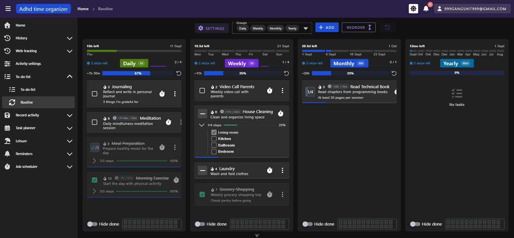
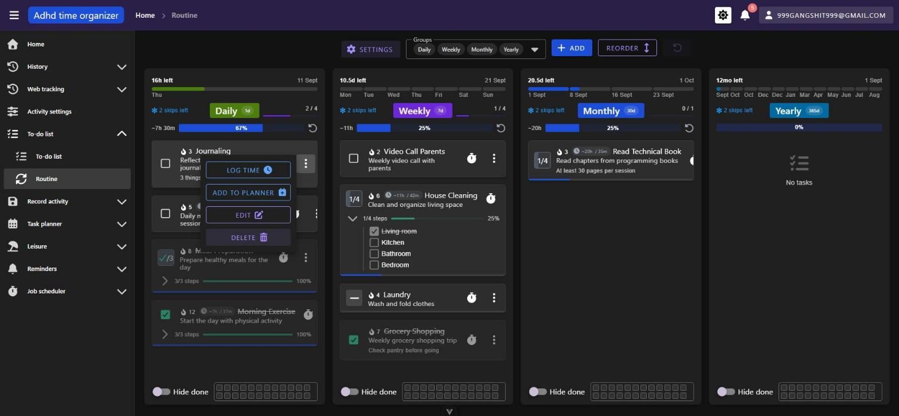
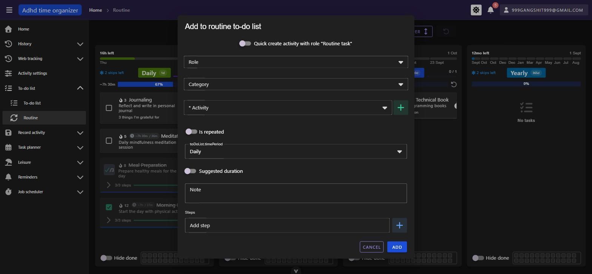
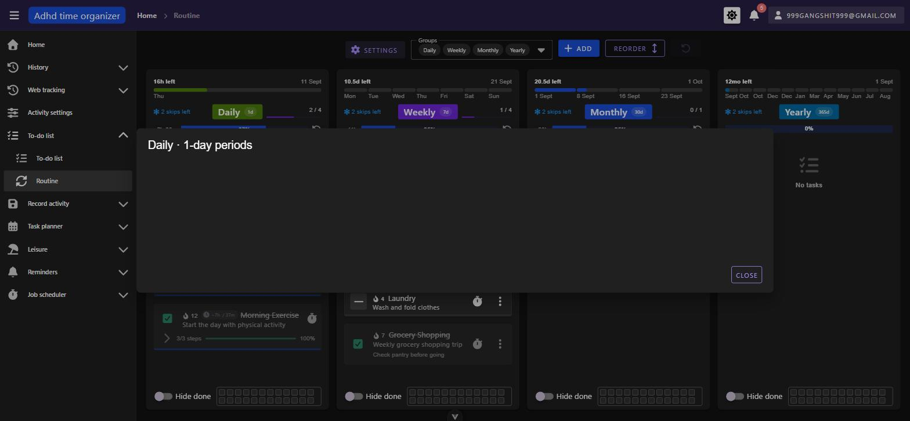
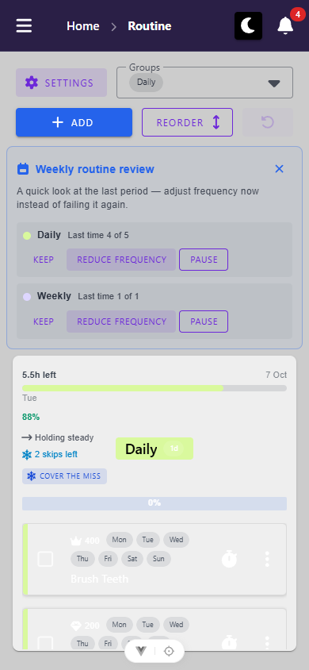
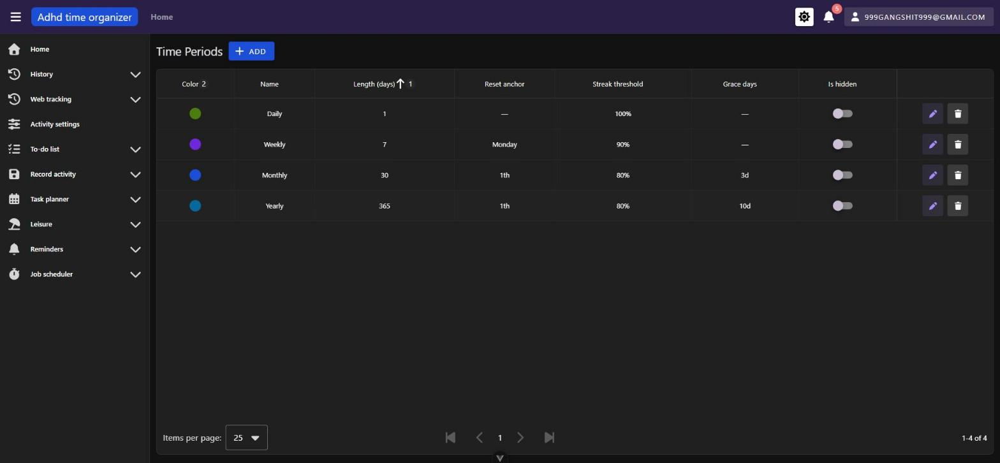
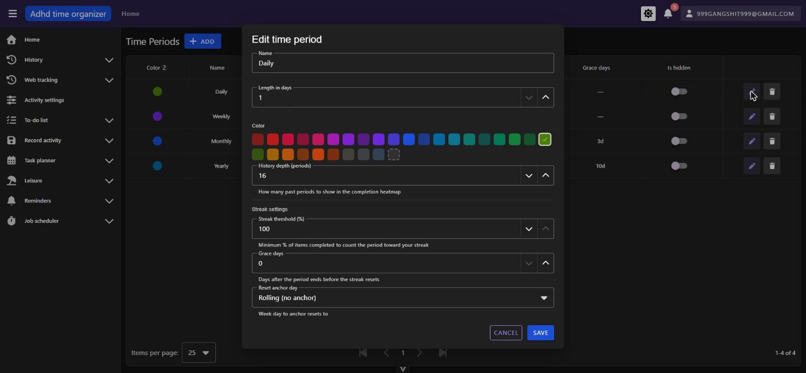
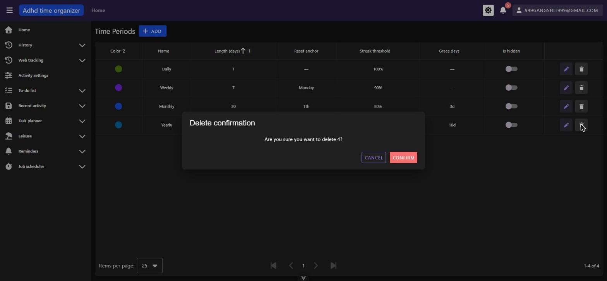
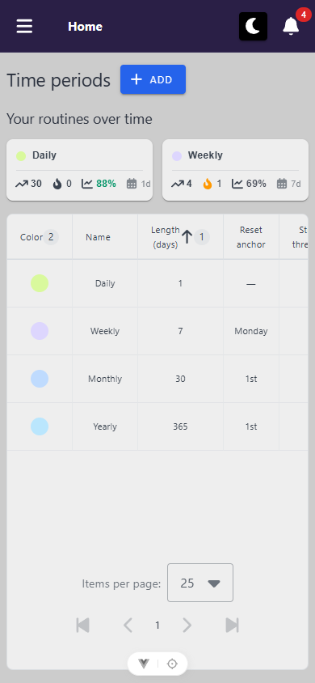

# todo-routine — inventory

> Captured 2026-09-10 · locale EN · account `999gangshit999@gmail.com` · commit `acd7db0d`

## Views

### RoutineToDoListView (`/routine-todo-list`)

**Route:** `/routine-todo-list` · params: none · guard: `auth`
**Reached from:** sidebar › To-do list › Routine

**Actions**
| label | kind | selector | does | destination |
| --- | --- | --- | --- | --- |
| SETTINGS | link (`VBtn to=`) | text "Settings" | navigates to the time-period settings page | `/routine-settings` |
| Groups | multi-select | `aria-labelledby` → "Groups" (properly labelled) | shows/hides recurrence-period columns; on `xs`/`sm` becomes single-select | in place, not URL-backed |
| ADD | button | text "Add" | opens `RoutineToDoListForm` create dialog | dialog |
| REORDER | toggle button | text "Reorder" (does **not** change label by state — see Findings B7) | enters/exits drag-reorder mode; strips streak flames, timer/overflow icons from every item while active; only colour/variant distinguishes the two states | in place |
| Undo (icon-only, rotate-left + badge) | button | **no accessible name** — see Findings A3 | reverts the last reorder/create/edit/delete; stays disabled after a plain done-toggle (see Findings B-checkbox) | in place |
| "N skips left" chip (per group) | chip w/ tooltip | text + snowflake icon | tooltip: "A missed period can be covered by a skip so your run continues — N per period, refills \<date\>." Properly localized. No click action observed (no period has fallen below threshold in this seed) | in place |
| Hide done (per group) | switch | `aria-label="Hide done"` | hides completed items in that group | in place |
| Heatmap strip (per group, clickable) | clickable region | no separate accessible name beyond the region itself | opens the period's history dialog | dialog |
| Item checkbox (single-count) | checkbox | `VCheckboxBtn`, no label beyond position | **toggles done AND unconditionally opens the "Log time manually" dialog** — see Findings B1 | in place + dialog |
| Item counter (multi-count, e.g. "0/2") | button | **no accessible name** — see Findings A1 | increments `doneCount`, hover swaps between a dash/checkbox glyph and the "`x`/`y`" counter | in place |
| Steps-expand chevron (items with steps) | icon button | **no accessible name** — see Findings A2 | expands/collapses the step checklist | in place |
| Quick-start timer (per item) | icon button | `aria-label="Quick start timer"` (good) | starts a running timer immediately — **not clicked**, side-effecting | hands off to running-timer store |
| Overflow menu (⋮, per item) | button → menu | `aria-label="More actions: <item name>"` (good — contrast with the normal list's unnamed equivalent, `docs/views/todo-lists/findings.md` A2) | LOG TIME / ADD TO PLANNER / EDIT / DELETE — **no MOVE TO LIST**, expected (routine items don't belong to movable lists) | dialog / in place |
| Weekly review card (`RoutineWeeklyReviewCard`) | card, closable | Keep / Reduce frequency / Pause buttons, all localized | **not reached this pass** — gated on `totalPeriodsElapsed > 0` per group, which is 0 for every period in this seed even though `routineReviewDismissedForWeekStart` is `null` (server-confirmed via `GET /api/routine/settings`) | see Findings U1 |

**Readable surfaces**
| surface | kind | contents | raw/derived | populated by |
| --- | --- | --- | --- | --- |
| Per-period mini timeline (top of card) | progress bar + labels | e.g. "16h left · Thu · 11 Sept" (daily), day-of-week ticks (weekly), week markers (monthly), month ticks (yearly) | derived from `nextResetAt` | `GET /api/routine-todo-list/grouped-by-time-period` |
| Streak flame + number (per item, `pre-chips` slot) | icon + text | the item's own `streak`; icon swaps to star/trophy/gem/crown at 30/90/180/365 (**not reached — no item streak ≥ 30 in seed**) | raw (`item.streak`) | same endpoint |
| Group progress ("`N / M`" + thin bar, `RoutineGroupStats`) | text + `VProgressLinear` | items-done-count / items-total-count | derived client-side, **item-count based** | client-side, from the same payload |
| Second progress bar ("`~time left`" + "`N%`", `BaseToDoList`, shared with the normal list) | text + `VProgressLinear` | `~estimatedTimeRemaining` and a **unit-weighted** done/total ratio (`doneCount ?? isDone?1:0` over `totalCount ?? 1`) | derived client-side, **disagrees with the bar above** — see Findings B2 | client-side |
| Consistency % + trend arrow (`RoutineGroupStats`) | text + icon | % of elapsed periods completed; trend compares the two halves of `completionHistory` (needs ≥ 6 entries — **not reached**, history is empty for every period in this seed) | derived | same endpoint |
| Per-group completion heatmap (compact strip) | mini heatmap | one cell per recent period | raw (`completionHistory`), **empty for every group in this seed** — renders as an all-empty strip, not a blocker but nothing to visually confirm | same endpoint |
| History dialog heatmap (ECharts calendar) | chart | same `completionHistory`, expanded | raw | same endpoint |
| Step list (expanded item) | list + progress bar | step names, strikethrough when done, "`x/y` steps", "`n%`" | raw / derived | same endpoint |

**States**
- empty: "No tasks" for a group with zero routine items (reached for Yearly in this seed) — icon + text, matches
  the normal list's empty-state copy
- loading: not separately captured this pass
- error: not reached — no non-2xx response was produced against this view in normal use

**URL & persisted state**
- `Groups` column visibility is **not** URL-backed and **not** persisted — deselecting "Monthly" and reloading
  restores all four; contrast with the normal list's `TodoListView`, whose filters are fully URL-backed
  (`docs/views/todo-lists/inventory.md`). Not filed as a defect — matches the normal list's own
  `TodoListsView` precedent of session-only filters, just worth naming for whoever designs the next filter UI.
- `isInChangeOrderMode` is local, non-persisted — matches the normal list's documented (accepted) behaviour.

**Dialogs opened from here**
- **"Add to routine to-do list" (`RoutineToDoListForm`)** — "Quick create activity" toggle, Role, Category,
  Activity (required, inline "+"), "Is repeated" toggle (reveals a "Total co…" — visually truncated, see
  Findings P1 — multi-count stepper), a time-period select **whose label renders as the raw key
  `toDoList.timePeriod`** (see Findings B3), "Suggested duration" toggle, Note, Steps. Cancel/Add. No
  Priority/Due-date/Reward fields — expected, routine items have neither.
- **Per-item overflow menu** — not a `MyDialog`, a `VMenu`; closes on Escape (confirmed).
- **Log time manually** — Start time + Length inputs, Cancel/Confirm. Reachable both intentionally (LOG TIME
  menu entry) and unintentionally (any checkbox click — Findings B1).
- **History dialog** (`RoutineGroupHistoryBody`, opened via the heatmap strip) — title "`<Period> · N-day
  periods`", a 220px chart area, CLOSE button. **Escape does not close it** — same framework default as the
  shell's A1 (`MyDialog persistent=true`), not re-filed here.
- **Delete item** confirmation — not opened this pass (avoided after the checkbox mutation incident — see
  Findings note).

**Keyboard**
- Escape closes the per-item overflow `VMenu` (confirmed).
- Escape does **not** close the history dialog (framework default, see above).
- The "N skips left" chip and heatmap strip were not separately keyboard-tested this pass.

**Console & network**
- errors/warnings: none on a clean load. Opening the "Add" dialog produces
  `[intlify] Not found 'toDoList.timePeriod' key in 'EN' locale messages.` ×4 (repeats per field re-render) —
  see Findings B3.
- non-2xx: none observed.
- duplicate requests: none — `GET /api/routine-todo-list/grouped-by-time-period` and
  `GET /api/routine/settings` each fire once per load.
- **Note on seed data:** the seed was empty ("No tasks" in all four groups) on this pass's first two loads,
  then populated on a later reload with `lastCompletedAt` timestamps matching the exact moment of a backend
  reconnect observed in the console — the seeding evidently completed mid-session. Not a frontend defect;
  noted so a re-run isn't surprised by the same transient state.

**Narrow viewport (390 × 844)** · checked 2026-10-06 · commit `27dd210b`

- layout: the sticky toolbar stacks into two rows: Settings + Groups, then Add (grows) + Reorder + Undo. The weekly review card stacks its rows; Keep / Reduce frequency / Pause fit at 28 px tall. One group card at a time (`cols="12"`). The card keeps the desktop fixed-height board layout, so its item list is a 159 px inner scroller, and its footer (Hide done + heatmap) is clipped out of the card (Findings B12).
- mobile-only controls: **Groups** becomes single-select under `smAndDown` (`RoutineToDoListView.vue:17-20`, `useRoutineGroups.ts:70`). Same locator as desktop: click `main .v-select .v-field__input`. It opens a 4-item menu (Daily / Weekly / Monthly / Yearly, 223×48 each), and choosing one shows only that group's card. Default: Daily.
- replaced controls: multi-select Groups (several cards side by side) → single-select (one card).
- overflow: none. `docScroll` and `.v-container` are both 390.
- tap targets: everything ≥ 24 px except Cover the miss (107×20) and the weekday chips (display-only). Cover the miss passes through the spacing exception. Item checkbox, Quick start and ⋮ are 40×40; the review card's close is 32×32.
- dialogs: Add to routine to-do list fits (24–366, body scrolls, Cancel/Add at y 758) ([screenshot](screenshots/routine-todo-list-add-dialog--mobile.png)). History is unreachable (B12).
- visual sweep: every-day items wrap their seven weekday chips onto two rows, and the title drops below them. That's the trade-off P2 already accepted. Item titles are white on the light card, the same as at desktop width.

### RoutineSettingsView (`/routine-settings`)

**Route:** `/routine-settings` · params: none · guard: `auth`
**Reached from:** the in-page "Settings" button on `/routine-todo-list`. **Not** in the sidebar, **not** in
`/user/settings`'s module-settings list — see Findings **B8** (CLAUDE.md violation; fixed in round 2). This
cross-reference read "B4" until triage caught it: B4 is the localization finding, and the settings-link
finding had never been written up at all.

**Actions**
| label | kind | selector | does | destination |
| --- | --- | --- | --- | --- |
| Add | button | text "Add" | opens `TimePeriodForm` create dialog | dialog |
| Edit (pencil, per row) | icon button | no accessible-name check done this pass (visually a `VIconBtn`) | opens `TimePeriodForm` edit dialog, prefilled | dialog |
| Delete (trash, per row) | icon button | same | opens a generic delete confirmation — **shows the raw numeric id, not the period's name** — see Findings B5 | dialog |
| Is hidden (per row) | switch | no aria-label check done this pass | toggles the period's visibility in the main view's group selector | in place |
| Color swatch grid (in Add/Edit dialog) | ~20 buttons | **properly named** (`aria-label="Crimson"`, `"Red"`, `"Rose"`, …) — contrast with the normal list's unlabelled colour grid, `docs/views/todo-lists/findings.md` (mentioned as part of `TodoListCategoryForm`) | selects the period's colour | in place |

**Readable surfaces**
| surface | kind | contents | raw/derived | populated by |
| --- | --- | --- | --- | --- |
| Time-period table | table, client-sorted | Color / Name / Length (days) / Reset anchor / Streak threshold / Grace days / Is hidden | raw | `GET /api/routine-time-period` (via `fetchAll`) |
| Personal-bests panel | card grid | best streak, current streak, consistency %, period length, per period | derived, gated on `totalPeriodsElapsed > 0` — **not reached**, every period in this seed has 0 elapsed periods (see Findings U2) | same endpoint |

**States**
- empty: not reached (4 periods always present in this seed)
- loading: not separately captured
- error: not reached

**URL & persisted state**
- `itemsPerPage`/`page`/`sortBy` are local `ref`s, not URL-backed — a reload resets sort to the table's
  default (`lengthInDays asc`). Not filed as a defect; consistent with this being an infrequently-used admin
  table, but worth naming since `TodoListView` treats equivalent state as bookmarkable.

**Dialogs opened from here**
- **"Add time period" / "Edit time period" (`TimePeriodForm`)** — Name, Length in days (`VNumberInput`),
  Color grid, History depth (periods) + helper text, "Streak settings" section: Streak threshold (%), Grace
  days, Reset anchor day (weekday select for week-aligned lengths) / Reset anchor day of month (for others).
  Cancel/Save. **Every visible string in this dialog is a hardcoded English literal — see Findings B4.**
- **Delete confirmation** (`BasicTable`'s built-in `MyDialog`) — title "Delete confirmation", body
  **"Are you sure you want to delete 4?"** (the raw id) — see Findings B5. Persistent (Escape did not close it
  — not separately re-tested, same framework default as elsewhere).

**Keyboard**
- Not separately walked beyond confirming Escape does not dismiss the delete-confirmation dialog.

**Console & network**
- errors/warnings: **none** — this is notable given Findings B4: because every string in `RoutineSettingsView`
  and `TimePeriodForm` is a hardcoded literal rather than an unresolved `$t()` call, there is no
  `[intlify] Not found` warning to flag it. The only way to catch this class of defect is reading the
  component or comparing rendered text against a Slovak-locale pass.
- non-2xx: none.
- duplicate requests: none — `GET /api/routine-time-period` fires once per load.

**Narrow viewport (390 × 844)** · checked 2026-10-06 · commit `27dd210b`

- layout: title + Add on one row. The "Your routines over time" cards wrap two per row. The table keeps all ten columns inside its own `v-table__wrapper` (`overflow-x: auto`, 877 / 372).
- mobile-only controls: none.
- replaced controls: none. The Is hidden switch (36×36 at x 701) and Edit/Delete (40×40 at x 790 / 838) are reached by scrolling the table sideways. The Name column isn't sticky, so the row's name scrolls out of view first.
- overflow: `table → 886` inside the intentionally scrolling `v-table__wrapper`. The page doesn't scroll sideways.
- dialogs: Add time period fits (24–366, body scrolls, Cancel/Create at y 764). Colour swatches are 28×28. The "Nudge me before the reset (days)" label ellipsises to "(da…" (212 vs 208 px, cosmetic) ([screenshot](screenshots/routine-settings-add-dialog--mobile.png)).
- visual sweep: nothing wrong at this width. The breadcrumb shows only "Home" on this route (not compared at desktop width).

## Transitions out of this unit
| from | control | goes to |
| --- | --- | --- |
| RoutineToDoListView | SETTINGS button | `/routine-settings` (this unit) |
| RoutineSettingsView | (no back link) | user navigates away via sidebar/breadcrumb only |
| RoutineToDoListView | overflow "ADD TO PLANNER" / header-adjacent planner hand-off | opens `dayPlanner`'s `PlannerTaskDialog` (stays on route, dialog only) |
| RoutineToDoListView | overflow "LOG TIME" / quick-start timer / checkbox click (see Findings B1) | opens/starts `BaseTodoListLogTimeController` (stays on route) |
