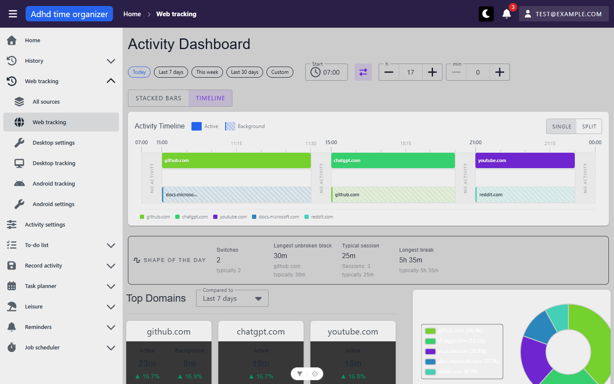
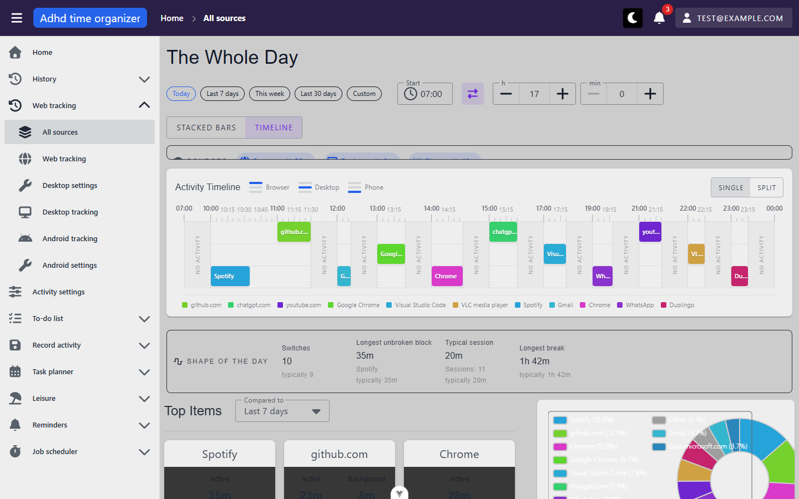
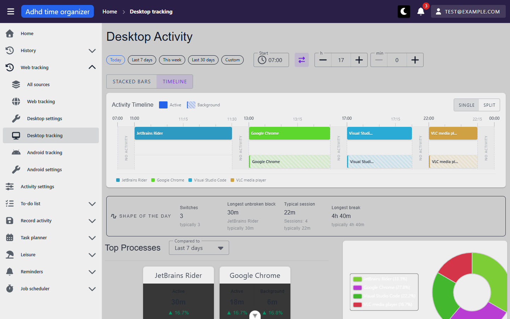
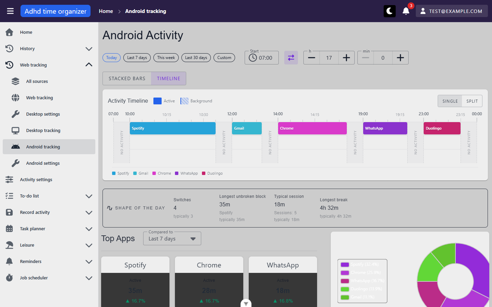

# tracking-dashboards — inventory

> Captured 2026-09-14 · locale EN · account `test@example.com` · commit `6aac48bb`

Methodology note: this app's main content area scrolls internally (the sidebar/top bar are fixed), so
`playwright-cli screenshot --full-page` — which sizes to `document.documentElement.scrollHeight` — does not
capture content below the first viewport. Below-the-fold surfaces (stacked-bars grid, pie-chart detail panel)
were captured by scrolling the inner container into view first, then taking a viewport screenshot. Noted per
screenshot below.

## Views

### ActivityDashboard (`/activity-tracking`)

**Route:** `/activity-tracking` · params: none · guard: auth
**Reached from:** sidebar › Web tracking › Web tracking

**Actions**
| label | kind | selector | does | destination |
| --- | --- | --- | --- | --- |
| Today / Last 7 days / This week / Last 30 days | chip (date preset) | `VChip` inside `VChipGroup`, text match (e.g. `text=Last 7 days`) | Sets `dateFrom`/`dateTo` to the preset span; switching to a multi-day preset forces the visualization to stacked bars | in place |
| Custom | chip | text match `Custom` | Reveals a `Mode: Range` picker with `Date from`/`Date to` date inputs | in place |
| Start (time textbox) | input | `textbox "Start"` | Sets the time-of-day window start | in place |
| swap direction | icon button | `button "Switch to time range"` | Toggles between duration mode (start + h/min) and explicit start/end time mode | in place |
| h / min steppers | number input + spin buttons | `textbox "h"` / `textbox "min"`; +/- spin buttons are `aria-hidden` (VNumberInput default) | Adjusts the window's duration | in place |
| STACKED BARS / TIMELINE | button group | `button "Stacked bars"` / `button "Timeline"` | Switches the main chart; TIMELINE is disabled (greyed, no interaction) once a multi-day range is active | in place |
| SINGLE / SPLIT | button group | `button "Single"` / `button "Split"` | Timeline only: single merged row vs. two time-split rows. **Not synced to the URL** (not in U1's param list — confirmed by design, U1 only names date/from/to/view/baseline/window/selected) | in place |
| Domain card (e.g. "View details for github.com") | button | `button "View details for <domain>"` | Selects the domain: highlights its pie slice, opens the detail panel, sets `?selected=<domain>` | in place |
| Compared to (baseline) | combobox | `combobox "Compared to"` | Changes the baseline every card's % figure and the focus-strip "typically" figures compare against; refetches summary-cards + focus-metrics only (confirmed via network, no duplicate/extra panel refetch) | in place |
| Total / Active / Background | radio group | `radio "Total"` / `"Active"` / `"Background"` | Changes which metric the pie chart slices represent | in place |
| Close (domain details) | icon button | `button[aria-label="Close domain details"]` | Closes the domain detail panel, returns to Day Total, clears `?selected` | in place — **icon fails to render, see finding B1** |
| Timeline session bar (e.g. "github.com session from 11:00 to 11:30…") | button | `button "<domain> session from <start> to <end>, duration <dur>"` | Selects that domain (same as a domain card click) | in place |
| Desktop settings / Desktop tracking / Android tracking / Android settings / All sources (sidebar group) | link | nav links | Navigates to the named sibling route | respective route |

**Readable surfaces**
| surface | kind | contents | raw/derived | populated by |
| --- | --- | --- | --- | --- |
| Activity Timeline | timeline, 2 lanes (Active/Background) | one bar per session, hover shows domain+time+duration | raw | `POST /api/activity-tracking/web-extension/timeline` |
| Stacked bars (range mode) | bar chart, one column per window | per-window domain segments, active (solid) + background (hatched) | raw | `POST /api/activity-tracking/web-extension/stacked-bars` |
| Shape of the day | 4-stat strip (Switches, Longest unbroken block, Typical session, Longest break) | each stat + a neutral "typically N" secondary line (no arrows/colour, per U5b's constraint — confirmed) | server-computed (U5b; no client-side fallback) | `POST /api/activity-tracking/web-extension/focus-metrics` |
| Top Domains cards | up to 4 cards, Active/Background time + baseline % | e.g. "23m ▲16.7%" — this volume comparison **does** use an up-arrow and green colour, unlike the focus strip. Pre-existing feature, not governed by U5b's neutral-framing rule (that rule was scoped to fragmentation metrics only) | raw (seconds) + derived (% vs baseline) | `POST /api/activity-tracking/web-extension/summary-cards` |
| Pie chart + legend | donut chart, one slice per domain, "Other" bucket under 3% | percent of selected metric (Total/Active/Background) | derived (percent computed client-side from `pie-chart` response) | `POST /api/activity-tracking/web-extension/pie-chart` |
| Day Total / domain detail panel | stat list | Total/Active/Background time, Domains/Pages/Visits counts (Day Total) or a domain's own split + page list (domain selected) | raw | same `pie-chart` response, no extra fetch (unlike Desktop, see that view) |

**States**
- empty: confirmed via `?date=2020-01-01` (genuinely no seeded data). Timeline: "No activity recorded for
  this period" with a muted icon. Top Domains / pie chart: "No activity recorded for this day" — **different
  wording from the timeline's**, both from the shared `ActivityEmptyState` component reading `emptyProbeState`.
  No "jump to a day with data" affordance shown (acceptable per U6 — "skip that affordance rather than
  inventing one" if it needs a new endpoint). See `screenshots/activity-tracking--empty-full-day.png`.
- loading: not captured (both fetches settle inside the debounce window before a screenshot could catch the
  skeleton reliably) — code path is `VSkeletonLoader` per panel, not exercised visually this pass.
- error: not triggered this pass (would need request interception/throttling); code path is `_silent: true` +
  per-panel retry button, confirmed by reading `useActivityDashboard.ts`, not observed live — **unverified**.

**URL & persisted state**
- `date`, `dateTo`, `from`, `to`, `baseline`, `window`, `selected` — all confirmed round-tripping: set via UI,
  appear in the URL, survive a full reload, and a URL seeded with all of them fires **exactly one** round of
  the four/five dashboard requests (confirmed via `playwright-cli requests` after a reload with
  `?date=2026-09-08&dateTo=2026-09-14&window=240` — one each of summary-cards/pie-chart/stacked-bars/
  focus-metrics, no timeline since range mode disables it, no duplicates)
- `selected` clears on any date/time change (confirmed: navigating with `?selected=github.com` present but
  changing the date drops it) but survives a plain reload of a URL that already carries it — matches U1's spec
- `SINGLE`/`SPLIT` timeline mode: local ref only, not in the URL, resets to Single on reload

**Dialogs opened from here**
- none — this view opens no `MyDialog`/`DialogHost` overlay

**Keyboard**
- Date-preset chips are focusable (`tabindex="0"`) but expose no `role` and no `aria-label` — see finding A1
- Domain cards, session bars and the close button are real `<button>`s with accessible names — fine

**Console & network**
- errors/warnings: **`Could not find one or more icon(s) {prefix: fas, iconName: mdi-close}`**, fired the
  moment a domain is selected — see finding B1
- non-2xx: none observed
- duplicate requests: none — confirmed on initial load, on a URL-seeded reload, and on a baseline change

### UnifiedActivityDashboard (`/activity-tracking/unified`)

**Route:** `/activity-tracking/unified` · params: none · guard: auth
**Reached from:** sidebar › Web tracking › All sources

**Actions** (only what's additional to `ActivityDashboard` above — range/window/visualization/baseline/
Single-Split/domain-card controls are identical and confirmed to behave the same way)
| label | kind | selector | does | destination |
| --- | --- | --- | --- | --- |
| Source chip (Browser / Desktop / Phone, each showing its counted time) | chip | `VChip`, text match e.g. `text=Desktop 1h 6m` | Toggles that source out of/into the merge; re-requests all 5 panels (summary-cards, pie-chart, stacked-bars, focus-metrics, sources) — confirmed one of each, no duplicates. The **last remaining selected source cannot be turned off** — the chip stays clickable but the toggle is a no-op, and its tooltip explains why (`activityTracking.sources.keepOne`) rather than doing nothing silently | in place |

**Readable surfaces** (additional to the shared four)
| surface | kind | contents | raw/derived | populated by |
| --- | --- | --- | --- | --- |
| Sources panel | 3 chips + overlap note | each chip: source label + its counted seconds (own contribution, in the current merge); below, when there's overlap: "`Xm` was recorded by two sources at once and is counted once", one line per displaced source ("`Xm` from Desktop is credited to Browser"), and the standing precedence rule ("foreground time beats background time; otherwise the more specific source wins — browser, then desktop, then phone") | raw contribution figures + derived overlap note | `POST /api/activity-tracking/unified/sources` — its own round, independent of the other four (confirmed: survives when another panel errors, per the component's own comment) |
| Activity Timeline | 3 lanes: Browser / Desktop / Phone (not Active/Background as on the per-source views) | one bar per session, labelled with each source's own label field (domain / product / app) | raw | `POST /api/activity-tracking/unified/timeline` |

**Overlap resolution — verified live, not just from source:** with all three sources selected, the "Shape of
the day" and Top Items figures include Browser+Desktop+Phone contributions once each; deselecting Desktop
(`?sources=webExtension,android`) dropped its own chip's figure and every panel refetched. The Sources panel's
own text is the resolution made visible, exactly as U4 asked for — e.g. "23m was recorded by two sources at
once and is counted once" / "23m from Desktop is credited to Browser" / the standing precedence sentence.
Colour: the merged legend shows `github.com`, `chatgpt.com`, `youtube.com` (browser, by domain),
`Google Chrome`, `Visual Studio Code`, `VLC media player`, `Chrome`, `WhatsApp` (desktop, by product) and
`Spotify`, `Gmail`, `Duolingo` (phone, by app) as eleven distinct labels/colours in this seed data — none of
them collide on a shared underlying app name in this environment, so `unifiedItemColor`'s one-entry-point
design (`useActivitySources.ts`) was not put under real strain by this pass; **unverified** whether two
sources reporting literally the same label (e.g. both extension and desktop logging "github.com") would
render as one colour or two.

**States**
- empty: not independently re-tested (shares `useActivityDashboard` + the same `ActivityEmptyState`
  component family; `UnifiedPieChartSection.vue` confirmed via source read to use the same
  `icon="fas fa-xmark"` close icon as Desktop's, **not** the broken `mdi-close` — see finding B1's note)
- loading / error: not exercised live, same as the per-source dashboards — **unverified**

**URL & persisted state**
- Everything from the shared composable (`date`, `dateTo`, `from`, `to`, `baseline`, `window`, `selected`)
  plus this view's own `sources` param — confirmed via URL after toggling Desktop off
  (`?sources=webExtension,android`). Per the view's own comment, `sources` is omitted from the URL entirely
  when all three are selected (the "everything" default), confirmed: the default-state URL carries no
  `sources` param at all.

**Dialogs opened from here**
- none

**Keyboard**
- Source chips have the same gap as the date-preset chips: focusable (`tabindex="0"`) but no `role` and no
  `aria-pressed` to announce the on/off state — folded into finding A1 rather than filed separately, since
  it's the same root pattern in a second component.

**Console & network**
- errors/warnings: none beyond the shared `mdi-close` issue (not triggered here — this view opened no domain
  detail panel during this pass; `UnifiedPieChartSection.vue` uses the correct icon per source read)
- non-2xx: none observed
- duplicate requests: none — confirmed on initial load and on a source toggle (5 requests, one of each)

### DesktopActivityDashboard (`/activity-tracking/desktop`)

**Route:** `/activity-tracking/desktop` · params: none · guard: auth
**Reached from:** sidebar › Web tracking › Desktop tracking

**Actions** (additional to / differing from `ActivityDashboard`)
| label | kind | selector | does | destination |
| --- | --- | --- | --- | --- |
| Process card (e.g. "View details for JetBrains Rider") | button | `button "View details for <product>"` | Selects the process **and fires an extra request** `GET /api/activity-tracking/desktop/process-details?processName=rider64.exe&...` — a genuine round trip, not a client-side re-slice (confirmed via network) | in place |
| Close (process details) | icon button | `button` inside the detail panel's `.v-card-title`, no accessible name | Closes the panel, clears `?selected` | in place — **no `aria-label`/accessible name at all, see finding A2** |

**Readable surfaces** (additional to / differing from `ActivityDashboard`)
| surface | kind | contents | raw/derived | populated by |
| --- | --- | --- | --- | --- |
| Process detail panel | stat list + window-title breakdown | Total/Active/Background/Entries, then a "Window titles" list with per-title durations (e.g. "AdhdTimeOrganizer... 20m") | raw, from its own dedicated endpoint | `GET /api/activity-tracking/desktop/process-details` (fired only once a process is selected) |

**States**
- empty: not independently re-tested live (shares `ActivityEmptyState` + `settingsRouteName="desktopSettings"`
  — confirmed via source read that the empty state, when reached, links to `Desktop settings`; not reproduced
  live this pass — **unverified** for this specific view, though the mechanism is shared and was confirmed
  live on the web dashboard)
- loading / error: not exercised live — **unverified**, same as the other dashboards

**URL & persisted state**
- Same shared params as `ActivityDashboard`; `selected` here holds the **product name** (`JetBrains Rider`),
  confirmed via `?selected=JetBrains+Rider` after clicking a process card.

**Dialogs opened from here**
- none

**Keyboard**
- Same date-preset-chip gap as finding A1. The process-detail close button is Tab-reachable but, per above,
  announces nothing.

**Console & network**
- errors/warnings: **none** — confirmed the `mdi-close` bug (B1) does **not** reproduce here; this panel's
  close icon renders correctly (`fas fa-xmark`), it simply carries no accessible name (A2)
- non-2xx: none observed
- duplicate requests: none — the `process-details` fetch fires once per selection, not repeated

### AndroidActivityDashboard (`/activity-tracking/android`)

**Route:** `/activity-tracking/android` · params: none · guard: auth
**Reached from:** sidebar › Web tracking › Android tracking

**Actions** (additional to / differing from `ActivityDashboard`)
| label | kind | selector | does | destination |
| --- | --- | --- | --- | --- |
| App card (e.g. "View details for Spotify") | button | `button "View details for <app>"` | Highlights the app's pie slice and sets `?selected=<app>` — **and nothing else**: confirmed via network that **no request fires at all** on selection (unlike Desktop's extra `process-details` call, and unlike Web's locally-available domain detail). The right-hand panel shown next to the pie chart is the same fixed Total/Apps/Sessions summary whether or not anything is selected — see finding B2. | in place |

**Readable surfaces** (differing from `ActivityDashboard`)
| surface | kind | contents | raw/derived | populated by |
| --- | --- | --- | --- | --- |
| Top Apps cards | up to 4 cards | **Active only, no Background row** — Android's source DTO has no active/background split (`AndroidAppSummaryDto.stat` is the only figure; `backgroundSeconds` is hardcoded `0` in `toStackedBarsWindow`), so the card layout correctly omits the column rather than showing a fake `0m` | raw | `POST /api/activity-tracking/android/summary-cards` |
| Pie chart side panel | fixed stat list | Total time / Apps / Sessions — **does not change when an app is selected** (confirmed: same three numbers before and after clicking "Spotify") | raw | `POST /api/activity-tracking/android/pie-chart` |

**States**
- empty: not independently re-tested live — **unverified** for this view specifically, mechanism shared with
  the other three (`settingsRouteName="androidSettings"`)
- loading / error: not exercised live — **unverified**, same as the other dashboards

**URL & persisted state**
- Same shared params; `selected` holds the **app label** (`Spotify`), confirmed via
  `?selected=Spotify` — confirmed synced even though selecting an app triggers no fetch and no visible detail
  change beyond the pie highlight and the card's selection border.

**Dialogs opened from here**
- none

**Keyboard**
- Same date-preset-chip gap as finding A1.

**Console & network**
- errors/warnings: none — confirmed the `mdi-close` bug (B1) does not reproduce here (this view never renders
  a domain/process-style detail panel at all)
- non-2xx: none observed
- duplicate requests: none

## Transitions out of this unit
| from | control | goes to |
| --- | --- | --- |
| any of the four dashboards | sidebar › Web tracking › Desktop settings | `/activity-tracking/desktop/settings/distinctEntries` (unit 6) |
| any of the four dashboards | sidebar › Web tracking › Android settings | `/activity-tracking/android/settings/distinctEntries` (unit 6) |
| empty state (source never sent data) | "go to settings" secondary line, when reached | `desktopSettings` / `androidSettings` route (unit 6) — mechanism confirmed via source, not reproduced live this pass |
| any of the four dashboards | sidebar / breadcrumb "Home" | `/` |
