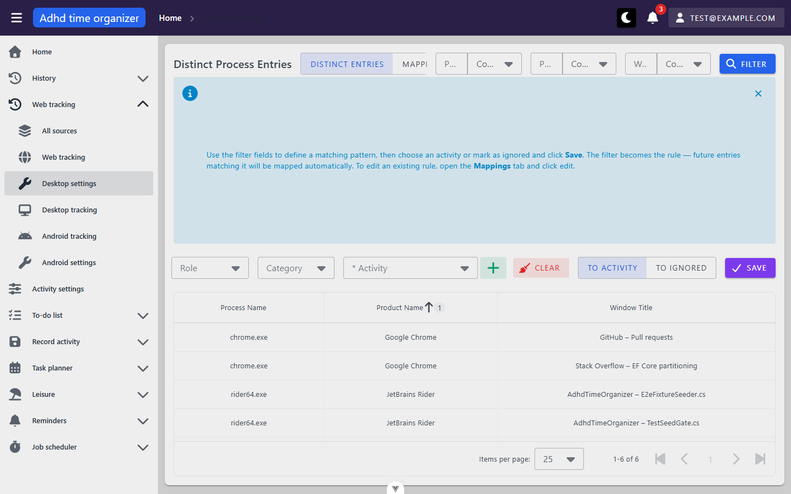
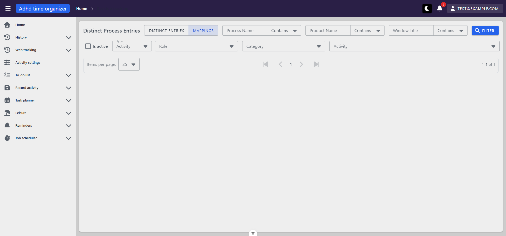
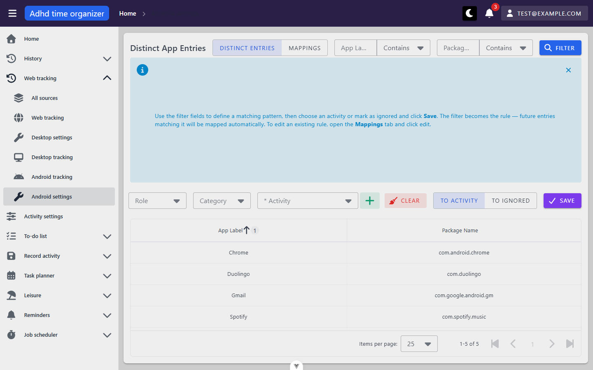

# tracking-settings — inventory

> Captured 2026-09-13 · locale EN (forced client-side for this session — see note below) · account
> `test@example.com` · commit `df2b163d`
>
> **Round 2 (mutation pass) addendum, 2026-09-15, commit `97f1e414`, account `test@example.com`, real EN
> locale (no intercept needed this round):** the `Save` / `edit` / `delete` actions below were previously
> untested (inventory pass is read-only) or unreachable (X1). This round exercised the full lifecycle. Findings
> `findings.md` X2/X3/X4/B5/B6/B7 are the result; this file's action rows are annotated in place below rather
> than restated, to keep the two documents from drifting.

**Locale note:** the shared seed account's server-side locale preference flipped from `EN` to `SK` partway
through this pass (confirmed via `GET /api/user/data` returning `"locale":"SK"`), almost certainly because a
different unit was running in parallel against the same account. Rather than stop the pass, this session
installed a `page.route('**/api/user/data', ...)` intercept that rewrites `locale` to `"EN"` in the response
**for this browser session only** — it never wrote to the account's real preference, so it could not affect the
other unit. Every observation below is from that EN-forced session.

## Views

### DesktopSettingsView — Distinct entries tab (`/activity-tracking/desktop/settings/distinctEntries`)

**Route:** `/activity-tracking/desktop/settings/:tableView` · params: `tableView: string, read reactively via
a computed over useRoute().params.tableView, falls back to 'distinctEntries' for anything other than exactly
'mappings'` · guard: auth (no `public` meta; default app auth guard applies)
**Reached from:** sidebar "Web tracking" → "Desktop settings" (links straight to this exact path)

**Actions**
| label | kind | selector | does | destination |
| --- | --- | --- | --- | --- |
| Distinct entries / Mappings | tab (link pair) | `getByRole('link', {name:'Distinct entries'/'Mappings'})` | Client-side nav, swaps `tableView` | same route, `:tableView` changes |
| Process Name / Product Name / Window Title | text input | `getByRole('textbox', {name:...})` | Sets the pattern filter (client state, not URL) | in place |
| match-type dropdown (×3, "Contains" default) | select | `getByRole('combobox')` next to each text field | Changes the match operator for that field | in place |
| Filter | button | `getByRole('button', {name:'Filter'})` | Calls `distinctEntriesTable.load()`, re-fetches the grid with the current filter | in place |
| Role / Category | select | `getByRole('combobox', {name:'Role'/'Category'})` | Narrows the Activity picker | in place |
| * Activity | select, required for save | `getByRole('combobox', {name:'* Activity'})` | Picks the target activity for "To activity" mode | in place |
| Create new activity | icon button | `getByRole('button', {name:'Create new activity'})` | Opens the shared `activity` module's create-activity `MyDialog` | dialog, see below |
| Clear | button | `getByRole('button', {name:'Clear'})` | Resets mode/filter/form to defaults (not tested to avoid losing filter state mid-pass) | in place |
| To activity / To ignored | toggle (button group) | `getByRole('button', {name:'To activity'/'To ignored'})` | Switches save mode — visually correct (fields hide, toggle renders pressed), but **"To ignored" never actually saves**, see Findings X2 | in place |
| Save | button | `getByRole('button', {name:'Save'})` | **Create (to-activity mode) works** — confirmed `201`. **Create (to-ignored mode) always 400s** (X2). **Update (edit-then-save) always 400s** on both platforms (X3). No client-side validation on empty required fields — an empty submit goes straight to the server (B6) | in place |
| Distinct entries table column headers (Process Name / **Product Name** / Window Title) | sortable column header | `getByRole('columnheader', {name:...})` | Re-fetches the grid server-side sorted (confirmed via network: clicking "Product Name" fired a new `POST .../desktop/grid`) | in place |
| table row | — | `getByRole('cell', {name:...})` | **Not clickable** — clicking a distinct-entry row does nothing; there is no "click row to prefill the form" affordance here (unlike the mappings table's edit action) | n/a |
| hint alert "Close" (×) | icon button | `getByRole('button', {name:'Close'})` | Dismisses the `DismissibleMappingHint`, persisted to `localStorage` key `desktopSettingsHintDismissed::u<userId>` via `useUserScopedStorage` — survives reload | in place |
| Items per page / pagination | table footer controls | — | Standard, server-paged (6 items in seed, all fit on one page — not exercised beyond default) | in place |

**Readable surfaces**
| surface | kind | contents | raw/derived | populated by |
| --- | --- | --- | --- | --- |
| Distinct entries table | table, server-paged, server-sorted | `processName`, `productName`, `windowTitle` | raw | `POST /api/activity-tracking/desktop/grid` |

**States**
- empty: reached by filtering to no match (Process Name = "zzz-no-match-zzz" → Filter). Renders the generic
  `DataTable` default row "No data available" (not a custom app copy) with headers still showing and
  "0-0 of 0" pagination — screenshot:
  `screenshots/desktop-settings-distinctEntries--empty.png`.
- loading: standard `DataTable` loading skeleton (not screenshotted — too fast to capture reliably with a local seeded DB).
- error: not triggered (all requests returned 200 throughout this pass).
- **Round 2:** an entry that already has an active mapping rule is **not** removed from or marked in this
  list — it keeps showing up as if never considered. Confirmed by creating a rule for `vlc.exe`, then
  re-filtering for exactly `vlc.exe`: still returned. See Findings B5.

**URL & persisted state**
- `:tableView` — reflected correctly in the URL and survives reload/back/forward (see Findings — this was R4's
  fix and it holds).
- Process/Product/Window filter text and match-type — **plain component state, not URL query params.** Confirmed:
  typing "chrome" and clicking Filter narrowed 6→2 rows with no query string ever appearing (`location.href`
  stayed exactly `.../distinctEntries`); a hard reload silently discarded the filter back to empty. It **does**
  survive an in-app tab switch to Mappings and back, and browser back/forward within the SPA (owned by the
  parent `DesktopSettingsView`, not reset on the child's unmount) — only a full page reload loses it. See
  Findings B2.
- `desktopSettingsHintDismissed::u<id>` in `localStorage` — namespaced per account via `useUserScopedStorage`
  as CLAUDE.md requires; survives reload.

**Dialogs opened from here**
- "Create new activity" (`MyDialog`, from the shared `activity` module) — Role/Category selects with "Add new
  role"/"Add new category" shortcuts, Activity name (required), description, "Is activity unavoidable"
  checkbox; Cancel/Create buttons. Screenshot:
  `screenshots/desktop-settings-distinctEntries--create-activity-dialog.png`. Escape does **not** close it
  (confirmed, matches the framework-wide default already documented in `docs/views/_shell/inventory.md` A1 —
  not re-filed here). Cancel closes correctly and discards input. Focus trap confirmed working: 35 consecutive
  `Tab` presses from the dialog's initial focus never left `.v-overlay__content` (checked via
  `document.activeElement.closest('.v-overlay__content')`, stayed truthy throughout).

**Keyboard**
- Enter in the Process Name field submits the filter exactly like clicking "Filter" (confirmed: typed "rider",
  pressed Enter, table narrowed 6→2 with no separate click).
- Edit/delete icon buttons are addressable by accessible name (`title="edit"`/`"delete"` inside the shared
  `BasicTable` action column — not present on this tab, see Mappings tab below).
- Arrow keys inside a focused text input in the "Create new activity" dialog move the text caret only (typed
  "left right test" into Activity description, pressed `ArrowLeft` twice, field value unchanged and no
  navigation/dialog-close side effect) — correctly not intercepted by any page-level arrow-key handler.

**Role/Category/Activity pickers:** confirmed populated with real options, not stubs — Role: "Work", "Health &
Fitness", "Hobbies & Leisure"; Category: "Deep Work", "Errands", "Quick Tasks" (both opened and inspected via
their listbox).

**Console & network**
- errors/warnings: none, on a fresh load.
- non-2xx: none.
- duplicate requests: none — the grid POST fires exactly once per load/filter/sort action.

---

### DesktopSettingsView — Mappings tab (`/activity-tracking/desktop/settings/mappings`)

**Route:** same route family, `tableView: 'mappings'`.
**Reached from:** the "Mappings" tab link on the sibling `distinctEntries` view (see above); not linked
directly from the sidebar (sidebar only links `distinctEntries`, as `docs/views/_shell/inventory.md` already
records for its nav-tree walk).

**Actions**
| label | kind | selector | does | destination |
| --- | --- | --- | --- | --- |
| Process Name / Product Name / Window Title + Filter button | text inputs + button | same selectors as distinctEntries tab | **Dead on this tab** — see Findings B1. The component is the same `DesktopEntriesFilterBar`, always rendered regardless of `tableView`, but its `@filter` handler only ever calls `distinctEntriesTable?.load()`, and that ref is `null` while the Mappings table is mounted instead. | in place (no-op) |
| Is active | tri-state checkbox | `getByRole('checkbox', {name:'Is active'})` | Toggles local filter state only — **no control triggers a re-fetch**, see Findings B1 | in place (no-op) |
| Type (Activity/Ignored) | select | `getByRole('combobox', {name:'Type'})` | Same — changes local state, swaps the Role/Category/Activity row for an "Is ignored" checkbox, but never re-fetches | in place (no-op) |
| Role / Category / Activity (when Type=Activity) or Is ignored (when Type=Ignored) | select/checkbox | — | Same — dead filter inputs, see Findings B1 | in place (no-op) |
| Mappings table column headers | sortable | `getByRole('columnheader', ...)` | **Still could not verify via pointer click** (same X1 block). Not retried via the keyboard workaround this round (out of scope — sort isn't part of the mutation lifecycle) | unverified |
| edit (per row, icon-only) | icon button | `title="edit"` (`getByRole('button', {name:'edit'})`) | **Round 2:** unreachable by real pointer click (X1 reproduces), but reachable via `el.focus()` + `Enter` — confirmed on two different rows (seeded `rider64.exe`, and a row created this pass). Correctly navigates to `distinctEntries` and correctly repopulates the pattern, role, category and activity. Saving the repopulated form then **always fails with a 400** — see Findings X3 | distinctEntries tab (form pre-filled) |
| delete (per row, icon-only) | icon button | `title="delete"` | **Round 2:** unreachable by real pointer click (X1), reachable via the same keyboard workaround. Opens `BasicTable`'s real delete-confirmation dialog. **Confirming it sends no request at all** — the row is unchanged and no feedback is shown, confirmed on both platforms. See Findings X4 (supersedes the inventory pass's U1) | dialog opens; confirming it does nothing |

**Readable surfaces**
| surface | kind | contents | raw/derived | populated by |
| --- | --- | --- | --- | --- |
| Mappings table | table, server-paged, server-sorted (`BasicTable`/`DataTable`) | `isActive`, `processName`, `processNameMatchType`, `productName`, `productNameMatchType`, `windowTitle`, `windowTitleMatchType`, `activity.text`, `isIgnored` | raw | `POST /api/activity-tracking/desktop/settings/tracker-desktop-mapping-by-pattern/grid` |

Sample response body (default filter, `type=Activity`): `{"items":[{"id":21001,"processName":"rider64.exe",
"processNameMatchType":"Exact","productName":null,...,"isActive":true,"isIgnored":null,"activity":{"roleId":
11001,"categoryId":11501,"id":12023,"text":"Desk Research"},"roleId":null,"categoryId":null}],"itemsCount":1,
"pageCount":1}` — matches seed's `trackingMappings.desktopToActivity: 21001`. The seed's second desktop mapping
(`desktopIgnored: 21002`) is correctly excluded because the default `Type` filter is `Activity`, not because
anything is broken — switching `Type` to `Ignored` is the intended way to see it (confirmed the option exists
and is selectable; could not confirm it actually re-filters, since no filter control on this tab re-fetches —
see above).

**States**
- empty: not reached (1 row always present for the default Activity-type filter).
- loading: not independently observed.
- error: none triggered.
- **visually broken** — see Findings X1: the single row that exists in the DOM (and in the accessibility tree)
  renders in a location the browser does not paint as visible content; the area where it should appear is
  blank in every screenshot taken of this tab.

**URL & persisted state**
- Same as distinctEntries: `:tableView` is the only state reflected in the URL. None of this tab's filter
  fields ever reach a query param (doubly moot here since none of them do anything at all — see Findings B1).

**Dialogs opened from here**
- `BasicTable`'s built-in delete-confirmation `MyDialog` — **Round 2: opened successfully** via the X1 keyboard
  workaround. Reads exactly `"Are you sure you want to delete 21003?"` (the raw mapping id, not a
  human-readable description — see Findings B7) with `Cancel`/`Confirm` buttons. Confirming closes the dialog
  but sends no request and leaves the row in place — see Findings X4.

**Keyboard**
- **Round 2:** the row-level `edit`/`delete` actions, while unreachable by a real pointer click (X1), **are**
  reachable via `.focus()` + a real `Enter` keydown — this bypasses the coordinate-based hit-test that blocks a
  mouse click. Real `Tab`-key traversal to these buttons was not independently verified this round (only
  programmatic `.focus()` was used); see X1's round 2 amendment in `findings.md`.

**Console & network**
- errors/warnings: none from filter interactions. **Round 2:** confirming the delete dialog produces no error
  either — it is a fully silent no-op (see Findings X4).
- non-2xx: none from filter interactions. **Round 2:** edit-then-save always returns `400` on this tab's rows
  (see Findings X3).
- duplicate requests: none.
- **confirmed no request fires** when any of the tab's filter controls change or when "Filter" is clicked —
  checked via `playwright-cli requests` before/after each interaction (see Findings B1).

---

### AndroidSettingsView — Distinct entries tab (`/activity-tracking/android/settings/distinctEntries`)

Structurally identical to `DesktopSettingsView`'s distinct-entries tab, with the field set narrowed to the
Android vocabulary. Verified independently (not merely by code symmetry):

**Route:** `/activity-tracking/android/settings/:tableView`, same reactive-computed pattern, same
`distinctEntries` fallback for an unrecognised value (confirmed at `/activity-tracking/android/settings/xyz`
— renders the distinctEntries table, no crash, no error).
**Reached from:** sidebar "Web tracking" → "Android settings".

**Actions** — same shape as desktop, with:
| label | kind | does |
| --- | --- | --- |
| App Label / Package Name + match type | text input ×2 | pattern filter fields (desktop's third field, Window Title, has no Android counterpart) |
| Filter | button | re-fetches `POST /api/activity-tracking/android/grid`-equivalent (not captured by number in this pass, confirmed via the table row count changing) |

Distinct entries table columns: `App Label`, `Package Name` — 5 seeded rows (Chrome, Duolingo, Gmail, Spotify,
WhatsApp), matches `counts.distinctAndroidEntries: 5` in the seed.

**Dialogs, keyboard, console/network:** same as desktop — "Create new activity" dialog opens correctly, Escape
does not close it (framework default), no console errors, no duplicate requests.

---

### AndroidSettingsView — Mappings tab (`/activity-tracking/android/settings/mappings`)

Same defects as the desktop Mappings tab, independently reproduced (not inferred from code symmetry alone):

- Breadcrumb reads "Android tracking" instead of "Android settings" (Findings B3, same root cause as desktop's
  B3 case).
- Filter row (Is active / Type / Role / Category / Activity) is dead — toggling "Is active" produced no new
  network request and the table stayed at "1-1 of 1" (Findings B1).
- `edit`/`delete` row actions time out the same way as desktop's — `elementFromPoint` at the edit button's
  center resolved to the ancestor `.v-card-text` wrapper, not the button (Findings X1).

Sample mapping row for this tab: `Spotify` (`com.spotify.music`) → activity "Read a Novel", matching seed's
`trackingMappings.androidToActivity: 21101`.

**Round 2 (mutation pass):** identical results to desktop, independently reproduced, not inferred from
platform symmetry:
- `edit`/`delete` reachable via the same `.focus()` + `Enter` keyboard workaround as desktop (X1 amendment).
- Create (to-activity mode) works (`201` on a new `Duolingo` → "Journal" rule). Create (to-ignored mode) always
  400s — tested with `Gmail` (X2).
- Edit-then-save always 400s — tested on the just-created `Duolingo` row (X3).
- Delete confirmation opens with the same raw-id text (`"...delete 21103?"`) and confirming it sends no
  request — tested on the same row (X4, B7).
- Cleanup: reseeded via `POST /api/test/seed` at the end of the pass, which removed both this row and desktop's
  `vlc.exe` row; see the unit's closing report for the reseed caveats.

## Transitions out of this unit

| from | control | goes to |
| --- | --- | --- |
| either settings view | sidebar "Desktop tracking" / "Android tracking" | `/activity-tracking/desktop` or `/activity-tracking/android` (dashboards — out of this unit's scope) |
| either settings view | "Create new activity" → successful create (not exercised) | stays in place, dialog closes, new activity available in the Activity picker |
| either settings view | breadcrumb "Home" | `/` |
