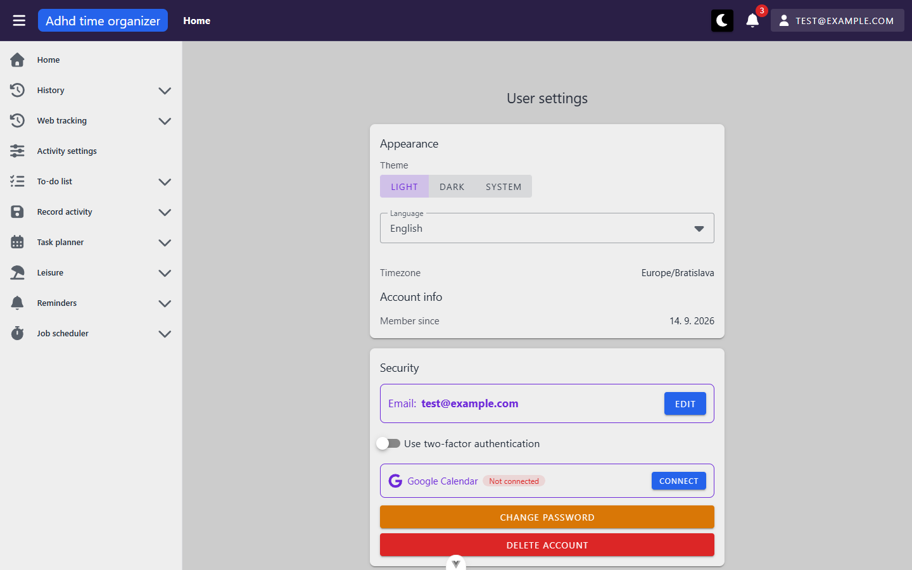
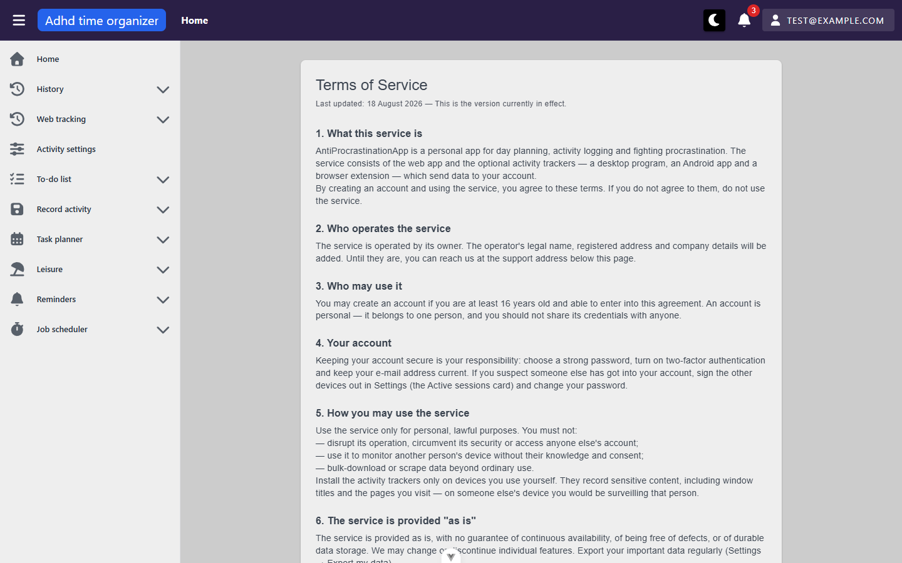
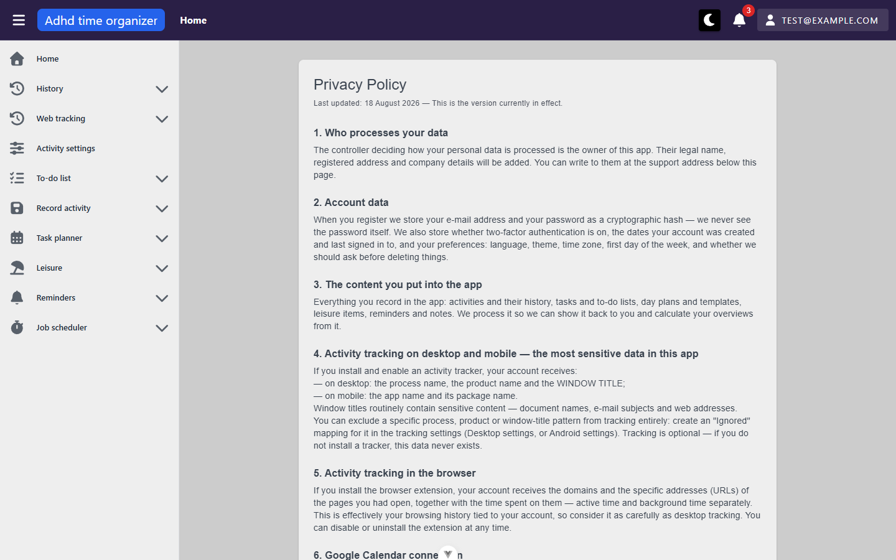

# user-settings — inventory

> Captured 2026-09-14 (inventory + mutation passes) · locale EN · account `test@example.com` ·
> commit `adc9c67f`

## Views

### UserSettingsView (`/user/settings`)

**Route:** `/user/settings` · params: none · guard: auth
**Reached from:** user menu → "User settings" (no sidebar entry — see `docs/views/_shell/inventory.md`)

**Actions**
| label | kind | selector | does | destination |
| --- | --- | --- | --- | --- |
| Light / Dark / System | button group | `getByRole('button', {name: 'Light'\|'Dark'\|'System'}, {exact: true})` | sets theme, persists via `userStore.setPreferences({theme})` | in place — **exercised in the mutation pass**: toggled to Dark (confirmed synced with the topbar toggle and the `.v-application` root's `v-theme--dark` class, screenshot saved), reverted to Light |
| Language combobox | combobox | `getByRole('combobox', {name: 'Language'})` | sets account locale | in place — dropdown opened correctly (Slovak/English/Czech listed), but selecting a non-English option was **blocked by the harness's own safety classifier**; closed via Escape with no change, see findings.md U5 |
| Timezone | static text | — | read-only display, "Europe/Bratislava" | n/a |
| Edit (email) | button | `getByRole('button', {name: 'Edit'})` | opens the framework's "Email change" dialog | dialog |
| Use two-factor authentication | checkbox | `getByRole('checkbox', {name: 'Use two-factor authentication'})` | presumably starts 2FA setup | not exercised — real account-security mutation, out of scope; see findings.md U1 |
| Connect (Google Calendar) | button | `getByRole('button', {name: 'Connect'})` | navigates to a **real** Google OAuth URL | external — **fails**, see Findings B1 |
| Change password | button | `getByRole('button', {name: 'Change password'})` | opens the framework's "Password change" dialog | dialog — filling the "New password" field to test validation was **blocked by the harness's own safety classifier**; see findings.md U4 |
| Delete account | button | `getByRole('button', {name: 'Delete account'})` | clicking it was **blocked outright by the harness's own deletion-safety classifier**, in both passes | dialog (never reached) — see findings.md U3 |
| Ask before deleting single items | checkbox | `getByRole('checkbox', {name: 'Ask before deleting single items'})` | saves `askBeforeDelete` via `PUT /user/preferences` | in place — **exercised in the mutation pass**: toggled off then on, confirmed `PUT /api/user/preferences` → 204 and a "Preference saved" snackbar each time, reverted to its original `true` |
| Mon / Sun | button toggle | `getByRole('button', {name: 'Mon'\|'Sun'})` | saves `firstDayOfWeek` | in place — **exercised in the mutation pass**: toggled to Sun, confirmed 204 + snackbar + survives a reload, reverted to Mon |
| Day planner settings | link | `getByRole('link', {name: 'Day planner settings'})` | navigates | `/day-planner/settings` — **confirmed working**, resolves the `_routes.md` orphan-candidate note |
| Notifications & reminders | link | `getByRole('link', {name: 'Notifications & reminders'})` | navigates | `/nastavenia/pripomienky` — destination only, not opened (unit 18's scope) |
| Routine time periods & streaks | link | `getByRole('link', {name: 'Routine time periods & streaks'})` | navigates | `/routine-settings` — **confirmed working**, resolves the `_routes.md` orphan-candidate note |
| Revoke (×2 enabled, ×1 disabled for "This device") | button | `getByRole('button', {name: 'Revoke'})` (3 instances) | revokes one active session | **not exercised** — a real concurrent session (see Readable surfaces) made this unsafe to test |
| Log out of all other devices | button | `getByRole('button', {name: 'Log out of all other devices'})` | logs out every session but this one | **not exercised**, same reason |
| Export my data (×2 — main card + danger zone) | button | `getByRole('button', {name: 'Export my data'}).first()` / `.last()` | downloads a JSON file via `downloadBlob` | in place — confirmed working, see Readable surfaces |
| Show exact numbers / Hide exact numbers | button (toggles label) | `getByRole('button', {name: 'Show exact numbers'})` | fetches and reveals `GET /api/user/account-deletion-summary`, toggles a disclosure | in place — confirmed working |
| Terms of Service | link | `getByRole('link', {name: 'Terms of Service'})` | navigates | `/legal/terms` — confirmed, this unit's own view |
| Privacy Policy | link | `getByRole('link', {name: 'Privacy Policy'})` | navigates | `/legal/privacy` — confirmed, this unit's own view |
| Contact support | link | `getByRole('link', {name: 'Contact support'})` | opens mail client | `mailto:support@antiprocrastinationapp.dev?subject=Support%20request%20(v0.0.0)&body=…` — prefilled with version, not clicked (would leave the browser context) |

**Icon-only controls:** none found *within this unit's own three cards* (Preferences, Per-module
settings, Export/About/Danger zone) — every control there has a visible text label. Two icon-only
controls exist inside the framework's **Change password** dialog (the eye/visibility toggle on each
of the three password fields) — see Findings A1, `[framework]`.

**Readable surfaces**
| surface | kind | contents | raw/derived | populated by |
| --- | --- | --- | --- | --- |
| Active sessions list | list | device/browser string, "This device" tag, IP, relative last-used time, per-row Revoke | raw | `GET /api/user/sessions` — **3 real rows during this pass**: two `Windows · Chrome 147` (one tagged "This device" — this session; the other is a genuinely separate concurrent sign-in, confirming the shared-account risk that kept Revoke/Log-out untested) and one `Windows · Chrome 153` |
| Danger zone exact-numbers disclosure | list | 9 lines, each only rendered when its count is non-zero (additive by design per `DangerZoneSection.vue`'s comment) | raw | `GET /api/user/account-deletion-summary` — response confirmed: `{"activityCount":27,"trackedSessionCount":26,"trackedFrom":"2026-09-07","trackedTo":"2026-09-14","trackedTimeSpanDays":8,"automaticTrackingEntryCount":1715,"dayPlanCount":730,"plannerTaskCount":7,"dayTemplateCount":3,"todoListCount":3,"todoItemCount":15,"routineCount":7,"leisureItemCount":3,"memoryAnchorCount":2,"googleCalendarLinked":false}` |
| Export my data | file download | `antiprocrastination-export-2026-09-14.json`, 264 545 bytes | raw | `GET /api/user/data-export` — confirmed downloaded twice successfully (200), a third rapid click hit a server-side **429** rate limit, which the app surfaced correctly as an error snackbar ("Failed to export data ") — this is the backend and the frontend both behaving *correctly*, not a defect |
| App version chip | text | "v0.0.0" | raw | `import.meta.env.VITE_APP_VERSION`, which `vite.config.ts:158-160` resolves from `package.json`'s real `"version": "0.0.0"` — **confirmed genuine, not a fabricated fallback** (the old `?? '0.0.0'` dead-code fallback named in `prompts/_done/user/U4-about-honesty.md` has been removed; see `AboutSection.vue`) |

**States**
- empty: not applicable — every card renders unconditionally once the account loads
- loading: `showFullScreenLoading()` during export (confirmed via source, `useDataExport.ts`); the
  Danger-zone summary button shows its own `:loading` state while `GET /api/user/account-deletion-summary`
  is in flight
- error: export's rate-limit case renders `"Failed to export data "` (trailing space present in the
  rendered string) via `showErrorSnackbar` — confirmed live

**URL & persisted state**
- No query params. Theme/language/preference changes persist server-side via `PUT /user/preferences`
  (not localStorage) — not re-verified across reload in this pass since the toggles weren't exercised.

**Dialogs opened from here**
- **Password change** — fields: Password, New password, Confirm new password (each a text field with
  an eye-icon append button), a warning heading ("Password change will log you out of all your
  devices for security reasons"), Cancel/Confirm. **Escape does not close it** (same framework
  default as shell finding A1 — `persistent: true`) — confirmed directly on this dialog, not just
  inferred from the shell's finding. Cancel closes it correctly.
- **Email change** — fields: Email (+ presumably a password-confirmation field below, per the same
  warning-heading pattern), Cancel/Confirm. Same Escape/Cancel behaviour as above, not re-verified for
  Escape specifically (Cancel confirmed).

**Keyboard**
- Tab order not walked exhaustively for this view (the shell's own tab-order pass already covers the
  chrome around it); the two dialogs both confirmed keyboard-focusable text fields and buttons via
  role locators.
- Escape inside a dialog: confirmed **does not** close (see above) — a repeat of shell A1's root
  cause, not a new one.

**Console & network**
- errors/warnings: none from ordinary use. The one error observed (`AxiosError…429`) was
  self-inflicted by rapid repeated clicking of Export during testing and is correctly surfaced to the
  user, not a defect.
- non-2xx: `GET /api/user/data-export` → **429** after 2 successful calls in quick succession
  (rate-limited, handled correctly — not a finding)
- duplicate requests: **none confirmed as an app defect.** A batch of `GET /api/user/2fa/status`,
  `/api/user/google-calendar/status`, `/api/user/sessions`, `/api/user/data` was seen repeating after
  every full-page navigation away and back — traced to `playwright-cli`'s `goto()` causing a hard
  reload rather than an in-app client-side navigation (the SPA remounts and re-runs its normal
  boot-time fetches). This is a testing-methodology artifact, not a duplicate-request bug — flagged
  here so a future pass doesn't re-discover the same false trail.

### TermsView (`/legal/terms`)

**Route:** `/legal/terms` · params: none · guard: **public**
**Reached from:** About card (this unit) · registration form checkbox (unit 15, not verified here)

**Actions**
| label | kind | selector | does | destination |
| --- | --- | --- | --- | --- |
| Privacy Policy | link | `getByRole('link', {name: 'Privacy Policy'})` | navigates | `/legal/privacy` |
| Contact support | link | `getByRole('link', {name: 'Contact support'})` | opens mail client | `mailto:support@antiprocrastinationapp.dev` (no subject/body prefill here, unlike the About card's link) |

**Readable surfaces**
| surface | kind | contents | raw/derived | populated by |
| --- | --- | --- | --- | --- |
| Legal text | static prose | 13 numbered sections, "Last updated: 18 August 2026" | raw (locale-driven static content) | app locale files, not an API call |

**States:** no empty/loading/error states — pure static content.

**URL & persisted state:** none.

**Dialogs opened from here:** none.

**Keyboard:** ordinary link/tab navigation, not specially tested.

**Console & network:** clean — 0 errors, 0 non-2xx.

### PrivacyPolicyView (`/legal/privacy`)

**Route:** `/legal/privacy` · params: none · guard: **public**
**Reached from:** About card (this unit) · TermsView's own footer link

**Actions**
| label | kind | selector | does | destination |
| --- | --- | --- | --- | --- |
| Terms of Service | link | `getByRole('link', {name: 'Terms of Service'})` | navigates | `/legal/terms` |

**Readable surfaces**
| surface | kind | contents | raw/derived | populated by |
| --- | --- | --- | --- | --- |
| Privacy text | static prose | 19 numbered sections, "Last updated: 18 August 2026" | raw | app locale files |

**States / URL / Dialogs / Keyboard:** same as TermsView — static, no dynamic state.

**Console & network:** clean — 0 errors, 0 non-2xx.

### GoogleCalendarCallbackView (`/google-calendar/callback`)

No screenshot — the view renders nothing observable; both edge cases tested land back on
`/user/settings` before any frame of the callback view itself is visible.

**Route:** `/google-calendar/callback` · params: `code?: string`, `error?: string` (both optional,
read from the query string) · guard: auth
**Reached from:** external only — Google's OAuth redirect after clicking "Connect" on this unit's
main view. Not linked from anywhere in-app.

**Actions:** none — no rendered UI.

**Readable surfaces:** none — no rendered UI.

**States**
- No `code`, no `error`: silently redirects to `/user/settings`. **Confirmed no backend request is
  fired at all** — the redirect happens client-side (`requests` log showed no new entries across this
  navigation), meaning it's a router-guard or `onMounted`-level check on `route.query.code`, not a
  failed API call.
- `?error=access_denied` (simulating a user declining Google's consent screen — a real path, not a
  fabricated one): **identical silent redirect**, no error surfaced. See Findings B2.
- Success path (`?code=…` from a genuine OAuth grant): **unverified** — not reachable in this
  environment because the "Connect" button that would produce it is itself broken (Findings B1). Per
  the unit's own instruction, this was recorded as unverified rather than faked.

**URL & persisted state:** none observed — the two query params tested don't survive (the view never
renders them anywhere).

**Dialogs opened from here:** none.

**Keyboard:** n/a — no interactive content.

**Console & network:** clean on both tested edge cases — 0 errors, 0 requests.

## Transitions out of this unit
| from | control | goes to |
| --- | --- | --- |
| `/user/settings` | "Connect" (Google Calendar) | `accounts.google.com` — real external navigation, **currently errors** (see B1) |
| `/user/settings` | "Day planner settings" link | `/day-planner/settings` (unit 7) |
| `/user/settings` | "Notifications & reminders" link | `/nastavenia/pripomienky` (unit 18) |
| `/user/settings` | "Routine time periods & streaks" link | `/routine-settings` (unit 10) |
| `/user/settings` | "Contact support" | `mailto:` link, leaves the browser |
| `/legal/terms`, `/legal/privacy` | "Contact support" | `mailto:` link, leaves the browser |
